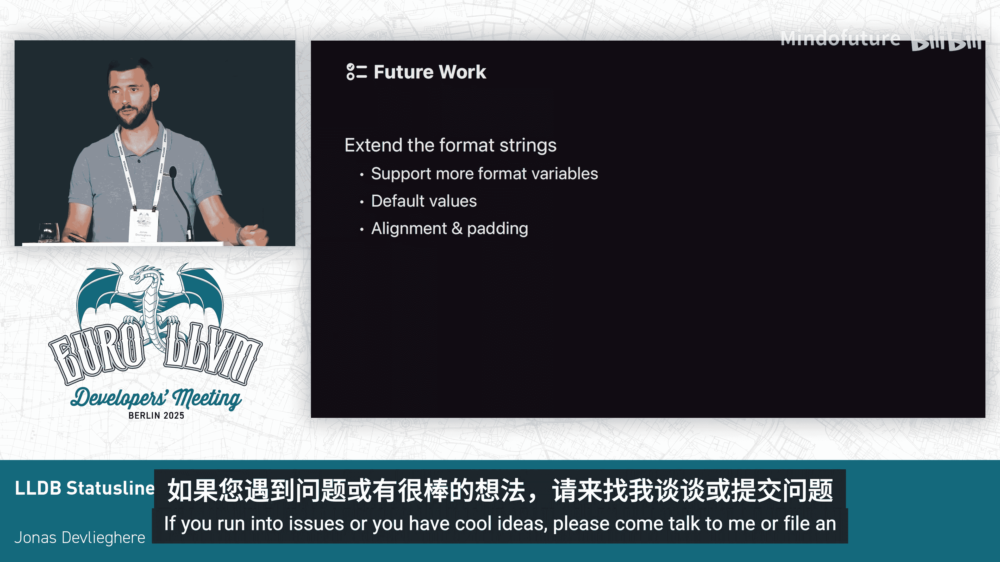

# 2025LLVM欧洲开发者大会-p04-P04-LLDB-Statusline--BV1EoE9zUEbG_p4-

Hello again。 My name is Jonas， and I work on debugging at Apple。

 and now I'm going to talk about the new status line in LGB。Alright， let's jump right in。 here。

 I'm debugging the count utility。 And this is what that would look like before the status line。

 Im kind of had to cheat because I'm using a top of tree build， which has the status line。

 So I have to disable it in my L in it to show you the old look。 So let's turn it back on。😊。

Here it is。 The new status line。 It's a dedicated area at the bottom of the screen。

 It is fully configurable using LDBs format strings。

 This is an existing concept that you might have already used to customize the way your frames or threads are formatted。

 So look at， let's look at the different components and how they are configured。😊，So first of all。

 you'll notice that the status line has the four and background colors inverted。

 This effect is called reverse video or negative， and that is our first format string。

 because it reuses the existing form and background colors of your color scheme。

 It's kind of guaranteed to look good in any color scheme。 And so it makes a good default。

 But I would like it to match my solarized color scheme a little better。

 So I'll go ahead and change it。 As you probably know。

 every color scheme has its own interpretation of the standard thermal code。 So here。

 black corresponds to this slightly brighter background color Also I had a lot of fun with supporting UTF8 when I was doing this。

 So I'm going to throw in a bug emoji just for fun。😊，Alright， so let's move on。 next to it。

 we got the name of the target。 So as I said， we're thebugging to count utility。

 I don't want to have the whole path there because that would take up too much space。

 So we're going to restrict it just to the base。Here it gets a little more interesting。

 So the next component is the source location of where we're currently stopped。

 I want to highlight two things。 So first， we're using the vertical pipe as the separator。

 and then you'll notice that there's this extra set of braces on the outside。

 And these are used for scoping。 And so with LDB format strings。

 what that means is that unless every format variable within that scope resolves。

 that thing is not printed。 So if we didn't have a source location。

 we wouldn't show you the separator either。😊，Next to it， we got the stop reason。

 which is a breakpoint。 and then finally the progress reports where I'm stopped here the the bug is idol。

 So there are none。 And so you hear you see the scoping in action。

 there's no separator between the breakpoint and the nonexisting progress message。

 So if you do an operation that does generate progress that will show up at the end of the status line。

 plenty of space there。 and just like with the alt inline status progress message， sorry。

 if the number of operations is known in advance， will' show you between square brackets which is the progress do count variable in the beginning。

 So that is the default configuration of the status line here I'm going through a few of those format strings。

 but there is a bunch more the LDB website has a table that lists all of them with a little bit of explanation of how to use them to configure the status line and other parts of LDB。

So before I talk about the implementation， I want to talk a little bit about the motivation。

 So a big part of that was the progress events。 previously。

 if you have been using LDB on the status line， you might have seen them in line。

 This was kind of fragile the problem there is that even if you do have proper synchronization of stood out you have to do bookkeeping to know which progress event was on screen so that you can clear it when it's over and that gets really tricky when you have output coming from LDB itself and from the process that youre debugging And so this bookkeeping was kind of complicated and it meant that sometimes we had to forego showing these progress events which was really confusing to our users because then they didn't understand why they didn't see anything and frustrating to the people trying to add more progress events to LDB and then the second motivator was customization people always are looking for different ways to make LDB their own and a popular request has been to support these format strings in the prompt。

 but I think that the status line is a better way to do those things。

Talking about the implementation。 I could have used NCis。

 which is an established library to make efficient terminal user interfaces。

 I didn't go that route because in order to do that。

 Ncurs likes to take control of the whole screen and clear it。

 which is a big departure from how LDB works today。

 So the alternative is to use NC escape codes directly。

 which is something LDB already does for edit line like multiline editing。

 And so this whole feature kind of relies on one particular escape code。

 which allows you to reduce the scroll window of your terminal。 So by reducing it by one line。

 we can basically pin the bottom line to the bottom of the terminal and give the status line。

 exclusive access to it。 And then everything else just like operates normally in the scroll window above it。

😊，As I mentioned， it's enabled on top of three。 So it is available there today。 So going forward。

 I think most of the work is gonna be related to the format strings。

 I expected as people start to use and customize the status line。

 there will be a request for more of these things to expose parts of LDB。

 One other thing I want to support is default values。 So right now。

 if you launch LDB without a target。 you just get an empty status line， which looks kind of odd。

 So want to have the ability of saying if this variable doesn't resolve。

 print something else like no target。 And then during the RFC process。

 lots of people were asking about alignment and padding。

 which I think will allow for more interesting status line layouts。

 So please try it out if you run into issues or you have cool ideas。

 please come talk to me or file an issue。 Thank you。😊。

