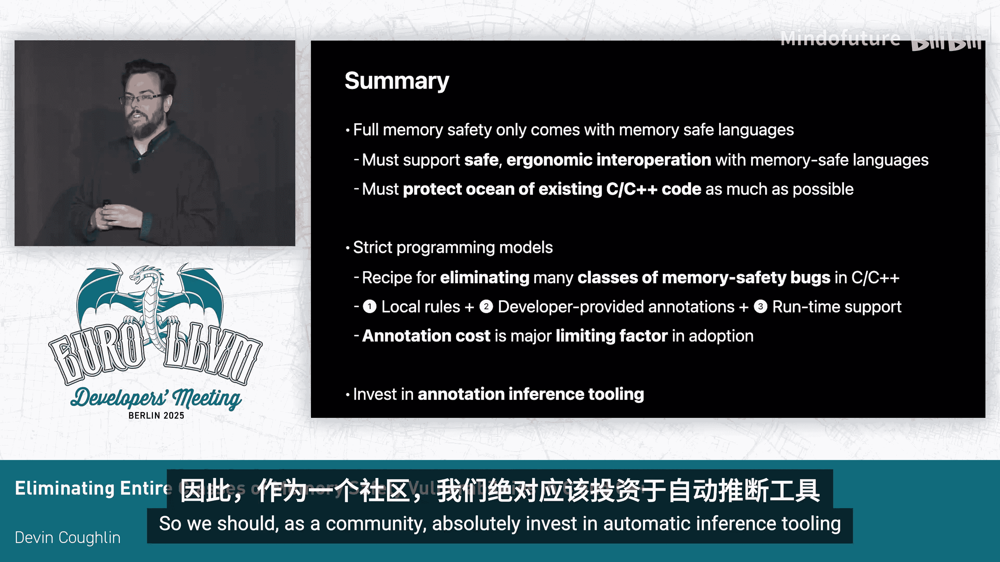
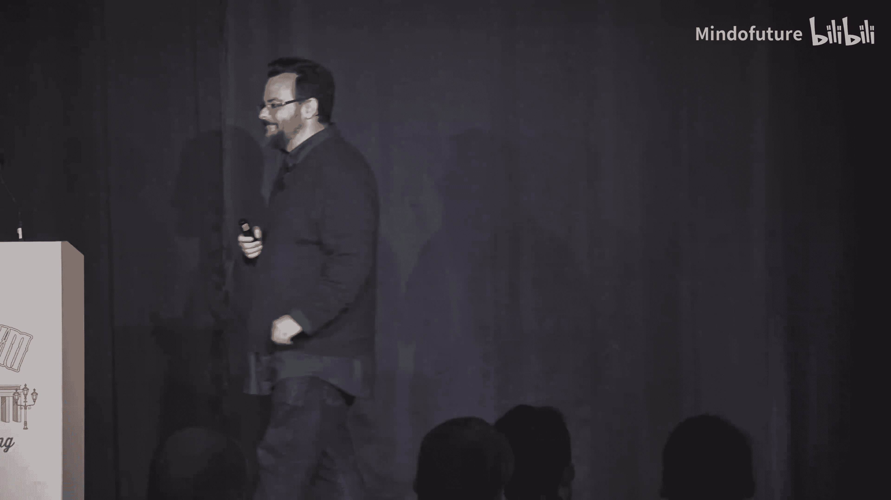

# 2025LLVM欧洲开发者大会-p05-P05-Recipe-for-Eliminating-Entire-Classes-of-Memory-Safety-Vulnerabilities-in-C--BV1EoE9zUEbG_p5-

Hi， I'm Devin， Ily， theDevelop Security toolsols group at Apple， and as Sanya mentioned。

 I'm going to tell you about our work on eliminating entire classes of memory safety vulnerabilities in sea based languages。

These days， we all have personal computing devices in our living rooms and offices。

 our cars and bedrooms。 We often carry them around in our pockets everywhere we go。

These are essential tools that we trust with the mundane。

 but often intimate private details of our lives。Our location， our photos， our messages。

 our contacts， our browsing history and more。At the same time。

 these devices are connected to the Internet and to each other。

 And so security vulnerabilities in them open us up to bad attacks from bad actors。

The cost of attacks on individuals can range from identity theft and money to blackmail to threats on the lives of journalists and human rights activists。

And memory safety is at the forefront of these security challenges。

There is a large amount of security sensitive code out in the world written in memory unsafe languages。

Our memory safety strategy is that we believe that full memory safety requires using a memory safe language。

At Apple， that Swift。However， there's simply too much code and C and C plus plus and objective C to rewrite it all。

And so we have taken to adopting memory safe languages in new code and rewriting high value code bases in memory safe languages。

This is a great strategy， but it does come with some challenges。

 And the metaphor that we use here is islands of memory safety。

We have these islands of memory safe code。 These are the green islands in this vast ocean of blue memory unsafe C and C++。

😊，And as much as we are growing the islands as quickly as we can。

 we need to do something to protect that large ocean。Now。

 we strongly believe that we cannot make C and C plus， plus fully memory safe。

That's just not possible without changing the language so much that we would have to rewrite all the code anyway。

 And if we're going to rewrite the code， we might as well rewrite it in a more modern language。

But we can aim to eliminate entire classes of vulnerabilities。And if we can't eliminate them。

 we should try to mitigate them extremely strongly to make sure that attackers can't take advantage of them。

Now， I want to compare this to static and dynamic bug finding， which are incredibly useful。

 but they're not comprehensive。They don't satisfy the goal of eumminating entire classes of vulnerabilities。

 The best they can do is find as many bugs as possible before they get into the hands of our users。

So they're great， but they're not enough。I want to highlight what we view as our definition of success。

 because it's very ambitious。 Our goal here fundamentally， is about shifting attacker behavior。

We want to drastically increase the cost of attack development so that attackers move on either to other vulnerability classes or to unprotected code bases。

And what's the ultimate sign of success， It will be when memory safety bugs are no longer the low hanging fruit for attackers。

When attackers move on to logic bugs， we know we will have done a good job with memory safety。

When I say memory safety， what do I mean。We tend to think of it as having five different dimensions。

Guaranteed initialization， bound safety， lifetime safety， type safety。

 by which I really mean cast safety and thread safety。And the rest of this talk。

 I'm going to tell you about each of these kinds of memory safety。

 the work that we have done to try to eliminate security vulnerabilities in that space and also where we think that there's additional work that needs to happen。

Let's start with guaranteed initialization。This is the property that all memory is initialized before it's read。

We developed the F trivial autova in it extension and clang to protect stack memory。

 This guarantees initialization to 0， and it prevents information disclosure attacks and many stack grooming attacks。

😊，We can also zero initial liiseison free to protect the heap。

This is an approach that we have deployed on hundreds of millions of lines of code。

 It's been very successful。😊，At the same time， it's not perfect。

 And one thing I do want to point out is that zero is not the programmer's intended value all the time。

 And in our studies， it's roughly around 20% of the time。

 zero zero initialization is not the correct value。 so that represents a logic bug。Nonetheless。

 this has been very successful at preventing some of the worst security problems from use of of uninsalized memory。

😊，So it's really quite good。For more information on zero initialization。

 you can see the RF that we posted。 This was six years ago Now。

 I can't believe it's been that long on the LVium forums。Now， let's move on to bound safety。

Bound safety is about making sure that when the programmer is accessing a region of memory。

 that they're only accessing within that region and not outside of it。

I'm going to tell you about two different bound safety approaches that we have taken。

 one for C and one for C plus plus。Let's start with C。

We developed the F bound safety language extension for the C language。In this extension。

 users specify for buffers and bounds of relationship between the two of them with code annotations。

The idea is that these annotations are enough so that the compiler can insert runtime bounce checks to trap on out of bound memory accesses。

Now， this is not pure static analysis。 It's not trying to prove that everything is inbounds at compile time statically。

 rather what the compiler does is ensure that there is enough information at compile time so that it can generate the appropriate checks at runtime。

With this language extension， we made a number of key design choices to lower the adoption cost。

 such that the time to adopt this language extension is roughly around one hour per 2000 lines of code。

This is something that we have adopted on millions of lines of code at Apple。

 including hundreds of thousands of lines of of X and U。The kernel in our operating systems。

So let me tell you more bit about it。Here we have a simple C function that takes in a buffer and account and fills in that buffer。

And those of you looking might might notice that it does have an off by one overflow。

How can the programmer make this code bound safe？Well。

 they will make a code modification to tell the compiler that count the second parameter has the same number of elements。

 has the number of elements that the buffer has in it。

So this is establishing in a relationship between the buffer parameter and the count parameter。

This is enough for the compiler to add a one times bound check to make sure that that this access isn't bounds。

And this， then when the code runs， we'll safely trap when it goes past the end of the buffer rather than right past the end of the buffer。

Now， what's great about this approach is that this use of annotations allows the language extension to preserve the binary interface and signature of the function。

😊，This is a type attribute that doesn't change the the type of the function or of the parameter。

 And this allows for incremental adoption。Programr can adopt this on one part of their code base and not on another。

 And the two things can still fit together without causing problems。As we'll see。

 this is a really important property for many of the safety protections that we have developed。

 incremental adoption so that it's not all or nothing so that it can happen slowly over time is a very important property。

Now， this does have an annotation burden。 And so we also developed， developed as part of this。

 a technique that tries to reduce that。For this， we use implicit wide pointers。For local variables。

These wide pointers are fat pointers carry their bounds。 So， for example。

 here we have a function with a local variable。 The compiler will implicitly transform that underneath the hood to have that local variable be a wide pointer that contains both the pointer and the bounds of it。

What this means is that the programmer only needs to annotate the bounds on their A BI surface。

Cquires ultimately requiring fewer code changes and， and requiring less work to adopt。

So what we've done is combined lightweight annotations on the A BI surface with implicit white pointers everywhere to give us this incrementally adoptable bound safety with a reasonable annotation burden。

😊，And it's been very successful for us。There's more information inang the Kang RF C that we put up。

 My colleague， Yoll Na gave the Euro LVM 2023 keynote on this approach。 and my colleagues。

 Herik and Patrick gave a tutorial yesterday on this。

 I encourage you to take a look at that tutorial when it's up on YouTube。

 If you didn't get a chance to watch it。We have a full implementation up in Swifts Spk of L VM。

 And this is something that we are in the process of upstreaming to L V M do org。

It's something we're really excited about and something that we're looking to have wide use throughout the community。

Now， let's move on to C plus plus。C plus plus is a different language than C。

 It's a much richer language。 It has a richer library ecosystem。

 It has much more language affordances。 And so we took a different approach for bound safety and C plus plus。

We built the W Nafe buffer usage compiler warning， and we built the hardened Lu C plus plus library。

 And we call the combination of those two things， the C plus plus Safe buffers programming model。

 And this guarantees bound safety for C plus plus。In this approach。

 the compiler rejects raw pointer arithmetic。 If you have C plus plus code with this warning on。

 it will war on it。 And most of our users turn this warning into an error and say， no。

 I'm just not going to use any raw pointer arithmetic。Instead。

 the programmer uses bound checked standard library extractions。 like stoodpan and stood vector。

This is something that has been adopted on tens of millions of lines of code。

And in terms of adoption speed， we find it's very bimodal。

There's a lot of C plus plus cut out there that I call C rid in C plus plus。 And for that。

 we find that the adoption cost is roughly two times higher than for the C F bound safety。

 So that's around 1000 lines of code per hour。But for modern C+ plus code bases that that use a bunch of these library abstractions already rather than raw pointers and Malck。

 it is extraordinarily fast。 A quotation from one of our adopters said that they were zoom in。

 it's really impressive to see how fast a modern C++ code base can adopt this technology and get bound safety。

😊，So let's take a look at how this works。Here's our old friend。

 the same function from before that fills in array， fills in a buffer。Here。

 in order to make it bound safe， the programmer will turn on the warning that rejects raw pointer arithmetic。

 They'll get an error saying， look， programmer， you're doing this array access on a raw buffer。

 That's just the pointer arithmetic under the hood。You said you don't want that。

 So we're going to complain to you。Then the programmer。

Will change the type of the buffer to be a span to indicate that it's a contiguous span of vintagetegers。

Then underneath the hood， through the use of harden's Lipsy plus plus。

 the span implementation checks the bounds of that array indexing operation via operator overloading。

And this is， this is an example of why we chose a different approach for C versus C+ plus In C plus+。

 we have things like operator overloading and a very rich standard library where we can rely on those parts of the language rather than needing to have a full blown language extension。

We had more information on this in the Kangharf Sea， and we also gave LVM 2023 talks。

 both on the hardened Lips C++ and on the unsafe buffer usage warning。

And the implementation for this is， is is in LVM do org open source。Now。

 let's move on to lifetime safety。 This is a trickier problem。I'm again。

 going to describe two different techniques that that we have taken。

I'll start with one that is based on static analysis。Over the last several years。

 we have developed in the Kangstatic analyzer a set of checkers that enforce a a strict programming model around reference counted smart pointers。

Now， I want to emphasize that this is not bug finding like you might be used to in the Kangstatic analyzer。

 Instead， is it is trying to enforce this programming model。

 such that if the programmer sticks to that model， then then they haven't guarantee that they won't have this class of bugs。

This is also something that we have adopted on millions of lines of code。

 and it's been quite successful。So how does this work。

Here's an example of some potentially buggy code。The programmer has some container。

 That container has a smart pointer field in it with a resource。

 and they're getting that resource as a raw pointer from the smart pointer。

Then they're calling some other function or method that really could do anything。

 The programmer has no idea what it could do。 And in particular， that could overwrite that resource。

 And if it happened to be the case that that smart pointer in the container was the last thing that was that was keeping the resource alive。

 It could be freed。 And then this use after that is a use after free。So with the static analysis。

 the compiler gets an error saying， look， you're using this resource。 you put it on the stack。

 You're using this resource。 And in between， you're doing something where you can't guarantee that the resource won't be won't be released。

 That's a problem。 You need to fix it。How does the programmer fix this。

 They change the type of resource to indicate that its lifetime must last for the entire scope。

 In this case， with a Ref pointer smart pointer class。

Where the runtime implementation guarantees the lifetime of that underlying resource until the de is called。

This implementation is an LVM do org。 We have used it on Webkit smartpointers。

 but we think it's generalizable to all sorts of other reference counted shared pointer disciplines。

 And that's something we'd be excited to talking to folks about to see if you think it could work for your code basiss。

😊，Now， what about situations where there's not our reference counting discipline。

What if the programmer is using RE Malck， what if it's C？In this case。

 we need to take a different approach。Here we have developed a language extension for both C and C plus plus that mitigates use after free vulnerabilities by limiting data pointer type confusion。

So this doesn't eliminate the use after freeze， but it does mean that when there is a use after free。

 it makes it much， much harder for the attacker to take advantage of it。

This is an approach that we have deployed on hundreds of millions of lines of user space code。

 We've also taken a similar approach in the X N U kernel。And this is really exciting。

So how does the compiler part of this work。Well， I'll give an example of C。

 and then we can talk about C++。This whole， this whole approach is driven by a new typed memory allocation attribute that that library vendors who surface allocation APIs can place on their allocating functions。

So here there's this new attribute that we have developed， and it says two things。 One。

 this is an allocating function， and the size of the allocation is passed in the first parameter。

And2， the。The library vendor is also going to vent another allocation entry point Malic typed that contains a second parameter that includes extra information for type。

 for type information。And the allocator will use this type information to try to isolate the allocation in a way that improves security。

So now library vendors vent two for each entry point like Malik or Calck。

 they vent an additional entry point that contains the extra type information。

Then when the compiler sees a call to this， to the standard allocation function。

It will transparently rewrite that during compilation into a call tod to the typed pair of it。

 In this case， Malek typed。And it will look and try to infer the type of the thing that's being allocated。

 In this case， the type of struck some type。And pass in a type descriptor to the allocator。

 which the allocator is then free to use， however it chooses。We need similar support for C++。

 But again， C++ is a much richer language。 And so we can use something that fits in with C++ and some of the existing language affordances that it has。

We have a proposal P2，7，1，9， which extends the language so that so that programmers can provide a templized operator new and delete。

And this proposal changes the the lookup rules so that if there is a tempatized operator newer delete。

 the compiler will prefer that before looking to find normal operator news and deletes。

And since it's splized， then the implementation of that can use the template parameter。

 however it sees fit in order to pass the type information to the allocator。

We have a Kang RF up for this。 My colleague Oliver Hunt also gave a talk for this about this at LVM 2024。

And this is something that we're， we're working with the C++ Standard Committee to standardize。

 And I expect this to be part of C++ 26。 We're very close to getting it approved。

This is also in the process of being upstreamed。 The C+ plus support was， was merged last week。

 in fact。Now let's talk about type safety。And here， again， what I mean by type safety is casts。

And we don't， in my opinion， have as good answers here， although we have some。

We have developed another static analysis and force programming model， again。

 that works with with the Web Webkis APIs that rejects unchecks casts unless the compiler can prove that they're safe。

This works great for C plus plus code bases with a runtime representation of types。

 So I think this would work quite well in the LVM code base。

 There's lots of other code bases that do that， especially if the code bases have an idiom of always using runtime checked casts for downcasts。

😊，However， I don't think that we have a viable approach for C code bases。

 nor for C++ code bases that don't have some notion of runtime type information to rely on for checked casts。

 and so this is an area where I think that we as a community need to do more investigation in order to figure something out。

For more information on the static analysis that we've applied to Webkit。

 we have that in upstream in LVM。 org。Now， let's talk about thread safety。 And this is the scary one。

We really don't have strong ideas for how to handle thread safety。

 We know that it's going to be very important in many situations。

 thread safety can lead to use after freebus。 It can lead to leaks。

 And this is something that attackers absolutely can take advantage of。

And this is an area that needs much more investigation。Cang has the W thread safety warning。

 which is quite useful， but it doesn't eliminateuminate the entire class of。

 of thread safety data race bugs。And so our general recommendation is for thread safety。

 If you want it， you need to use a threads safe language。For example。

 a swiftift concurrency's actor model provides data race freedom。

But I do think that there's more that we can do here for C And C plus plus。

 I'm just not sure what it was， what it is。 And so I would love to hear from all of you if you have ideas on this front。

 because I think this is going to be increasingly important。

As we plug holes and bound safety and lifetime safety。

 Aters will shift to focus more and more on thread safety， and it will become increasingly important。

Now， I want to take a little bit of a detour here and talk about memory safety in heterogeneous code bases。

So let's go back to our metaphor around islands of memory safety。

We are increasingly in a world where our code bases are a mix of code written in a memory safe language and。

 and now perhaps partially safe C and C plus plus。😊。

And we what we wanted to be the case is that if we have adopted a bunch of these memory safety technologies on C。

 And C+ plus， that when C And C++ interact with a memory safe language and interoperate with them。

We want to have that incorration be safe and to preserve the partial memory safety that we have worked so hard to provide in in。

 in see。So to use this metaphor， we need to protect the beaches。

 It's not just enough to build out the green islands and to partially protect the oceans。

 We need to do something pretty strong on the beaches as well。At Apple。

 we use a mix of memory safety technologies， and it's common that codebas will contain all of these。

We have Swift。 that's fully memory safe by design。We have this bound safety extension that that adds bound safety to C。

 with， with annotations。We have hardened C+ plus， which is bound safe via the the Li C+ plus library and。

 and the compiler mode that rejects raw pointer arithmetic。

So what we really need to do in order to secure the boundaries is think about how do these things interoperate with each other。

 And what can we do to make sure that the guarantees aren't dropped there。

This is something we've done a lot of work on over the last year。So， for example。

 we can import types annotated with bound safety annotations from C into Swift as Sw as Sw span type。

Similarly， when Swift calls into C++， we can take advantage of lifetime annotations in order to make that more more safe。

 And if you haven't seen it， I encourage you to see my colleague Goor's talk from yesterday on C++ interoperability with memory safefe languages。

 It describes a number of the annotations that we've developed in order to make this interface more secure。

And then， of course， we also need to protect the interface between C that's bound safe and hardened C plus plus。

 And this is something that we've done some investigations on。

 on making this safe with strict compiler warnings。So we can't forget， you know。

 we put a lot of effort into developing each of these individually。

 We can't forget how these things need to talk to each other。So let's go back to memory safety。

We talked about guaranteed initialization。 For that。

 we developed F trivial autotobar in it with zero initialization。For bound safety。

 we developed approaches for both C and C++。For lifetime safety。

 we use a typed allocator with compiler support， and we've developed static analysis for a CQ++ code basis that use a fairly disciplined discipline。

For， for cast safety， there's a little bit that we， we can do there， but really。

 there needs to be more investigation， especially for sea。And for thread safety。

We don't have strong ideas there。 And so we'd love to hear more from the community。

I want to step back here now and synthesize some of the ideas that we've talked about because underlying a bunch of these approaches is a recipe that we've developed。

 And that recipe is to enforce what I call strict programming models。What are the ingredients of。

 of a programming model， Well， we commonly see that there's three things that we need to do in order to eliminate entire classes of vulnerabilities。

One， we develop compiler checkable local rules， Two。

 we need the developer to provide annotations to inform the compiler about things that they know。

 but that the compiler doesn't。And 3， we often find we need some level of run time support。

So let me talk about each of these in turn to provide a little bit more detail。

Inreedient 1 is compiler checkable local rules。Typically。

 these rules restrict the programmer to a subset of the language。

And by restricting the programmer to that subset， the programming model can make strong guarantees。

And we should think about this more like a programming language feature rather than bugfinding。

 Sometimes we implement this in the compiler。 sometimes it's implemented in a static analysis。

 but we should think of it like a programming language feature。

 And when programmers think about this that way， we find that it's much more successful to have it be adopted。

 and the reason for that is that they're willing to adopt a new language feature to get strong guarantees。

Now， it's typically very important that these rules be easy to reason about locally for a programmer。

 and it should be easy for the programmer to tell， does this particular piece of code follow the rules or not。

And then if it's easy for a programmer to reason about。

 then it should also be easy for tools to reason about so that the tools can ensure that the programmer doesn't make mistakes。

The second component is developer provided annotations。

It's often the case that for these programming models。

 the compiler needs some amount of more information that it doesn't know what the developer typically does。

 These are often key invaris that the programmer has in their head and expects to hold。 know。

 they might not hold， but the programmer expects it。

 And this enables the compiler to reason about the program。

This affords what we call modular reasoning or assume guarantee style in P jargon locally。

 for example， on a per function basis。This is analogous to type checking， where， for example。

 if the compiler can guarantee。That the caller passes a string as the first argument。

 the colleague can assume that that first parameter is a string as well。

So this kind of guarantee things that the call so the colleague can assume it is very powerful as a mechanism for these programming models。

 and we often need the programmer to provide these annotations to inform the compiler of the invariance。

And then finally， we found that we do often need some amount of runtime support。

Compile time checks are just not enough。The reason for this is that tools often can't reason precisely about program behavior。

 as we all know， that's typically undecidable。 And a lot of times， in order to have safety。

 we need to establish， track and check global invariance。

 And this is something that's just very difficult to do purely statically。 It's expensive。

 It does not scale to large programs。And so when we're faced with a problem like this。

 we typically design a runtime abstraction to handle the difficult cases。

And the runtime abstraction can do some amount of checking at runtime。 And then locally。

 we can guarantee that the right runtime abstractions are used at compiled time。So this is you know。

 ultimately an escape hatch for global reasoning。So I'd like to talk through how a couple of the approaches that I outlined fit this recipe。

Let's talk first about the Bo safety extension for C。We have a local rule。

 The programmer must only de reference pointers with known bounds。

The developer provides annotations in the form of bounds attributes。And there is runtime support。

 A compiler is cogenning in traps that you reference if a pointer is at a bound at yourreference time。

For our C plus plus approach， it's somewhat similar。 The。

 The local rule is no raw point arithmetic at all。The developer needs to provide annotations here in the form of adopting the span utility class for buffers。

This tells the compiler what's a buffer and what what the programmer expects to be able to。

 to use operations that syntactically look like pointer arithmetic。And， of course。

 there's runtime support in the hardened standard library inside the implementation of span for the bound checks themselves。

For the Webkit smart pointer analysis。The local rule is。

 thou shalt not have raw pointers on the stack across unknown calls。

And the developer provides annotations here in the form of Ref pointer utility class adoption for those pointers that need to be on the stack。

And again， the runtime support is in the Ref Pointer implementation itself。

 which handles the bookkeeping to keep the raw pointer alive。So this is a pretty general recipe。

 and one challenge that I have for the community is to think about if there's other security problems out there that you are all facing that we think we can apply this kind of recipe to。

My hunch is that there's a whole lot more that we can do here。

 and this can perhaps inspire a lot of different approaches to eliminate entire classes of security vulnerabilities。

So if you have ideas here， I'd love to talk to you at the rest of the conference today and learn about the use cases that you have or the problems that you're facing from a security perspective。

I do want to talk about the， the costs of these， these strict programming models。

 and we find that the biggest limiting factor in adopting them is the programmer effort。So。

 for example， if we look at zero initialization or the type allator。

 that required relatively little work on the part of adopters。 And so it was easy。

 It was actually a lot of work。 But like in the scheme of things。

 it was easy to roll out to hundreds of millions of lines of code。

Whereas if we look at our bound safety approaches， these are very powerful。

 but they do require more adoption work on the part of the programmer。

 and so our adoption so far is in the millions and tens of millions of lines of code rather than the hundreds of millions of lines of code。

And what I think this really points to is for some of these programming models for them to have widespread adoption across industry。

 we really must invest in tooling to lower the adoption cost。This is something I think that we。

 as a community need to work on。And ultimately， what we need to do here is build annotation inference tooling。

The the main bottleneck is having the programmers actually write down their annotations that express their invariance。

And the problem here around building these tooling is that even though the annotations can be checked locally and we typically design them to be that way。

 they often must be inferred globally。 So， for example。

 what annotation is an appropriate in a collealie might depend on the color and what happens there or vice versa。

So this essentially requires whole program reasoning。

So one proposal that I have for how we can extend LVM in clang with infrastructure to make this possible is a summary based inference tooling。

And if you're familiar with the idea of thin LTO， this is a very similar idea。

 but applied to the front end。Where we can and the compiler achieve whole program reasoning with summaries。

 So when the compiler compiles each file， it can also emit a profile summary of the interesting things that each function does from a security perspective。

 from a memory safety perspective。Then have a phase of the build that merges those summaries。

 iterates on them to a fixed point to infer annotations。

 and then apply those summaries or apply those annotations automatically to each file。

This is a very powerful approach for analysis， and it's something that I think that we as a community should start working to build together and I will be working with folks both at Apple and at other companies to put together an RC for this in the coming months。

This kind of infrastructure would also be broadly applicable。

 We could use it for the Kangstatic analyzer to enable cross translation unit analysis to scale across larger code bases and with a lower maintenance cost。

 It would also reduce false positives and false negatives。😊。

It's also extremely useful for this problem of safe interop with memory safe languages like Swift and C++。

😊，Again， safe interop there typically requires the programmer to add annotations on the CN C plus plus code so that Swift or rust can know how to how what promises that C And C plus plus code makes。

 so it can know how to import that safely and ergonomically into the memory safefe language。

And so we can use the same， these same mechanisms and the same infrastructure to infer things like lifetime annotations and escapescapability annotations for use in in inter with memory safe languages。

So this is something I'm very excited about。 And I'd love。

 if you're interested in working on this kind of thing， I'd love to talk with you later on today。😊。

So that's the end of the talk。 I do want to summarize it a little bit。

Memory safety is a really important problem for our community。 And。

 and I strongly believe that memory safety really only comes with full memory safe languages like Swift。

 like rust。However， we have all of this existing C and C plus plus code。

 And so we need to do as much as we can to protect it。

We also need to make sure that we have safe ergonomic interoperation with our existing CN C plus plus code and the new code written in safe languages。

One of the best ways to do this is with strict programming models。

These provide a recipe for eliminating entire classes of memory safety bugs and C C and C++。 Again。

 it won't make the languages completely memory safe。

 but it can mean that attackers will have to find completely different kinds of bugs to take advantage of。

There's three components to a typical programming model， a set of local rules。

 developer provided annotations and runtime support。

And the annotation cost of the from their developer is， in our experience。

 the major limiting factor in adoption。So we should， as a community。

 absolutely invest in in automatic inference tooling。

Thank you。You mentioned that zero initialization is not always the right thing。

Did you also consider making initialization compulsory in the language？ Yes， and that is， I think。

 something that is very reasonable to do。 that does have a higher adoption cost。

 But I think there are there are lots of codes where that's a very reasonable thing to do。

 And you need to be a little bit careful with that because there are some patterns that programmers use where。

They rely on flow sensitive compiler warnings to tell them when they haven't initialized something to find bugs in their logic。

 And so if we forced those code bases to initialize something like syntactically then then that can cause them to introduce logic bugs。

 But I think in general， those codebas are rare in general， that doesn't happen very much。

 So I think that's a great thing And in enforcing that。

 if you can enforce that in a particular codeb， that is a great place to start。

 So so you could also make that a standard option to use rather than the zero initialization option。

 Ab。 Thank you yeah。😊，Hey， so， oh， that's very loud。 First of all， thanks for all the work。

 And also thanks for upstreaming all of this。 I know it's not， you know。

 the default curse that everything gets upstream。 So thanks for that。 So my question is。

 So this this saying that says security research is measured by how much slower you make everything。

 So I was wondering one reason why people don't adapt security measures is because the code gets slower。

 even like， you know， for example， you see plusus use shared pointer suddenly have terrible code and。

😊，What do you think about。Essentially， treating situations where the safe code is slower than the unsafe code because of hardening checks。

 whatever that don't get optimized out。 But you think about treating this as an actual。

 like part of this effort to make code more secure。And I think in many cases， we have done that。 So。

 for example， for the Bo safety extensions， we Florrianhan developed the new constraint elimination pass that was specifically in order to to eliminate redundant bounce checks for F bound safety。

 for example， So we have done a lot of work in the optimizer in order to reduce the cost of these things。

 and that's very important。 typically these approaches do come with with the cost。

 and it can vary depending on the approach。 We put a lot of effort into reducing the cost of them。

 improving the compiler， improving the optimizer to reduce the cost of them。

 And then sometimes we do also try to find other ways to pay for these these costs when we deploy them by optimizing other parts of the system。

 for example， performance is extremely important at the same time。

 we do need to acknowledge that the entire community is。

Is needing to do a huge amount of work in order to pay for our lack of memory safety。

 And so we can't say that performance is the most important thing。

 We need to balance performance and security。Thank you。Okay， how do you well。

C++ it's common a pattern not to use pointers， but say pairs of iterators to your function。

 How do you deal with that and how do you deal with the AB implications。 for example。

 when you you probably need to roll out an A incompatible version of Li C++ system。

 Yeah so that's a really great question in a great point。 and in some cases， So for example。

 stoodpan itself， we do not need to change the A of that to provide bound safety。

 but for Stpan iterator which you know， in a lot of the existing As is only a single pointer that cannot be bound safe。

 And so so we have Li C+ plus Louis deion has developed has developed extensions for Lips C+ plus that enable Lips C+ plus library vendors in different environments to specify what A they would like to use for their iterators and in particular for say a span iterator。

A library vendor can say， I would like iterators for to span to be three words and to contain both the pointer and an upper bound and a lower bound。

And then in some cases where we can't change A BI or where the use of iterators can introduce other other bound safety problems as part of W and St buffer usage。

 we warn on those idioms to say， programme where you shouldn't do that。

How does it compare to ellipse plus plus deb mode。It is inspired by that。

 and it's kind of that debug mode was kind of the foundation of our thinking about that。

 The checks that we use for hardened Lips C+ are a subset of the debug mode checks。

 but we have gone through through the effort of making sure that rather than just being a debugging feature that they are a user。

 a program or visible feature something that we are moving to standardize and has been accepted for standardization in the C++ in the C++ language so it's absolutely inspired by that work in some cases it depends underneath the hood on that work。

 although the things that we're using tend to be the faster debug checks there's a bunch of awesome debug checks that are too slow to have on in production。

Thank you。I was wondering， O。 I was wondering if you have any thoughts about how you benchmark or measure。

These approaches starting to have success。 Like， do you see reduction in exploits or other other ways to measure this is successful。

Yeah， so that's a really great question， an important one and。

We have kind of two metrics that we use to measure our own success。One is around adoption。

 And if we can talk about what fraction of particular security sensitive code bases have adopted this based technologies。

 that tells us something about success from an ergonomics perspective。

 how easy is it to adopt our programmers is willing to adopt it。

 and and that is a really important aspect of any of this kind of programming model work。

But then ultimate success is around shifting attacker behavior。

 and so we measure success there twofold one， we， of course attack our own systems。

 we fuzz our own systems， and it's been the case， for example。

 that we have found some holes in our programming model by fuzzing against them and fix them and then we also look long term at how attackers shift their behavior。

 Are they moving from attacking one subsystem to another subsystem。

 are they moving from attacking one particular kind of bug to another kind of bug and that is how we measure success in the long term that's fuzzier that takes longer to measure。

 but it is something where ultimately that's what we need to do in order to convince ourselves that we have made a difference。

Some。I don't no question or comment on your C LT O approach， right？

 So that calls for abandon and shared library， right， Because if you want to whole program， you。

 you need study libraries， right？ And then you trade in one class of bugs like， okay。

 this is bug in my code。And I could prevent it， but I will ship the bug with the library and no way to easy update it。

 Now， when the library fixed， I need to redistribute all the applications Li。 that's how what。

 what's your。how you look at this trade of。 Yeah， and so one thing I do want to say is I don't think that there's incompatibility with this approach with shared libraries。

啊。For the annotations that we are inferring， they can typically be expressed as attributes in headers。

And so what I'm imagining here is annotation inference。

 What it's doing is producing header annotations。That means that。

On the portions of the code that a particular codebase controls。

 they can run this inference algorithm on the code that they have， put that in their headers。

 Then a library vendor who's ving a shared library can do the same thing and put in the headers these annotations。

Now， of course， a library vendor might not， you know。

Want to add their own annotations or they might not have been able to do that yet。 And for that。

 we can use a technology that's in clang called API notess that was designed for exactly this purpose。

 It allows a particular project to add annotations basically the programmer says provides a Yaml file that provides annotations。

 clang attributes in a YaAl format and applies it to another project headers as it's compiled So this allows one project to add annotations to another projects headers without needing to modify those headers。

 So I think in both of those cases， we have we have approaches that can work here。

Does that answer your question kind of， yeah。Thank you。Unfortunately， we are out of time。

 so please talk to Devin after the talk。 we will now have a 30 minute break。 Thank you。

