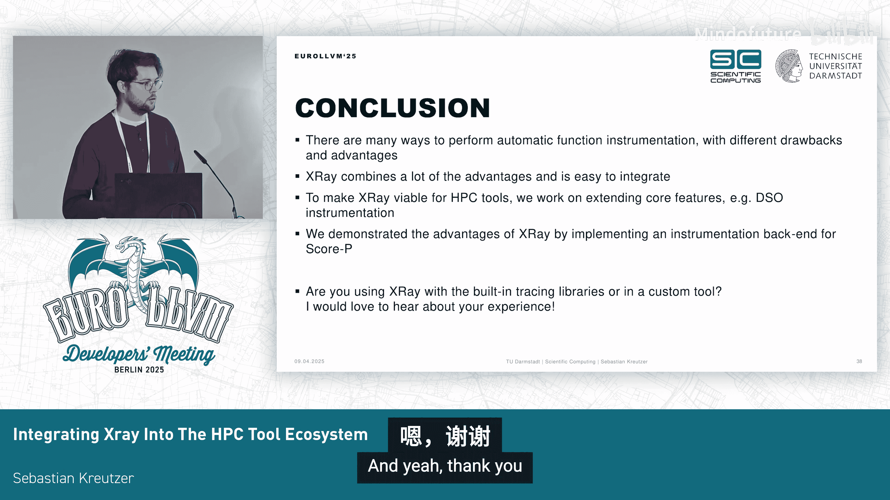

# 2025LLVM欧洲开发者大会-p06-P06-Integrating-XRay-into-the-HPC-Tool-Ecosystem--BV1EoE9zUEbG_p6-

Hi， I'm Sebastian， and I'm going to talk about yeah。

 LVM Xray and how it can be used in HPC performance tool and generally and third party profiling tools。

😊，So。This talk is about one second。Okay， this doesn't know。 This talk is about X ray。

So I'll give a little bit of an introduction to Xray。

 then talk about how it can be used by performance tools in HPBC in particular and then talk a little bit about ongoing and future work for better integration。

😊，So what is Xray？So it's kind of an integrated tracer in LLVM playing that's been built to allow a sort of hybrid instrumentation that inserts static instrumentation points that can be patched runtime to enable tracing selectively。

And there's like different components， there's the In approach itself。

 there's a runtime library with built tracers and then tools to kind of convert and analyze the collected data。

And this was originally developed by Google for performance debugging in yeah。

 in kind of like production applications for kind of motivation I'm referring to。

 this talk by the Embarrass that gives a better overview about the whole system。

Here I want to focus on the instrumentation approach and how it can be used by third party tools。

So I said it was going to talk about， all right first。

 yeah let's have a little bit look of a look into x ray instrumentation itself。😊。

And it's a kind of interesting hybrid static dynamic approach。

Where we have these knobslas which are like sequences of noop operations that are inserted at compile time。

 and then at run time， they can be patched by replacing them with cause to a profiling handler。So。

Here is a little example on an excerpt of yeah， the main function。So is the entry function。

 we have some like all of these knbslas here and when patching at runtime。

The X runtime will insert the call to a traline function passing unique function identifier。

 and then this will be invoking the runtime library。So what does this system give us？

There's near zero overhead because these knobs， if not active。

 basically don't impact performance at all， also compared to a fully dynamic instrumentation like binary instrumentation。

 there is no reordering of the binary or compilation necessary， so yeah it's like a little bit more。

Yeah， not as invasive。And also threading， sorry patching is thread safe and very fast fast。

 so you can do it at any point in the program without breaking anything。Right。

 so I said I was going to talk a little bit about HTC performance tools。😊，So yeah。

 I want to kind of take a step back and look at how established tools handle instrument in different cases。

😊，And for that， I've selected a couple of representative tools。

 as Scorpi and Tau are kind of like two very widely。

Use performance tools and SPC and yeah for profiling and tracing。

And tile is an natural tool that's produced useful overall collecting high level performance metrics。

😊，And yeah， since this is HPC， all of these tools have support for different parallel program models like MPI O MP and more。

Right so let's look at how like different paradigms are supported when you look at MPI there's this PMI interface。

 it's quite clear for OpenMP， there's the OpenM tools interface。

 so it's like a semi standardized way how you do instrumentation for different models。

 however if you go to general purpose region instrumentation and it's little more difficult。

And what a lot of tools historically and kind of still rely on is this F instrument function flag。

Which inserts profiling probes at entry and exit points in each function。

And this is kind of being adopted by a lot of tools because it's available by most compilers。Yeah。😊。

But it also has a lot of drawbacks， and mostly there has like very limited control over what gets instrumented kind of。

Instruments everything， so there's usually high overhead involved and even dynamic filtering is tricky because even if you filter stuff out at the event handling level。

 they are still the overhead of calling the handler itself。😊，Right。

 so different tools have kind of come up with solutions for that forco P。

 there's custom compiler plugins for GC and LLVM。And that's kind of one way to mitigate that。

 so they use， for example， fast dynamic filtering at the coal site。

 which drastically reduces the overhead。And also some tools to use like fully binary dynamic instrumentation。

However， there like with the compileella plugin there's maintenance and development costs involved and the dynamic in is kind of。

A little bit overkill， maybe if I for just these like very simple probes and can be error prone as well。

Right， then。Just as a remark， there's also usually some kind of manual instrumentation API available。

 in this case all of these tools used at。Right so maybe you can see where this is going。I think we。

 as in the compiler can do better， like provide a better infrastructure two tools。

And kind of the question。Yes。Like LVM already has Xray available for the internal tools and it can be used as a third party tool。

 so can we kind of。Use X ray as a more general replacement for。

Like this classic F instrument functions option。And kind of to reiterate the advantages。

 we have like fast dynamic adjustments， yeah， we have low overhead when we don't patch something。

Also the maybe most importantly， we get all of these benefits without like a huge yeah integration effort。

 so it's quite easy to。To。Yeah， use interface。So kind of in essence。

The idea X ray could give us F instrument functions on steroids almost。Right， so if Xray is so great。

 why are almost no tools using it currently？And in my opinion， there's too many aspects。

First is that all of these tools or a lot of the tools have been developed when all of this wasn't available。

 so they kind of relied on like the basic interface or built their own thing。And secondly。

 Xray as a like third party tool kind of has some some drawbacks and limitations that need to be addressed before it's。

Yeah， before it can be adopted by a lot of tools。Right。

 I personally think that actually has a lot of。Yeah， potential。

 so I'm kind of working towards changing that。And that's on。Like two different aspects。

 the first one is enhancing the core capabilities。A thing we recently did was enable to shared library and smutation for Xray。

 which was previously not possible。And then also looking forward。

 we want to add some more control over what is instrumented on the static level。

Also kind of to get people to use it， you have to like show them thats you know how it can be integrated and that it's beneficial so we've kind of been working on integrating Xray into established tools。

So recently we've built a Sc P instrumentation back based on Xray。

 and also we used the Xray with our research tool for selective instrumentation。

So I want to give some more detail into the shared library implementationation and also the Scpy integration for Xray。

Right， so as I said， we recently upstreamed this shared library instrumentation support and that's already available in LLVM 20。

You just passed this Xray shared flag and it should work right out of the box。

One caveat is that the built and Xray tracing modes don't currently fully support it。

 they were run that we would call the functions， but the resolving of the identifiers doesn't fully work。

 but there's an open biopsy and prototype reputation so hopefully that can be fixed。

Right then a little bit of technical detail on this。So first。

 looking at how it works with our shared libraries。So we have this。

Here there's about sled data which kind of contains a list of available patchable functions。

With their unique function I。And when patching， this idea is baked in the trampoline call that then is passed through the event handler。

Then going to like the full instrumentation with shared libraries， this is kind of how it looks。

The difference here is here that in addition to this like main runtime we have for Xray in the executable。

 we also have like a little random component in the shared library and this onload will register with the main runtime kind of inform it about the available las。

 the addresses of the trampones and yeah just。诶。So that the runtime knows that these functions are available for patching。

Right， and then based on load order， each object kind of gets a dynamic idea。😊。

And we use this ID to build what we call a packed ID where we have yeah。

 this dynamic object ID and the static function ID to uniquely identify each function over the whole application。

Right， patching kind of works the same before only difference is that。Yeah。

 the main runtime conerates over all the objects and then patches those that are available。Yeah。嗯。

Right， then。Yeah， this is currently available for X86 and R。

So I've put the link to the podcast here for the arm extension for reference for anybody who wants to。

Extend this to other architectures。Right。Okay， then the second thing I wanted to mention is the X back end phoosscopy here。

This is available on Gi。Kind of easy to use to just pass a flag and it will be used automatically。

Here， we haven't added the shadow log invitation yet， the support for that。

 but that's work in progress as well。Yops。So the question we kind of wanted to answer with this evaluation onco is kind of how does this x ray back and compare to a like。

Polished， true specific static solution。And for this。

 we looked into how it compares to the Scpy clang andC plugins。AndThese are kind of， yeah。

Poge solutions， I would say， but I have this internal through specific。Efficient API。

 they embed the region information right into the binary they do fast dynamic filtering at the coal site so you don't jump into filter functions。

嗯。Right， so we looked at a couple of benchmarks from Spect and also Luadesh。

 and because they are kind of similar， I'm going to focus on one of them。Right。

 so important here is the the red bar and the blue bar， where does the。

The xray back end blue is the Lleium plugin and kind of the dotted line down there is the baseline for clang andG。

GSC is also included here the plugin， but it's not really comparable， so just see for reference。

So let's first look at the full unfilter configuration。😊。

And here you can see that X actually has a little bit more overhead。However。

 if you look at the like total overhead， then this is seven times slower than baseline so it's not usable for profiling or anything at all。

And actually， we only observed this increased overhead in configurations that had too much overhead to be usable anyway。

So then going to a dynamically filtered configuration， yeah。

 actually it kind of at least matches or outperforms the static plugin。And once you。

 it's quite interesting， once you go to a fully filtered configuration。

 basically meaning no tracing or proing at all， then there's no yeah measurable overhead for x ray here。

Compared to up to 6% with the steady plugin， which 6% isn't a lot。

But kind of this0% overhead allows you to use the same binary for both profiling and for production runs。

 so it kind of makes the workflow a lot easier。Right then one thing I want to briefly touch on is increasing instrument flexibility so this is like a direction for future work so my goal is kind of to have X ray as a general purpose back and for third party tools and。

😊，For that。Some things that can be made more flexible and that is that currently it's only inserting these points course inlining and that functional level only so a possibly extension of that would be to allow like general region sumation either via a fl。

 for example， yeah like。Extra instrument loops or something like that to to allow loop instrumentation。

 but also to kind of have a better system。That allows you to to put。

Points like measurement points and the IR， for example， via intrinsics。

And then have them be trained into like regions you can measure for tools that want to have full control。

Right then think my time's up so I'm going skip over the summary and just like a final thing if anybody here is using X-ray either with the built built in tools or with a custom tool as a yeah instrumentation back and or once you use it then please come talk to me。

 I would love to hear about it。Yeah， thank you。

