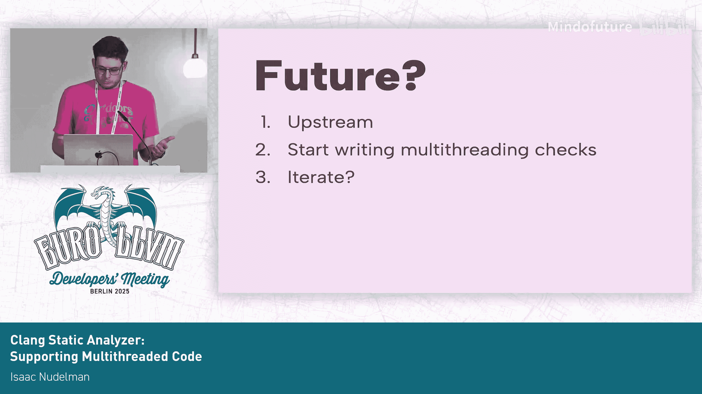

# 2025LLVM欧洲开发者大会-p07-P07-Clang-Static-Analyzer---Supporting-Multithreaded-Code--BV1EoE9zUEbG_p7-

Just by a show of hands， who here has encountered a multi threading book。

That should be everyone because if you've used a modern operating system in the last。

Well you're here， so you probably have encountered one。So。In this code， I have a laser part。

Can you spot the book？More importantly， could you spot this during code review if you haven't noticed by now。

 this is a kind of a classic data race we're using the resource。Before in a thread。

 And then we're initializing it after we've createdd a thread。If this was single thread to code。

 we could detect this with the static analyzer today。

Maybe it was a use before use after free or something like that。

 we could detect it and we'd like to do this for multithed code as well in our static analyzer。

So what's stopping us from doing this？The answer is actually many things， but chiefly。The problem is。

Kind of how the analyzer looks at things。So the analyzer will go through code and will build a graph of all the possible states of the program。

Variables， memory， so forth。And with thread code， it'll often visit both the parent and the child threat。

 but the problem ends up being that。It creates separate graphs for each of them。

And our state is marooned on each threat。And we can't even begin to start enabling kind of those cross thread analyses if we have just completely separate thread and no way to connect it。

So how do we connect it Well， first we want to just kind of do kind of that initial step of just initially。

 let's just bridge our thread together， let's combine， let's let's just be able to look at the code。

And then eventually， we can move on to fancier things like deadlock detection or data race detection。

So today we're just focusing on that initial step of modeling that thread creation。

 bringing that kind of combining up parent childil state there in the future we can model thread joins and potentially thread and leaving。

For this， we have some goals we want to keep in mind。First of all。

 we want existing checkers to just work， we don't want to kind of break a bunch of things or make it incompatible and secondly。

 we also want this to be portable so if you have a machine that has a 42 bit character。

 it should be fine or if you have don't have shared memory or whatever it looks like it should also work。

And then're also explicitly we're kind of restricting our scope。

 we're targeting traditional CPU threats， we're not going to target GPU memory models。

 they like KUa or any other kind of ST model， those things， you have stronger invaris。

 you can build a better。Abstraction there。So we're just going to kind of go for those CPU threads。

So kind of what happens now in the analyzer， what is our blocker？

We can take a look at kind of what happens， all threads more or less look at the same。

 we have some function that the thread will execute。

 we have some data that we can give to the thread。To initialize it。

Maybe we have some additional metadata to name the thread or have it handled the thread。

And we really care about that function in that data。😊，So， when the analyzer。Looks at this right now。

 Anar kind of has two steps。First， the analyzer， it'll see that this is a function call and this clleangstatic analyzer is very aggressive about trying to inline these because it's a way to kind of prune the state space and this will fail because it doesn't have the definition for what a threat is in many cases is not possible because you dynamically link against your studying library。

And then after it fails to inline the function， it's going to try to kind of pass it along to a bunch of checkers and these checkers are what implement the analysis。

in a static analyzer and none of the checkers that will work kind with function calls。

 they don't know what a threat creation event is and they're also they're not going to do anything and so at the end all of our state that we've put into this threat creation it just escapes。

We just pretend。It's kind of you can think of it as going to a black hole。谁。😊，Our。What do we do？

We want to kind of。Make this not going into a black hole。

 so we want to basically just link our two things。And we have a。

A very simple solution we have our two separate graphs what if we just merge them that's our kind of our goal and we have a pretty powerful tool where we can just have we have our function that we're executing on the thread。

 we can just inline it and。Then we've merged our graph。

 and now all of our state is unified and all the checkers will work without a new modification。

So kind of our first attempt to try to implement this is as a modeling checker。

 but we're going to implement it as a checker， we're not going to actually do any analysis but we're going to kind of encapsulate all our platform specific state and try to model it and this works you we did P threads because they're kind of the most common denominator。

 we go through we extract all our arguments and then we try to inline it and then we run into a bit of a wall because it turns out that in it's not really available to the checkers。

 it's kind of stuck in the core and more importantly checkers are not designed to kind of influence the control flow of this symbolic execution。

So we need to kind of rethink it。 So our second first try is to just slap it into the core。

We added a config flag so that you can opt in， and then it's kind of you just copy and paste the code from before。

And then the question is， of course， where do you put the code And we just put it where the checker would have evaluated。

 You have some kind of。Default call evaluation where you do that inlining step and then you try to dispatch on your checkers。

 so we're just going to put our code there。And we have like where we were before。

 we have our kind of our thread function and our data， and now we need to endline it。

We have to make a call expression because we inline function calls and we just have a function。

 but other than that， we've inlined it and it works。So we can test it。

So how do we know that actually works so with lit we can introspect the internal state of the analyzer so we can see that kind of got butchered a little。

 but you can see that we can have a trivial example to show that we actually inline the code。

And then we can after this， we can kind of step up with some bigger examples。

 we can add some little bugs and we can show that we've detected we're enabling existing checkers to detect these bugs across threat boundaries。

And we tested this for use after freeze， noy references， taint analysis， most of the core Uni checks。

And then kind of step two is we've done these little toy examples and now we want to actually。

 we need to test it on real code。So first we tried it on MC， it found a crash。

 but it was in our code， not in MC， unfortunately， so we fixed the bug and after that。

We didn't find any more bugs testing on real world code。And。So what did we find？呃。

We didn't really see a big difference。This is kind of a good sign means were not really we didn't really lose results。

 we didn't see meaningful performance overhead， although there's a big caveat there I didn't have time to properly characterize this。

 so there's probably some cliff somewhere that you can run into， but kind of in the common case。

 there's a negligible difference。And。We did show that we can find real bugs。

 so we took LZ4 and in the thread pool code there we removed a null pointer check and we inserted a null pointer during thread initialization and it did find it。

But generally speaking， this is not going to find that many interesting bugs in open source code because realistically you're going to be looking at initialization。

 which is probably very easy to test and you're probably going to run into it。But。

It's a good starting point and there are definitely some cases and platforms where you will be able to find a lot of interesting things。

And where do you want to go from this， our kind of goal is to upstream this so that we have this kind of starting point for doing thread work and then we later we can。

Have know， better analysis and more。More complicated checks， and we want to start writing。

 once we've upstreamed it， we want to start writing more multithted checks。

 start modeling more and kind of go from there and have that drive where we go with it instead of trying to kind of bite off let's do fner leading right away。

That's kind of it。If you have any questions， I'll be happy to take them。

And there's my contacting info， if you want to reach out。Hello， thank you for the talk。

I have a few questions。 Let's start by。Have you considered exposing the inlining or how the control flow。

Basically。Way for checkers to influence the controlflow have you explored that option that is an option it's been considered before。

 but that would probably be a very long lot amount of bike shedding and take many years before that would happen because that would be。

 I think youd probably need a pretty big reing rearchitecturing of the analyzer。

The second question is， do you think， do you think that the same technique could be applied to higher higher order functions like。

St fine or whatever library functions we may have that is currently not in line and。

I don't know those functors or predicate functions。

They may also have some bugs that could be inferred from the invocation itself。

 basically connecting the data to the function of the predicate。

 do you think the same technique could be applied there。Yeah， I think that would probably work。

Thank you。Well no question。 So do you think this could be like extended to。

 to other like threading models， let's say open MP。 And you know， so for open MP。

 that would be like a more higher level model， probably。That would。

You would probably build on top of it， but OpenM has kind of additional challenges because there's a lot of generated code。

But I don't see why it wouldn't work。And then for like， I know for like the message passing like MPI。

 there's some existing work on that。Cool， thanks。