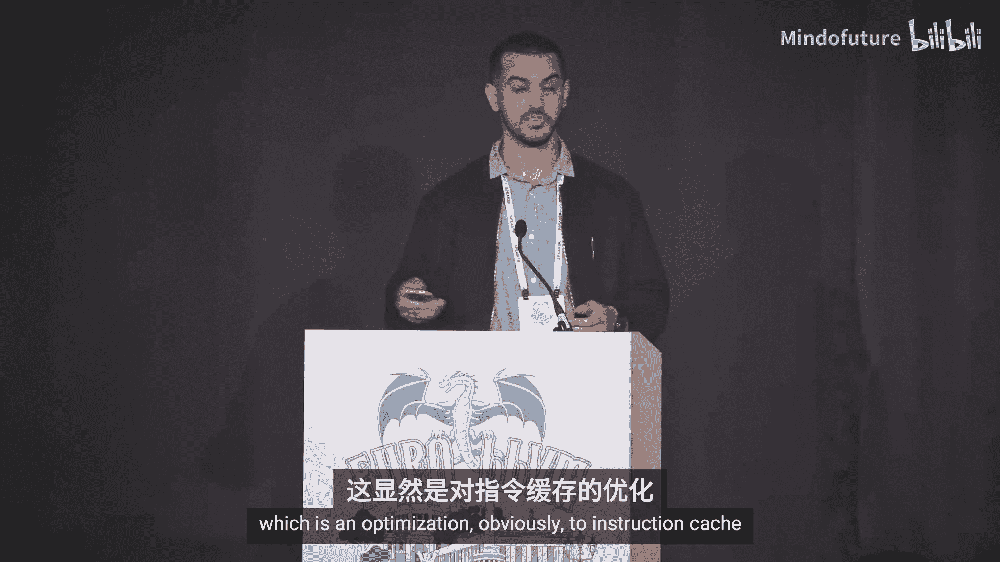

# 2025LLVM欧洲开发者大会-p08-P08-Instruction-Cache-Prefetching--BV1EoE9zUEbG_p8-

Hello everyone。 My name is Oa Wm。 I work as a Comp engineer for Mobile。 And in this presentation。

 we are going to talk about instruction and cache Gr， which is an optimization。

 obviously to instruction in cache， and it should make your instruction cash much more efficient。

 much more updated。 And it's only going to include the software solution。

 So if you have instruction cash in your target。 this one is for you。😊。

So first we' are going to talk about the instruction cache just to put everyone on the same page to remind everyone what that is。

 Then we'll talk about the proof instruction and we' will see how we're going to use it to update the instruction cache。

 Afterwards， I'm going to talk about some L VM analysis that I found useful during the implementation of this optimization。

 And at the very end， we'll talk about the performance impact that we managed to get。

 thanks to this optimization。😊，So the selection cache。Just like any of the cache。

 the instruction cache is a small fast memory component inside CPU。

 The only difference is that the data that is restore store the instruction cache is instructions。

 And let's take a look if this is example to to summarize it up。 So at the fetch stage。

 the CPU looks for the next instruction to execute。 it has to go to the instruction cache。

 And if the instruction is there in the instruction cache。

 We are any scenario that is called the caches。 and we can quickly fetch the instruction and move on to the decode stage。

 But if the next instruction to execute， is not in the instruction cache。

 we have to go all the way back to the D， which is much slower， this is called the cache miss。

 And only then we update the instruction cache and we can finally go on to the decode stage。 Now。

 the point of this optimization is to minimize cache misss as much as possible because while we handle cache misses。

 the CPU is。 It does nothing， It's a big waste of time。 and our purpose is to reduce cache misses。😊。

So the question that arises is， how do we keep this of cache updated。 and apparently in model CPUus。

 general purpose CPUus， just like Intel I 9 series， for example。

 we have dedicated hardware that does it for us。 It does an amazing job updating the instruction of cache ahead of time before the CPU actually used it The only problem with this this dedicated hardware is that it's expensive。

 It requires much more power， more space， physical space on the chip。

 and it's not that easy to implement。 So for all of these reasons。

 usually custom CPUus like much smaller ones and more dedicated ones。 They like this hardware。

 they cannot afford it。 And what happens is that they don't update instruction cache at all。

 They just get a cachem。 And only after they get a cachem， they handle it in waste a lot of cycles。

 Now for us  Moized this was exactly the problem。 You couldn't afford this hardware solution。

 So we looked for replacement another solution to to solve this issue。

 And the solution was inserting this instruction adding this instruction。😊，So what it is all about。

 So， first of all， it is just a hint。 It does not change the behavior of the program。

 and it is a hint of the processor to fetch instructions into the instruction cache。

 Let's get into a little bit into the the specifications of this instruction。

 When it comes to the syntax， it's very simple， just。P fetch with label。

 just like any jump instruction。 will come to the semantics。 What it does。

 It signals to fetch the cachehan associated with label into the instruction cache。

 And the last thing what we want from this instruction is we must require that this instruction will be a non blocklocking instruction。

 because we want that once the CPU execute this instruction。

 it will immediately continue executing the next instruction。 And mean， in the background。

 the instruction cache will get updated。 This is the source of the optimization of where we get the performance impact form。

So if it's not clear， let's take a look at this simple example。 I have this code over here。

 which is divided into cache L N。 first part is associated with cache and N。

 And the second part is associated with cache N plus1。 Now。

 I added a quick instruction in the very start of this code。

 And what happens is once the CPU executes this instruction。

Take a look and if you notice that leverage is associated with cache n plus one， then instruction。

 then cache n plus one will get updated in their instruction cache。 Meanwhile。

 we will execute some code。 And finally， when we jump to label to cache and n plus one。

 everything is going to be updated in the cache， and we will not waste any cycles and we not get the cachems。

 without this pre instruction， there is a high probability that we will get the cashms and waste a lot of cycles。

 So this optimization is all about ined prefi instructions ats location， Keep that in mind。😊，So。

When it comes to the album analysis that I found useful doing the implementation。

 let's take a look at this case。 We have this basic machine basically lock in red。

 And I already inserted the pre instruction to the next cache line。

 Basically just like the previous example。 And in this scenario， it looks It should work。

 But what if this basic rock is part of the loop。 what's going to happen is that in the first situation we are going to instruction cache It's expected。

 But from the second and so on。 everything is already updating the instruction cache。

 So what is going to happen， we are going to waste a lot of cycle running this pre instruction without doing anything because everything is already updated。

 Now one thing I didn't mention yet is that we want to insert pre instructions only when it's beneficial。

 only when know it's helpful otherwise we are going to cause something that is called a cache pollution。

 we are going to e things that we still need from the cache replace it without other thing。

 we don't want to do that。 So in this scenario， we want to avoid insert pre instruction because it's not always beneficial。

 And the way to do it is to use machine。😊，Analysis provided by L VM。

 and we can use this analysis to answer the question whether this basically this part of a loop or not。

 And if so， we can， we can decide whether we still want to insert this different destruction。

Another case is， let's assume we want to insert a predge instruction over here inside the basic log。

 and we want to pre the code from basic 2。 So it also makes sense。

 But what if we have this basic 3 that also leads to basic 2。 In this case。

 it's possible that we first execute basic 3。 And only then we basic log we execute basic afterwards。

 we execute basic 2。 And in that case， basic2 is already， we'll be already in the cache。

 And when we finally execute basic1 and prefi label。

 then it's going to be wasteful because basic 2 is already in the cache。

 So we probably want to avoid such an area as well。

 and the way to do it is to use this machine dominate to3 analysis。

 which basically answers the question whether basic 1 dominates basic 2 or not。

 And by dominate it means that every press of execution that goes to basic 2 has to go through basic 1。

 And if that's the case is much more safe to insert this pre instruction。

The last case I want to talk about is what if we have this basic1 to jump to basicicle 2。

 But in this case， it's a conditional jump。 So we are not certain that we are going to actually execute code of basic 2 after basic 1。

 in that scenario， it's also not that player whether we want to insert a play instruction or not。

 and we can use this machine branch probability info。 if you have PG O。

 I'm not going to get into what it is just because I don't have time。 But if we have PGO。

 you can use this machine probability branch probability info and get an estimation of what are the chances to branch to jump from basic 1 to basic2。

 for example， it can tell you that in 95% of the times you jump from basic 1 to basic2。

 and maybe you are satisfied with this number and still want to insert a instruction in this case。

So when it come to the performance that we managed to get from this optimization。

 when it's come to the instruction cash performance。

 we managed to get a 45% reduction installed caused by instruction cash misses。

 and we are not aggressive at all。 So the more we aggressive we can get the better numbers。

 But for our workloads， we even got the better numbers。 and it matter all the most。

 And when it comes to the total performance that we managed to get。

 we got between 3% to 4% of total performance gains in cycles。 and it's all up to you。 by the way。

 basically， the more we suffer performance instruction cash misses the more the there is the potential for this optimization。

 So to keep that in mind。😊，And just to summarize what we saw today， we saw that advance。

 actually not architectural advanced CPU handled in instruction cache usually efficiently using hardware components and simple as ones don't。

 And we need a solution for that。 We saw that we can use L VM framework to implement such optimization relatively comfortably。

😊，And that the compiled event pre using a software solution is a viable solution that can give you nice results。

So just one one thing I wanted to talk about is there is a lot of assumptions that I didn't mention here。

 If you have any questions， anything that you want to ask。

 feel free to contact me over here or just after this presentation。 And I'll be happy to help。

 And this is is。 Thank you。😊。

