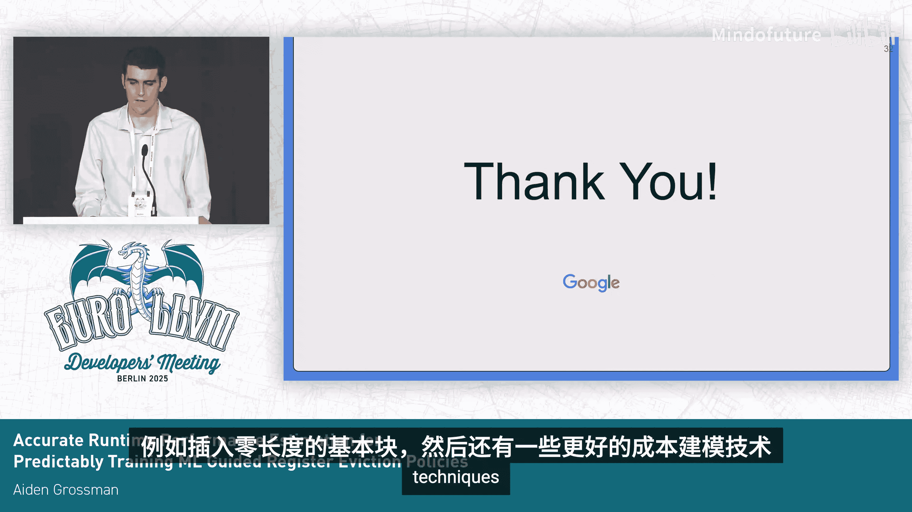

# 2025LLVM欧洲开发者大会-p09-P09-Accurate-Runtime-Performance-Estimation-for-Predictably-Training-ML-Guided-R--BV1EoE9zUEbG_p9-

Hi， I'm Aden Grospin， I'm currently a student researcher at Google， I'm an undergraduate at EC Davis。

 so the title is a bit of a mouthful， but essentially what we're trying to do is take a heuristic within the LVM greedy Reg allocator and then instead of using a heuristic we replace that with a machine learning model that is trained to improve runtime performance。

So the big thing that I want to focus on in this talk is specifically the runtime performance estimation。

 so the cost modeling of the actual register allocation that we get out of the model that we end up using within the training loop to tell the model whether it's doing good or bad within the reinforcement learning loop。

So the big thing on why we want to do this cost modeling versus just running micro benchmarkchs。

Or something like that so first of all the rewards are critical for training learn heuristics if your reward's bad the model that you're going to get out is going to be pretty bad macro benchmarkchs typically aren't representative and then macro benchmarks that you actually care about are typically too large to do within a tight training loop so cost models are typically the way to go。

So for this， we're doing trace based cost modeling。

So instead of like taking a static look at an like executable or something。

 we're taking an instruction stream。嗯。So originally there was some work originally where they trained a model to replace this heuristic。

 So they used PGO data。 So the reward just ended up being a linear combination of instruction types with some block frequency information mixed in。

 whereasas what we're doing it I'm just going to describe here is tracebased。

 So I we're essentially just taking a sequence of instructions that we may recentthe size。

 then you can just feed it into something like a analytical CPU pipeline model or an Ml based CPU model and get out cycle count at the end that you can then use to determine whether or not the model made your code faster or slower。

So for sourcing trace data， we're using Dyna Oo to just due to good internal support。

So previous work So L VM McaD， which did essentially a similar idea。

 like trace based cost modeling using LVMM CA。 They used a Cheou plugin。In order to。

Source instruction data。So we're doing basic block trace modeling。

 So essentially we take our so we need to be able to reconstitute the trace against a binary with a different register allocation that we don't actually need to run anything again。

 So the way we do that， it should be yeah， so this is a decent example。

 but so essentially we're taking an instruction an instruction stream。

 we're turning it into a sequence of basic blocks。 and then we can replay those basic blocks against a new replay those basic blocks against a new binary that has different instructions within those basic blocks with a couple of assumptions that we're making。

 So essentially just looking at the instructions stream looking at where basic blocks begin and then we create a stream of basic blocks。

 there's a couple areas where you need to split basic blocks like around call instructions essentially where you have control flow that's like not really represented at the basic block level inline assembly which is yeah I mean you end up with control flow even though just because the compiler represents it is a single basic block。

So yeah， so once they have a sequence of basic blocks。

 we can just replay them against a new binary and get out what the instruction stream would be for that binary。

 but you end up with this problem of if your control flow graph changes。

 then your instruction stream would actually be different。

So you have a couple of examples right here， most of them that you end up getting if you just change the register allocator are pretty trivially reconcilable。

 but some of the passes particularly basic block way out will end up changing things in a pretty gnarly way that's not really reconcilable。

 which is yeah the example at the bottom right。 So it sort of just sidestep this problem So instead of actually trying to do control photograph reconciliation。

 we just disable all the passes after register allocation that end up causing control photograph differences that would make our modeling methodology。

Not work super well。 So we disable three passes。 and then we dis like half of passes， how I put it。

 But like just disabling shrink wrap region splitting。 So some of its functionality。

 And then we believe it's not coupled to register allocateator performance。 So theoretically。

 if we train a model。 And this setup， it'll generalize to it'll generalize to binaries with these passes that are still enabled。

So we did like run some tests where we're essentially looking at how how closely we can reconstitute the instruction stream from a basic block trace。

 or we're getting like about05% missing instructions and those are mostly from things like symbols that are defined in assembly files rather than in the compilere which don't end up with basic block Is or anything and then interrupted reable sequences and a couple minor things like that。

 So there's no we could theoretically fix these things but not super high priority given like you can't change the register allocation of symbols and inline assemblies。

 So in assembly files or inline assemblies。 So yeah not super high priority So after we got that。

 we did some correlation studies。 So essentially taking a bunch of binaries with different register allocations benchmarking them and then seeing how well the model is able to predict the associated speedup or slowdown。

 So we're doing this example right here is with a peak optimized。Binaries so PGO CSPGO and thin LTO。

 no postlink optimization， but definitely a peak optimized binary because if you're going after like 1% performance gains。

 you want to do it on a binary that's already reasonably optimized。 So we end up with， I mean。

 pretty good pretty good results right here。 reasonable R squared value that works even better in the non non PGO case。

 Yeah， so the R squared value there is even better。

 So this is a reasonable reasonably real world example here。 So this is just running it on LVM op。

 which ends up with about 10 million retired instructions。 So it's not just a toy workload。

 I mean it's the full I mean， decent chunk of the compiler。嗯。So once we have that， we need to。

 I mean， we。If we have a reasonably predictive cost model。

 you can use it in a reinforcement learning loop to train a machine learning model to do everything。

So so in order to do this， we're essentially taking all the translation units。

 translation units within an application that we're interested in optimizing。

 along with an associated instruction trace。So we take all those。

 we put them into what we call a corpus， so it's essentially just a collection of bit code files。

 so within thin LTO we're just taking the post import pre optimization bit code。

We do this corpus subsetting thing because when we want to evaluate a Reg allocation policy on a binary。

 we need to recompile like all of the object files in the binary with our new Reg allocation policy to figure out how well it does。

嗯。And， and we only need to actually find the functions that are in the trace。

 And it turns out that most， like only about 10% of the modules are actually useful here。

 So we do this corpus subsetting procedure where we're essentially pulling out just the modules that contain functions that are in the trace。

Which， yeah， I mean makes it a lot more efficient。 So then we do some Ml stuff。

 So using evolutionary strategies for training algorithm。

 mainly because it enables long trajectories， reinforcement learning can sometimes suffer when you don't have quick feedback。

 So ES is really good with well， you can make like millions of re allocation decisions and then spit out a reward at the end。

 and it does well with warning based on that， whereas a lot of a lot of gradientbased algorithms like like quick feedback where you get make a couple decisions and they want some numbers based on that。

 it did some initial experiments on the opt vacation that we did for the correlation studies earlier。

 So this is just a reward graph。 So there's a constant offset here。

 But after like a pretty expensive training process。

 we ended up getting about a half a percent real world performance improvement on this binary specifically。

嗯。Yeah， so we did。Yeah， so this is on。 So this is another。

Training run that we did on a internal server application。So we did some RL hyperparameter tuning。

 which helped things along quite a bit。 And we got a pretty， pretty reasonable model out of it。

 So these are some benchmarks on some internal server applications。

 So this one was about like half a percent。7% when， which is， yeah， I mean， it's not super big。

 But when you're the scale of a hyperscalear。 that's pretty significant。

 And this is mostly just a first attempt。 we believe we can do I mean。

 in terms of headroom I mean suspected it's about double this like this is the model that we sort of just did on a first first run through of everything。

 So， yeah， so we're looking at a couple improvements。 So making training go。Faster。

 so we can make it a couple more optimizations。 like instead of just subsetting the corpus。

 we can also only compile functions that we can only compile the functions in the corpus。

 and we can also just only compile functions with redjag decisions。

 which is a big performance improvement。We have a couple ideas on reducing the modeling costs。

 L VMMCA is pretty expensive to run。嗯。And then， yeah。

 the main thing that we want to focus on in the future with this is generalizing to other optimization。

 So the control flow graph reconciliation is a pretty big challenge regarding that。

 So we want to figure， we want to figure out how we can generalize this approach to other optimizations that like might inherently change the control flow graph without easy cop outs like register allocation。

 just inserting zero length basic blocks。 and then also some better cost modeling techniques。 So。

 yeah， that's all that one。

