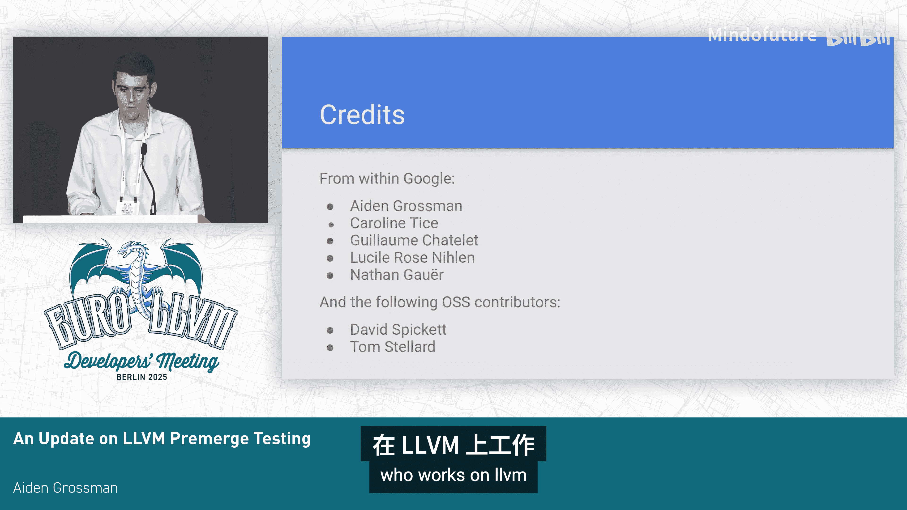

# 2025LLVM欧洲开发者大会-p10-P10-The-New-Premerge-System--BV1EoE9zUEbG_p10-

Another thing that I've been working on is the L O VM pre merge system， so。Yeah， I mean。

 currently running， it's currently running through build kit。 I mean。

 a lot of people here are probably familiar with it。

 those pre mergeged checks that are usually broken a decent amount decent amount of the time that run all of your PRs。

 So you've been working on some infrastructure changes mostly to help with queue times and enable some other improvements。

So right now， we have this new beta system。 We're hoping to launch it soon as they'll talk about it a little bit。

 So right now， both the old system that runs through build kitite and the new system that runs through Github actions。

 So they're both running in parallel。 So if you've opened up a PR recently。

 you've probably seen the build kitite checks。 And then below that。

 you'll see the like Github actions， L VM prege checks。 And then they'll have like a disclaimer。

 like test only ignore these results。嗯。So they're both running in parallel mostly so we can test the stability of the new infrastructure。

So the new system currently marks all jobs as passing so that if there's actually infrastructure failures。

 we don't end up spamming a bunch of people with emails on a system that's somewhat unstable。

So with the new system， we're still sorting out a couple stability problems。

 There's a couple issues where GiHub sometimes stop sending jobs to us。

 So they just end up queuing instead of actually being executed。

 So we're hoping to launch it next couple weeks is what we're hoping。 But I mean， yeah。

 almost definitely by the end of Q2。 once we sort out those stability problems and。

Get some like guarantees on funding and engineering resources internally so that we can make sure we're actually able to support this going into the future。

So a couple of the features on this new rendition of the infrastructure that we think are particularly important。

 so。The big one is auto scaling。 so we can essentially just have more machines available。

 And then within a fixed budget， like dedicate those machines to running at the peak。

 like peak times， which are usually like， I mean， right at the beginning of the day。

 like European and。Pacific time。 And then yeah， I mean。

 also definitely most of the workday Pacific time。 So that can significantly improve latency and just make more effective use of the resources because the current pre merge system。

 it just runs a bunch of machines all the time。 And that's not a very effective use of resources。

 like you only need them during certain times。 So if we can reallocate things to where they're needed。

 we can be a lot more efficient with that。 And we have some metrics。

 which I will talk about on the next slide。 And then the two big two of the bigger things also are more on the organizational side。

 So the point。😊，So there's like onca rotation that's getting set up that will provide be able to provide support during working hours。

 We have some awarding and whatnot that I'll get to that should help with that。 So， I mean。

 if stuff starts breaking in Q times explode or whatnot。

 there should be someone else who's actually going to investigate that。

 and then also dedicated engineering staff for maintenance and improvements。

 which is something that the current prem system like had at one point。

 And then people wanted to move off a project。 And it's been like mostly unstaffed for the past year or two。

 which is LED to some issues and Yeah， I mean， it's been barely， I mean。

Only when things like start exploding or when people are actually working on it。 So having。Yeah。

 I mean， having dedicated maintenance procedures and everything will help keep things running smoothly into the future for that。

 So for the metrics， we have a Grfana dashboard。 So I mean' there's a public version of it。

 So if you go to the Lvm Zor repository under the pre merges directory。

 there's a link to a Grfana dashboard that will show you these metrics it doesn't look the metrics don't look as good as this right now because there was recently an issue where Gitthub stopped sending his jobs for like 20 hours or so。

 So there's still a bunch queued but it displays metrics that people have cared a lot about in terms of pre mergege in the past。

 So things like queue times and runtime also probably going look at doing things like failure percentages because if we end up running into too high a failure percentage。

 I mean， it's probably an infrastructure issue。And then also， I mean。

 potentially looking at like failures on mainine。 And then the other thing is that metrics are coupled with alerting。

 So like if queue times suddenly start exploding or。

 there's like some other infrastructure issue that the alerting is set up to catch。

 someone will get notified， I mean， during working hours and will be able to work on investigating that。

So a couple other improvements。 So most of these have actually impacted like both the new premge system and the old premage system since they're pretty much running the same same shell scripts。

 So like So the premge system like has this like somewhat complicated job computation script where we're trying to figure out what exactly what projects we want to test based on what files were changed。

 So it's not， I mean， so it's sort of I mean， you sort of just testing the project that you touched and then all of its dependence。

 there's a couple caveats due to like timing like build and test time related issues。

 But that's mostly what it does。 So that got that got rewritten recently it was originally a shell script that was really hard to reason about。

 So it's unit tested and a lot nicer。 there's been quite a few other misllaneous improvements like around that within the shell scripts and around it and whatnot。

So a couple things that we're exploring。 So improving node in container setup times with new infrastructure。

 So like if you have， if you have a Windows node that like needs to spin up because you're starting another workflow with the auto scaling like you end up with like a 15 minute delay or so。

 So we're looking into improving that because it really only matters during like off peak times when you actually need to spin up a node to start your workflow。

 But it's something that， I mean。Faster is better。 So we're also working on reproduction instructions。

 something that people that's been definitely a pain point in the past is being able to reproduce pre mergege failures locally。

 so you can actually debug them。So since everything runs in containers， it should be， I mean。

 we can write very accurate instructions that should be reproducible across most machines。

On how exactly to reproduce those issues。 So that's something that's planned。

 And then hopefully a faster tool chain on Windows to get the window。

 the windows pre mergege checked latency down a little bit。

 especially when the compiler cache isn't super warm。嗯。Yeah， so for launch it。

 so they're both running right now。 So like， yeah， I mean， they're technically both running。

 But so watching in this sense essentially means making the new the new system authoritative。

 So instead of just like ignoring all of the failures。

 we're actually reporting them has failed to Github and they're showing up as failures rather than just passing within annotation and then also turning down the old presmit infrastructure at the same time。

Yeah， and then so there's also a discussion to be had around prem latency versus test coverage。

 So this is the thing that's come up somewhat recently as people have been adding projects and yeah。

 I mean， it's been causing queue times and there's been tradeoffs that we've been making regarding this。

 So more test coverage is always great。 But there's a cost there in terms of latency increase。

On the pre mergege jobs。 So at least， so in this case。

 Google intends to Google intends to deliver a high reliability and high performance system。

 but we want to leavea the tradeoffs in terms of pre mergege latency versus like exhaustiveness of testing。

 ultimately to the community。 So in the like the way we've been dealing with it currently is， I mean。

 people are just essentially proposing PRs。 And then like most things have been， most things we。

 I mean， everyone's been able to agree on what to do within the PR。And then if things becoming。

 if things end up becoming contentious， we want to defer coverage decision to the L O VM governance。

 So in that case， that would be the infrastructure area leads。So in terms of yeah。

 so in terms of people have worked on it。 So yeah， so Caroline Guone。

 Lucil and Nathan have all contributed pretty significantly to this within Google。

 And then David Biot and Tom Stard on the open source side have been very helpful in reviewing a lot of patches and whatnot。

 there's definitely plenty of other people on the open source side。 yeah。

 that I've forgotten to mention here。 So yeah， definitely yeah cool to see more community involvement here。

 And yeah， hoping we can continue pushing this until it's something that's reasonably effective for everybody who works on LVM。

😊。

So， yeah， no， kiss， yeah， no questions。 But yeah， thank you。

