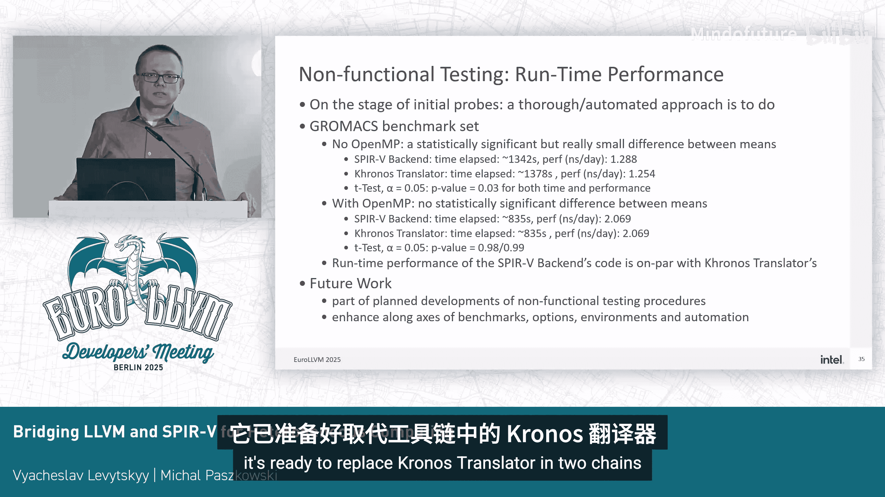

# 2025LLVM欧洲开发者大会-p11-P11-Bridging-LLVM-and-SPIR-V-for-Heterogeneous-Computing--BV1EoE9zUEbG_p11-

Hello and welcome to the Spirit back can talk。The spry backend has become an official target and a tool to produce spri in sickle。

So we plan to expand our presence in real life applications。

 including deep learning workloads and would love to see also another implementation of SQL。

 which is adaptive CPP using the backend。Our general goal is quality。

 also performance and functional improvements， of course。

 so let's discuss changes and steps taken to achieve those important milestones。

This talk covers technical and community aspects of the sp backend。

 we join different topics and this reflects the complexity of the project that bridges Ldium and spiri with heterogeneous computing。

It's not a single message to convey， but a set of stories about challenges。

 solutions and integrations。From our size the project's scope and driving forces heterogeneous computing in general and SQL as one of applications but not as a restriction of any kind in these domain the compilation process is complex and complicated and a unified representation of code is required to materialize compute kernel across various backend APIs。

Dargeting various hardware。A key challenge is deciding what gets converted and when asCO moves from backend independent IR to device specific binaries here Sp comes to the rescue as an abstractstruction that hides details of vendor specific instruction sets and languages。

Spirri and its native LLVM backend as the combination of a format and transformation step is our answer to this complexity spiri is a crosswinnder portable IR for compute and graphics and the spry backend is a previously missing link in the LVM2 chain。

We have the Chronos translator to generate SpV， but it adds complexity and dependencies being nonobstreamable。

 so applications get additional dependency on the external tool。

Our native backend removes this barrier offering tight integration and bed maintainability。

Supporting SQL has been a driving force behind development。

 but HOSL and Ve equally benefit from the computer improvements as maturity of our project is increasing。

 getting better for real world。Workloads。Bringing periodically into allivia makes tool chains simpler and gives vendor more incentive to build on top of it。

 it's no longer just about compatibility， it's about efficiency and longter sustainability across our tool chains。

The SPri backend is an intersection of interests and the implementation is to coordinate involved actors and cases Comp has high semantic expectations。

 Sp instructions are well defined and the flow of meaning from source to target must be preserved precisely This is challenging having so many different users of SPri in the role of portable AR。

The runtime environments front ends backckends a reverse translation from SPE back to LOVMIR as part of hardware drivers implemented by Chronos translator Ch the The may struggle with unexpected and backend specific patterns。

LLium tools and concepts alone also are not enough to fully capture rich Sp semantics。

 requiring more effort， so now if you connect all involved with actors and cases。

 you see an intricate network of this crossro。Shaer involcan and kernelnal in open seal and SL may overlap in functionality。

 creating implicit dependencies and restrictions from run times that guard against unsupported spirit capabilities。

This may be eliminated in future， but until then the back end is to manage this ditomy。

 implementing shared core for kernel and shader， and relying on environmental checks to branch between these models to ensure correctness across different areas。

One of backs is to clarify ambigutities in the spirit specification。

 we have one recent example its how the compute flavor used image readrite instructions。

 they depended on shader capabilities but might be used in compute with the unknown image format。

This unnecessary coupling caused errors in computer work clothess with images and the sphere back helped the specification to evolve。

 documenting this behavior in the kernel context。Another major issue is runtime against periodpointer types the key word is fragility runtime rely on spiritotypes while front ends and optimizers may generate patterns that disrupt type tracking Cor type inference is essential but not always possible。

There is no guidance inspects on how front ends are to create AR or intrinsics to finally map it to SpV。

 and a front end solves the problem on its own， which may lead in consistency。Again。

 recent example is a front end packing by size bulls into a vector of 32 bits。

Against the spirit regarding a bull as having no beat pattern whatsoever。

So while semantic consistency is the goal， the path to get there may be unclear and fragile。

Spirry has a hiarchical type system and most instructions are typed。

 the Beckend runs a model pass that scans IRnon patterns uncovering dependencies and deducing types and avoiding relying on name man。

To encode types and relations， type inference emits internalent intrinsics。

Type inference is complicated， here we list draft steps to infer types in the backend。

 we analyze bodies of functions， maintain a work list of incomplete types。

 allowing delays in deductions until the entire model is analyzed。

AGett element pointer is fixed early。Function parameters are processed based on heater's and coal sides。

 There is a forward traverse so。To use opera to infer results types and the backward reversal to adate or refine opera types。

Here you see examples of how is the backend reasons in the forward reversal about Tibet dependencies in IR。

In addition to rules there is a space for educated guesses。

 sometimes like in fine note with values of different types。

There is also some prior knowledge about well known functions encoded in the past。

 like pointer type conversions between address spaces。

 implying equivalence between argument and result types。

The backward reversal infers opera types from results and make sure we generate consistent types across the model。

 we build a pointer typecast in place and propagate changes further to affected opera users in addition to reasoning about IR。

 we use semantics of wellknow built in op codes。Finally。

 we check function call sites and finalalize incomplete types。

 this is also the moment to save the function pointer extensions from the IR translator cleanup。

Continuous helpers propagate changes with eventual insertion of pointer type conversions for instructions to remain valid and patch allloium types when needed。

At the moment， the only case is one element vector case。

Type inference is not always feasible in a well format way when frontronend doesn't generate enough meaning。

 some sphere instructions do not have corresponding LLium instructions on intrinsic6 like upgroup assignend copy。

A frontend uses a build team to encode this of code that copies between pointers。

 given number of elements。And that the problem number of bytes would be more in the spirit of spvy than number of elements if we can't guess the pointer type。

 the up code just will not work。So now imagine the call of the building as inserted into this slide without any helpful relations between pointers and IR to help deduct the types。

This is exactly what we want to avoid in general because it is dangerous to rely on mandling。

 but in this case we just use pointer types as encode quoted in mandling。It would be nice， of course。

 to reformovate the op code itself in terms of bytes。But it's too late to change。

 feasible options are either the untypped pointer extensions or a hypothetical new build team that would convey the meaning properly。

Another problem is logically out in period Forly a model is a linear list of instructions。

 however there are model and function scopes de facta and the model scope goes in the predefinite order。

 it's a place for type definitions and we must re the same type ID for identical types。

We would like to keep other definitions like constants unique as well to avoid blowing of the output。

So now I imagine a function in LVMMR instructions refer definitions within the functions scope。

 but we remember that definitions eventually must belong to the model scope and be reused。

That's one more conceptual mismatch。For constant， by the way we don't even have a choice。

 they from the very beginning are created and duplicated outside of the backend starting with a translator。

 our talk uses the word brging in the title not by chance。

 the backend acts as a bridge between Pvy and LVM concepts。

The duplication of definitions and efficient gathering of model instructions are essential The backend can't be the bottleneck in heterogeneous computing and now the keyword is efficient it would like to replace the translator in compute tools but it's not fair to compare absolute timings LLC runs a lot of passes transforms and optimizes IR and MR and somewhere between other passes with backend the backend lowers IR topir。

The Chronos stool， meanwhile translates without LDM overhead， so it's a cave translator is quicker。

It's not O though， it's if we see it it's 560 times quicker， hence the screen。

The first address root course was exactly inefficient approach to the model scope instructions。

 the duplication used to build a dependencyGraph 4 IDs and the data structure didn't scale well。

We removed the graph altogether and translation time got five times speed up。

 a solid step to close the performance gap。The next step was to further improve the duplication and tracking of types and values。

 where it worked in internal intrinsic that bloated MIR and reduced emittedcellular codes thanks to smarter type management。

 total effect is 25 times speed up from the original baseline。

 much cleaner intermediate state and IR MIR dumps and a simpler code。

In future we'll plan to profile memory usage end is late address the type inference logic。

 its currently tangled with AR transformations， complicating maintenance。

 so we'd like to make a standalone reusable pass from type inference and probably share it between beons and other projects。

Addressing performance had a side effect expected and intended tracking of duplicates is not entirely trivial task because of changes in IR along the rail translation。

 some changes are out of control being a part of passes unrelated to the backend。

 as the changes could have been watched over， though they were not。

Previous approach didn't guarantee a correct caching of entities。

 randomly returning style and incorrect records due to removal of instructions and their modifications in instruction selection。

 so we address this problem， creating correct caching for tracing and eventual duplication of definitions。

No full control over changes in IR means a bit more complicated cache than bidirectional mapping。

 although a new invitation is simpler anyway， the idea is to watch over IR changes in validating records and recognizing sta items by creating a unique key from an LLVM IR entity based on type and contents and storing a corresponding instruction with redundancy that ensures eventual consistency service of cache。

Consistency is eventual because of IR changes out of the backend。

 and redundancy in general and custom hasing in particular helps to distinguish between valid and sta records。

We store definitions as a tuupple of machine instructions， its definition virtual register and hassh。

 and along with bidirectional mapping， this is enough to provide consistent Ed find and eraase operations we use the record when we see a definition for this V in the machine function and the definition is the same as a stored instruction。

So in the past there used to be flaky behavior in certain payloads。

 now we don't observe it anymore after this fix。Table gen usage must become smarter in instruction selection and that our constant focus in the backend that's a part of the backend that could use a major refactoring。

 we plan to give everything sync to the approach and try moving manually coded semantic sts global AL pattern matching Now instruction selection code often looks repetitive and handledable by table gen patterns。

So there is a space for improvements。Recent achievement humanss already include validity from the perspective of machine verifier。

 simplification of table gen manual recorded rules， intermediate representations。

 and underlying assumptions。There was a couple of problematic interactions with global AL discussed at the latest USLLVM dev meeting。

 let's revisit them briefly from a pragmatic perspective the first is OpP Phi in spri that is a P node but is not recognize as such we had discussed the idea to patch LLVM code generation writing the hard code check in machine instruction is Phi as the opposite to patching the spo backend and postponing generation of OpP Phi so wouldn't it be better to support the specified target of code behavior after instruction selection phase。

The answer appeared to be no overri the hard coded check is an elegant solution because selected instructions should not require any further selection。

Target instruction in Fo would help begins to report file instructions in the ISA but the problem is that the ship is long goneong。

 optimization passes are using the her coded check and there are about 300 places to refactor so elegant doesn't look feasible we aligned with codeb and use phi generic op code until model finalization this enabled optimization passes for us。

Similar problem but the opposite solution to keep apparent types consists the backend uses bitcast between pointers。

 which I to use generic G bitcast， but the solution is to generate Spd up bitcast instead。

The rationale is that low level types don't bring enough info to align usage of GBbitcast with PV。

 so we can't emit a generic op code， its semantics differs from O bitcast。

Back to the community aspects， the Beckend's evident progress and non experimental status enabled new applications。

 SL remains the main driver of changes and new AI workloads and extensions are work in progress。

New Year's cases bring up the issue of missing B 16 support。V16 is important。

 global IL doesn't distinguish the semantics difference seeing 16 bits of floating point just as an IE half。

 so this ambiguity is a problem especially in AI workloads。

 we need to ensure that correct bit patterns are preserved and instructions interpret bits properly。

 representing non-standard load types in global ACL accurately and providing a solid foundation for efficient cogen and mass appearance。

Lack of BF16 awareness leads to workarounds in representing in global ASO projects use have floats ortesures for encoding and then rely on entriess or metadata or add bitcast。

Separate register banks may complic this and bankends need to guess if a 16 bit value is really flowed or integer from the context。

All this fragments z ecosystem and increases the chance of errors。

Eium community proposed several options to properly represent BF16 and as a non standardard flows The first is to extend low level type with extra to distinguish between variants another is to redefine LT kinds adding F fuel to specify format including future extensions like FB8 and TF32 the downside is that it requires a big refactoring。

The next is to embed a type N apparent in the floating point instructions。

 we would make MIIR remove bows and passes would have to pay attention to the extra opera。Finally。

 we could step into a reasoning territory attaching metadata and relying on analysis path in sum we really need a first+ representation of BF16 to avoid pitfalls of guessing。

Our test suite suite is expanding rapidly reflecting evolving priorities tests go beyond file check。

 we use Spview vow to ensure the code is syntactically and semantically valid。Looking ahead。

 we plan to identify weak spots in coverage and automate nonfunction testing。

Promotion of the backend called Mobos and continuous integration environments。

 which quickly uncovered a few fixed spots， many of these issues were minor but still needed urgent fixes as a broader lesson in such big code basis as allivium。

 even a diligent care about quality of the subproject can allow hard to detect bugs to remain unseen。

 resulting in surprises in new settings。The expanded coverage from buildboard sanitizers and external environments really helps。

The backant is table in heterogeneous computing domains。

 we will go better support for OpenCL and address all known issues in SQLCs。

 pass rates are high also for Triton and SQL N2 end test suites with some features intentionally unsupported and other in progress。

 adding extensions may require more time and efforts as in the example of joint matrix。

There is a lot of moving parts in QA， downstream Intel LLium， upstream IVium， Corronus translator。

 runtime drivers sometimes gi branches， components get updated on different schedules and there is always a lag。

 hence pass rates in C workflows can look lower than they actually are until environments updated to consistent state still continuous testing outside of LLVM helps。

When I will check how our runtime performance of speed code generated by the backend compares to code produced by the Chronos translator。

It's at the beginning on the stage of initial probes。

ASo and automated approaches to do First results are good news a runtime performance of our code is on par and don't have significant difference with translator。

So at the beginning of this presentation I've told you that it's a series of mini lessons rather than one message to convey。

 so if I were to pick up just one message now it would be that the LLVM sp backend is a major and stable project and it's ready to replace Chronos translator in two chains。

Thank you for your attention。Hello， thanks for the presentation。

 two short questions on type inference。 You said that taking mangleled names and their information into account is kind of dangerous。

 Maybe you can。Elaborate on that。 And the other question is。

 do you think it's feasible to use the buck information to。Help type inference。

It's a very good question because both mandgling and the bargain for should not be used for any semantic reasoning at all。

The bargain for should not influence semantics any semantics results or analysis at all。

 Mandgling is not stable at all， absolutely so you have no guarantees mangling。Basically。

 I know compilers that would like to proceed without mandgling it also， so for example。

 MLIR workloads would like to avoid mandgling。Mandling is our last effort and I know just one case for the whole spiral backend that requires mandling as a last effort actually it was on the slide It's about a think copy just because it's the only one instructions that refers to number of elements rather than number of bytes so you just force it to use correct types or runtime has no chance to do the right thing Okay so I understand it correctly that you use it as a fallback but it is not the proper way to go Yeah。

 absolutely so it's a fallback I mean it's for such cases when IR just have no tips at all to infer types properly Thank you。

There is an open pull request to add the floating point types to LLT。Yeah亮。

I know and it's in this review as well。It would be really great to see。BF16。

 by the way also use case from the real life， so I was contacted inside Intel by people who are working with XLA。

 adoption In Intels， so basically it's one of things that should be resolved in upstream to make it easier in related projects。

So。You said it's basically， you know， it's pretty mature， and things work。 Have you looked at。

For example， the Lipsy GPU effort that compiles Liy to AMD and Nvidia GPUs natively。

 just you know enabling that for Intel GPUs and so on and so forth。

 or other places where we already target you know accelerators，Now， I mean。

 you gave an Intel talk like targeting the Intel accelerators from there through Sp V or targeting the other accelerators through Sp V where possible。

 I mean， we have in， like， like， you know， upstream things that we could。

Used this for and basically ensure ourselves that it works well。 Have we looked into those。

But we are talking about native LlVium backend， so first of all。

 neither SpV standard nor the Spri Beckend are limited to Intel or related to Intel somehow intrinsically I mean。

 but did you try out compiling the Liy GPU through your backend and actually running it somewhere No no。

 okay， thank you。I would like to elaborate a bit about the question。

 so it's absolutely not about one company because well。

 the overall goal is to help the community in general。

 it's just IR vendor independent IR and native LVMP backend。In theory。

 there agnostic tos any vendor so we can use it anyway。This will be our final question。

 So it's the version you have。 The Sp we also work with the M I R Sp V or is。

Citeted different version。You mean， what is the relation between MLLAR。

 dialect and now looks I has something like speak of V di。Is， is， so this is a independent Sp we or。

So we have whatpir is a standard， it's a language， and we have the backend for it in L Lium project。

We have dialect in MLIR， but this talk is not related to MLAR dialect。

 so this talk is closer to translation of LLDMIR to SpV。Okay， thank you。👏Thank you。

