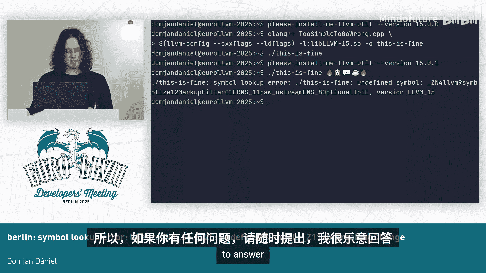

# 2025LLVM欧洲开发者大会-p12-P12-berlin---symbol-lookup-error---libeurollvm.so.2025---undefined-symbol--BV1EoE9zUEbG_p12-

Hi everyone， I'm Goia and Daniel and before we get started。

 allow me to actually do a quick survey about how many of you are familiar with this particular error message。

😊，So if you know where this's come from， then please raise your hands。

Oh okay that's actually a lot of hands， it's unfortunate because I wanted to keep going by taking a look at how to reproduce it and for that first we're going to take a look at the mango name take a closer look。

😊，It ends up being a quite literal closer look， but the point is that what we see here is actually a perfectly legal mangle name coming from this function。

😊，And I know this is not the kind of function you probably see every day。

 this is the kind of function that you get if you start feeding random words into a demand curve and it ends up de curve like this way。

And we're going to take this a bit further by putting it into a library。

And to make this library do something， we're going to give the function a definition。

And now that everything is ready， we can take my talk and compile it as a shared library。

 so to do that let's jump to a terminal and invoke clk this way。

And now that we have the library compiled， you might have noticed that the name of the library very closely resembles what you're just listening to right now。

 and apparently this is not a coincidence。So let's suppose that the same way you can listen to my talk at the conference。

 leave my talk is also used by another library called Lib Euroalia。

And this is where things get interesting because I don't know anything about this library。😊。

Maybe some of you do it's fine， but I definitely don't。So in fact。

 the only thing I know besides it's also a shared library is that since it uses code from Li My talk。

 it must be linked against it。And finally， similar to how the conference this year takes place in Berlin。

 Libbu Royal Vm is also he was by unexecutable， called Berlin。😊，And for the record。

 we don't know anything about this either。So you see at this point it's kind of like the current trends with Vibe coding when we completely ignore what the code reading together or even does。

 and then we end up getting some enterprise scale application that's way beyond comprehension。

 but still if we run it。It brings out the message we specified in Leby talk。Now。

 the thing is that if you remember， the function is called ABI breaking。And so far。

 it doesn't seem to break anything。And we ignore order this soon。At first。

 I don't know if you agree with me or not， but I think it still has a bit too few parameters。

 so let's give it another one。And the problem with this change is that if you remember this function is actually cod somewhere。

 and by giving it a new parameter like this， any source code that codes this function is no longer going to compile。

So to address this， because we want to preserve compatibility。

 we're going to give it a default value。And so by introducing this default value。

 we made sure that all the source files that code this function will still be able to call it using this new header。

 so let's pretend that we also added this seemingly innocent change to the definition of the function too and then jumper to the terminal and recompile Li Myal。

 so consider this like releasing a new version of a library beta change。

Now because this is a shared library。😊，Then any application that is being against it。

Should still function properly like they don't need to be recomplied for the changes to take effect and receiving the ensure backwards compatibility。

 so that means invoking Berlin once again should still succeed right， in fact。

 let's do this way like who thinks that it will succeed。Okay， one person。Actually。

 it definitely succeeded in reproducing the error message that we wanted to see。😊，And normally。

 I would assume that you're thinking like what on earth is a shared library and why did this change actually break something。

 but you all know that？So that kind of makes talking about it pointless。

 but since it's already part of my talk then。😊，We have to live with it。So as you might already know。

 when an application is linked against a shared library。

 the content of that library is not actually the part of the application。

 but instead there is only a reference to the library inside the application。

And then this reference is used later when the content of the library is needed so that the library can be loaded in runtime。

And when that happens， obviously the dynamic loader first has to look it upon disk and if the file is overwritten by installing a new version。

 for example， then is thecode from this latest installed version that's going to be loaded and executed and as you've seen it's very easy to make changes that will actually break backwards compatibility even though they might not seem like they do。

And so there are two kinds of compatibilities I want to mention here。

 the first is called source compatibility， which essentially means that any application that uses the old version of the library can still recompile against the new version without any modifications。

 so this is what you also know as API compatibility。

 and the other one is called binary compatibility， which means that these applications can still use the new version of library without actually recompiling them。

And so if we take a look at the。Programming and the binary interfaces of the old version of Li My talk。

You can see that here the function definition is what we have in source code and the way the function is used in the API is by invoking it in source code。

 but in the binary the function is actually defined under its very own label which in this case corresponds to the mand name of the function and the way the function is called is by dispatching a core instruction with that label。

And if we compare this to the inner faces of the new version of the library。

 then you can see that because we edit default value to the parameter。

 it can be called in the source code the same way as before。

 so the change was definitely source compatible。Well the new parameter is also part of the mand name。

 so we change the label under which the function is defined in the binary， and so to code it。

 a code instruction should be dispatched with this new label。

 but since the applications ver recomped， they still dispatch it with the old label。

 and this is the executive IV end up getting a symbol lookar about the undefined symbol that actually corresponds to the old mand name of the function because the load doesn't find it。

And there are situations when these compativbilities。Our idea had to be preserved， so for example。

 I'm maintaining legacy systems。😊，Like imagine that you work on a legacy system and then you make a change to it and it starts malfunctioning。

Then you can pretty much spend up the rest of the time uncovering multiple decades of software engineering knowledge to figure out what's the problem。

And in these situations， it would be helpful to have some tool that is able to detect these changes。

And if you are familiar with it， you might say like well there are already multiple tools detecting these。

 and in fact， a lot of them analyze the content of the binary。And seemingly。

 this seems to be the obvious approach to tackle this problem because the binary in our face lives in the binary。

 as its name suggests， except。Well。There are multiple different binary formats used across different platforms。

 and so there is no universal solution that can work on every platform。😊，And to address this。

 we have other tools that actually take advantage of the fact that multiple platforms use Wwarf debug info。

And this way we can get some cross platform support， however。

A penalty dwarf isn't the only debugging info format that's being used。For example， on Windows。

 we have PDDB and that's a completely different thing。So what if instead of。

Using tools that analyze the binary， we try to use other tools to analyze the source code instead。

And here were going to face a different kind of problem， which is called no such tool exists for C++。

And if you are familiar with the LLVM project， it actually contains many different plan tools that can one way or another can reason about the source code。

But none of them does it in terms of library compatibility。But on the other hand。

 LVM provides a suite lip tooling that allows us to create standalone Kank tools of our needs。

 and we also get the ASD Matts library， which allows us to extract information out of the KLang ASD。

So in fact here's the idea， let's take these libraries。😊。

And create a new standalone tankk tool that can take the source code of the different versions of the same library and uses some static code analysis to detect the actual compatibility breaking changes。

And at first， dance。This seems to be a trivial a problem to solve because the only thing we need to do is compare the source files across different translation units。

But the way the KLang ASD is designed， this is not a tria problem， this is a bit tricky。

 and the reason for that is initially Kang creates an ASD context for every source file it compiles and then this ASD context is used to store the actual nodes。

And whenever Kk needs to work with the nodes。They are actually accessed through pointers to them。

And so comparing two nodes within the same ASD context works by comparing two pointers。

 if they hold the same address， they actually represent the same node。

But if we have multiple ASD contexts。And even if both of them， for example。

 have the same function declaration。It's physically impossible for them to have the same memory address。

 so we need to find some other way to do the comparison。

Something that doesn't depend on the actual address of the node。And for this。

 actually Kk also already has a solution that's called the ODR hassh。

And the whole point of the ODR hassh is that it takes the AST nodes as its input。

 and then they generate a hash value as the output。And since this is a hash function。

Regardless of the address of the nodes， if they represent the same declaration。

 they will integrating the same hash value， and so we can use this to do the comparison across these different ASD contexts。

And so the idea of this the implementation of this whole idea can actually already be found on GitHub in this repository。

And I know。Like don't let this thing fool you because it's actually a serious tool。

 even though it doesn't look like one。In fact this is what happens when you that LLMs name your tool and they get way too creative about that。

 well this is actually my thesis project。😊，And I hopefully made my university proud with it。

But before the seed of doubt begins to grow further。Let me show you how it works。

So if we remember this was the change we did to leave my talk that actually broke the ABI。

 so let's see what it has to say about that。before we could invoke it。

 we need to specify the source files of the odd version of the library that we want to analyze。

And then we need to specify the source files of the new version as well。And now if we run it。

 you can see it display the warning that the overload or an overload of the A breaking function is missing from the new library。

 and that was exactly the cause of the A break。Okay。

 I know this seems like a made up example that's way too simple and it's not a real world project。

And believe it or not， I actually received multiple requests to somehow evaluate aBCO on LLVM。So now。

Here we go。So since today is the 15th of April， I thought about taking a look at the symbolizer from LVM15。

 so for this were going to use the headers of the symbolizer in LVM 15 and we're also going to specify the be directory。

To this version， because the PL directory contains the computation database and ECOn can use that to figure out the actual compiler options that need to be used to build the ASDs properly。

And for the new version， we're going to use the same source file from the next series， which is 15。0。

1。And the thing about these so called data releases of LIVM is that they actually tend to preserve both binary and source compatibility。

And that means we expect to see no warnings here。But we actually get multiple warnings。And look。

 maybe my my future to instantly rejected I don't know why。

But where warnings come from are actually these two changes， so first in 15。0。

1 we introduced a new field to a class code markov theater and with this we first changed the size of the class in memoryory and we also changed the offset of most of the fields in memoryory and we also added a new parameter to the constructor which led to changing its label as we've already seen before。

So if you take this， seemingly too simple to go wrong kind of snippet because it only instants a markov filter and then exits。

And then we install AirVM 15 and compile snippet against it。If we run the resulting application。

 so far everything works。Now if we decide to upgrade to 15。0。1。And then Iran the same application。

Then as you can see， we end up receiving the exact same warning that we've just seen at the very beginning of the talk。

Actually， I was thinking about doing the initial survey now。

But I dont want to try it again because you already know apparently where the warning was coming from。

 so instead in case you have any questions then feel free to ask them and I'm happy to answer。

Thank you， Doian， questions。What if the function is marked as exency。

 will it produced a undefined symbol even in that case？But in case of exterernancy， it shouldn't be。

Like apparently in C， you don't have function overloading， so with external C。

 you probably don't have any issues， but even if you like don't external it and don't change it。

 you don't have any issues either， so I don't know what you mean。

Like if you mean if it is marked as ex and you change its parameters， yeah。

 so in that case the parameters shouldn't be part of the mango name like you have no mango names so it shouldn't be an issue。

O。Thank you。I think one of the challenges with these source based tools is preprocessor if we have different if depths。

 so I think to be able to detect all of the potential BI incompat you need to。

I guess it's true for binary tools as well you need to compile it to all the platforms you want to support to make sure some of the incompatbilities are not like only applicable to one of the platforms。

Okay， so you actually mean that you have different if that's for the different platforms， right。

 but then if you。For example， invoke cl with the tripper for that specific platform。

 then the source file should get preprocessed according to that platform and then you get the resulting ASD you so you will still have the。

Technically platform， specific ASD， and then that should contain all the information regarding the target platform。

Yeah， yeah， okay， thank you yeah， it would be nice to see something like that in a CI for a VM or something like that。

😊，Any more questions？Otherwise， thank you very much for our speaker。

