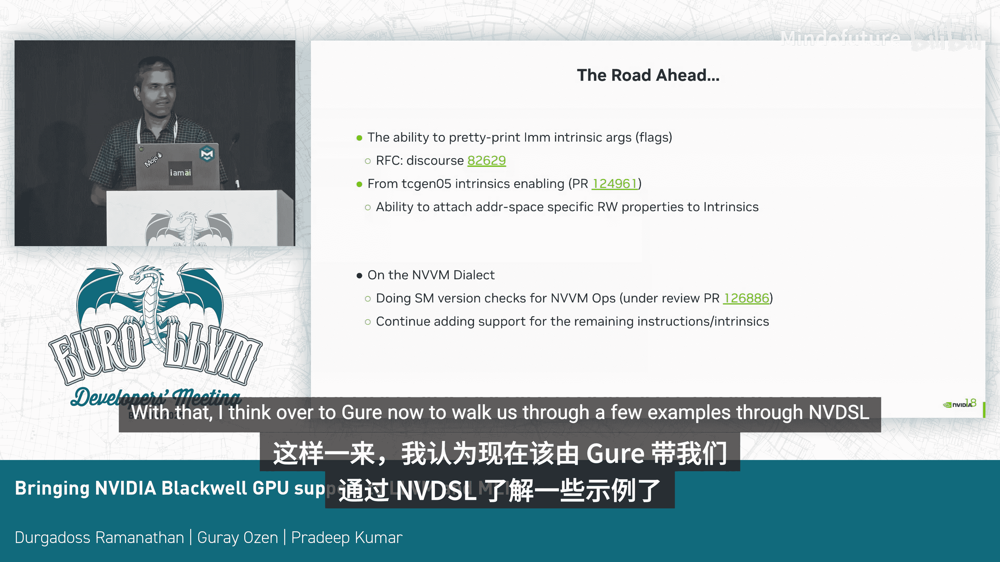
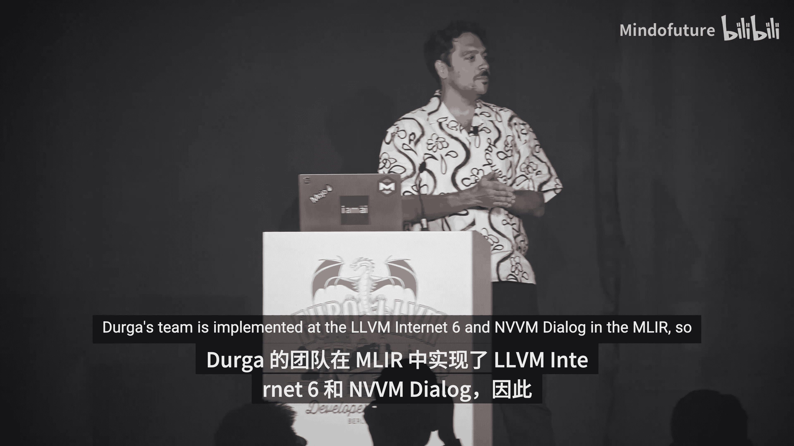
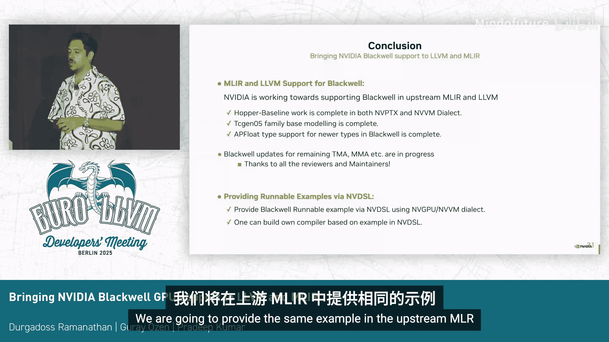

# 2025LLVM欧洲开发者大会-p13-P13-Bringing-NVIDIA-Blackwell-support-to-LLVM-and-MLIR--BV1EoE9zUEbG_p13-

Hello， welcome to our talk。 my name I'm Duga。 and along with Pradip and Guray。

 we are going to discuss bringing Blackwell GPU support to upstream LVM and Himalayarll start with a brief intro on the blackwell GPU features and then discuss the support for them in NvPtx back as well as the NVVM dialect and then we'll conclude by showing a few gem examples through NVDSl Blackwell is Nv latest GPU architecture it packs a lot of features towards accelerating A compute of those the Ms and Tmas are the ones that are going to be more interesting and relevant for our discussion today on the Mmas。

 the Mamals starting with MpR where we had threats from war cooperating together to execute a chunk of MmaA which got extended in Hopper to war group and Blackwell extensionten even further now where threats from up to a pair of CTs can work together to compute a chunk of MmaA along with that we also have support for。

😊，New tensor memory and it has dedicated allocation de allocation instructions as well as loadstore。

 which is basically to say that it's managed by the programmer and unlike in previous architectures。

 the accumulators and some of the opera for the Macm can come from tensor memory in blackwell and we also have blackwell MA support block scale types which are the fP6 and FP4 types and all of these are exposed as the Tcgen5 family of instructions in the Ia on the TMA side which is the tensor memory accelerator this basically does the data copy between shared memory and global memory and vice versa it understands like up to five dimensions it has support for like tiling mode I am to call mode and everything in blackwell it gained support for few specialized modes in I am to call as well as like scatter gather support and to give you a big picture of how all these featureses fit together in the compiler flow the NVVM dialect in MLR kind of models these p。

😊，as ops and it can also lower them to LLVM IR as inter6 or inland Ptx。

 and then the LLVM IR goes through the N Ptx backend to generate PTtx。😊。

With respect to blackwell we expect to be about adding like few dozens of ops for blackwell in NVVM dialect and then NvPtx backend already gained an address Space 6 for ten memory and we also think probably around  one k of intern6 to support these features in the NVPtx backend now talking about inter6 we see that example of a simple Tma instruction where just one variant of these instructions can lower down up to like hundreds of inter6 if we model them individually and similarly the Tc Gen5 mma family which models the blackwell MMmas that alone can like individually lower to around 700 inter6 and。

😊，Looking at the distribution of where we are today on a pre- blackackwell baseline we are about like 3k intrinsicn6 now and we see that 40% of those are already from the MMs and the Tms now we are going to add another K more just to support the tMSs and MMs of blackwell here is this scalable to answer this we kind of tried an experiment by running like a set of tests over1k2k and up to 10k of intrinsicn6 and see the impact of adding these intrinsicn6 in the backend for let's say lviium build time as well as binary sizes as well as user kernel compile time just the infrastructure for this is they are modeled on top of like a simple tma intrinsic6 that we have today and it also includes the front end intrinsic as well as the NVPTx codegen all of them selected through table gen to table gen everything is through release bills up to 10k with respect to the binary sizes。

😊，like opt LLC and things like that we see like a marginal increase of up to 3% with respect to build time it's important for us to conditionally compile these include files or the table gen2 the front end include files as well as on the back end side so on those we see like a proportional increase with respect to the number of intrinsics that we are adding all of these are in milliseconds on these tables so we don't see any impact of this on the entire full clean build of LLVM on a release build so。

😊，But when we go to user kernel comp time。 So we ran the same set over a set of  hundred blackwell kernels。

 these are real kernels implemented for gems and these are using the intern6 that we have added so far。

 the comp time measurement is done with the time passes option these are average over like 20 runss and separately measured for opt and the LLC phase and the opt phase。

 we don't see any impact on the compilation time of these kernels it's understandable because most of these inter6 as of now are just a simple pass through to optimization passes on the LLC phase。

 which does the heavy lifting of actual selection and code gen for these inter6 for 1 k and 2 k。

 we see a marginal increase of up to like 1% and 4% but when we get into like 5 k10k。

 we can see up to like 15% increase in the compile time。😊，Now。We clearly cannot afford this。

 so we started looking at options to consolidate these intrinsics in some form。

 One of the earlier approaches that we had was to model a set of these modifiers into like flags。

 what we are calling as flags。 but it's an integer constant。

 There is an example that is shown here with。😊，Takking like the example is like a tile mode and then the multicast and then hes a bunch of these pack all of them together and say that okay here is the constant。

 And only the backend looks at the constant and layerss it to the appropriate variant that it has this worked good for let's say maintainability and also compatibility reasons。

 but there were few practical issues we faced with this approach One of them was we modeled some field or a modifier as like let's say a two bit field。

 And then the isa expander， then it became like a three bit field。

 Now how do we manage with this flags。 there were few workarounds that we tried The other option another problem itself was deciphering flags。

 The In6 become more complicated with the isa evolving and like an example is like they can become like multiple32 or like a wider type and things like that just became harder to deal with these flag constants itself。

 basically we have to unpack and then map them to whatever the enumerations that they map to So the other approach that we looked at was to say。

😊，That okay instead of putting everything together into one I 32 why don't we split into like one flag field per a set of modifiers alone that looked much more easier in sense it's much more easier to deal with the I as in if you are debugging hacking through the I we can directly map the flag value to the enumeration value and we practically never run out of bit width we can use like Ih I 16 or I32 but the question was on what's the impact of expanding this one pack I 32 value to like a multiple sets of I32 on the bit code size So again go went back to the same set of kernels that we measured and the geome state largely close to one but for a few kernels I think we did see an increase of up to 3% in the D file size。

With that what we are learning is basically yes， it's important for the readability aspect where everything is in the name of the intrinsic。

 but also we need to keep in mind the aspect of the number of intrinsicss as well when to choose which approach what are the set of modifiers that can go as flags and what would work well not well we have put together a set of guidelines for NVPtx in this PR moving on to a float additions now blackwell supports these narrow fp types。

 FP and fp4 types and we have added support for these in the LLVms A float infrastructure。

 the FP6 and fp4 types were relatively straightforward were built on the existing infrastructure available but the scale format type which has like a precision0 it presented like quite a bit of challenges after like few rounds of discussions and reviews with our maintenance what we figured out was like the key fact here is to make a float understand precision can be0 for some exotic types Once we thought that to a float。

 everything fell in place。😊，The whole thing started working cleanly and。

A float in general has this concept called exhaustive pair test。

 They take one type and then just shuffle through all the bits patterns in that and test through all the arithmetic operations towards that。

 And using those kind of tests that helped reveal a lot of corner cases that were specific to these types and of course。

 all of these types have type definition support in the mR as well moving on to MLR side。

 I think most of these Tc Gen5 ops are supported in the NviM dialect Now。

 the Tc Gen type set is almost all layered through in6。

 I think as a prework we are also adding some of the pre black features as well mainly on the T aspect。

 the dialect itself can support both inland P X as well as inter6 lowering more than that。

 I think a particular op in the NviM dialect can partially lower to inline Px for some modifiers and then layer to inter6 for the other side。

 this feature we find it pretty handy during early stages of development and debug Yes we are also actively migrating。

😊，Some of the existing line as one to intrinsicn6 based， I think。

Looking into the future for the intrinsic side， we think the ability to pretty print some of these flag arguments instead of just saying a giant value or like a simple enumeration value。

 it would be good to say that okay this means let's say rounding mode or like reduction mode or a tile mode or something like that。

 There are discussions on this RF slide we free to take a look and let us know your thoughts on that then on another item that came up during the TC Gen5 enabling was we didn't have a way to specify at specific specific read right properties we are kind of working around that with more conservative properties in the I side now but I think it would be good to have them and we plan to look at that in sometime as well on the NVM dialect side。

😊，Along with all of these additions， we realized we don't have a way to check SM versions on these ops。

 So they go all the way up to the IL and then fail in the back end。

 So we are adding support for that， which helps us to catch these SM version checks much early in the development flow。

 And of course， we will be adding support for the remaining instructions as intrinsicns as well with that。

 I think over to Gu now to walk us through a few examples through NDSL。😊。

HeyThanks， Toba。 So Drga team is implemented L L VM26 and NVVM dialect in ML A。

 So we have kind of a bi support in there。 But if I tell you， hey， go implement， you know。

 very fast kernel。 Can you do it。 I I think it's gonna take time because because know。

 parallel programming is hard。 And using all of this tensor things are hard。 And and you know。

 writing fast kernels are really hard。 So we decided that we also deliver， you know， the building。

 the basic building block of the Ge example and along with this P T X instructions。

 and along with this NVVM dialect。😊。

So， and to do this， we are using the N V DS SL， which I introduced last year。

 I'm not gonna go to too much detail， but you can watch it。 It is basically a testing DSL in Python。

 and you can generate。You know， you， you can metapro Di R and generate N V GPPU or NVVM dialect。

 So what it does。 And let me go quickly， it can generate a M IR function automatically。

 and we have the decorators， and it can， you know， Jit compile。

 execute It is all of the boiler plates。 It is doing the operator overloading。

 It is also converting the nonpyyte to M left。😊，So it is just， you know， its giving you a little。

 little python DS SL where we can focus on this performance or where we can focus on testing in MLA。

 You know， we write one kernel and then that generates many。 so we can。

 we can test like larger things。😊，So let's go in。 Let's go deeper。

 So this is the slide volume last year because this is a Hopper GPU and how Hopper GPU was working。

 So we had a tensor core in Hopper， it's the the the size of the tensor core instruction is 64 by 1028 by 16。

 So if you w to do like1028 by 1028 by 64 gem。 You need to execute8 instruction。

 So that was a hopper。 and it was resulting on registers。It was resulting on registers。

 which means if you want to do computation， if you want to use the result of those registers。

 you have to hold that vers。To continue it。And in NviDdia， we are doing the warps specialization。

 You know， we are some vp is doing the TMA， some vp is doing the MMA another vp is doing the art magic logic in it。

 So this is really different。 It was really harder to manage the warps specialization。

 because you have to whole test warps and then keep moving with them for the next， Yeah。

 for the next computations。 So that was opera。😊，So what has changed in Bwell in Bel Well。

 we have introduced a tensor memory。 It's kind of a game changer in terms of a core generation because it really。

 really simplifies the verization。 So what what happens here， And okay。

 our tensor core size gets bigger， but that's not so important。

 But now the tensor core results in a memory。 And this memory is really fast。

 and it is accessible by the other registers or other verp。😊，So you don't have to， you know。

 hold your verb group or you don't have to hold your verb to， you know， to continue。

 You can basically take a one verb， actually take a one thread and then submit the ver to tensor core。

 and then you can continue your life and you can continue ver specialization in and Yeah you can do the ver specialization in the using the other vers。

 And another thing is here。 the synchronization has changed。 and we are using the M barrier。

 This is like a little bit detail。 It is like easier to manage。

 and your barriers because everything is asynchronous now。 I'm sure it is not clear for you。

 So we will go to examples。 I will go like one by one。 So we will take a very basic tensor core。

 So this is this was like a chapter 3 in my last tutorial。

 And I took the same chapter and apply it on the blackwell GPU。so our。

 the sequential version of the kernel is like this02 and 8 by 1 hundred2 and 8 by 64。

 We are using F 16 type， accumulate on F 32， right？ And if you write in the N V DS SL。

 So this is gonna be the on the， on the right side。And we will go this all of the steps。

 like step by step。And this is gonna be our like next many， many slides。

 So in the left side is you are seeing the execution timeline and on the right side。

 you are seeing the yeah， you are seeing the code。 And in the in the right side。

 you are seeing the execution timeline on left side， you are seeing the code。

 And if you look at the execution timeline。 You will see four vers。 right， you will see four vers。

 And I am using the the first one is the first ver。 Im gonna use the that verb。

 And we have a leader thread concept that leader thread means is the fastest thread on my ver。

 And I can fetch it like at the dynamically。 It's an instruction。😊，Okay， so let's start the kernel。

 This is， this is a GPU kernel。 We start the kernel。

 So I have like two TMA descriptors that that comes from the host。

 and I need to introduce a fence by I am taking my first verb。 I am taking my fastest thread。

 So they are introducing the fence for this TM A because they are in the global memory。

 I need to make sure which is they are visible to everyone。😊，And also。

 I am I am initializing my M barrier。 So they are like split array If you are not familiar with this。

 and I am gonna use the two M barriers， one for the data load， another one， the， the。

 the M M for the M M A。 So that is the， you know， bootstrapping。And the step 2。In this step 2， now。

 as we have a tensor memory， I need to allocate this memory， right。

 and I am gonna allocate this memory by using the verb 0。

 So I allocate and the tensor core with12 N8 column， and I have 102 N8 threads。

 So my result matrix is gonna sit there perfectly。 So that is the step 3。 We allocate it。

 Now we are like kind of done of the put strapping。 We， we can do like the fence of the M barrier。

 which means these fences M barriers are visible to other threads。 and I am also using the barrier。

 So I want to make sure that all my threads are in the same location。 So I can start computing。

 I will start doing something interesting。😊，Okay， let's start doing something interesting。

 which is the step 4。 And here I'm gonna load the data using the T M A。 So this。

The So TMA is also asking grnuous is like a memory load store unit。

 and you can take the fastest thread and tell them， hey， load this many data。

 You can launch like many instructions。And you can， we are using the M barriers。 So and the step 5。

 we are going to wait this。all of the data it is coming from the T M A。

 So it' is like all asynchrony。Happening here。And in this step 6。 So finally。

 my data is in my shared it memory because I use T M A to load data from global memory to shared memory。

 My data is that。 And I know now I can multiply these metricses。 And after Hopper。

 as you know or you are learning now。 and the M A instructions are working with the shared memory。

 So you don't have to load them in the registers manually if you don't want to。

 They can directly work on the shared memory， you just need to build the registers build the descriptors。

😊，And so this is the step 6 In step 6， I am taking my ver 0。 I'm taking my the fastest thread。

 and I am using the the MMA instruction here or like the MM A API in the partss。

 And we have a for loop。 And as I shoved in the the previous slide。

 I need to execute like four of this MA instruction to， you know。

 because I am striding along the K dimension。 So I want to finish the， I want to finish the gem。

 And I am So for the the result， accumulator is， is the team M here， you can see the team M symbol。

 And we are accumulating on the same thing。 So this is not sliding。

 The only sliding part is the descriptors of metrics A and the descriptor of the metrics B。😊。

And then， and the end of the step 6。 and we are committing this barrier。 We are saying this hey。

 I'm done with you know， M M A。 I mean， this， this， this M M A is done。 We commit that。

So it is which is good。 Now， let's go to the step 7。In this step 7， I'm using the barrier。

 the second em barrier。 I'm weighting the second em barrier。

 This em barrier is connected with the M M A。 So， and there is no if， as you can see here。

 all of my threads in my kernel are waitinging this M MA。Because I'm doing this。

 I want to use my all of threads because I want to store the， the Tm to the global memory。

 You can do it in multiple way。 But as I said， this is， this is like， you know， one way of doing the。

 the gem。 And that is how I want to do。 So right now， and I am done with after this step 7。

 my matrix multiplication is done。 And my data isn' in the Tm， right， is， it is not on my register。

 So I need to copy them。😊，This is the step8。 So I need to copy them for in order to copy。

 we have a like load instruction。 you can load and whatever in the T map to your registers。

 And here I have La under28 Tours， and I am loading La under 28 elements per threadette。

 So I basically load all of my metrics to， to my registers。😊，And in the step 9。

 and we have a four loop。 like this is the SF 4 loop。 So as I have my register。

 I am directly storing these registers to global memory。

 This is not the best way to do it because it's not call ask， but you know。

 you can also store in the shared memory and then go back to the global memory or you can use directly the T M A。

 you know， to store everything to and store the shared memory to global memory。 there are minibase。

 But this is， this is one way of doing it。 And if you can understand and learn it。

 you can basically build your compiler on top of this idea。 And as you can see。

 even the basic things。 like even the basic gem requires still the verps specialization because we are using this verb to do this。

 We are using another verb to do this。😊，Anyway， so let's wrap up the kernel and my time is going up。

 And this is the last step In the last step。 I just， I need to delocate my T M。

 and I need to also relinquish my analog permit， which means I I am done with this， you know。

 T M and another C T A or another like another C T A in my S M can allocate this。

 So this is basically it。 This is the gem。So let's conclude and what we are doing in N media。

 and we are supporting M I。 We are working on MR Upstream。

And we are bringing the support for the black world。 and the Hoel baseline is is there。

 And in the NVP T X we can as an inter 6 and also in the NV VM dialect， and we are improving it。😊。

And also， we are going to provide like a runnable example。

 We are going to provide the same example in the oppositeory mamallayia。

So， thanks for listening。再说面再看。Questions， please。Yes， I have a few。

 So whenever I was kind of trying to run the blackwell examples。

 I guess it's kind of a documentation thing。 can you please specify the exact difference between SM120 and SM M 120 A from my understanding。

 S M 120 is like your consumer grade R T X 50 series and 120 A is the B200。

 but I'm not sure which intrinsics are like not supported on 120 and 120 a。Yeah。

 I think you are talking about the black valve for the data center and the black valve for the consumer GPS。

 Yes Okay， it is so they are both blackwell。 And one of them。

 the the data center one is using everything what I have what I showed here is like T C Gen 05。

 And the consumer one don't have that powerful tensor core。

 It is using the the portable MA instructions， which are like MA do sync from the from the study exactly。

 So does it not support like the block scale matrix you can do block scale yourself， right， I mean。

 it it doesn't natively support， but you can do yourself。Okay， yeah。是对。I was wondering with P。

 T X builder。 I know that it's been used in places where you don't have intrinsics yet。

But is there also a use case to actually just inject some really optimal B， T X。

 Are you guys using it in that way， Is it feasible。Well， we have a one case。

 I remember that is easier tonight。 We have a like a loop。

 I think it's for the em barrier try weight。 Yeah， we have a loop。

 and then we are waitinging It is very easy to generate and it' like more optimal to generate。

 But I think like heavy automatic P T X generator is nice for the prototyping because you can come up with the different P T X and embeddedbed it inside the app and you can use it。

 It doesn't have to end up in the production。😊，But it is， it is really easy way to write P， T X。

 And if you like it， you can go ahead and implement ops， I think。Okay， sounds good， thanks。

What's things， Doga。You， Guray and Pradi， for their interest in talk。

