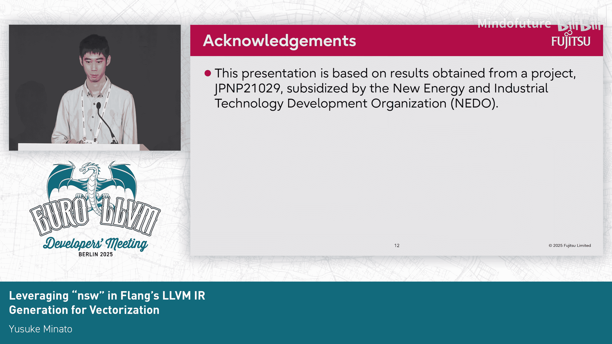
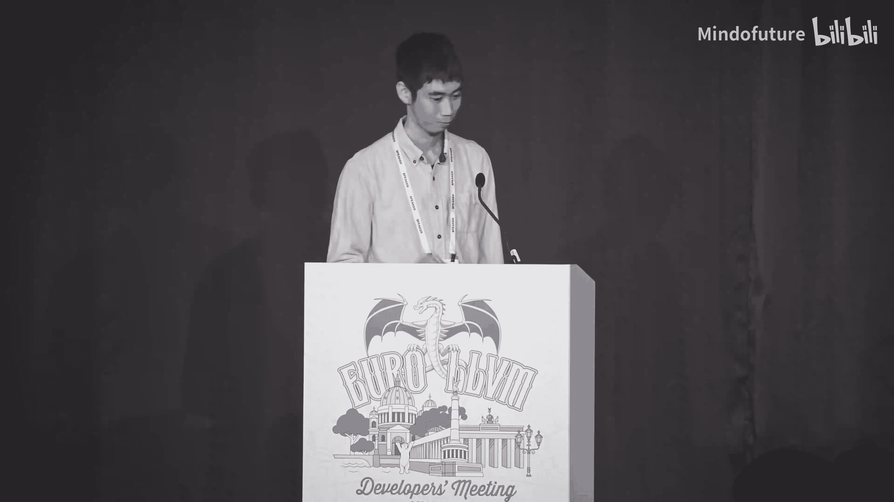

# 2025LLVM欧洲开发者大会-p14-P14-Leveraging-nsw-in-Flangs-LLVM-IR-Generation-for-Vectorization--BV1EoE9zUEbG_p14-

Hello， everyone。 I'm Uke Minino from Fujiu。Today， I'm going to talk about leveraging nano attribute in LB my generation。

So this talk focuses on vectorization per flk。Than is the photo frontend in the L project。

And flang res on the lurexite path in the back end because its prompt and itself doesn't have a vization pass。

Vectctorization plays an important role in optimizations。

 So we are trying to improve the capability of vectorization in the back end。

And to evaluate a capability， we used a benchmark called T SVC。 test 3，4 excizing competitors。😊。

This is available in both portraitron and C。 and this help helps distinguish fronttime problems from backing sheets。

Even though flamem relies on the past in the back end。

 the front end can also affect vectorization because it may generate a living I R that is difficult for the back end to vectorize。

And。We compile the loops in T SVC with， with these options using plan and plan and。And checks。

Optimizing optimization remarks from the Lou Praized Ba。

AndFas math is necessary for vectorization of reduction loops。

 and M R equals M V9 A is necessary specified to enable scalable vectorization。

And table below shows the results of our evaluation。According to the highlighted role。

 Cl 19 can vector 11 loops that plan 19 can't。And as a result of our work。

 three additional loops can be vectorized since 1120 by introducing several options related to individual flow into plan。

😊，So now let's look into these urban loops。They fall into four categories。

 subbotima analysis for R subscripts， reaction variabless passed by reference as three arguments。

The other are s there with noncon size at comp time and loops requiring L TO only for photo conversion。

We think categories A and B can be addressed in， in the front end。In other words。

 adding more information to generated MIR makes it easier for the lu vector pass to vector input L of VM IR。

And we focused on category A， first。The root cause is the complexity of other skes in forra。

Our subscripts are often 32 B in length， while the other states are 64 B and 64 B B。Therefore。

 other scars frequently involved。And different big lengths。In addition。

 lower bounds of subscripts are very0 unlike in C。So others calculations need a step to calculate offsets from subscripts。

As a result， internal representation of already subscripts gets complicated。

 and this can significantly influence analysis and low vectorization。

The following illustrates such' calculations in full term。As I said。Oh， sorry。

Our our subscripts are recal in 32 B and extended to 64 B for other calculations。

And to determine the offset。Southtract the lower bound and multiply by the stride and the size of lower dimensions。

Other scarations are linearized because the shape of an array is often mutable in photoron。😊。

In this example。And as the size of an NRA， A is not constant。And to solve this problem。

 we've utilized an attribute in LBMR I R。 That is NSW。

This is an attribute on several instructions in the IR。

 and it shows that the result will not overflow the range of s integer。

And one of use cases of an SW is simplifying calculations involving different buildings。Now。

 I'd like to ask you whether。The quantity I plus 1 -1 L equals I。Actually。

 equality does not always hold。Whereas in max， dollar hands side evaluates to log in my minus mean minus mile。

 While dollar time sides to long in max。Both are equivalent only if the addition has an NW flux。

 meaning I is less than or equal to inax -1。As we can see。

 NSW is very useful information for optimizations。😊，However， of course。

 we should not add any statute to instructions whose results could overflow。For example。

Ingerflow wraps around in rust release mode。So you shouldn't add an stuff to operations in rust。

And moreover， as far as I know， R range checks rather than integralte flow are water effect vectorization。

So I think we can leverage NW to promote vectorization in rust。Then。How about culture。In fact。

 the photon standard does not measure in overflow。This means it leaves the handling of inteflow up to compile developers。

Therefore， we can assume that the flowing operations will never overflow。

Incrementments of do loop variables， calculations for R subscripts and calculations for loop pointss。

Some other widely used poult and compiler， also。Also， make a similar assumption。

So we believe that our assumption does not affect compatibility with them。However。

 call that violence or assumption may exist because the center does not prohibit it。

Gan has an option F F B to handle handle sign the integral flow。 So we。

 we introduced this option into fl。😊，And these are the information details。

We've introduced a new flag in fur of builder， a kind of I builder。

And this builder lowers the AS T tire recursively， and this flag controls whether NS SW is added to the target operations。

Basically， the f is enabled when during operations， I mentioned earlier。But。Sorry。

 but and disabled otherwise。However， we should remember that P in 2008 and later have intrinsics for bitwise comparisons。

😊，This means that we should not add NW to opera of those intrinsics。And here is an example。

 Gene the totalar。AndAs a result of our work， NW is added to the upper bound of the loop。

And the R subscript， and。T the increment of the variable。And finally。

 I'd like to share some challenges。Our poes trigger a performance regression in the loop strength reduced path。

As Dave， it changed to you Dave in the incom bus when considering NSW on its opera brand。

We believe this transformation is appropriate， but it actually blocks analysis for the optimization。

Also， there are some remaining issues identified by PS SVC。Cryvo B， and A C， as mentioned earlier。

We've identified the root causes of them， but it doesn't seem easy to resolve them at the moment。

Okay， thank you。

