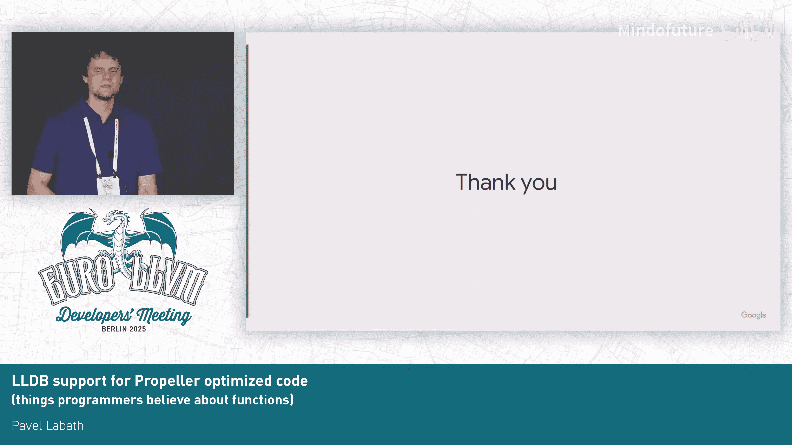

# 2025LLVM欧洲开发者大会-p15-P15-LLDB-support-for-Propeller-optimized-code--BV1EoE9zUEbG_p15-

Today， I'm going to talk about what I did to make LDB support binaries。

 which are compiled by the propeller optimization framework。

 So I'll start with just a very quick introduction to what the propeller and other tools do， so。

This is how a normal binary might look like if it contains a bunch of functions。

 each of those functions may have some cold code， may have some hot code what propeller does is it takes all of the hot codes from all of those blocks from all of those functions and puts them together and then that's the same thing for cold code as well。

And this brings you， you know， increased speed through you know， better cold locality， eye cash。

 lower eye cash misses and whatnot。But what I want to talk about is how to debug this， so。

Let's look at how this looks in the debug info。 In the first case。

 the representation is really simple。 It just says like function starts here and there and the same for other ones。

If if we enable propeller， the representation gets a bit more complicated because you have multiple ranges so that the function one may go from here to here。

 from there to there。And so on。But this， this isn't really anything new。 like you know。

 inline functions and variables have been using representation like this for a long time， so。

You would think that it would just work， unfortunately。

 that's not the case because when you look at the internal representation of L ODB。

 you'll see that it has that before I started on this project functions like this note the use of the single nouns。

😊，And what LDB just did is it created a single address range for each of these functions。

 which contained all of the blocks of the functions and everything in between。😊。

And I'm sure you can imagine how this can cause a lot of bugs in the code， which depends on this。

Also， the thing that's not visible in this slide is that there isn't actually an API to get the address of the function itself of its entry point the assumption was that you can just take the address range。

 take its base address， and this would give you the address of the function。😊，And， of course。

 assumptions like this propagate throughout all of the code base， like even even in APIs。

 which supposedly。Can return multiple address ranges like this one here through this range index。

While it can return multiple ranges， none of the code， which called it， was actually using that。

 It just assumed that like， if the symbol context represents a function， it will only ever。

Return a single range。So what to do about this？At one level， the solution is really simple。

 Just have a different set of APIs。 So I， I added。No。

 one API to get the list of ranges rather than just a single range and then another separate API to get。

The address of the function。 The hard part there is updating all of the code。

 which depends on these APIs to do the right thing when there are more than one range。

I'm not going to talk about individual code because it's frankly， not that interesting。

 What I want to share is like lessons I've learned while doing this in the hope that。You know。

Ma you aware of it will prevent similar know problems appearing in the future， so。

If if you're writing anything that works with functions。

 please do not assume that functions are contiguous。 like they can， they can come in many。

 as many parts as。As you want。Also。Do not assume that any par。

 that all parts of the function are for。Within a single section。

 So the way that these tools work is that。The way the propeller works is that they put every part of the function in a different section so that it can be rearranged by the link curve。

This， in particular， means that you shouldn't do any arithmetic on the parts of the function know。

 offsets in the section。 So a code like this is probably wrong。

If you want to do remitting on a function， you probably want to use file addresses。

 which are called virtual addresses in Elf。 So something like this instead。Also。

 please don't assume that a function is described by a single EH frame record or a single line table sequence and so on。

Since each of these parts needs to be。Relocable by the linker independently。

 each one of them will have a separate record like this and。You。

You need to be prepared to handle that case。呃。Next。

 do not assume that the function entry point is its lowest address because。

The linker can rearrange things as you like， the function can begin in the middle or anywhere。

The next one is kind of obvious， but I think it's worth mentioning separately。

 do not assume that offsets from the entry points are positive。

So anytime you want to figure out how far into a function you are。

 you must be prepared to handle the case that this value will be negative。嗯。That's。

 that's all the recommendations I had。 Now I'm sure you're wondering， like。

 how what's the current state of the project。Most the most things should just work。

 Most of the APIs inside LDB have been updated to handle these situations。

The main exception is the unwinding code。 I'm， I'm still in the process of fixing that and it' taking a while because like it suffers from basically all of the problems that I've mentioned so far。

呃。Also， some of the behavior of LDB may come off as a bit surprising。 So， like， for example。

 if you try to disassemble one of these functions， you may get output like this， which。Is not wrong。

 but you would be forgiven for thinking this is an LB bug， if you。You know， come across it， so。

Probably we need to do something you know， better here to better surface the information that these functions are you know。

 come in multiple parts。That's not something I。I'm going to have time for， unfortunately。

 So this is something that you know， feature that is important for you。 Come talk to me afterwards。嗯。

Yeah。And that， that is all。 Thank you。

