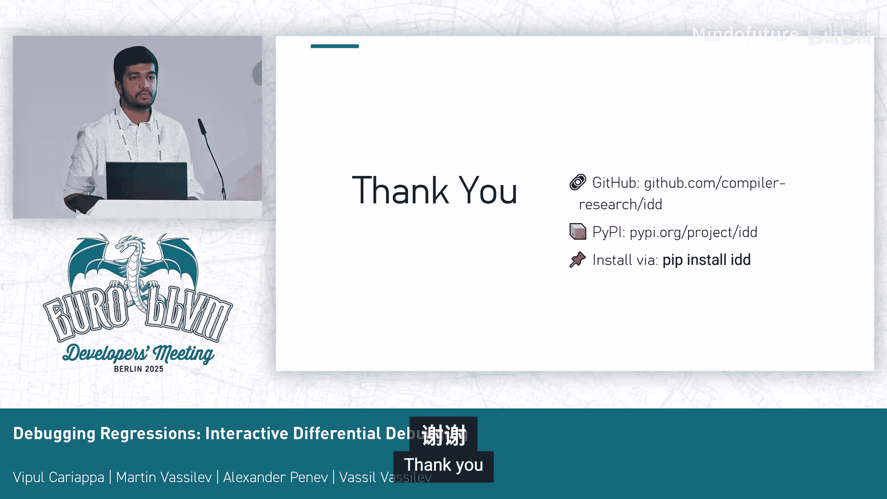

# 2025LLVM欧洲开发者大会-p16-P16-Debugging-Regressions---Interactive-Differential-Debugging--BV1EoE9zUEbG_p16-

Hello everybody， my name is Martin， this is ViO and together we are going to present debugging regressions with interactive differential debugging。

The problem domain is complex software systems。And we will talk about how differential debugging might be helpful to find bugs in such systems。

 we will also provide a demo。So software systems composed out of million lines of code。

They are no longer rare to find this kind of software as the developer is often maintained by data developers from over the world。

 developing new features and conducting maintenance in such systems can easily cause unexpected behavior。

 code regressions in other parts of the same systems。

 which can be difficult to isolate and reproduce。Naturally， with this kind of complexity。

The debugging could be a very time consuming and difficult task in the development life cycle。

And this trend has negative impact on software equality and in the ability to add new features。

Different debugging is a powerful approach that can help reduce this problem。

 The key idea here is that we can use previous stable version as a reference point and by comparing the current version with the base one we can easily narrow down where the problem might have been introduced which。

Reduces the search space significantly。However， existing tools。

 they trade both the debugging instances completely separate and there is no way for them to communicate or synchronize。

 which presents a missed opportunity。Ours2， the interactive differential debuggger or IG。

It outmates the process of filtering out irrelevant execution paths between a reference and the re software system。

Let's see actually how I works first it holdss two versions of the same system。

 the base one where which we。I believe is the correct one and the regress where we suspect that bug have been introduced Next we use abugger like GB or AODB。

We run them both in parallel under the control of5DG。嗯。嗯。Those are well known， yeah。

 they are well known on the buggers， we have focused on them。

And what's powerful here when we use them is that we leverage a deep view。

IDD automatically compares the internal states， for example the。Variable values， the cost tag。

 memory layout， and only highlights what differs。This means we can ignore all the noise。

 we can ignore all the parts of the system that behave identically and only focus on divergent execution paths。

And as a end result， we get a focused debugger review that only shows what differs。

 which dramatically speeds up the root cause analysis。

IDD is designed as a major for thebus such as AODB and GDP， I said。

 it leverages the robust Python API of AODB。For obtaining detailed information from both the target processes。

 providing rich insight beyond the traditional thebugg output。

While IDD also operates on G lacks the specialized API that AODB provides。

 which makes AODBD preferred backend for advanced features。

The system works by allowing each AODP instance to debug a different version of the same program and IDD synchronizes their execution and filters out shares to highlight only the differences。

And。By highlighting the differences， we can see the interface of the program， it is terminal based。

The interface is separated into two side by side views。

 the left one is about the base version while the right one is for the regress version。

We can execute a single commands to both the thebuger instances。 and also， if needed， we can issue。

And execute commands to a target instance， if if needed。呃。

There are the paines that display dips between the stack frame， for example。

 walk of variables or arguments if you are talking about sub routineoutines and of course。

 the actual execution state。And now it's time for rojimo。Okay。

For demo we will be trying to we will try to resolve this issue on Github。

 so this is related to class template argument deduction。

 so it seems in clk version 20 there is a regression。I have the reproducible here。

 so you see that we have struck it as a。It has a nested M constructor and we are asserting that the value type is equal to nteure and if I use LLVM version 19 and execute this this does not cause any problem whereas if I use LVM version 20 it says that there is sound。

Error， but this isn't expected。 This isn't the behavior it。It is supposed to。

So I'm going to launch IDD， so I specify LDB as my base debugger and Im using my base target to be version 19 and the rigorous target as version 20 and I'm going to launch this。

Oh， sorry。This will take a second because it needs to read all the symbols and there are quite large binaries。

Where is my god。Okay， so because we are debugging something related to template deduction。

 So I am going to set a breakpoint here and launch this。是。Live demos are difficult。

So we stop the execution at reduceius template specialization from initialization and this is the view so you can see the stack frames。

 you can see the local variables here， the arguments here and the de view itself so for simplicity I have modified the IDD to display the clang version year and year so it makes reading this slightly easier so right now we do not we do not see any difference between the base version and the rigorous version so let's just step over these till we find some regression sorry till we find some divergence between the two。

Okay， so we have this candidates and the best， I guess that that is something we should look into。

We also have this try to resolve overload this is a lambda function。

 maybe this too is an interesting thing to look at。Okay。

 so we are executing the try to resolve over load Lada function。

 So after resolving after executing it， let's dump the best that it has resolved。

Okay so now you can see that in the base version we have built an integer type whereas in the regress version we have the record type thestruct itself so we see the diversionence here the diffuse makes it easier for you to compare between the base version and the regress version as the colors make it very easy to identify these things so let me kill the process and start it again and we can jump into the lambda function。

Okay， so I am going to step into this function and again。

 does not look like there is any divergence here。 Okay， so let's continue。

We are are inside of for loop and we are adding potential reduction candidates， okay？Okay。

 so let's step into this function， maybe this is interesting。Best viable function， okay。Again。

 doesn't look like the two base version and the rigorousgress version diverse， but。If。

 if we step into this and then continue executing。We see a clear divergence here so the base version is executing something else and the regress version is executing something else completely。

 so in in such situations you would most probably want want to look into the base version or the regress version independently without the cross communication thing so in such situations you can just dispatch specific commands to the regress or the base version using the input fields in between so Im going to go to the next。

Execution point。Okay， so looks like we are executing the same line over here。

 therefore I I can like sync up the execution again and go next， maybe I need one word next year。

Okay， so let's see if something else diverges。Okay， so we looks like there is one divergence here。

 So if we scroll up and look at this， So we are in a F statement。

 which is get more specialized template and looks like in our base version。

 we are inside the F block， whereas the control flow exits。

 So in the base version we the F statement as results to true whereas in the rigorousgress version。

 the F statement results to false。Therefore。Now we exactly know where does the two base version and the rigorousgress version divers。

 so this makes narrowing down the to narrow down the search area and to pinpoint the location where the bug arises so if we require we can further continue debugging this but I' am going to stop here and move on to the slides。

Where is my cursor？Yes okay future work so improved semantic de so you in when I was showing the demo you could see that the pointers were different the pointer values were different but most probably the underlying data might be same in such situations saying the debugger saying that there is a difference between the base version and the rigorousgress version doesn't make sense so。

We hope that turning off ESLr that address space layout randomization would help us here。

 but not sure if you have any ideas on how to eliminate the difference in addresses of pointers where the addresses are different but the underlying value itself are the same the if you shouldn't say that it is two different things it should it should be able to figure it out and say that it is the same thing。

And the next thing here is automatically break a diverging stack frames。

 so say we have two versions and in the base version function a calls function B whereas in the rigorousgress version function A calls function C so the stack frames diverge in our in our example we didn't show this case。

 but in such situation where stack frame divrges maybe you can introduce a new command that is run until stack frame divers where once the stack frames between the two versions diverge the execution al and the user is given control so that we can now inspect what app that we have come to this。

Place watch pointss are diverging。Variables so we already have watchpoint where the program all when specific variable changes in value。

 but in our case maybe that' is not very interesting the interesting scenario will be where the variable change value but it doesn't change consistently between the base version and the regress version say some integer in the base version is assign sign 5 whereas in the regress version is 25 or something so in such situations we would like to stop the execution and inspect what happened instead of instead of just putting a watchpoint on the variable and looking at it in all scenarios better GDPDB support。

So GDPDB does not have any API for us to build on top of we currently internally launch the GB CI and then use a common IOophil and that's the way we communicate with the GDP interface which is a very bad design and it makes synchronizing execution difficult。

 so we would either want to add API maybe or it figure out some other workaround。

 but its a GDB is quite difficult to work with。Thank you if you have any questions please let us know to try out GB you just need to install it it's a Python package the LLDB we just used the LLDB's Python API to implement it thank you。

So we have time for questions。Yes， thank you it was a great talk I've been doing this by hand but you having to I think people will recognize that what I usually trigger for is the first difference in control flow is that part of your functionality you were just suggesting difference in stack frames but the first divergence in control flow is usually the point where I say oh here it goes really differently that's usually slightly later than your stack frame difference probably。

Yes okay so the control flow difference would would be the immediate thing once there is a difference in the control flow then it would it would emerge as a stack frame difference makes sense but detecting a control a control flow divergence is difficult it it shouldnt be impossible but we will need to look into how would be implemented。

呃。Like we can say the line numbers differ， but then in our example。

 different line numbers are kind of expected because the two versions aret the same。

 so just arbitrary using line numbers doesn't work here。But if if。

 if the debug information provides a way to capture control flow， then maybe we can leverage it to。

Implement what you have asked， but we， we will need to investigate about it。 Yeah。

 there was just a talk about automatic instrumentation。

 maybe some extra instrumentation could also help in in keeping track of the control flow。

 Maybe the second remark they want to make， you were talking about GDP， that was difficult。

 if you tried the the email debu protocol， which doesn't go through the command line。 but。

We have not tried it out Thank you。 we should make a note ofm not sure whether it will fit。

 but maybe I know it exists and usually for connecting to a sh or something that the remote de protocol is noiseis。

Thank you。Great talk， great work。Is it possible to set kind of a conditional break point so that the breakpoint stops when the condition in the tool debuggers return different results so not whether condition returns true or false but whether those condition expressions are different return different values please make a feature feature request on Github we never thought of this the this use case has never come across。

 we have never come across so please open a issue on GiHub this is doable the way I see this is doable。

 we should be able to implement this soon enough。是。Great talk， thank you， I have two questions。

 one is about the address space anonormization that you mentioned。

I think both GDPB and LLDB are capable of disabling ESR。

What's the additional challenge on top of that， Okay，Additional challenge so。

The number of objects being allocated may be different on the EP because you are running through a different version maybe the base version just allocates5 things and then the rigorous version is allocating more things or something like that so in such situation again you do not get the same addresses。

Maybe come here。So what the problem is is that you have two processes at the same time in memory and then when the allocator gives you the address。

 they're basically in the same the same indiffer space。

 but offset is the same because allocator keep you consistently allocating objects so if theres an API from LDB to get and subtract somehow the offset from the pointer printing。

 then that would make the the same because you only look at the offset of the base。

you so my second question is about thebugger adapter protocol。

 the AP have you considered using it because you mentioned you have problems with GDP Yes。

 GDP we still need to look at it LLDB it works flawlessly because it provides a API I have not come across any GDP Dap but GDP remote execution maybe you think maybe I can look into that if you know a project that implements GDP D maybe that that will help we can just plug into the D system there and it should work out of the box。

Okay， thank you。Any more questions？I have one more question。😊，Have you tried。

One of the most difficult problems we have to debug is when application。

 the same binary works well on let's say one Linux distro in one container。

 but on the next version of the Linux distro it crashes and most likely due to GC or C library or one of the library dependencies。

 dynamic library dependencies can we debug it with this differential。

 so not at the application level the difference will come from one of the shared library dependencies。

I don't how you bring the two to one common place to。Get the di view， like。

So you you will be running it in two different devices。

Maybe we we would want to access into the two machines and then use the information that way。😊。

LDB has this remote execution thing。 So in principle you can okay so the remote execution is remote debugging on the same machine or it different machine。

Thebugger， the debugger runs in one machine， the debugy is somewhere else。 Okay so okay。

 then its welcome。O， thank your Sp。 Thank you。😊。