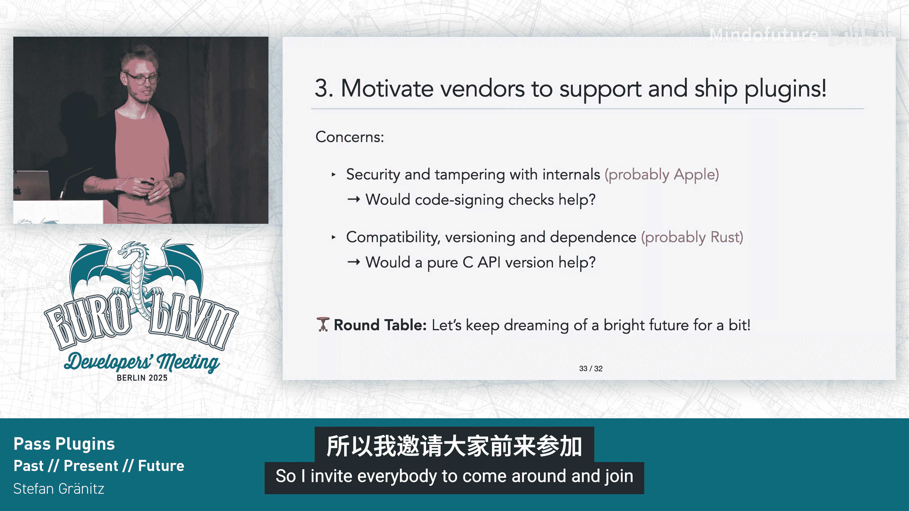

# 2025LLVM欧洲开发者大会-p17-P17-Pass-Plugins---Past,-Present-and-Future--BV1EoE9zUEbG_p17-

Hello， everyone。 My name is Stefan。 I work as a contractor and consultant here in Berlin。

And I have small and midsized companies around the world with LDM based tooling。

 We kickstar products， maintain tool chains， discuss ideas。Train employees。 And today。

 I want to talk about past plugins。 In particular， the past， the present and the future。

And I don't want to spend too much time on the first two aspects and rather focus on number 3。

 where the core question is， should we extend that concept to allow for richer out of three extensions in the future。

That will involve some questions。 And it would be great to collect your feedback and maybe also your ideas。

 So there will be a roundtable right after the talk。 If you have anything to share。

 please come around， talk to us。😊，And there will be another one tomorrow that I will be an will announce at the board。

 Another note beforehand。The plugin term is quite convoluted in LBM。

 I'm not talking about LTO plugins， and I'm not talking about clang front and plugins that work on the IST。

I talk about past plugins。And that's the ones that transform LVM I R。

 And we usually pass them as dash F pass plugin to cl。If you want to know the future。

 look at the past is the phrase that I wanted to put on this slide originally。

 but then I couldn't hold back and use the quote from fabricator。 Don't dwell in the past。

 Don't dream of the future。 Con the mind on the present moment， focus。That's a great quote。

 It's not from fabricate originally， but it's a good match for a4 or four page。

 And I'm guess I'm not the only one who remembers that。

Can we have something like that on Github as well， I。 Anyway， in the past。

 we had legacy pass plugins， and they worked with a legacy pass manager。

 and we used the dash load option to。D L opened them basically。

 And then each such plugin had a static initializer that takes the pass registry and adds its own passes。

 Polly was always the public reference implementation， I believe。 And we see here how Polly did that。

 That is。Nice and simple， but it has two downsides。

 The past registry had to be a global static instance。And plugins kind of sneaked in。

Their passes without actual cooperation with the tools。 And that causes all kinds of problems。

 So things changed with the new pass manager。Modern past plugins。How I call them here。

 We're introduced in three steps， basically on three milestones that I linked here。 And in summary。

 the most important change was that the control was inverted。 So now the tools are in control。

 and they initiate。The interaction。And furthermore， we have a example entry now。

That is the buy example， because it's called like that because it waves on each and every function that goes through the optimization pipeline and。

It shows how to implement or how to register passes with the legacy pass manager and the new pass manager。

On the plugin site in modern past plugins， we implement a defined interface like that。

 and it takes a callback with a passport reference。

And then we return an instance of thestruct from a well defined entry point that is called L VM get pass plugin info。

And we see here the implementation in the by example。

It takes the pass builder and just calls the same reches or callback functions that any entry tool would use。

On the tool side， we just enumerate the plugin。 we want to load。

 We D open them and call this function with the actual instance of the pass builder。

And that is great， because the code paths don't differ between in tree tooling and out of tree tooling。

😊，And we can use the same concept in M LIR， just with different prefix of the entry point。

 and we keep the existing。Benefits like the C interface for plugin registration and fast builds against of the M release versions。

But there is also one downside or something。That we did not improve。

 And that is that the pass base class is a C plus plus template class。

 and the pass builder is a C plus plus class as well， which means。We pull in the C plus plus A V。

 I into the static library interface。And that causes some issues。 Most。

 it makes plugin hard to build correctly。 There are so much， so many things that can break your API。

We have to admit that most pluginins use the C plus， plus A V，I， anyway。Because the C A P。

 API is often not flexible enough。But well。The the compatibility issues are there。

 and we basically need one distinct pluginin build for each compiler that we want to target on each platform in each SDK version。

And that's well， not optimal。 It's possible。 But， well。

 something we might want to think about in the future。 If we had the I R dependency alone。

 we would need one plugin per platform and LVM release。We're coming back to this， a bit later。

The tools that support our plugins are well up。 Of course， we can even select the pass to run there。

 This is great for debugging and development。 Then we can use that dash F pass plugin option for clang。

 flang and clang raple。😊，Which I wrote the blog post about last year。

And then we have support for LVM pass plugins in Swift on mainline。 Now in rust。

 there is an unstable option where we can use LVM passes， but。We have to enable this lium dot。

Plukins option in the build configuration of rust。 And this is a bit unfortunate。

 So the regular night nightlies don't support all the impulseasses。And surprisingly。

 LLD supports L VM I R passes for those that are surprised。

 This is for L LT O enabled builds where the opt pipeline runs。😊，At length time。

And it uses the new P manager， just like the compiler does。The plugins that we find in the wild are。

 well poly is in tree today。 Then there is ensom， which is an alternative plugin that works on V M I R。

And then there is the open source implementation of the O M V L L pluginin from Bill 38 that does native binary obfuscation。

But， that's about it。I know there is a few inhouse projects that use plugins， but all in all。

 it is still kind of rare。 And that makes the transition to the future where the question is。

Is it that people are not interested in extending the compiler that way。

Or as it may be the interface that is too narrow and doesn't allow for good extensions。

And here we come to the motivation part。 So the claim is there is a larger demand。

For domain specific compiler extensions， than what we see today with past plugins。

And that is probably because people find other ways to implement their needs。

To get some evidence here， I think it makes sense to look at sanitizers。

What we see here are the support it sanits in3 since release 4 in 200。In 20， in 2017。And。

It seems that the number is plateauing in the early 2020s。

And that makes total sense because sanitizers used to be tools that help us live with the inconveniences of C and C plus plus。

 like missing memory safety， undefined behavior， missing， missing threat safety， things like that。

And now that we filled all the gaps， we have all the sanitizers。 and maybe the list is complete。

 right。Kind of makes sense。 But then last year， the opposite happened。

We got three new sanitizers at it。How was that。Well， let's look at the newcomers。

 We have types in aizer now that lets us check for time based A in violations。

We can check for floating point precision issues with the numericalical stability sanitizer and for blocking calls in code with deterministic runtime requirements with the real time sanitizer。

Well， type sanitizer is kind of sish。 Yes， but the other two are clearly cross language concerns。

 And， well， this is always a point of view。 And this is only my opinion。

 But I think they are at least a lot more domain specific than the sanitizers that we had before。

And this is the observation here， More domain specific， less C， C less bus specific。

Is it it might happen that now the list is complete。 And in the next 10 years。

 we have no news sanitizers added。 But if this is not the case and more proposals come up in the future。

Is it should we， Should we keep building everything。

 all of them upstream and ship them to the whole world while just a tiny fraction of our users actually need them。

 or should we maybe come up with an alternative and support rich out of tree extensions like sanitizers with some infrastructure。

 Could we implement that with the past plug in today。Well。

 plugins used to be like narrow and do like static local transformations。

 So it doesn't seem like that。But let's see what， what do we sanitizers do。

They need a front end part where they have attributes to control where and how they apply or not apply。

 They have an IR pass that does instrumentation， adds shadow memory markers。

 calls into runtime library， things like that。 And then they have a tiny driver edition that adds the runtime library on the linkline。

Well， the instrumentation pause we can clearly do with the plugin。But what about the others。

Maybe let's see how one of the newcomers is implementing that and how we could maybe do it with the plugin。

So I chose the Real time sanitizer here because Im was in touch with the developers。

 Thank you very much for your feedback。 Realtime sanitizer developers for here。 and we。

 we we see look at the situation where we have real time sanitizer built in in compiler R T and LVM。

😊，So in Kang， they added built in attributes as well， which is blocking and non blocking。

 and they translate into the L VM versions。Sanitize real time blocking， sanitize real time。In Swift。

They created a R T San standalone Swif package。That wraps the C API API of the compiler R T header。

That is interesting。 They don't need the attributes because they have expression macros to express that marking of functions to say here to apply。

 here not。 That is an exception， things like that。 And the same is true in Ru。

 They have procedural macros to mock their functions。

 and they have a crate called R Ts and standalone。😊，They also prepare an RRC to implement it。

 built in in rust。Which I don't want to comment further here。 In my opinion。

 the modular package based sign is the perfect solution for these kinds of extensions。

So how would it be if we did not have。The real time sanitizer built in and OEM M。

Then we wouldn't have the built in attributes and clang either。 Well。

 but we could replace them with a front end plugin and cllang that is allowed to define clang attributes。

 Perfect， that could fill in the blocking nonpling attributes。Well。

 if we don't have anything built in to translate that into how could we do。

 how can we replace the LBM orten。Well， in principle， we could emit annotation attributes。

 and the I R pass would still be able to detect them。

This is something that I would like to discuss on a roundtable。

 Can we use annotations here is that a proper solution or not。

 or could we maybe even teach past plugins to define L VM attributes。

 just like clang front and plugins define。Clang attributes。 That would be the ideal solution。

 But any of the two would do， I think。 And if that is the case。

 then we could combine our pass plugin with a front end plugin in one shared library and just chip that。

This is what， for example， Clat does the Auto plugin that works on the clang A S T。

And in modern languages， I think， well。If we have language constructs that。

Define what we do in clang with attributes。 Then they could probably emit annotation attributes as well。

 Or at least we could give them an interface to do that。

What's left is how to add the runtime library on the linkline。

Maybe some of the auto linking features help that we have today in LVM already。

 That's like named media data entries that are listed here。

 LVM linker options and LVM dependent libraries。Well， yes， they are format specific。

 and they require support from the linker。 And it seems a bit abusive to just inject them from a L VMIR pass。

 But on the other hand， it doesn't seem impossible to do that。So question for the roundtable。

 Could we make that a bit more consistent， maybe。Or does anyone have an even better idea how to do that。

 That would be great， because if that was the case。

 then we could already implement sanitizer like extensions out of three。😊。

At least from a functional perspective。 And I wondered， is there nonfunctional aspects here as well。

 And for that， I。Want to have a very short look at the story of the real time sanitizer here。

 You can read the RF C on your own。 I don't need to discuss all that and。

 and look at the 150 PRs that went in3 since it landed。

The most important thing here is that it started as a hack in L VM， in a fork of LVM。

 And if you start a project as a fork of L VM， then it's very easy to imagine a future of your work to be upstreamed。

Into LVM， that is a natural evolution of your work。 Most other forks。

 most other features don't survive downstream of LVM， right。And from the developer's perspective。

 re reusing the infrastructure from other sanitizers is one of the most important reasons to go for the upstream solution inside of the M so。

These are the aspects that my proposals are tackle。 If someone。

 if someone asked me what to do to promote out of tree extensions。 and oh， yeah， I would say that。

Promote reusable provide reusable infrastructure First。

 make it a playground for users to test their ideas。 Second， And third， as a consequence。

 motivate vendors to support plugins and maybe even ship them。Looking at the first point。

 one we have today is a plugin interface with unit tests and one example in three that has a lit test。

But unfortunately， our bots don't build examples so much。 And so the lit test almost never runs。

 And so the example has issues with many configurations。Of L V M。 And also。

 vendors don't ship examples so much。 So if you want to test the plugin with an SDK。

You don't have one。 You have to build it from source。

 which is not easy because you have to match the C plus plus A VI of your compiler。

 And this is pretty complicated if you don't have a reference。So。The point or the idea here would be。

 should we maybe make a reference plugin that builds and deploys by default。

I think that would help a lot of people。And if we had such a plugin。

Maybe it had a bit more complexity than waving at functions， but more like a real world thing。

 And it could support L VM and M IR， maybe， and do something useful that people can experiment with。

 That would be great。 Maybe even consider a PR C interface。😊，And then， like。The idea is。

 why don't we make a plugin that loads the Python script。And runs that as a pass in the pipeline。

 Python is super popular。 It would be it would make for a real world extension。 We could even。

Show how to link lip pythontheally。 If we don't wantan to go with this dynamic dependency。

We have more than enough binding for LVM and MLLIR。And。

It seems to be nice because you could write IR transformations without rebuilding the plugin。

 Imagine a world where you can download your compiler from app and also install the plugin right away with it and just tinker with a Python script to try out and tinker with past transformations like that would be possible if we had that as a reference plugin。

😊，And by incident， actually， there are two open source rep posts with the proof of concept。

 and only one is from me。The first 1 I did last year is a bit of research for the O M V L L project。

 And the second one just popped up at the same time。 It's written in rust and。

I never met that person who， who wrote it， but it's a funny incident。So last but the least。呃。

We should， or we should try to to convince vendors to support and ship plugins。 And for that。

 maybe we have to take their concerns seriously。There are markets where it doesn't sound like a good idea to have arbitrary plugins flying around that tinker with your internal code。

Because they might introduce vulnerabilities， and that is a security issue， and that is fair。

So we should give vendors a way to control that and why not do that by code signing。

A plugin would only be loaded by the tool if it has a proper signing。

 And then vendors could say on our platform， we want to audit the plugins that are allowed。

 That would be totally possible and totally fair and reasonable to me。And for rust。

 which has a bit of a problem with C plus plus， we could maybe wrap the pass registration in this in the C interface and have the reference plugin as a pure C interface plugin because。

Pla in registration is C already， and。Python binding is used to see interface， as well。

So we're almost there。 And that would be an interesting addition， as well。With that。

 we're coming back to the initial fabricator quote because I think it's quite healthy to dream a bit of the futures sometimes times。

 And that's what we also want to do on roundtable。 So I invite everybody to come around and join with that。

 I would say thank you very much。 Thanks for your attention。 See you later。

 and looking forward to your questions now。😊。

So great talk。 One question， Oh not really a question。 but I could imagine for a lot of the sanits。

 you would essentially need not just pass integration into the LVM IR pipeline。

 but also for the machine I R pipeline。 Do you have any thoughts on that on where problems there might be or what would have to be done to kind of address that。

That is interesting。 Yeah， that's an interesting note because right now。

 plugins only work for IR level passes， not for machine passes。

 And that is because the new new pass manager does not expose the functions for that。

 I think we should teach the pass manager to expose functions to register machine passes as well。

 And then plugins with。😊，Do that naturally。 Like you you。

 we don't have to add anything to the interface。 We just need to let the new pass manager expose these functions。

 I think that would be a useful addition， yes。Thank you。Thank you for the talk。

 So what is the status for Windows support。Windows support is interesting。

 There is a ongoing effort to allow to build the L VM shared library on Windows。

 The problem there is that we had too many exported symbols。

 and Windows only allows like 604K or something like that。 And there was。

 there is an ongoing efforts to。Specify which symbols are exposed so that we can finally build the L L VM shared library as a D L L。

 I think this is like 75% through。 And if this is done， then we can also support plugins and windows。

You， thank you。No further questions。 Then thank you very much for attention and see you at the round table。

 hopefully。

