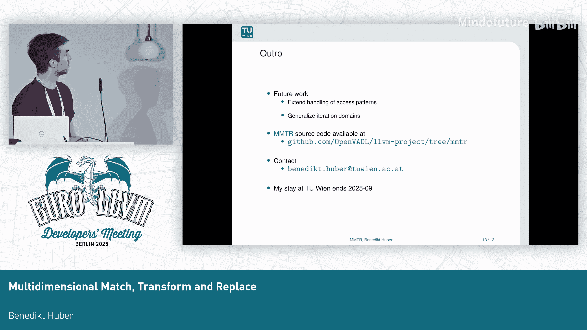

# 2025LLVM欧洲开发者大会-p18-P18-Pattern-Matching,-Transform-and-Code-Replacement-using-LLVMs-Polly-library--BV1EoE9zUEbG_p18-

Hello， I'm Benedict Tuber from Tvinen， I'm a PhD student at the Department of Comprs and Languages。

 I'm part of the Open Bar team which was presented yesterday by my colleague Kevin Peer and I will be talking about multidimensional match transform and replace or shot MMTR。

The whole thing will be about basically vectorization。

 it will be on a lower level than many of the talks we have heard on this conference。

 it's restricted to the LLBMIR。In LLBM， we already have for single dimensions， powerful tools。

 for example， the loop vectorizer or the SLP vectorizer。

The open problem is what should we do with multidimensional？Optimized target implementations。

 for example one could think of those as optimized library calls， for example。

 matrix multiplication in openB or the two dimensional dot product which we find for example in the Intel AM extension normally these are accessed by the programmer by explicit calls to those optimized target implementations。

Be it the library call or the intrinsic call。But of course this is not very portable and it's also error prone。

 so the goal of MMTR is。To identify loops that can be replaced。

 transform them in such a way that it's possible to replace them and then replace them by the optimized target implementation。

We have observed that many of those optimized target implementations are semantically equivalent to a perfectly nested loop with a dense and rectangular iteration domain。

 a constant ss size， a loop invariant iteration count。

 a small loop body with not too much control flow。These are pretty strong restrictions and one could also see them as a list of things that we have still to improve on in the MMTR。

These are suitable for analysis in the polyhedral model and also for pattern matching。

MMTR is implemented as an extension to the Poly Library。

 which is the Pohedral Library which is distributed with LLVM distribution and it's currently implemented in LLVM19 so it works in the middle end of LLVM there are two modes。

To specify dimensions， the parameterized mode where the the dimension sizes are passed as parameters to the。

Optimized target implementation， this is typically used for calls to the library functions。

 for example in open+ or fixed dimensions where the dimension sizes are restricted to a fixed value。

 this is typically seen in。Dedicated instructions which operate on for example。

 vector or let's say matrix registers which have a fixed size。

 at this conference I learned maybe the better terminology would be dynamic and static but yeah maybe we changed it later on and also we have a table gen backend which allows us to give a short description of the target implementation and from that we generate the。

Meult。Just some short words about the polyhedral model for explanation。

 it's a compact representation of control flow and memory excesses one restriction is that all the indices to arrays and control flow so the branch conditions have to be a fine functions of loop invariant values or let's say they are similar to linear functions so not too complicated。

 all the parts that can be analyzed in the polyhedral model are called static control parts。

 so all short scopes。A polyededral statement is just some piece of linear code and it's not exactly a basic block。

 but for this talk I think it's sufficient to think of it as a basic block。

 a polyedral statement instance is just one execution of such a basic block。

So that all the iteration variables have one specific value。

 an instance set is the set of all these instances。And array access is defined as a mapping from A。

From。Politral statement instance to an array index。

 and the polyheral schedule is similarly a mapping from a instance to a multidimensional point in time and with these two mappings。

In the polyhedral model， we use these two mappings to manipulate， for example， memory excesses。

 or can do some powerful loop transformations， for example， loop fision loop fusion。

 strip mining or tiling。What does MMTR need as an input， so for each optimized target implementation。

 MMTR needs an M pattern。This is the one that has to be matched。

This consists of an instruction pattern which basically matches the loop body of the looping question。

 then some information about the dimensions that have to be matched， all the memory excesses and。

Information about what we should put in place once it occurs a match。

 so this is the replacement block。In order to show how this all works。

 I will present a short example。This is just a。Typical implementation of a matrix matrix multiplication。

 so we have two input mates that are multiplied and written into one output matrix。

Note that there is also a。In theization block， this will become important a little bit later on。

 but apart from that the。The loop body is pretty straightforward what one would expect with the multiplication and the accumulation。

So how？Can we specify this M pattern for MMTR in T Gen？

Let's say we have a optimized target implementation for a vector matrix multiplication。

So we have to first specify the instruction pattern， which is just the tree pattern。

 this is produced straightforward， also with the multiplication and with the addition with the accumulation。

This maps directly to the pattern match facilities that are available in LVM。

 additionally we have to specify the excesses， so in our case we have three read axis and one write axis。

The most interesting one of those is the one to the RAB， which is the。

Matrix access so it's the access to the 2D vector 2D matrix so and then we put everything together so first we have the instruction pattern so the next thing is something new it's the information about the dimensions so in our example we have a fixed dimensions with the inner dimension with the out dimension of size6 and the inner dimension of size 4 then we list all our excesses we have defined here and in the end we just specify the call to the optimized target implementations which is just a function name and all the parameters that have to be passed。

To this optimize implementation。How does MMTR go about matching these things。

 it starts with matching the loop body， so it takes its instruction pattern。

Checks whether all the instructions in the loop body are equivalent to this pattern。

 and it also captures values that may be needed in later parts of the computation， for example。

 it could capture the pointer values that are then passed as parameters。

Then it checks the size and the shape of the instance set， in our case。

 this is yet restricted to a rectangular。😊，Rectangular shape。 and then it for each for each。

Memory access it checks whether it maps to the specified patterns。

 so for this in our case it has to project to two dimensions so to the innermost two dimensions。

 which means that this I0 just goes away and what remains is this and as we can see this more or less looks like the one that we are trying to match modular renaming。

And in the end， it gets some information about the stride size。

 which is important to access the matrix， and this is also done by。Available functionality in polyly。

 which is the array info。 So this would be the matching part。

 but we also have to do some transformations。There was this block where the initialization 20 happened。

 so this is something that we cannot measure or cannot replace with the optimized target implementation。

 so we have to move it out of the way， this we do by manipulating or manipulating the schedule tree of poly which allows us to move this basic block out of the way by using loop fiss so it went from this inner part just out of the looping question and since we have a fixed。

Dimenssion setup， we also have to do loop tiling， so again we use police functionality for loop tiling and this provides us with a prologue and the epilogue and what remains in the center is just a nested loop that is equivalent to our M pattern to our optimized target implementation。

These transformations are in general not safe so we have to check the validity of the schedule whether it's still valid。

 then if that's the case we set the replacement mark and during the emission phase of poly we just take out these nested loop。

 the nested loop and replaced it with the call to the optimized target implementation providing the captured arguments。

 we did a evaluation of this with the target implementation being open blast for this we provided for pattern。

 one matrix multiplication which is the three dimensional pattern one two dimensional pattern which is the vector matrix pattern just like the one that we have seen in the。

In the example and to one dimensional patterns， the topt product and the vector edition。

 and in polybech we managed to get seven out of the 30 benchmarks out of the suite with matches。

We have a very nice speed up for the three dimensional cases and also a good speed up in the two dimensional cases。

And the one dimensional case is about the same as the。

Normal LBM vectorizer the good results are mostly thanks to open blast and the fact that these benchmarks just are very well suited for for the open blasts implementation。

 in addition to that， we。Checked the visual Wake words benchmark from the MLP of tiny benchmark suite。

We used TBM micro to generate C code from the model file。

 and in this we managed to get four matches in hot functions which reduced the run by the runtime of the inference by 66%。

Future work will be generalizing access patterns and generalizing the size of the iteration domain or the shape of the iteration domain and also probably we have to provide a better cost model。

 the whole prototype is available at our open bottle project yes。

 and this was my talk about MMTR thank you。

We probably have time for one question。那你回去。Thanks for your talk， Michael Quiuzzer here。

 I'm current con owner of Poly， Poly audio has like matrix multiplication detection and optimization would have this potential to replace that to be detect arbitrary patterns。

I think the polymetrics detection is mainly focused on optimizing memory excesses。

 so it has a little bit of a different goal in mind。I'm not quite sure whether it。Can replace it。

 but I would have to look into it whether there's certainly some overlap Inter functionality。

 but I cannot tell whether it's。And yeah， it's replaceable by our approach。

So is an opportunity for like rewriting or match passes be done by LLM AI or like k or some or you're talking about MLR match rewriting by AIL model or' know I not thought about maybe it' possible everything done by hand basically。

Okay， thank you， thank you very much。 I one question。😊。

