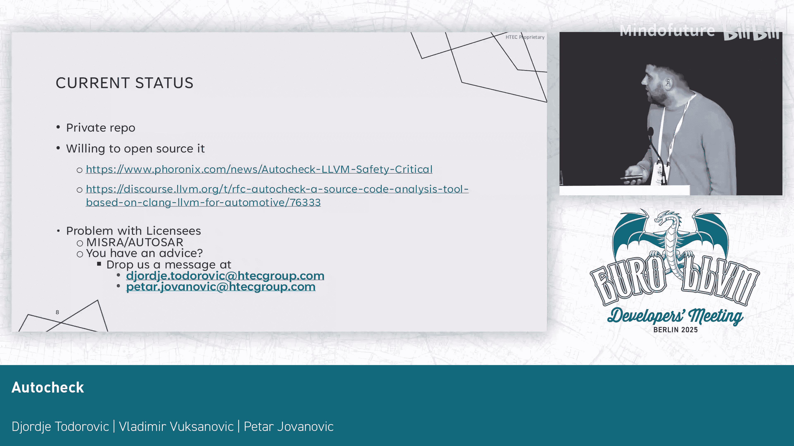
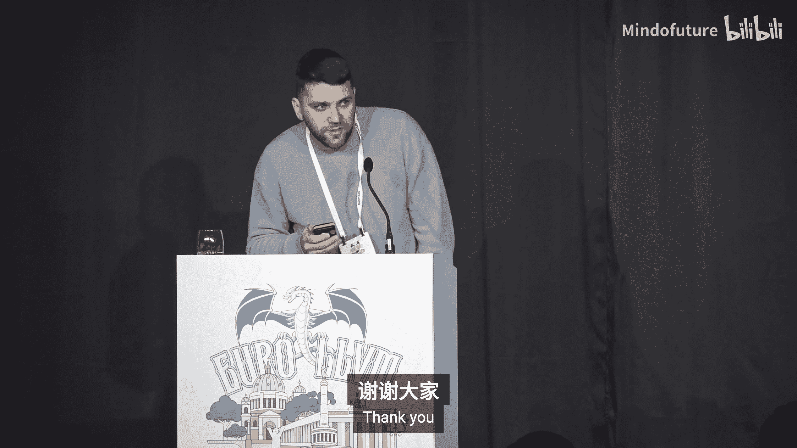

# 2025LLVM欧洲开发者大会-p19-P19-Autocheck-–-Clang-Based-Checker-for-Automotive---Status-and-Issues--BV1EoE9zUEbG_p19-

Hello， everyone。 Im George Todoge coming from Seribia， representing H T group。Today。

 I'll be talking about autoche。It's a tool for static analysis targeting Mira and Autosar coding guidelines。

 We presented it five years ago at LVM developers meeting。Yeah。

 it can be used as a CI tool or as a weis code plug。An interesting thing is that yeah。

 we even integrated the AI for some rules。 And where it makes sense。 And Ill， I'll talk about it。

So very briefly， what is Mira。 It's a set of coding guidelines for writing safe C plus plus code。

 which is very important in critical software such as the one coming from automotive industry。

So it supports several C plus standards， and our tool supports most of it。So how we implemented it。

 So basically， it's a wrapper around lip plank。 mostly。 Yeah。

 we are using it in in a similar way as clean tidy。So we， yeah。

 implemented the rules based on several front end stages。 Yeah， including preprocessor Lea。

 and some rules are implemented as AS T visitors and S T matches。

An interesting thing is that we implemented some rules at LVMIR level。

 because when it comes to writing some kind of data flow analysis。

 it really makes sense to prefer L VM IR over A S T。For example。

 there is a mis rule that puts some constraints on value range。

 for some opera or some merittic operations。 And yeah that that rule is implemented at LDM level。

 as I said， yeah， we implemented LSP， which allows us to， to easily implement support for various Is。

 not only for V S code。This is an example， as you can see it nicely reports rules violation。So， yeah。

 as I said， we integrated AI， where it makes sense。 What does it mean。

 We are using it for the cases when compiler technology cannot do too much， for example。

 static analyzer。W to suggest better layout of abstractstruct。

 And when doing the reorganization of the abstract fields， we are using AI to。

 to actually preserve the commons。And for， for that， we are using ama CP P API。So， yeah。

 this is the most important slide of the presentation。 What is the current status of， of the project。

We announced it one year ago and made it public， But unfortunately。

 we needed to make it private again because we were not sure if we were breaking licenses。 Yeah。

 legal stuff。 So definitely， we do need help。 So if someone from the audience have experience with with this or。

 or your company。 yeah。Heres my， my， email address or address with my colleague。

 So please drop us a message because we do want to open source this， so。

Yep， I guess we don't have time for demomo。Thank you。

