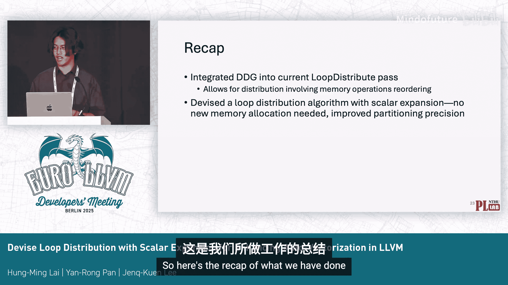
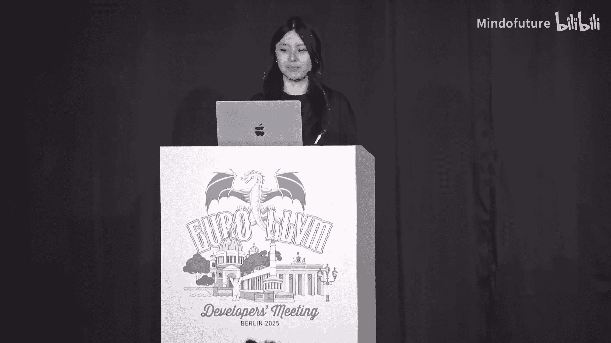
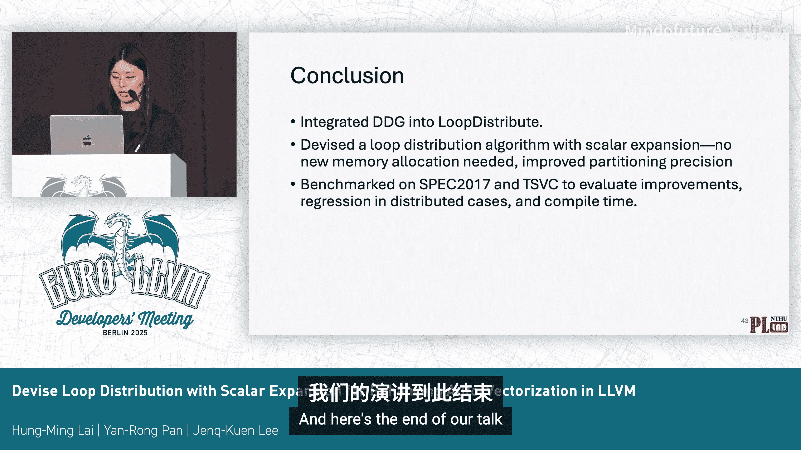
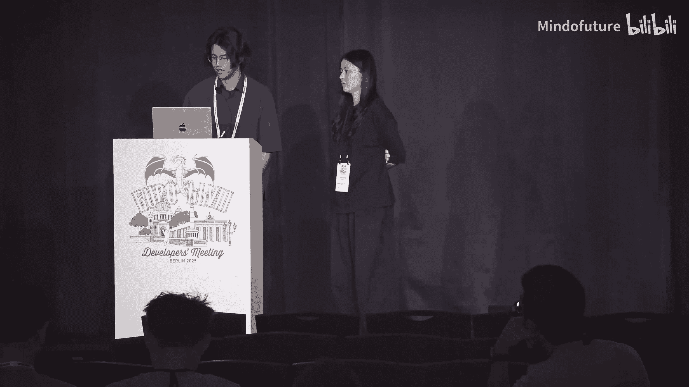
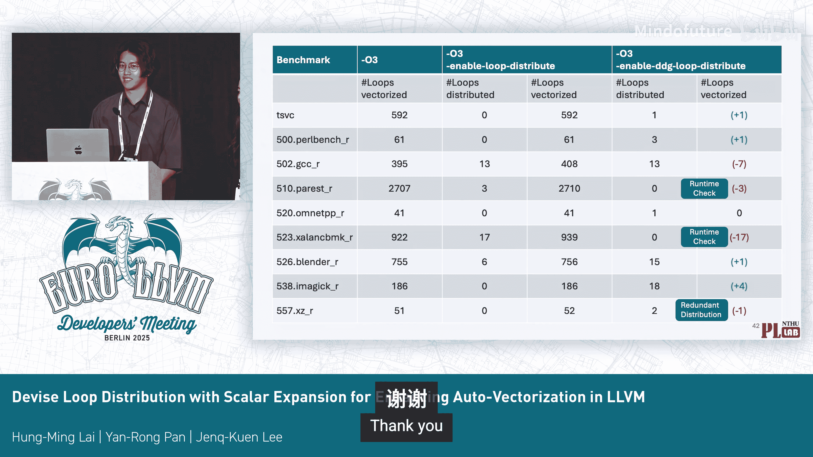
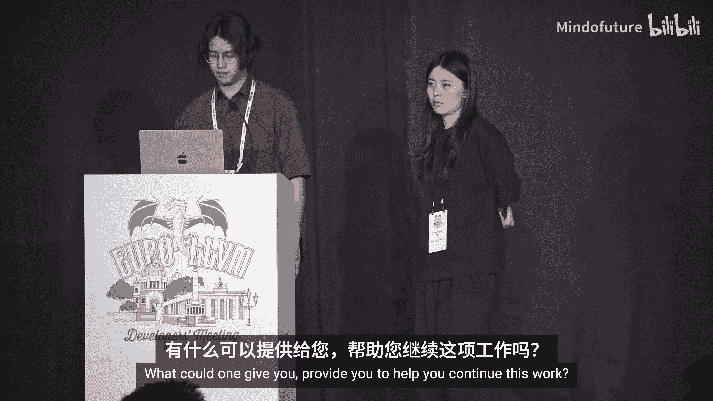
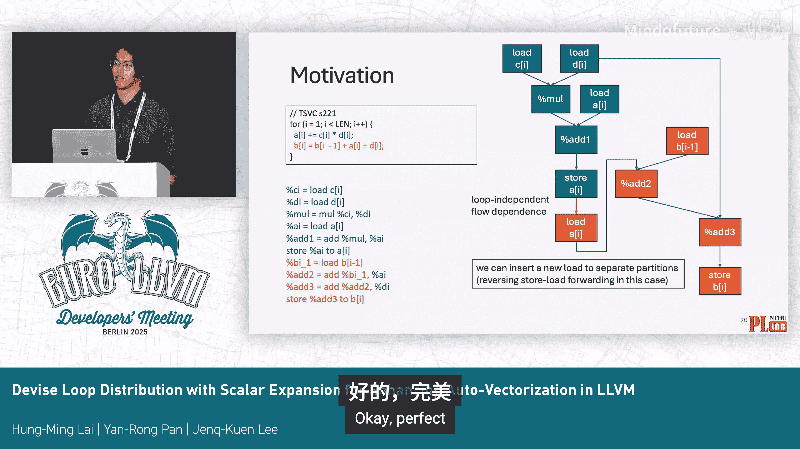

# 2025LLVM欧洲开发者大会-p20-P20-Devise-Loop-Distribution-with-Scalar-Expansion-for-Enhancing-Auto-Vectorizat--BV1EoE9zUEbG_p20-

Hi， hello， everyone。 and I'm Ho Min Lai from National Qinhua University in Taiwan。

 And today I'm going to talk about our work on new distribution for we are trying to improve the autoveization in LVM。

😊，So here's today's agenda。 First， I will set up the background and motivation for the。

 the distribution and its current limitation in L VN。 And I will talk about how our。

Proposedse method implemented in Cy of VN using the D D G and also the scale expansion we incorporated to enhance the partitioning capability。

 And then we will show our experimental results。So what is a loop distribution is a compile transformation。

 which will split a loop into multiple loops。 and with the same iteration space。

 But each loop will only parts of the original loop body， but it is not always profitable。

 So it because it did not just reschedule the computation。

 It will also replicate some of the computation。 For example， the loop header。

So how does loop distribution can enable partial loop vectorization。

 So loops with dependent cycles is now vizable， and new distribution will enable partial betterization by splitting those cycle into a separate loops。

And the current LVN do have a loop distribution pass。

 and its goals is also to enable partial liization。

 and its implementation is using a fast lightweight algorithm and does not build dependence graph and it relies only on loop S analysis。

 But this approach will have some challenge and limitation。

 major in that it cannot reorder the memory operation。

 So it's currently now added in a pass pipeline， but it's not enable by default。

 So our focus of this work is that we want to try to improve its partitioning capability using the data dependence graph and maybe future we can have a better cost model for always profitable distribution。

😊，And here I want to go through3 case study for showing what's the limitation the current distribute path face。

 So this one is taken from T SBC S 2 to1。 And in this case， what we want to show is that。

Before atization by other passes like C SE and GVN， this， this code is distributable。

 You can be separate to one statement in one loop。 But after the optimization。

 the low redundant load is eliminated， hence the partition boundary is non separable。

And this is the second case， which is the， which we are showing this。

 There's two loop with identical computation， but only the order of the B I and B one is a shuffle。

 but only one pattern can be distributed。 This is because the current new distributed pass rely on the less order of the memory operations。

And here's the circuit， which is the dependent cycle caused only by final and SSA value。

 So current distribute paths can detect the dependent cycle caused by memory operation。

 but not caused by the Phi and SSA value。 So it will not distribute this case。

 but this case is non non vectorizable。So the cause of this limitation is that we。

 it currently relies only on L A A and。And this make the reorder of memory operation unsafe。

 So only it only distribute a certain pattern， which is the。

Interdepend memory operation of placing the boundary phone by the un Sa memory operations。

 And it will also cause some merging if they are sharing the same memory operations。😊。

So there's many previous community efforts on these issues。

 like the first in the first talk of this original author or the patch。

 they also mentioned the future work of adding dependent graph based the distribution。

 and all other talk also have mentioned the moving forward to using DD G based distribution。And also。

 and it's worth noting that currently the DD G patch is already on the。L V and upstream。

But why is the D D based Lu view is still not a reality currently， So we， we find it。

 The people mostly have concern with its scalability because the to build a whole dependence graph。

 it will have a projected time complexity concern。😊，So here's our plan in our work。 this work。

 we want to try to integrate the available D analysis into the Lu this review Pass。

 and we try to cover all cases that is already handled by the current algorithm。

 and we will want to check the combat high regression by running some benchmarks。

 and for future work， we may with this analysis， we can enable more cases。

 and we can develop a better， better cost model for emerging and scheduling。So here。

 I want to quickly go through the classic textbook distribution algorithm based on dependence graph。

 So it basically it has three step。 First one is we transform source code to compute dependence graph。

 So each node is a statement。 and each age is a memory dependence age。Then we compute the LCCC。

 So each SCC statement inside the same LCCC should be placed in the same loop。

 and then the loop order should be。the same as the topological sorting order of the SCC dependence graph。

So how do we adapt this algorithm into L VN IR， The most trickest part is the first part。

 because the original algorithm， one statement is mapping into one P G node， But L VN IR。

 we cannot place rendering one instruction into a different loop。

 We need to place only in dependent instruction into the same loop。

So here's we first look at how the current DD G graph is looks like。

 So it node is using the instruction level。 So it will have single instruction node or multiple instruction node or the SCC in DD G。

 It will form a pipe block。And their age has only two kind1 is the U change。

 and the other is the memory dependent age。 It currently did not support control dependence。

 and it supports go have two ones function and one do。

 So you did not have to build all the dependence graph for the whole module。

And so move back to the first step of the algorithm。 So to adapt into L V and I R。

 we just need to find the seat instruction。 and we walk up the D U chance to get all the dependent instructions。

But， yes， but even with DD G， theres some cases is not enabled by this method because the like the case study1 we just mentioned。

 there will be low emulation that will mangle all the partition together。

 So we want to have a scalar expansion technique to solve this problem。

 So here's the motivation example。 in this example。

 we want to separate the blue instruction and the green instructions。

 But this two seed instruction have depend on the same SA value。

 So the intuition here is that we may want to reload the S a value using a low instruction。😊。

And now that， too， will become separable。So this process is similar to scalar expansion atization。

 and expansion is typically used for breaking dependence。

 and but it typically will involve new memory allocation。 So， for example， on the right hand side。

 you will see that each iteration， it will assign to a new T I location。😊。

And it will break the cycle dependence created by scalar T。

So what we want to do in the distribute pass is that we want to detect the allocation free expandable scalr。

 And the requirement here is that the store must write to a distinct address in each iteration。

 and the new load must dominate all the uses in our the partition。 So basically。

 it reverse the store load forwarding and our heuristic here is like we is that we just check the store pointer is scalr evolution comfortable。

 and we check it conform to the first requirement。 And the second one is that we use the location of store to verify the dominance because we currently insert the new load immediately after a store。

😊，So here's the recap of what we have done。 And now I'll hand over to Yanong to for experiment results。

Hi， and now I'm going to talk about the experimental results。

And our goal is to cover all cases handled by original loop distribute。

 And we will mainly focus on the number of loops distributed。

 And we will also show the result of the compile time overhead。

And here's the setup of our experiment。 We will use the Intel core CPU with L L VN 20 and compile the benchmark。

 T SVC and spec CPU 2017。And in this trial， there are three configurations。

 And the first one is V N 20 without enable loop Dis。

 And the middle one is enable the original version loop Dis。

 And the last one is D D G version loop Dis。And we can see that the numbers of loop distributed in most of the benchmark our version had outperformed the original version。

 while there are still some cases has some regressions。

And here we can see the number of loops vectorized and remain half of the benchmark and outperform the original original version。

 while the other have drops in vectorization。 Then we will explain this result later。

And here's the compile time regression。 And all the compile times are in second。

 And we can see the right most column。 It's about our DD G version Comp time。

 And we can see that there's not a lot of changes considering of the compile time and also in some benchmark。

 there show some reduction in comp time because in our D D G version。

 we are able to early exit when we found out there is no profitable loop distribution candidates。

And also in this chart， we can see at the R column。 Its about the time that DD G analysis consumes。

 And we can found out that DD G only account for a small fraction of the total low distribute。

 low distribute pass execution time。And as we can see now。

 our D version does not outperform across all benchmarks。 So to explain this result。

 we will categorize the successful distribution in to below six cases。And for the first one。

 in these kind of cases， it is able to be distributed by original version loop distribution。

 but we can see the。Partitions after distribution， all the instruction in partition1 are contained in partition 0。

 So this kind of distribution is seen to be a redundant computation。 So in our D DG version。

 we will eliminate this kind of cases to be distributed。

 and also the partition one will be possible to be vectorized。

 So this redundant distribution will also affect the numbers of loops vectorized。And here's the。

Cases of runtime check。 And in this kind of case， we have add the restricted keyword to C And D。

 So we only have to consider about the A And B was' now overlappped by others。 Well。

 in the original loop distribution， it will ignore thesals age first and try to distribute the cases。

 Well， in our D version， we are unable to provide the runtime check feature。

Cause the D D G does not provide information。 So we are unable to handle this kind of case。

And here's the case about the cases contains only dependency， which is a backward dependence。

And this kind of cases is unable to be distributed and also unable to be vectorized in the original version of loop distribution。

 But we can see the graph in the middle。This graph is the simplified D D G of the test case。

 So we can know that if we each exchange the order order of the statement to put the second statement first。

 we are able to vectorize the design of the test case without distribution。😊，And this is。

 and this kind of case， we can look at the statement， too。

 This will be optimized to the file instruction。 Well， in the original version of blue distribution。

 we are unable to know this kind of memory dependency of the file instruction。 So in our DDG version。

 this kind of final will be inserted to the pie block and we see as ancycl partition。

 So in our DDG version， we are able to distribute this kind of test case。😊，And in this test case。

 we will assume that all thes in， all the opera in the second statement will be load independently。

 So the left part is the original version In the original original version this is able to be distributed。

 and also the right part is our DD version。 We are able to identify that the second second statement is a cycle partition。

 and also is able to be distributed by our D D version。😊。

And the last cases is about what our works can do， but original version cannot。

 So we are able to use the scalealar expansion technique to enhance the loop distribution。 And also。

 we are able to duplicate we only lot， and we can see the this kind of test case。

 We have D I in both statement 1 and statement 2。 but actually。😊，In partition 0 and partition 1。

 they are identical low D I。 So in the original version， it will be merged into one partition。

 So it will fail to distribute in the original version。Well， this is the same test case。

 but is our D D G version。 If we analyze there are multiple use on a load instruction。

 we will make sure that if this load instruction does not relate to any memory dependency。

 we are able to duplicate this load。 And so we can distribute this kind of loop。😊。

And here's the summary of supportive cases of two different kind of version of distribution。

 And the upper chart is about the original version。

 The original version requires to preserve memory operation order。

 And our D T G version is the below chart。 We are able to reorder the memory operations to enhance loop distribution。

But the main limitation of our D D G version loop distribution is that we are unable to provide the。

Bron time check feature。 So this is because our D D G does not provide the alias information。

 So we are unable to do this。 and also， we are unable to handle the backward dependence only cases because currently we currently our method only。

Deal with the cases with cycle。 But if we can reorder the statement of the that I mentioned before。

 and we are able to vectorize this kind of case。😊，So here's the reason why half of the benchmark will show the drop in。

R DD G version， that's。First， see the last benchmark first。

 And this because the original distribution has a redundant distribution。 And this will。

 this will also affect the numbers of vectorized。And about the other free benchmarks。

Is because our D DJ version does not support with run check。

 So we are unable to match the performance performance with the original version distribution。

And here's the end of our talk。 Thanks for listening。

Thanks for your presentation。 It's very insightful。 And now is the Q And A session。

 Anyone have questions。😊，I the D DJ was originally driven by IBM who unfortunately shifted priorities。

 So that's why there's no use in in LM for it now。 So thank you making it useful my question is for for spec 2006 hammer。

 which was also the original motivation to even add a loop distribute parts and in LVM。

 So as far as I remember loop distribute would split it into two parts of which one could not be vectorized。

 And there was， I think the control depend in there。

 which would actually make it possible to split it in three parts did you check that hammer benchmark and and proof on that as well。

Yeah。

I think the hammer benchmark is back to22006，6。 Yeah。 So this is later。 Yeah， we later。

 you haven't tried it。Well we haven't tried it on the same yet yet。Thank you。

Yeah， any other questions。Hey， thanks for the talk。 So you had this。

You have this reload scheme where， you know， when， when you can figure out that a value can be reloaded。

 you， you know， put it in a new partition and break the partition。 What do you。

 But that that doesn't always work because the value might not be reloadable and you don't want to introduce an entire array to hold intermediate values。

 but you can recompute intermediate values。 I mean， you basically can undo the merging。But is。

 you know， duplicating the computation。 Have you looked at that。Yeah， so we are planning to like。

First version。 and we can like， maybe model it in the future in the cost model because we cannot currently like model how the recomitation cost in the original algorithm。

 So maybe after， so after our adding D D G we can moving forward to like model。

 how the different kind of coke generation is better。 Yeah， what would you need to make like a。What。

 what。What would help you to make a cost model， And， you know。An evaluation， like。

What could one give you provide you to help you， you know， continue this work。

Is there anything that is blocking you， Is there anything， you know， infrastructure you need。Oh。

 currently， maybe it just， we still have no time to like work on this cosmoto。

 But our plan is like with D G， we can look at like the new partition。

 including this area or we just just reload it。 And we can like try to compare the cost between this two version。

 but it is impossible in the original distribute algorithm。 So with D G， we hope to。

 we can move on to work on ask differently。 Do you have enough。Like， say， benchmarks or loops or。

 you know， little examples to actually， you know， validate all of this。 I mean， do you。

 do you need more loops or do you have enough。And。I think we currently have some examples yet now。

 so okay， cool。 Thank you。 Thank you。

Any other questions。If not， then let's thank them again for their great work。

