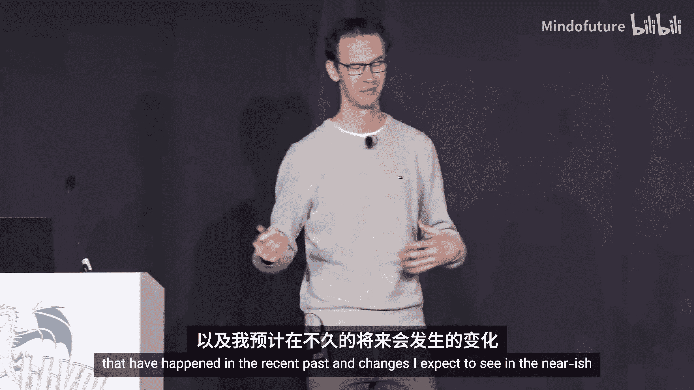
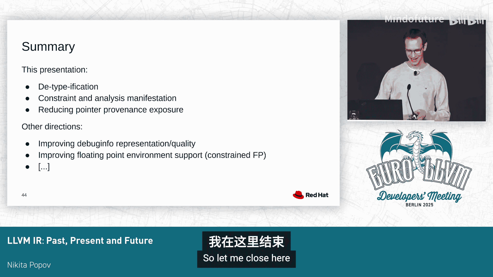
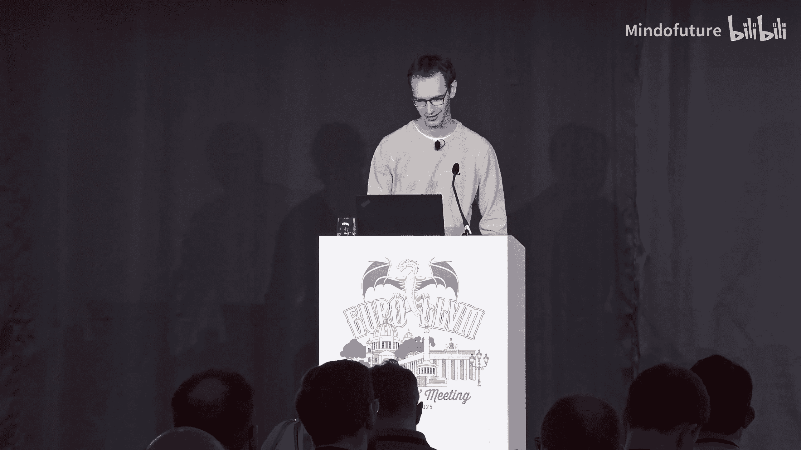

# 2025LLVM欧洲开发者大会-p21-P21-LLVM-IR----Past,-Present-and-Future--BV1EoE9zUEbG_p21-

Good morning。So I will be talking about LVMIR a bit。In particular。

 about some changes that have happened in the recent past and changes I expect to see in the。

Well， near， near East future。But to start with， I want to look at a very distant past。

 So all the way back to LV M1。0， I basically picked out a random test from the repository at that time。

 It doesn't do all that much。 It just allocate some memory stores into it and freeze it again。

 But I'm， I'm kind of curious。Who in the audience was involved with LVM project when the IR looked like this。

Okay， I see one hand here。Two more。Okay， that's， that's not a lot of people， but respect。 that's。

 that's a very long time， long before my time。I mean， this looks pretty familiar。

 It does have some unusual elements。 For example， we have this implementation begin and stuff。

 We have the C style integer types， so long and U end and things like that。

 And we also had first class men free instructions。Then over time， those things all went away。

 So in 2。0， we already have more familiar syntax， and we have the signless integer types。

Then to 7 dropped first class me free。 Instead， we have normal function calls。

And then the last change was L VM 15， the switch to OPEC pointers。And at that point。

 we have reached all of theMIR like it looks like today。

So one of the common threads here is what I would call the D typeification。

 so the removal of unnecessary type information from the IR。

The two examples here are the scientists this integer types。

 So instead of having a s and an uns type， we have a single integer type。And similarly。

 instead of having lots of different pointer types， we have a single opPEC pointer type。

And the motivation for these changes is basically always the same。

 So we avoid introducing good casts and。Well， it does not strictly enable any new optimizations。

 but it certainly guides us in a。In a more general direction。 So， for example， if you， like。

 if your signed ads and your unsigned ad are literally the same operation。

 it becomes a lot simpler to de duplicateupate them。 Like you don't have to do anything special。

 It basically comes to free。And there is also a correctness aspect here。

 because if you give people a pointer type。And you tell them。You know。

 a pointer type with an element type。 And you tell them you are not allowed to use that element type because it has no semantics。

Like， what's going to happen。 I mean， the type is right there。 So， of course。

 people are going to use it。 The only way to actually prevent that is to remove it。

So this is the past。One of the ongoing changes in the same direction is the migration from the get element pointer to the pointer add instruction。

So here we have like the way it currently works is get alone point is type based。

 So you have a base type and you have indexes into that type。

And here we have three different get element pointer instructions。

 which all do exactly the same thing， which is to add four bys to a pointer。

And the goal is to change the presentation to a single pointer an instruction that does no more and no less than add an offset to a pointer。

This is partially complete。 So we are currently using get on point I 8， if we can。

Which is basically the same as a pointer add instruction。

 What has not happened yet is doing this for variable offsets。

That case is a bit more tricky because we usually have a scaling factor。

And this scaling factor could either be represented as a dedicated shift or a multiply instruction。

Or it could be folded into the Poade itself as a like native scaling support。

 And the decision on which direction to go is kind of still outstanding。

 And this is where this particular project is stuck right now， basically。

So this is not the only place。 If we look further， for example， we have L O K instructions。

 which currently take a type。But the only thing you are allowed to use from that type is its size and alignment。

 So ideally， we would directly represent it as such。

 which also prevents people from making silly mistakes， like looking at that type。

 seeing there are four bedding bys in the middle and thinking like I can ignore those four bytes for optimization purposes。

 which is。Natural assumption to make， but also entirely wrong。

Same argument goes for various attributes like bival， Srat， and to a more limited degree。

 also for global variables。 But those are trickier because they also have initializers。

So this is one of the general directions we are going。From here。

 let me switch to a completely different topic， which is the fact that we have added a lot of new instruction flags in the last couple of OEMM versions。

 So we have things like or disjoint， zero extental negative。Or a truncet without unsign rap。

And one thing a lot of the new flags are targeting is the ability to undo canonicalization transforms。

So， for example， an or thisjoint instruction can be converted back into an ad。

 zero extent on negative into sine extent， or a same sign comparison can switch between unsigned and signed predates transparently。

So to give an example， if we， if we shift value by， by 2 B， we know the low  two B are 0。

And if we add one， we can convert that ad into an or。We do that both， like as a general principle。

 to reduce the number of different IR representations。But also。

 because ors are just simpler to analyze， they have very predictable good propagation patterns。

However， sometimes we just prefer ads instead of ors。 For example。

 if you are matching an addressing mode， if you want to form a Leah instruction on X 86。

Then like addressing modes allow you to embed a small constant offset into memory instruction。

 but they don't allow you to embed a small constant or。 So we have to undo the transform。

And in this simple example， we can just do it based on local analysis， but in more complex examples。

 having the flag allows us to do this reliably， even if the original transform used some kind of IO control flow or interprocedural analysis。

So this is like part of the motivation here。 The other part is generally for instruction flags。

 the ability to manifest analysis results and enable cooperation across passes。

 So we can have one pass that， for example， does some kind of， you know， sophisticated。😊。

Inter procedural analysis to infer the instruction flags。

And then have a second pass that just does local transforms based on the flags。And finally。

 it also enables us to convey guarantees from the front end。 So based on language semantics。😊。

In which case， these are facts that L of V M might not be capable of inferring itself。

 but which we know based on front and semantics。So this， this particular。

 like point is something I want to discuss in a bit more detail。 So this point of。

Manifesting analysis results in the I R or more generally value constraints in the I R。

 because this is。I think generally a core problem of optimizing compilers。

And something where L V M offers a lot of different mechanisms。

 even though we are not really happy with any of them。So we have attributes and metadata。

 which allow fairly precise information， like precise value ranges。

But they effectively only operate at coal or load boundaries。

Which also means they are very easily lost。 Like if you inline a call。

 the attributes on that call are lost forever。We have instruction flags。

 which are a lot less precise。 So， for example， you have the non negative flag。

 which just gives you a single bit of information inside of a full range。

And they only apply to like specific flags only apply to specific instructions。

And we have assumptions which are like the the fully general mechanism。

 So you can encode anything in an assumption， but they often also negatively impact optimization。

Because you have the assumptions on the instruction stream， and you have additional uses。

 and both of those act as optimization blockers。So， yeah。

 this is kind of remains an somewhat unsolved problem。 And our current strategy is to just you know。

 keep adding more attributes， flags and so on in the hope that things will get better。

So one thought that has crossed my mind。Is that for some of these new flags。

They don't really have anything to do with the surrounding instruction。

 They are pure statements about the value。And it really would make sense。

 more sense to not have something like a zero extent or negative instruction And instead to have a normal zero extent that has a non negative opera。

 So flags at the use site， a specific opera。Like this generalizes。

 So this would subsume a bunch of the recently added instruction flags， like the one on U I to F P。

 The same sign comparison is basically the same。And also， flag we currently don't have， like。

 we don't have a logical sub right no negative， even though it would actually be quite useful。

The generalization of that will be to have range information at specific uses or opera。Now， this is。

I mean。Nice concept。 But there are some big problems。 And generally。

 one of the biggest problems we have is that every single time， we add new instruction flags。

We get a whole bunch of numerous compilations。And the main cause of that is that there are lots of transforms that modify instructions in place。

And those modifications may not uphold the invariance of the new flags。

 which is why we generally recommend that transforms create new instructions instead of modifying existing ones。

But a lot of them don't。And， of course， we have the problem that like， there is a lot of overhead。

For storing information about individual users。Though there are some trades we can make， for example。

 if we just store the number of leading zero bits that gives us like most of the optimization benefit for a lot less cost。

But anyway， this is， this is a very speculative direction。

 I'm not really convinced whether it makes sense or not。

So let me get a bit back onto Earth and switch to the next topic。

Which is next to a lot of new instruction flags。 We also have a lot of new attributes。

With essentially the same motivation。 So， you know。

 convey front end constraints and manifest analysis results。The only one I， I。

 Im going to discuss in more detail here is the the newest one， which is the captures attribute。

So captures replaces the old。 No capture。 So no capture is captures none。

And what is new here is that captures allows you to specify which components of the pointer are potentially captured。

 and the main components are the address and the provenance。

So we can say this point of argument only captures the address of the point， but not the tro。

Or we can say it captures both， but only through the function return value。

And the key question here is， yeah， what what does that mean。

 So address is the information about the like integral value of the pointer or the pointer identity。

While provenance is the actual permission to do memory accesses through that pointer。

Because we have this notion of provenance， just because you know the address of a memory object does not mean you're actually allowed to use it。

 You have to have the corresponding provenance。This is an important distinction， for example。

 alias analysis and memory optimization in general， they， they don't care about addresses at all。

 They only care about provenance。That also means， for example， pointer comparisons。

 which only look at the address， but don't expose to problems。

 They no no longer interfere with alias analysis and memory optimization。

So the reason why I'm highlighting this topic is that it's part of a larger goal。And the。

 the broader context here is that if you look at the pointer to in instruction。

 So you're converting a pointer to an integer。And then you want to convert the integer back to a pointer。

What happens here is that the pointer to integer conversion exposes the provenance of the pointer。

And which can then be recovered when you convert the integer back to pointer。Otherwise， like。

 you wouldn't really be able to use the resulting pointer for anything useful。

 The problem here is that this technically makes pointer to end a side effect。

And this means we are not allowed to eliminate that point to intersection。We do it anyway。

 even though it causes miscomilulations。 we do it anyway， because otherwise。

 the optimization impact would just be way too high。

 And part of the problem is that L of Y M currently has no mechanism at all to give you a point your address without also exposing the provenance at the same time。

 So we need。mechanismchanism to do that。 So， for example。

 a flag on pointer to in or possibly a separate like pointer to address instruction。Which。

Ma be useful for some unrelated reasons， as well。And I'm closely related to that。

 one of the biggest contributors of pointer2 Ins in the I R is point of subtraction。

 because L VM does not have a native operation for that。 So you have to first convert to integers。

And then， subtract as integers。Which means every time you subtract pointers。

 you also expose to proven， which means to have a pointer escape。

 which means most memory optimization stops working。

So I think we should have like a dedicated point of subinstruction to mirror the pointer ad。

Which would only capture the address。And if we combine that with the like usual flags， for example。

 and see if you subtract pointers， they are required to be part of the same memory object。

So in that case， actually， the subtraction does not leak any information about the。

 about the base address of the object。So the general direction here is。Yeah。

 basically more explicitly tracking proven exposure and reducing the amount of times it happens so that we can in the future。

 hopefully address existing discomilations affecting。

 like related to pointed integer conversiongence。😊，So。This is all basically。

 just to summarize the the three topics I covered was the， like the detyification agenda。

 The second is the like， like how we manifest analysis results and constraints in the IR。

And the third one is， yeah， reducing point of provenance exposure in LVM I R and generally taking provenance more seriously with the goal to reduce。

 I mean， to， to fix miscomilations while improving optimization along the way。😊，Like。

 I should say this is， of course， by far， not everything going on in terms of IR changes。

 There are lots of other things。 For example， recent。

 really amazing work to switch Dbug info representation from intrinsics to records。

 And there are more upcoming changes to improve debug location handling。

 Then there is also an upcoming major change to how we represent constrained F P。

 So from specialized intrinsics to。😊，Upburn bundles on generic intrinsics and lots of other stuff that。

 yeah， I。I mean， I already saw the one minute mark just now， so I don't have time to cover。

So let me close here。 So thanks for your attention。 And if you have questions， I would be。

happy just始。Yeah。Hi， so I have a question about the constrained stuff。

 Would it make sense if we start or the implementing and using some generic API for invalid invalidating certain constraints。

 Because right now， like if you， for example， change an instruction place， you just。

 I think nuke all the flags most of the time just to be safe。

 like the U be implying flags on certain values。Would it make sense to start having like a generic API as in。

 oh， remove all flags that I don't know， somehow correlate with some predicate to whatever we just changed。

And then with the idea that later on， once there's like a final system for constraint tracking in the I R that this would essentially move in automatically。

I mean， we already have a lot of generic APIs。Like typical one is things like drop poison generating flags or drop。

 you be implying attributes， which you can use， depending on the situation。 I guess yeah。

 problem always is you have to actually remember to call those。

 I guess my point is instead of just dropping all flags that you knowly or whatever's more like drop all flags all flags。

 And then you provide some kind of you know， predicate it says this is what I change so that later on if we add like new flags。

 It doesn't just drop all of them like let's say know don't change the sign bit or whatever。

 And then you kind of encode this into the generic API that later on if you have a more fine grain tracking system。

 it would automatically only drop the relevant flags and not just nuke the whole thing essentially Yeah。

 I mean， generally make sense if you can。Like finding good trade off between describing the change you。

You made while keeping it kind of still generic enough to be useful。 Then I would say， yes。

 that makes sense。I don't know if that's actually possible in， in practice or not。He， thanks。はい。

So a couple of years ago， there was a talk about comparing and contrasting L VMI R to M L I R。 And。

 you know， it had some suggestions on how they could be unified。 And nothing has。

 as far as I'm aware， happened in that direction since then。Is that something that we should be。

Spending some time on， or is that， you know， best left。Lying there。 Yeah， I mean， that's。

 that's a very good question。😊，The， the thing to always kind of keep in mind is that it is。

Incredibly hard to make L VM I R changes。 Like， if you have gone through the process of doing a major I R change。

 then you， you kind of you， feel like you never want to do that again。Just because like。

 we have huge amounts of code both in LVM and outside that has to be updated。

 So like doing any kind of radical change is just very hard。

 Like there are definitely things about L V sorry， ML A R。

 I think we should consider adopting in LVM。😊，But there's always a question of， you know， how， what。

 what the cost of actually doing that is going to be。Like， I。

 I like the idea of basic block arguments instead of fine notes， but I'm scared of implementing it。

Okay， so you said every anyone that has done a change realizes how much work it is and doesn't want to do it again。

 Do you think that's a good thing or a bad thing or。嗯。Well， a kind of both。I mean， we。

 we shouldn't just be doing changes randomly because doing changes has real costs on other people。

But we should also not shy away from it。 I think like generally。

 great strength of the LVM community is that。嗯。Like changes are never rejected。

As long as someone is really willing to do the work。Often， no one is。 But if you're willing to do it。

 then like。There is like no fundamental inertia that says， no， we， we just are not going to do that。

嗯。No， but I， I definitely know that， like， for example。

 the OPEC Port migration has been painful for a lot of people。 I think that was one of the biggest。

 Yeah， yes， do you， I mean， on the， on the ML IR note of things we might want to adopt。

 Do you have any thoughts on。Hetererogeneous L MIR modules that have more than one data layout。

 more than one target triple。Yeah， that's， that's a pretty tricky question。呃。

I don't have any specific thoughts。 Like I， I would say， we already have。嗯。Something。

 quite some trouble getting the data layout into all the places it is needed。Like， for example。

 especially when it comes to constants， which kind of live。

Outside the module and as such don't have access to the data layout。嗯。Yeah， to be honest like enough。

 I， I， I can't really。 I'd have to think more about that one。Thank you。

