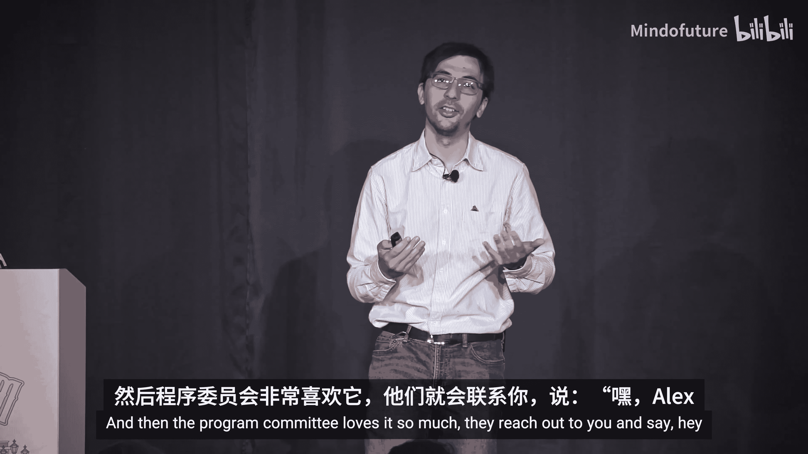
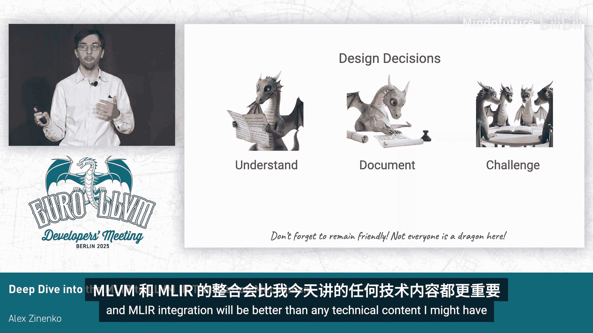
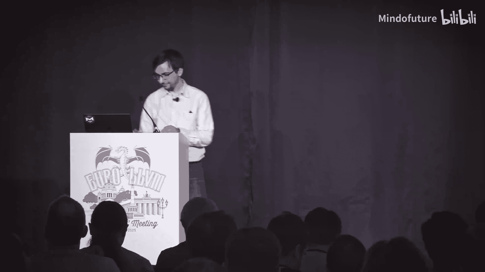

# 2025LLVM欧洲开发者大会-p22-P22-Deep-Dive-into-the-MLIR-to-LLVM-IR-Translation-Mechanism--BV1EoE9zUEbG_p22-

Good morning， everyone。 I'm Alex。 I work in a company called Bris。 It does a lot of M stuff。

 sometimes compilers， not always。 And in case you don't know how URL LVM and LVM meeting keynotes work。

 usually submit a talk。 And then the program committee loves it so much。

 there reach out to you and say， hey， Alex， how about you do a keynote instead。

 And looking at your faces understand that this deep dive into MLR to LVM。

 whatever is kind of boring talk for an opening keynote。 So I'm not going to talk exactly about that。

I am more going to tell you a story about how M L YR and LVM connect。

 how they come to be in that connection historically and what we can do in the future。

We will do a deep dive for maybe 10，15 minutes。 That's about the amount of time I was planning to talk for。

 But we're also going to talk more about keyote stuff about M O I R and gameM and what can you do with it。

So there are many ways to interpret this connection or integration。

 so certainly MLAR is part of the broader LLVM project。

 so are many other sub projectsjects or libraries in LLVM。

We can also say MLR is sort of a spiritual successor of LVM。 LVM itself。

 We can think of it as sort of static in assignment form with useful instructions and type。

 And it's really useful。 it has been around for like 20 plus years。

 And a lot of people are using it happily。 MR took it and try to generalize it sometimes over generalize it。

 if you ask me but it's SSA with regions and a way to bring your own instruction type。

 So instead of LVM having here are your additional operations Here are your floating point numbers。

 please send if you want to float in。 don't need any that you can just go and add your types to your operations。

 your attributes， etc。 It's not an introduction talk to MR。

 I'm going to assume most people are somewhat familiar with。

 So that's as much of introduction of MLR as have on my slides。😊，And finally。

 more technical parts that I originally intended to talk about is that we have a bidirectional translation between MLIR representation and LLVMIR。

It's a technical presentation。 We'll get into that。

 And it's basically a way to connect one project to another into one complete compilation form。

Before I can talk about the connection and basically to justify why the connection works the way it works。

 I need to tell you the origin story of MLR。 So ML AR was sort of created out of realization that a lot of the work these days in computer science goes into machine learning or what people call artificial intelligence。

 And back in the day in 2018， Tensorflowlow was kind of the most popular M framework。At Google。

 as well as outside。 And a team at Google was looking at and seeing， well， you know。

 if you kind of opens a Tensorflow black box， the way it works， it's， it's almost compilers。

 It's like full of tiny little cute dragons there。I I know L V M love dragons。

 So Tensorflowlow is also a compiler thing， except it was not using a proper compiler design。

 or maybe it was it It was' actually using a compiler design， just not an L VM style design。

So a team at Google led by Cr set out to fix that and provide the compile infrastructure that would support both things like LVMIR and abstractions like the ones used inside the Tensorflow ecosystem。

So it started in early 2018。It was pushed to the Tensor floor repository first and stayed there So it was pushed in April 2019 and stayed there for several months before we proposed it to the LVM Foundation to be upstreamed into the LVM project。

 It took several months to negotiate what the exact criteria。

 but it would finally merge in3 around December 2019。

 So there is some time that we spent in a small team。

 and then there is some time that we spent in a different project with slightly different contribution rules building out MR before it was contributed wholesale without additional review。

 Maybe we should have reviewed it more。One more important thing。 Yes， I。

 I left this space there to say， well， yes， it's important event I missed。 I joined in late 2018。

 I've seen most of MLR。 Many people think I've been around all the time。 I haven't。😊。

And that's what I've seen as state of the project in late 2018。Well。

 there was an IR folder with lots of things just to give you an example。 if you know in IR， you know。

 it has like operations and nothing else。 It had 7 or 8 different concepts back in the day。

It had some analysis like normal SSA dominance。 It had first class support for polyhedral。

 I come from polyhedral compilation world。 I was super happy about that。😊，It had 17 operations。

 most of which were borrowed from LLVM， well it had actually more intensesorflow。

 but the MLAR project by itself had only 17， and it had some useful transformations like canononic Eliizer。

 which is equivalent to things combined， vectorizer， some loop transforms。

Do you know what it didn't have？Any way to execute this code。 you can transform it。

 You have IR come out and you're happy。 You can not do anything with just IR others and read。

 So I sort of set out to fix that by making sure M IR connects to L VM so we can then use L VM compilers to produce binaries that we can run and understand that our transformation。

 actually make sense make program fast while keeping it correct。😊。

So that's what I did over that year， mostly in private repos， so detect detect tansorflow。

 we converted to this beautiful polyhedral representation。

 we converted to a normal control flow graph。 if you see a compiler yard it is usually control flow graph。

 well， except it didn't have branches in ML layer， so I had to add them。

Then we convert that to L VM IR。 we translate M IR to the equivalent in L VM。 Well。

 except ML IR operations kind of transparently worked on tensors。

 which is this like big multi element objects。 So we kind of had to go back from and add on tensors to a fine loops and to Cf Gs。

 And again and go back and have sort of loop in the lowering process kind of ugly。

 And then we can call， for example， or orgje if you run from tensorflow or just emit L VM IR called kang or L C。

😊，Except we had this type called member for member reference。 and it test had no APII。

 So we had to define it。So there was a lot of work and a lot of this was。

Doing what you would normally do writing an L L VM compiler。

 So you write a lot of code using the L VM IR builder to produce L VM IR before you can invoke passes and all the useful things。

And。We didn't quite want to do that because M AR， if you don't know or assume it stands for machine learning AR。

 It's， it's not。 It stands for multilevel A。And， you know。

 going from a loop directly to L V and my is what Clang does。

 There is not much multi leveling in there。 So at some point， we decided， yeah。

 we should probably do this L VM dialects。 We've been talking about dialects for months。

As sets of in operations。 So LVM dialect was one or the first it was added as sort of intermediate layer between all the other MLR instructions and the L VM IR world。

 You go to that thing。 Then you can go to LOVM。Many of these things still exist as they set up the foundation for what MLIR called base is today。

 so this polyhedral to CFG translation is now called convert SCF to CF。

 CF is control flow SS structured。CfG conversion to the LVM dialect is called convert whatever we now have like dozen dialects to LVM。

Both of which resulted in the so calledled data conversion infrastructure。

LLVM dialect to L L VM IR resulted in a thing called module translation。

There is an execution engine in MLIR that sort of abstracts the way the way the LLVM execution engine works。

 The polyhedral N LOVM together resulted in the generalization to having on the operations with regions。

 as we do right now。And L V and dialect was the first one to introduce custom type 7 in M IR。

 So you can now bring custom types。 So if you use ML IR， you recognize these things。

 These things are still there。 A lot of the code we sort of wrote in late 2018，2019 is still there。

 It's probably one of the heaviest exercise code in M IR。

 And we are kind of in this situation that I borrowed。

 So all of the M IR and M L infrastructure built on it is somehow relying on the code。

 a couple of junior Asian engineers wrote。😊，As essentially Ho project， I'll tell you a secret。

 I was never on the official MLR team。 I was a random researcher in Google Bra。

 and I applied compilers was a cool thing went on。 So my story started contributing。😊。

And now I'm sort of unofficial maintainer of the thing。So just to give you。

 slight more amount of details on the LLVM dialect。

 the design objective of that was to mirror LLVM IR as closely as possible inside MLIR abstractions。

And as a result of that， the translation from the L O VM dialect to L VM IR should have been as straightforward as possible。

Some examples， if you have an operation in L L VM， which is on the right。

 in a malarial have the same just with prefix with L VM dot sets a dialect。

 and it will have a slightly different syn。 But basically， if you know one。

 you can read the ad pretty much easily。Same for clothes。Then interesting stuff starts。

 at some point， Emilyar sort of thought， well， you know。

 we have some people who have been working on LVM for many years。

 and we kind of think there are some design mistakes。 Maybe not but sub design in LMR。

 So how about we fix that。 One of that was fine notes。

 F notess are greater canonical way of representing data flow alone control flow edges in SA Fors。

 But there is a better race。 There is a way that's called functional where you can have basic blocks with arguments。

 That's whatar has。Except that when you have these。

 you can actually branch to the same block with different values。

 which you cannot do in a canonical SS A form with final。 So translation gets a bit ugly。

 Now that one conditional branch requires to create a new block。

 And another saying we can highlight in MR。 we really cared about multireading the compilers。

 So things like going into a global context or a global register of things were considered bad。 So。

 for example， we have constants as operations in the IR and not a special class of value。

 We generally wanted to generalize。 So we don't have a special class of value for anything just value。

 So basic blocks are not values。And we also generalized metadata to what we call attributes。

 It's a sort of structured， well defined， verified metadata on each operation。 So， for example。

 a no in line metadata can be on function。 and we have verification rules that says。

 well this metadata is existing or not。 But you cannot say no in line equals 42。

 It just doesn't make sense。So now we generalize that to having functions as operations。

 not first class entities。 But what we needed to do is sort of mirror L VM IR into M IR and be as close as possible。

 And then translation is simple。 We don't want to write yet another huge L VM IR emit。

And that the translation is really simple。 It's in pseudopyython here。

 but it's really mostly English。 So for each function。For it， we first translate signature。

 and then for each global， we kind of do the same。 And then we do the same for certain kinds of metadata。

 We understand the attributes。 And then for each function， for each block in that function。

 we are going to just create a new block， convert all operations except for the termminator and then connect the termmininators using the final in。

 It's really straightforward。 Like if you understand both projects as how you will write it。

 It was really maybe 200 lines of code， but initially contribute。That was good。

 so we could take MLIR in almost any form， translate it to lots and lots of MLVMIR feeds that to Kang or LC or whatever it takes LVN can use。

 and then run it。 We can run it execute and then leave happily ever after it's a story about dragonness。

Until we sort of realize these things exist， They are called GPSs and people really like them。

 especially in the AI world。 They want to run stuff on them。 And not only is that specific one。

 but that， Z。 And there are some things called accelerators and T PUs。

 And we have to support them somehow。So。The way LVM deals with it is LVM has platform specific intrinsics。

 and we thought it was an error to separate instructions from intrinsicns。

 So we decided to push into dialect idea。 And now we have a dialect that's specific for NviDdia GPSUs and another one thats specific for AM D GPSus。

 And all of those are sort of borrowing intrinsic， which themselves are borrowing from the IA of the corresponding hardware。

 And we have many of this。 I didn't do the stats。 I only counted operations in the biggest ones。

 So A M D and Nvidia GPU by themselves contribute 300 operations that we need to handle。

CPUus are slightly more reasonable。 Theres like 50 in the two dialects I looked at。 there's more。

 like if you look at all of them， there's probably 1000。

 if not more operations that we need to reason about and translate。

So we looked at this and like I don't really want to write a 10，000 or 20。

000 lines of code file with a huge switch that says， oh。

 if I see an andV the intrinsic amid this intrinsic instead。

And by the time we had this glorious feature of MLR called interfaces。

 If you don't know what interfaces are， but do know object oriented programming。

 then you know what interfaces are in MR。 Theyre exactly what their name suggests in object oriented programming。

😊，Itch means you can say in the Malayar hay operation， are you translatable to L VM， If so。

 please translate yourself。 And that's how it works this way。This interface。

 I'm going to show you a bit of code。 And trust me。

 I am going to get back to cute dragons after that。It's really what I said it is。

 So it's a way for well， a dialect in this case to tell how to convert operations from the LVM dialect or actually any other dialect in MIR to LVMIR。

 It takes an operation。 It takes an LVM IR builder if you ever wrote code using LVMIR。

 You probably know that object， and it has a model translation。

 which is basically a way to store information between different implicationss of this interface。

It has another thing called amend operation， comes from this realization with GPUs that a lot of them are using sort of weirdered metadata。

And it might belong to a dialg that's different。 We have an LVM operation with an NVVM。

 which is Nvidia stuff annotation on it saying， oh， here it's a kernel。

 Or I know that this operation is the one producing your thread index。

 So it never exceeds 1024 or something like that。 So sometimes we need to amend an operation after we translated based on a different interface。

That's pretty much it。 That's all you need to do if you want to support a new dialect in the LDM translation。

 You basically need to implement that interface on your dialect。 That's it。 There are two functions。

3， Actually， I'll show you a third one。 but that's pretty much all you have to do in the work。

So it takes an operation。 It takes what's it。 a set of instructions that reproduce。

 and then you can modify them。 There is the same set of mappings between that we can use。

The is last one， convert parametermeter utterer that's like metadata on function arguments。

 It's a bit special。 We will look into that and also doesn't make a lot of sense to have it。

 but we do。😊，So now we could take M IR， convert it to lots and lots of L O V M IR。

 feed it into clk and run it on a GPU。 We looked at that and we decided， yeah。

 we could leave happily ever after。😊，Until we realize that open and P is the same。

 and our first major adopter in L VM upstream was the Fort compiler flk。 And apparently， they really。

 really care about Open and P in the For world。😊，And also。

 some people working in our team were into these polyhedral compils。

 They also like open N P and sort of automatic polarization。 So if we looked into that。 And， yeah。

 well MR likes dialects。 Everything is a dialect。 We can have an open N P dialect。😊。

Except that when we want to translate the to LVM， it becomes ugly。

If you haven't seen open MP inside the LVM。 Well， that's kind of location information。

 we can ignore it。 Don't really ignore it in your code。 It's useful。

 But for the sake of the presentation， you don't have to。 What open MP does。

 it has a runtime library。 And then does's lots of calls to that runtime library。

 So your code that comes from the left is actually getting outlined it to a function that's getting called by the runtime function。

It's nice design。 It's a bit ugly to handle when you write a compiler because for MLAR。

 you have to think about regions outlining globals。

 you have to know how the MLAR runtime library works。Luckily for us。

 there was this thing called open MP I R builder。 It's now called Open MP frontronend that has like 22 K lines of code。

 And we didn't really want to rewrite that。 So we decided， how about we reuse that。

So we modified our module translation object to just return an instance of an open and PIR builder。

And call it。 We also had to expose the possibility to convert individual blocks before。

 you know L VM has functions and functions have blocks in them how hard can it be。 Now， suddenly。

 in the model we have， we need to convert it differently for L for open MP P blocks。

 and we do for normal dialg blocks。And we also needed to reconnect final after that。

 because there's a difference we've seen。And because open N is this nested thing。 And so is MR。

 there are boss modeled in this nested way。 so we can have nested loops。 Well， it's normal。

 we can also have nested parallel construct。 If you write open N code in any language you can have pragma open MP parallel inside other parallel。

 We can have multiple work shares and we just mirrors them in MR with this infinitely nesting region structure。

 So we sort of had to add a stack object to translation。 So we have a virtual stack。

 the translation code can use。 So we have stack frames。 If you seen LVM code。

 it roughly follows what LVM does with this CtP patterns。

 So there is a stack frame The thing you can derive。 So， for example。

 we have an open N loop information stack frame in which we can put any information that the open MP builder needs to build loops。

It's just code。 It's reasonably well documented， so。If we did that。

 we could run this translation using the infrastructure we built， converting Open& to MLR。

I think it's probably the last code slide I haven't。 I'm not sure I'm trying to get through the code。

In that module translation object， we have a way to save the state of translation to push it onto a stack。

 and then we can walk that stack， looking specifically for a certain kind of the operations。

 So if you remember the slide， we can mix multiple kinds of regions。

 each of which can have its own kind of stack frame。

 And then we might only want to walk through loop stack frames。

 or because MLR allows you to mix dialects。 You could have open and regions mixed with， I don't know。

 normal loops， mixed with labda functions mixed with something else。

 And you probably don't want to reason about stack frames from the dialect。 you're not a part of。

So with that， we could take M IR。 We could translate it to lots and lots of L VM IR。

 We could run it through Klan with Libo point P and run it on multiple CPUs。

 And we were happy and decided we could live happily ever after。😊，Yeah。

 you see where I'm going with this。 There' a thing called open ACC that didn't even have a logo I could use。

 So I just put some text。 and we looked at that。And they actually didn't have to do anything。

 It was supported by the functionality weve had edit already。And we are happy。

So just to summarize the technical part of it about translation。

 if you want to go to the L VM IR from any MLR dialect。

 what you have to do is implement this little interface called L VM translation， dialect interface。

 It's very consistent。 You translate to L VM。 It's a dialect。 You have an interface。

Any implementation in this can use an object called module translation。

 That object contains the intermediate mapping。 So if you go from MLR value to L VM value。

 you can ask also the other way around if you go from MLR function to L VM function， you can ask。

 that's where it's all stored。 also gives you some possibility to translate individual blocks， types。

 attributes and so on， you can trigger translation recursively。

 because MLR itself has recursive structure。And one thing you cannot do。

 you cannot have custom types。 Well， that's kind a design choice because LDM IR itself has a fixed type system。

 MDR does not， but it does not make sense to also build a type conversion infrastructure for that。

That's pretty much a technical deep dive。Now， we can step back and reflect a bit。

 So we have this code。 It's really simple。 Is it general enough。Well， in MLR。

 everything is an operation， we can convert operations， so it kind of is。Another question is。

 why do these things exist， Why do we translate global separately and functions separately In L VM America makes sense。

 Globals are its own thing。 Functions are their own thing。 In thelayar， they are all operations。

 Why can't my translate operation handle that。Same here in the interface。

 I talked about this convert parametermeter utterer。

 why cannot we just use the amend operation on the function operation？It's a good question。

So I started digging into that， and I found this old commit of mind that introduces this convert functions logic and the entire flow。

 It's not huge。 The date you see on the slide is actually wrong。

 It's the date when all the commits that we had internally were pushed into the Tensorflow repo。

 somehow it split between March 29 and March 30， but all of those happened before it's like likely December。

 November 2018。 And it says lowest color parts of CG functions to L IR。

 just to give you an idea how all of it is。 Does somebody in the audience know what a CG function in M AR is or has seen the distinction between CG and M functions。

No。Meaning even the justification that I wrote and it， I cut it short。

 that justification is a third of what's actually written in the command description makes no sense anymore unless you have historic context for how everybody are evolved。

So this added these convert functions， which made sense at the time。

And then this commit five years later was adding support for something called grid constant by a person from Nvidia because they needed it。

 And they decided to add this convert parametermeter attribute because functions have parameters。

 And you can put attributes on them。 That's kind of metada。

 we really want to convert when we go to Nvidia。And， yes。

 that person actually checked that their first and only commit to N L VM。

 They could not have known this thing I know about C G functions and why this logic with convert function and loop exists。

You know who should have known probably a senior person reviewing and approving that patch。

As you can see， it was me， and I proved it because I forgot about it in the spirit of the moment。

I thought about this presentation and was preparing for this being a keynote。 I thought， well。

 I am going to show you a proof that a lot of the code in L VM dialect and in translation between Emer and L VM is old。

 and we should revisit it。 So I did some stats。 And the code is not actually old。

 Most of the code was touched last year or two years ago， and we are on track to touch it more。

It's a naive way of looking at it。 I tried several less na ways。 so I looked at commits。

 I tried to filter out the NFC functional commits。 I tried to filter out documentation and type of fixes。

 and all of those were still showing that most of the code in the translation is relatively new。

What isn't is the design。So what I want to say here is a lot of design decisions in M AR。

 especially parts that were added early in the project。

May have made some sense at the time when we made the decisions and may not have made sense anymore。

Yet we keep adhering to those decisions。 We keep using the convert function。

 We have a function called translate module to L V M IR。You know why。

 Because module was a separate thing。 And we want to translate a module。 We also have the inverse。

 They have translate L VM IR to module， which like why it's calls that way just for symmetry。

And that is not any observation。 It's not specific about M IR or L VM or any programming community。

There is this story on the Internet called theman kiloadral experiment。

 The story pretends it's based on science。 I have actually found no evidence that there was an actual experiment conducted like that。

 And by a description。 It doesn't look like a scientific experiment。 I went even further。

 I found a friend of a friend of a friend who is an experimental psychologist。In their training。

 they actually work as monkeys。 And she told me there is no such thing as a monkey ladder experiment。

 But I think it's a useful metaphor。If you don't know the experiment is allegedly going as such。

 five monkeys are being put into a room， They are being fed and taken care of。

 and everybody lis to them。 And in the rooms， there is a la。 And on top of ladder， there are bananas。

 And some point， one of the monkeys will try to climb s laer， grabs the bananas。 And if it does。

 it triggers a cold shower。 So everybody gets shortless cold water。At some point。

 monkeys realize that， you know， we are good here。 We have food。 Who cares about those banana。

 Let's just not climb to avoid getting dosed with cold water。

And then one of the monkeys get replaced with a new monkey。

And the remaining monkeys will prevent the new monkey from climbing up the ladder because they don't want to be showered with cold water。

 The process continues until all of the monkeys are replaced。 So at some point。

 none of the monkeys have experienced the cold water。

 but they all somehow know not to climb the ladder to get the bananas。

That shows what one may call tradition or institutional knowledge。

 There are actually papers on a similar thing called the cargoult。

 And there's a lot of that in some of the early Maar design。

So I think we should not be like those monkeys。 We should not be just people who follow whatever is established because they've established without trying to understand。

So， I would like everyone。In MR and in the broader Vimen。

 generally in the broader software ecosystem， to take maybe 5% more time to try to understand the rationale behind certain design decisions。

 Maybe there was not even a conscious decision made。

 but it was something that was easier to do at the time。And really does not take a lot of time。

 Do a get blame。 Do a good log。 I made those slides in maybe five minutes。

 I spent much more time going through the code and doing code reviews。 You can check forums。

 You can check mailing lists。 You can ask around。You can probably find a person who was around when the decision was made and can give you some historic context。

And one thing that's important， I've seen this too much time， but assume good intention。

If you don't know， assume people actually knew what they were doing and don't come and say， oh。

 you know， it's all wrong。 We should fix everything。It's an easy one。 If you want a harder one。

 you know， we should probably document design decisions better。 stands for MLIR stands for LVM。

 pretty much everything。We have a great community， great tooling。 We post RF Cs。

 I love RF discussions。 I know some people hate them， especially around them they are。

 They tend to get long。 Sometimes we get like several hundreds of commons that you need to get through to understand what's going on。

😊，What we don't usually get is some sort of summary。

 So to understand why a certain design was adopted。

 you need to read through pages and pages and pages of great technical argument。

But it's unclear in the end what decision was made and why。

 So how about we write that it also will take you 10 minutes as the patch also sort to say， well。

 the discussion references kind of summarize the discussion and say， well， we decide it。

Maybe you should also consider putting accepted RF Cs into Git or have some sort of single persistency。

 Forms are great。 Sometimes it's hard to jump between forms， old mailing lists。

 commit information documentation。Mlayar used to have this rationale document。

 It was last really updated in 2020。 We should fix that。And then a harder one。

 Sometimes we need to challenge legacy design decisions that no longer makes sense。First， again。

 I'll repeat that we must acknowledge that this decision most likely made sense when it was made。

 But then we can think that， maybe it doesn't anymore。 propose a better one。I also understand。

 and I seed， I don't really see theres like light in my eyes。 But I know some people。

 especially in the industry， are not very happy with how LDM and MR tends to change sort of fast over time。

But it's part of the evolution。 We should not confuse the stability aspect of L VM for immobil。

 We want to be able to change。 We want to be able to improve。

 We want to be able to learn and use those learnings in our projects。To mitigate that。

 we can devise a clear migration strategy， There are several good efforts。

 I think I don't remember how many years it took to introduce opaque pointers。 But in the end。

 we managed to have opaque pointers in L VM。It's a good design decision。

 And there were lots of discussions and some tools to help migrate all of the infrastructure。

 the test and so on from the old representation to the new one。 We can think about it。

 We shouldn't be stopped from revising design decisions that we think no longer makes sense。

And it might be easy for me to stand here and ask every single one of you to do extra work。

 So I'll start with myself。This is me。 Yeah， if you don't recognize me from my picture on maybe this will help。

是。I do a lot of forum communication and chats and what not。

 And I think it's my second most common phrase in M AR discourse。

 If you want to translate to L V M IR from M LR， you must go through the L V M IR dialect。

 and we must keep the translation simple。And I was thinking about this。 And I say this a lot。

 And some people are not really happy about me saying that。 And they actually。Makes sense there。

 So the simplicity of the translation is the corollary of the original design goal for the L VM dialect to reflect L VM IR。

 a corollary。 It should translation should be simple。

 except that now we are not only translating the L VM dialect。

 We are translating like a dozen of related dialect， some of which are modeling ins。

 some of which are modeling a completely different programming model like open N P or open ACC。😊。

We have a technical translation system which uses like recursive blocks and this stack and so on and interfaces and dynamic dispatching and lots of stuff。

 Is it really simple anymore。So maybe we should rephrase that and say dialect to L VM IR translation should be pay only for what you use。

 And， yes， that means we should remove the dependency on leave open MP P frontend or make it optional。

So。Going back from that to the overall MLia design， Maybe there is a new coron to make。

 We might need a new dialect if we are going to do something with it。

 just introducing a dialect for the sake of it being a dialect。While。

 it was great for pushing MLR forward。Today， do we want to add to the complexity of the thing。Yeah。

 maybe not。So when thinking about this， one way I think about this is to think about transformations。

 Are we going to do something with this IR， And then we can do a trade of imbalance。

So we know from a keynote， I think two years ago by Me and Jeff that M IR manipulation is on average 3。

 four times slower than that that of L VM IR and adding more dialects to M IR and increases the cost for everyone。

 There is compile time cost of those there is also some runtime code because sometimes you need to go through all of the operations。

 all the types you have。And then there is the cognitive cost。

Orienting yourself in the MLR infrastructure is hard。

 I used to do this big graph you might have seen on slides before on how dialects in MLR relate。

 I stopped because I cannot keep track anymore。 Theres like 50 dialects that we have。

So adding more dialects is costly。 However， if you have dialects。

 you have explicit operations that are like normal instructions。 You can reason about that。

 You can query them。 You can transform them。 It's arguably a better API isnt just transformings。

Transforms and analysis in MLR。 most of them are designed to work through interfaces。

 So when you add a new dialect， you can say， well， I have an operation。

 It does not have side effects。 It does not have something else。 It's specable。 So， you know。

 your common sub expression emination will just work out of the box by writing two lines。

 You don't have to change the past。 don't have to change analysis。

One thing that we were really proud of when we designed Himalar is MLar context and the general ecosystem supports multistring in the compiler in general。

😊，So MLAR context object is Stra。And it means we can sort of offset that 3。

4 x slower manipulation by this manipulation being concurrent。

 So there is something things there that we can trade off for simplicity。

We used to push for more dialects as sort of forcing factor for MR development。 It's been six years。

 I think it's enough of forcing MR development。We can stop adding dialogue just because we think it's a good contribution。

 We need to add them because we can add something useful to the broader ecosystem to downstream projects to other projects like Kang or Fan。

So before adding a new dialect， especially dialect translatable to L VM IR。

 we might wait whether it is worse to add the dialect or not。 If not， then it's perfectly fine。

 And I know I said the opposite many times。 But now I think it's perfectly fine to take whatever dialect you have。

 if that's where you stop your transformations。 You can take that and go to L VM IR using the infrastructure we already have。

One controversial thing I'll say from the stage just because I can as well。

 we have this arimetic dialect and mass dialect and several others。

 They are basically a carbon copy of L VM AR， except they also support arithmetic contenders。

Maybe by this criterion， we should get rid of those。

 Maybe we should just have an L VM dialect and use it or have an is dialect and not have an LM dialect。

 I don't know。 Some， please start an R C。So I might have veered off topic a bit。I'll conclude this。

Where I started， Mpalayar is a part of a broader L V M project， along with many other good projects。

I think in MLR in L V M， we should be more aware of our design decisions。

 We need to take effort to understand them。 We need to take even better effort to document them。

Actually， part of the reason why I'm standing here is I realize I have not documented a lot of the decisions I have made。

 So Im trying to fix it by coming here and presenting them and have guys in the back record me doing so。

 So the this record。And then some of the decisions can and have to be challenged。

I showed the way it's for the others to do， but please remain friendly。

 We don't want a discussion that goes into a shouty match。 We can challenge decisions。

 but just assume that everybody who made the decisions had thought about it。 By doing so。

 I think the L V M and MR integration will be better than any technical content I might have presented today。

Thank you。Any questions？there are mics I think you can come to the mics。Hi。

 so is it true that every conversion between from one I R。

 from one dialect into another dialect causes a performance penalty。 And if that's true。

 what's your estimate。Performance penalty in compile time or run time in runtime， execution time。

I don't think it does。 I think it's the opposite。So there are two things。

 There is conversion between dialects。 and generally the idea of conversions。

 There are not an optimizations。 They are just going from one abstraction to another。

 But going to another abstractstruction is a way to enable certain transformations。 For example。

 you go from structured loops to control flow and then you can do C of G simplification of that that creates a CG that's not reducable to loops。

 for example。So normally， the conversion itself should be roughly nothing like a knob in terms of runtime。

And then you can do further optimizations。 If you can't， then you should probably not convert。

I have a question about RF Cs specifically， you know， looking back in an RF。

 which is a discourse thread with hundreds of of comments。Can be time consuming and frustrating。

Is there any interest in the community in formalizing the RFC process and making it kind of a first class citizen that gets。

 you know， an RFC has， you know， undergoes review and gets committed just like code does？Yes。

 so I'm not speaking for the community。 There are some discussions in the newly formed LVM project Council on like we have started thinking about that。

 We not know what the answer is。 And they think it's great to have a process to give some structure。

 but they also don't want to put unnecessary friction in that。

 I know a lot of people complained about RFs taking a long time。

 So there there is a balance to be found， but I would say there is a general interest in somehow structuring these discussions and making sure we keep track of them。

 for for example， for the LVM project， we now commit accepted RFs on specifically governance into a Gric。

 We might eventually do the same for LVM， but it's a discussion to be had as an RF。😊，给， thank you。

Hey， Alex the numbers that you spoke about on the gitlog。

 the increasing of the changes on the translation side。

 do they include only from MLR to the LLBM side or the other import side as well。 Yeah， only export。

 Okay， import import is newer。Okay， so。Thanks， thanks， Alice。

 I think this is a good time because once more and more code base builds on assumptions。

 and then it's harder to change because the amount of change that would be required be enormous。

 And even if you have a better design in mind， it would be hard。 I mean。

 people have limited time stuff。😊，The second part question really I had was like。

 we could draw some in like parallelils with albumbium， which has a longer history and。

In your opinion， like， you know， okay， how much of that LVM design changed  five years。

7 years into LVM。Probably album was so well designed that there was no need for change。 Yeah， of。

 of course， it's perfect。 It's been perfect since day one。

 except that we keep adding operations and keep changing the type system。So some。

 some design decisions can be revised and should be revised later。

 And sometimes new things come out after the initial design。

 I have not looked at LVM evolution in the first five years of L VM。

 I was not I was probably in school at the time。 if somebody here knows the answer。 I mean。

 one thing I can think of is like maybe the scalable vector part， which much later on for this， we。

And， and there were optimizes like， you know， somebody down the road。

Made the opt the mid optimizers better。 But those are really like add on。

 They don't really change fundamentally the intrinsic design， the architecture。 Yeah， I。

 I generally think of L V M and Ma are sort of these deep stack systems。

 And there are some things that are very core to the systems that are extremely hard to change。 like。

 should we replace SSA with something else。Maybe at some point， we'll have a good argument。

 but it is going to be extremely difficult to do so。

 And there are some things that are easier to change， like adding a new type。

 like adding new floating point types is the recent edition or scalable vectors。

 So there are some things that are very fundamental to the design。

 And there are some other things that might be easier to change。

 and we should weight the complexity of the change and the cost for other projects in the ecosystem against the benefit of the change。

Thank。Okay， thank you。Which your hunters goes first。I'll start。

 Another one thing that scares some new players away from M A R is this sort of。

Extreme diversity of the dialects and the volatility of them that they change all the time。

 New added。嗯。There's sort of no concept of a standard set of dialects。

 And I think that has also been discussed a few times。 And as far as I understand。

 we don't want that。 But can you sort of comment on the。

The balance between having some concept of a stable standard as's maybe even versioned versus as Jeff Ne phrases said。

 embracing the chaos。Yes， so， just for a historical context， used to have a standard dialect。

 And well I removed it because I didn't want to sit on the Standard committee。

But no the real reason is it was very high stakes discussion to add something to the standard dial because it's the standard。

So I think what we should do is better document this state of a dialect。 So when you start something。

 you can document， well， I just started。 It's gonna take me some time to figure it out correctly。

 Please come and contribute。 It's one extreme。 Another extreme is like L VM LVM is very stable or as stable as L VM Ir。

 So please don't change this unless you have a really， really good reason。

 which means L VM IR changed。 And there is a spectrum in between。

 And the problem is we just don't know where each of the dialect lies on that spectrum。

 And that's a matter of documentation。 It's easy to fix。 Like。

 let's open laptops and fix it right now。I think it's the last question。 thanks for the talk。

 First of all。 was， It was great。 So to， to follow up on on an earlier question is like。

YouYou gave a talk about M IR to L O V MIR translation， like a deep dive into this。

 What parts do you think L of VMIR should adopt from MIR to maybe make that translation easier or just because it was a good design in M IR that we should adopt just because。

I there are two things that I find interesting。 One is some sort of API support for intrinsic that's better than what we currently have。

 like have a function and a function call and resolve by name and just magically knows that this specific function call means something。

Well， I think we had the discussion before， and you can kind of build most of ML IR out of intrinsics。

 Another part is regions。 I don't exactly know how to model regions in L VM IR。

 There have been a keynote， I think I forgot several editions ago on convergence infrastructures had some ideas。

 We had discussions about loop regions and loop passes in LVM for ages。 So some concept of a regions。

 So like a multi block set of IR thats sub function。

 I think that might be useful for reasoning and for isolation and transformation。 Thank you。

 that's all I have。 Thank youial。

