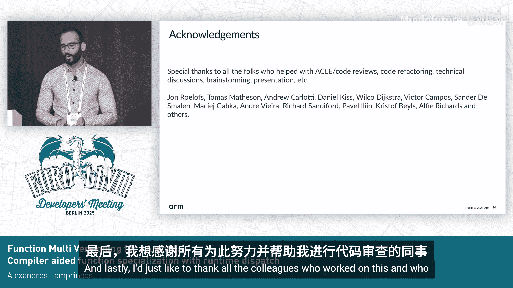

# 2025LLVM欧洲开发者大会-p23-P23-Function-multi-versioning---compiler-aided-function-specialization-w-runtime--BV1EoE9zUEbG_p23-

So as you may have guess from the title of my presentation。

 I'll be talking about functions with multiple versions。So what is function multiversioning。

F versioning is a feature that lets the compiler generate multiplefunctionual versions and auto dispats between them。

😊，Why would you like that？Because software is deployed on various devices。

 and we sometimes want to compile for a baseline architecture。

 and then we use the binaries on other targets。However。On most CPU use。We have optional instructions。

 which may not be present on the target we are compiling for。For example， on N。

 the product instructions may not be available。And to make use of satisfaction section。

 we need runtime check。Right。So function with versioning isn't new。

 It was introduced for the first time in 2014 for X6， using the attributes target and target clones。

😊，On those attributes， you could specify a string that corresponds to an architectural extension for which you would like to specialize your function on。

To be optimized for that target。However， on Air 64。

 the target attribute is mostly used as an optimization hint。And as you can see in this example here。

Which is taken from the header files of R C language extensions。

The target attribute is guarding a built。So therefore， we introduced a new attribute。

 we call it a target version。And as far as I know， this has also been adopted by disk 5。

And without the specification for functional diversioning， this is inac Lee。

 and it's currently in better state。But， now， let's talk about Co。EFirst。

 we generate multiple versions for a function。 and to be able to differentiate between them。

EWe want the the features that each version is using to be encoded in the man name of its version。

So if you see this example below， we have a version that is using four extensions of the architecture。

 C，RC， B， T I， AE S， and B F 16。And in the green box。

 you see what the man name looks like for this version of the function。

EEach of these versions is associated with metadata。

 And the reason we want them is to propagate information from source code to LMIR。

Then you can imagine that when you have multiple versions of a function。

 you need to determine which one will be executed at runtime。And in order to do that。

We want to detect which features。EAre available on the host。And then。

From the versions that are available on that host， we still need to select the best version that is more suitable to execute。

 and do that。We are using a priority scheme， which is part of the specification。

 and its architectural extension in the ACLE is associated with some priority。😊。

EThe resolution is being performed by a function called the resolveolr function。

 this resolution is dynamic。😊，Meaning that it is performed at load time。

And it is permanent for the lifetime of the process。And。And lasting with Z 8。

Is a global variable to be able to store the state of the features that have been detected on a host。

😊，Right， so why do we need compile R T。We need the run time to be able to detect which of the features we're asking for are available on the host and so that we can initialize the global state accordingly。

😊，This is supported across various platforms。And in this example， in the code you see on the left。

We are looking at how this is done on Linux。Where we ask the kernel using hardware caps。

 which features are available。 And then we initialize the global variable Air 64 CPU features。Okay。

 now I will。I hope this is visible。I'll talk about how to use functional re with an example to optimize your code。

On the middle and the left side of the screen， we can see the source code。

 which I'll walk you through。 And then on the right。

 we will see what teleMIR that is generated will look like。 and I'll walk you through that， too。

So we have a program that takes two arguments。Those are strings。 It concatenates them。

 and writes them in a buffer。 This buffer is then passed to a function called skip word。

Whi tries to identify white space， and then it returns the remaining shrink after the white space。

And。We have two versions of Sword。 The one in the middle of the screen is the default。

And on the left of the screen， we have an optimized version of Sword for S V 2 using in line assembly。

And on top of that， on the top of the screen， you can see an auxiliary function called copy word。

 which also has two versions。And those two versions are sharing the same body。 And therefore。

 we use the target clone attribute for those。 One is the default， and one is optimized for mops。

 which is an extension for memory operations。Okay， so let's start looking at the IR。

This is the co for the symbol that is a resolve at run time。EBy the is function。

 which is which is associated with it。 And you can see。At the end of the line。

 we have one for copy word and one for skip word， because both are aversion functions。

This is the man version of copy word for mobs。With its associated metadata。As you can see。

 we have two types of metadata， which I'll talk into detail about them later on。

 One is the FM B features metadata， which is specific for multi versioning。

 And the other one is the traditional target features we have。

This is the default version of copy word with its metadata。Theres V2 version of Sword。

And the default。And now comes the juy bit， which is the resolver function。

This is the resolver for S word。EIt does a couple of things。 First， it initializes the run time。

Which is the call you see on the first line， which we have to declare there。

This initialization basically sets the global state。 So the global variable AR 6，4 CPU features。

On the second line， we read that global variable， and we compare it on the next line against a beatm。

And this beat mask corresponds to the S V 2 version of Sword。AndDepending on that comparison。

 we will select between the S V2 version of Sboard and the default。Right。

 let's talk about some design choices we had to make when implementing the spec。

The first one has to do with the resolver emission。

So we wanted to support functionalversioning across multiple translation units。呃。

The challenge with that is that the resolver cannot see versions that exist beyond its current os unit。

And。If you emit a resolver on use， meaning every time the function is called， you may have。

Uses on different translation units， therefore， multiple resolvers that are potentially different from one another。

And why would they be different， Because maybe you would。

You declared different version in different versions in needs of the translation units。So。

The selection of versions would not be deterministic， and it would depend on the linking order。

So I think the first object that comes to the linker is the one that will be selected。 If。

 if you have two resolvers， the first one will be selected。 So to to deal with this problem。

 we decided to only emit a unique resolver in the translation unit where the default version resides。

Another design choice had to do with feature detection。Specifically。

 we wanted to detect depending on features transitively。So， for example。

 if you have a version that is using S V 2， you would also like to detect S V， the presence of S V。

The presence of F P 16 and the presence of FP。And another case was that we wanted the features that are imping from the command line to not be exempt from grant time detection。

Because in the example I'm showing you here with B T I。

 you may have an extension that is specified on the command line。 But if the host。

 but if it's not available on the host。The host wouldn't trap when executing the instruction。

 But instead it would execute as no op。 And if it did not detect it at runtime。

 you wouldn't know if it's present。 And there were use cases where people wanted to just be able to detect features with multiversioning。

EOkay， now I'll talk about roughly how we represent information for FMV in the compiler T say。

The first thing we need is a name for the extension。 So basically。

 the thing that goes in the attributes。Then we need a feature bit。

 which is what is used for runtime detection。This is part of the API。

Another thing we needed is to be able to express the priority of FMV。

 So we do that with another entry there。And detection cannot be the same as priority。

 I wanted to highlight this。Because， as I said before， the detection is part of the API。

 And you can imagine that in theseams， if you had remove features。EYou would si the values。

 and that would break the API。So that's why those entries had to be different。

 feature bit versus priority bit。Lastly， we want to store information about the architectural extension that corresponds to the withversioning feature。

And its associated dependencies。And these dependencies are used for two reasons。1 to runtime detect。

 and then to enable the necessary sub features for code generation。

And all this information just to say that at first， it was scattered here and there in the compiler。

 and you had to keep things in sync。 And with the commit with the commit， I， I am listing there。

 We auto generate this with table Z， and it's easier to maintain。😊，Okay。

 and now let's talk about metadata。 Why do we need them。How do they look like。

 Why didn't we use target features， which is very similar。So first， how they look like。

 they look like the red rectangle at that third line from the code。 It's called F features。

 And then it's a list of architectural extensions separate bycoma， lexographically sorted and unique。

 It's basically something。More or less the same as target features。

But I'll give you an example of why do we need them and why did we not use target features。

So imagine we have these two versions， The first one using I8 M M end product。

 and the second one using FMA。Those are extension for Air 64， in case you don't know。

According to the specification， the priority of I A M M is higher than FMI comes second。 And lastly。

 the product。Now， we will compile our program with MR equal and V 8 plus I 8 M M。

EThis I8 MM ends up being propagated to the target features， but for both versions。So at this point。

 we've lost information of where is this I8 M M coming from。

 Is it coming from the command line or is it coming from the target version attribute。

So if we use target features to deduce the priority of the versions， you。

 we would think the second one has higher priority than the first， which is wrong。EOkay， here。

 and for the next couple of slides， I'll be talking about an optimization in LVM。

Specifically in global opt。诶。This is an optimization that allows us to static resolve goals to version functions。

 meaning that we no longer have to。Perform runtime thesepats and resolve dynamically。 But we can。

 at compile time， we can decide which version should be executed。This。

This can happen under certain criteria， of course， not for every call。

And we do that by comparing the L VMIR metadata between the color and the coli。

And we support two specific scenarios。 The first one is when both the caller and the collie are functional versioning functions。

EIn which case， we compare the FMV features between the color and the Colli。

 The second scenario is when the color is non FMV and the Col is FMV， in which case。

 we compare the target features against the FMV features。So first， as you see on the left。

 what we need to do is to select which metadata we， we will use。And on the right。

 once we have selected the metadata， we construct a bit mask using those metadata。

 And with this with these bit masks in the next couple of slides。

 I'll be showing you how we use them for the algorithm。

The main benefit of this optimization is in liing。Right。

 so since global op operates at the module level， we start by iterating the iPhonef symbols in the module。

😊，The iPhoneang symbols is， if you remember from the second slide where I saw the， the codes in IR。

It's the， the symbol that is generated for runtime disputepats。

So we the over all the iPhone functionss in the module。

We look we look into the associated resolver function for its iPhonephon。

 and we examine its basic blocks。We examine its basic blocks， starting from the return instruction。

And we walk backwards the use of chain。EAs we itate and through this process。

 as we walk through the use of chain， we can recognize select instructionss and fennots。

 And in any other case， we just bail。Once we have discovered orly versions。

 we use the masks I described in the previous slide。To sort the cosing decreasing priority order。

Next thing we do is we discover the color versions。And again， similarly。

 we sort them in increasing priority order。 So now we've ended up with two sets of functions。

 the colors sorted in increasing priority order and the Col。And。Here。

 I will explain how we will walk you through the algorithm with an example。

This example is taken from the L regression to suite。At the bottom of the screen。

 you can see the two list of functions I just mentioned。The corner is on the left。

 The corner is on the right。嗯。EThe curly braces next week's version， correspond to the beat masks。

And。In the note， I have added that there on the right。

 You see that those beat masks correspond to the features， mops， S V2， S V E， F， P 16 and F P。

That is simplified with mask after Depend6 v。EAnother thing to note is on the top of the screen。

 you can see the red rectangle with Lada function。EW whichhich is describing the relationship between two beat masks。

 So when I say。A bit masking flies another bit mask。

 It means that all the bits of the second beat mask are present in the first one。

So you can also see two arrows here I have added， the red arrow is theerator for the colorss and the green arrow theerator for the Coles。

So we can start the algorithm by comparing mops plus V 2 versus mops。

So since mops plus V2 implies mops， we can static resolve this quality。We advance the colorerator。

Now， we are comparing mops versus mops。Mops implies mops so we can start resolve this one， too。

 And because of bit mask quality， we advance the coerator。So at this point， we。

 we advance the callliterator because we know。Since we are executing the S V collar。

 we know that the mops collar that was higher priority is not present on the host。

So we don't have to compare against it anymore。 So now we are comparing S V with S V 2。

SV does not imply SV， so we cannot static resolve this call。 However， because as V2 implies as V。

 we advance the call iterator。We keep giving over colgue candidates。Because as I said。

 in the previous step， V V collar cannot be staticly resolved。And since as we implies as we。

 we advance the coeratorator once more。So now we are comparing both default versions。

And since none of these features are available on the host， we can statistical quickly resolve。

I hope it wasn't very complicated。On this slide， you can see some future work。嗯。

One of those things is the user to be able to control fit priorities。

 And we have a pull request on AL for that。EAnother thing is the user to be able to refer to a specific function version。

So we haven't decided how it would look like at the source level。

And there was an open ticket for supporting point a with highf resolvers。

And at the point of writing this presentation， there was a request to support more features like CSSC。

 which is some extension for。Pop count instructions。

 This has already been merged in post1  V 20 release， actually。

And we would like you to use the feature because it's still in better state。 as I， as I said。

 we need your feedback。 We'd like to see what's missing， what we would like to see。And lastly。

 I'd just like to thank all the colleagues who who worked on this and who helped me with good reviews。

And now it's time for questions。I'll I'll start。 Can your scheme be extended to support X 8 6。

 for example， like A V X 5，12 has different instruction， Newer instructions than than previous A V X。

 So the X 86 implementation is already there， I think since 2014。 and it's separate。 right。

 So we did nothing on X 86 implementation。 That's a separate thing， okay。But it suits it。

 there is support for it。 I think， Okay， I don't know what the state of it is， but it is， is there。

Cool， thanks。And。I guess there are other questions。

Yeah。Thank you。 All right， thanks everyone。