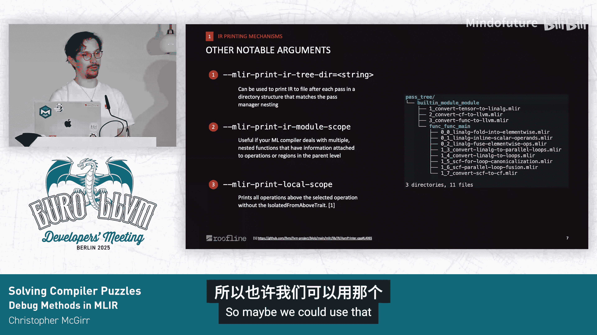
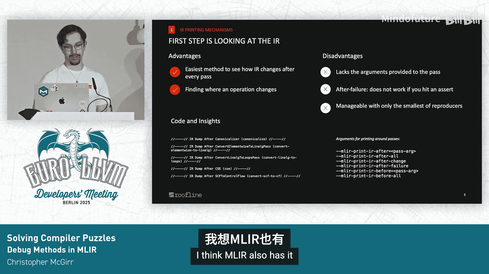

# 2025LLVM欧洲开发者大会-p24-P24-Solving-Compiler-Puzzles---Debug-Methods-in-MLIR--BV1EoE9zUEbG_p24-

Hi， my name is Christopher McGur， I'm from Roofline。

 and today I'll be talking about solving compiler puzzles， debug methods in MLAR。

So what is this talk about， so this talk is more of a compilation of tools and methodologies I've compiled over the past few years working with interns and working students。

Basically how to get them onboarded with MLR， how to solve problems if you find a bug in the compiler pipeline。

 so this is essentially focusing on ML or tensor compilers。Where the inputs are non source languages。

 so I'm talking things like exchange formats like Onyx。Um。

And oftentimes these files contain large constants， so you're loading in a very large file from disk。

 which may not be that practical if you're。Running if you want to iterate quite quickly to find this root cause of a bug。

So some disclaimers， this is a practical guide， based on my experience。

 it's most likely not exhaustive， there are probably some things I'm missing and it's not definitive at all。

 and it might be opinionated so I apologize in advance。

So what am I talking about when I say debugging AI models so for example here I took Lama 3。

2 from Huging face ran it through an importer and got it down to Lalg and you can see here in the bytecode format it's around 5 gigabytes of code and if you put it out in a textual format it's around 10 gigabytes of assembly so it's quite large right。

And you'll have to deal with a lot of different operations。 There are matms。

 some generics that could implement Mams， transpos these kind of things。 So there's lot going on。

And in order to find the root cause， you have to maybe reason about a bunch of different abstraction levels。

 So when I'm talking about an ML compiler， I'm really talking about。

Our version of a compiler is basically these three steps。

 so a front end composing of onyx Tor ortoa with some kind of middle end that uses Lel vector or Memif。

 and then of course our backend IR target， which is。Oftentimes， PTX， SpearV， or LOVM。

And like I mentioned before， you're dealing with large files。

 so if you want to iterate quickly to find the source of that bug， loading it from file。

 saving it back to file can be quite slow， you might have issues with past phase ordering。

 so maybe you should have ran canononicization before pass in order for a certain pass to successfully do what you would like。

You could have issues with some operations having undefined shape propagation。

 maybe you're seeing dynamic shapes when you expected not to。And of course。

 maybe there are some patterns that are not matching。

And all of these can be problems you encounter when you're trying to find。

 why did my ML compiler fail to compile this ML model？So today I'll be focusing on five major topics。

 the first one being the printing mechanisms available in the MLIR framework。

 some useful MLIR opt arguments， how you can leverage the Rer functionality。

 how you can also integrate LLDB in your debugging， and finally I'll talk about MLIR reduce。

So the first step I always take is to actually look at the IR and see what is happening。

So you can do this quite simply with some of the arguments provided to you in MLIR Op。

 these are the print arguments， you can see here I've listed some of them。

Essentially it allows you to print the IR after each pass or before each pass or during a failure。

 it's quite useful to see how the code is changing and I show here some of the。

 let's say header statements that are printed out when you're using such an argument but one of the downsides is maybe your pass is a bit generic。

 it's parameterized， it has arguments， so you might not quite know what it's doing。

 it's a little bit simple， so。It might hinder you in your debugging efforts。

 also one thing to note when if your failure is like a hard failure， like se fault or an assert。

 the print after failure doesn't quite work， it doesn't get to the printing mechanism unfortunately。

 and it's really only usable if you have a small reproducer。

 so if you're working with a large model like Lama 3。

2 that's a lot of text that will be printing out to your terminal。So as I mentioned before。

 the models you're working with oftentimes will have the constants。In IR。

And this can be quite cumbersome when you're reading it from disk and when you're trying to read it in a terminal or an IDE。

 so one of the things I always use is the Allied functionality。

 so it comes in two flavors at the moment， so alignlighting the element attributes and resource strings。

 so here I give it a small example of what that looks like essentially it just doesn't print the constants out to the output streams。

Which is quite useful when you're dealing with large files。

Maybe if you're working on another kind of compiler framework， you don't have this problem。

 but in vanilla MLIR， the constants are usually in the IR。

So that's not the only options you have for printing。

 there are some actually quite useful ones as well。

 so I showed that you can also print after each pass。

 but you can also print after each pass to a file which can be quite useful if you want to jump around between the different states of your compiler pass so you can see here you can use the argument MLIR print IR tree。

 which will simply dump your whole pass pipeline to a directory structure that mimics what that pass pipeline is。

So you can see here that we have some passes that operate on the module up。

 and then you have some passes operating on the funk up， and those are actually marked in order。

Quite useful when you need to jump between different passes and see， okay。

 did canonicalization fail here， did a pattern fail here， why is this line up， now dynamic。

 things like this？Another useful argument is the print IR module scope。

 which essentially if you have a pass that operates on a function and you have potentially attributes attached to the module you need to look at to help debug the pass on the function。

 you can use this to print the whole module scope。If that is a bit too robustbose and you have a function op nested within another function op。

 let's say， or another module and you have multiple modules in a file。

 you can use MLR print local scope， which essentially prints up to the first op that that does have the isolated from above trade。

Now I've talked a lot about now printing， but maybe now you've narrowed the scope and you have one single pass that you want to focus on and this pass has a lot of patterns。

 the debug flag is actually quite useful if you want to see which patterns did match or didn't match and potentially why they didn't match。

嗯。So as you can see here， these are the two arguments。

 one thing I have to mention is that this is only available in debug mode。

 So if you're new to MLIR and you just try to find this argument in the help。

 it's not going to be there unless you build it with Dbug。

It prints every pattern that did or did not match， so if you have a past with a lot of patterns。

 it can be quite verbose and hard to follow。But if you're lucky。

 some of the patterns implement some notify rewrite failures with nice messages that can help you follow why did this pattern not match？

And if you're creating a new pass， make sure to add the macro debug type and some LLVM debug statements to help your fellow developers in the future。

 This is actually quite useful。 There are some passes that have very good debug statements。

 others with。A little bit less， but it can't help you in the future when you need to remember， okay。

 what is this pass actually doing？And of course。This kind of debugging is only really useful if you have a very small IR to run it upon。

 if you have a lot of ops， it'll print a lot of output。

The third kind of tool I often use is MLIR Reprocer。

 so this is essentially a way to have the compiler fail and produce an IR with arguments to replay the failure。

You can see here the arguments you can use， it's great for generating bug reports for upstream LLVM。

 of course if the IR is small enough， please don't post large IRs of the whole models。

And you can see here on the right， an example of what it looks like in the IR。

 so at the end of the module， you'll have little external resource that describes the pipeline you ran as a string and some additional flags such as if threading is disabled or if it should be verifying operation。

Syntax。One thing to note though that we did counter when playing around with reproduces is make sure all your passes in your past pipeline actually have the arguments serializable。

 so what I may mean by that is of course you can define passes that take。

 for example some kind of data structure a strut as an argument and you can instantiate this in C++ no problem。

 but when it comes time to replaying it with the rer if there's no serialization from string to this strut or back。

 you can' have some very weird failures， you can be very confused by it。Another thing to note。

 we've also saw some odd behavior with nested pass managers。

 so we were dealing with some compiler pipelines that had very deep nestings of past managers。

 we couldn't quite find the reason why it was very odd and hard to reproduce。

 but just to be aware if you're playing around with this。And if you want to generate a local rer。

 which is essentially a reproducer file that just executes the last pass before failure。

 you have to make sure that you disable threading for your MLR context。

 which if you have a lot of patterns， maybe it'll slow down your debugging。Usually it's quite okay。

So if you want to get a little more interactive and use LLDB。

 there are some great pretty printers available from the LLVM subproject and also MLIR that can help print out the very complex data structures we have in the project to a more human readable format。

 so here I list my VS code debug configuration just to show that you can import these Python scripts。

And give a little bit of a better human readable string。Let's see if this works。

Yeah if you can see here， the producer and consumer are actually operation pointers and they were resolved to their op name。

 now unfortunately it's li generic so you don't quite know much more information。

 but at least it gives you an idea of what kind of operation your producer and consumer is。

So this works great for very simple types， small vector events looks great。

 you don't have a pointer just some heap somewhere， but for more complex types like values。

 things like this， there's not quite a pretty printer available yet。

 so there is some roomor improvements， maybe you guys have some good ideas， and。When in doubt。

 I've always found useful to use the LLZB terminal and also just calling the functions like Op dump。

 attribute dump， type dump just to see what we're looking at。

If you can't see it nicely in your debugger。So another great LLDB integration that we have in MLIR is action debugging so this was actually presented in a meeting a few years ago and actually works great with VS code also in normal terminal it allows you to break on higher level granularity in your compiler so when I say that I mean things like patterns and passes so you can actually set breakpoint on certain passes and patterns and then the debugger will stop there and then you can inspect the IR using the MLIR cursor functionality and you can also jump to the parents to the children and stuff like this。

One thing to note， you have to make sure that you enable the hook so that the debugger actually can stop at these kind of breakpoints and that it actually registers properly in your LLDB debugger terminal。

I've added some links here to the documentation and where you can find the implementation。

 feel free to look at it after this talk it should be posted online。是。And finally， ML reduce。

As the name implies， it allows you to reduce your IR to a smaller problem given some kind of script where you say hey this is the bug I'm looking for。

 keep reducing the IR until it stops producing and then that's the last state where you have hopefully a minimal reproducer this in theory is great for enabling automated bug reporting。

 you could have this somewhere in a CI to generate a nice small IR potentially even a ticket automatically。

 there's actually welldocumented usage on how to use it。

 how to implement your own reduction patterns for your own custom dialects or ops。

Although in my experience using it in the real world。

 it has often failed to reduce the problem sufficiently。

 and it seems to me at least someone who wants to use this out of the box without too much tinkering。

 that you need quite a bit advanced knowledge to actually use it。

 oftentimes I find it much quicker to just simply print out the IR in a textual format and just delete a bunch of lines until I get a couple of op that trigger the issue。

And one thing to note， there are actually some downstream projects that use MLIR reduce and there's custom implementations。

I don't have much experience with them， but I just wanted to point them out things like MLR Eie reduce and circuit reduce are available。

 you can take a look at， they might have more functionality than the vanilla MLR reduce。So yeah。

 as I mentioned before， there's some great documentation and reduction patterns and I've added links to the slides here so you can take a look at it yourself。

 great。I'm actually almost done。So I hope you learned something from this talk。

 I believe we actually have quite an extensive toolkit already in place for debugging most problems。

 of course there's still room for improvement to help improve our productivity。

 I mean at the end of the day we're not here to fix bugs。

 we're here to implement features and to implement cool new hardwares and backends。

One thing I would like to note is that lit tests are actually a very valuable resource for figuring out okay。

 what is a pass supposed to do oftentimes the C++ code can be cumbersome to understand， okay。

 what is this doing and when you can just look at the Li test and see okay， here's my IR input。

 here's the output okay now I understand what it's trying to do。And as a final resource， of course。

 reading the code may help you to figure out， okay， how does this pass work。

 how can I use this debugging tool， and things like this？

So thank you very much for listening， I hope you learned something， feel free to connect， reach out。

 and if you have any questions， please let me know， thank you。So we， we have time for some questions。

是那个 sense。

For the reproducepro capability， you said the options have to be serializable。

 there's a mechanism you can define passes in TD files and provide the options there。That。

Yeah word boxs that checks that box， but sometimes you have passes that were implemented in pure C++ without tableGin and then that's when you run into issues and if you're working on a large compiler pipeline right it's kind of hard to find okay。

 which one is doing this because the error was quite cryptic right it's just fails somewhere in the stack well yeah。

 tableGin works no problem。Excellent， thank you。Hey， thanks for your talk。

 I had a question regarding like the IER when it changed between passes。

I would love to be able to do a diff between like what it was before and what it's after like the SSA value numbers change and like if if you have a small change in the middle everything that's afterftwards gets changed and like the diF tool is pretty much not that useful so do you know if any tool that can do this I can I actually don't off the top of my head but I heard there was a cool talk earlier today I think on diing LLVMR they probably could be applied to MIR Probably not a far stretch so maybe we could use that。

Interesting， thanks， great question。So just one more on that same point。

LVM has has a fairly rich set of print changed， you know， like a reduced set of。

Diffs bit from past to pass。 So rather than print Ir after every， you know， the the full IR。

 is there any plan to get that functionality into ML IR， I think it's also there。

 Maybe I just did not put it in the slides。

I think MR also has it。

I would have to check。😊，Thanks。Oops。Any more questions。好O speaker。thank you。 thank you very much。😊。

