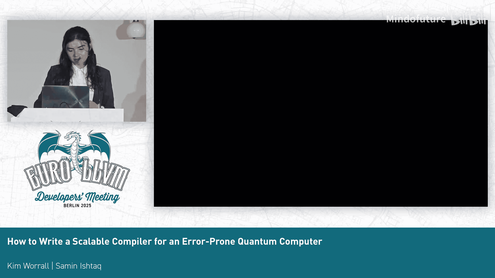
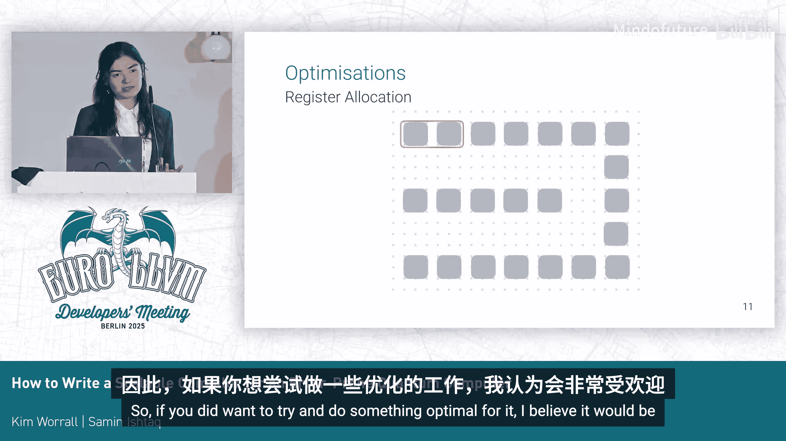

# 2025LLVM欧洲开发者大会-p25-P25-How-to-Write-a-Scalable-Compiler-for-an-Error-Prone-Quantum-Computer--BV1EoE9zUEbG_p25-

Hello and thank you for coming I'm Kim I'm a PhD student at the quantumntum Soware Lab at the University of Edinburgh and today I'll be talking about how to write a scalable compiler for an error prone quantum computer and we know it's quantum because I've used the nice purple pop color。

😊，So first， because I know you're not an audience of people familiar with quantum computing。

 we're going to go， but what a quantum computer actually is。😊。

So we've got a whole bunch of different languages now there's quite a few cropping up these are just some ones you might be familiar with but there's several more and there's a whole bunch of different types of qubit midari and that means different physical things we use to implement the qubits and here's a nice picture of Google's quantum computer but of course this is actually mostly the fridge。

😊，So what does it actually mean to have some sort of intermediate representation between these things？

So the first thing to note is that because this is just the fridge underneath we have a physical thing。

 which is the qubit， and then we actually have a whole big grid of these。😊，And of course。

 because those actual physical things， we also need some sort of control system to interact with them。

😊，The first thing we might want to say is well what happens I want to do something to one of these so first I need to know that one of them exists so I might say here I know about a physical qubit and I'm going to call it Q1 and this is a reference to the qubit and I'm going to initialize it into a state that is zero。

😊，I might want to know that I have a second one of them。😊。

And then I might want to do something to one them， so when I say gate。

 I just mean an operation that applies some kind of physical interaction to one of these physical qubits and here we use attributes to say which kind of thing we want to do of it and this changes is the probability that will get zero1 when I look at it。

😊，I might want to do something to two of them， so I've hopefully drawn out a picture here。

 and I might want to then say at the end of my computation。

 can I look at one of them and get a result that is a bit that I can use in another computation？😊。

So the first thing to note is that physics gets in the way of a lot of things， we can't copy things。

 this is called the no cloning result so we can't pass Q1 and Q1 to a CO gate which takes two qubits。

 but we can swap values around。😊，We also have a thing that physical connectivity actually matters。

 so if I want to interact two qubits， they have to be physically next to each other。😊。

And this changes the way we do register allegation。And when we think about it like this。

 it means that our memory is also our quantum computing space。

 so a little bit different from the way we think about fetching instructions and things from memory in a classical computer。

😊，And of course， we tend say that measurement is destructive。

 if I measure the same qubits twice without interacting with it in a quantum way。

 I will get the same result。😊，So we also use something called QSSA for optimizations because when I interact with something I might want to know what the next thing I do to it is and what I do here is I essentially rewrite my operations so you can see that now they will return a new SSA value and this is then used on the next operation。

😊，And what does the hardware look like well what we actually have are these big boxes of FPGAs and each card and the FPGA is connected to some wires and these control different things like potentially lasers and those lasers might shoot things shoot a laser at a qubit and this causes an interaction and you see we have several different ones because they control different parts so different operations have different lasers and they might control the fridge around it as well。

😊，And we don't just have one because I drew four qubits because these wires are bulky。

 so we might need several control boxes each controlling something like four to six qubits。😊。

And this means that they need to be synchronized because if I want to interact a qubit that's controlled by one box。

 a qubit that's controlled by another box， then I'm going to need to synchronize those two boxes。

 otherwise I just do the wrong thing。 I also need a transpir because whilst we love a C not gate because it's something that is actually quite。

😊，Intuitive to a classical computer scientist， it's not something that's actually natively implementable。

 so I have to change it into something that is。😊，And the things that we do have are at kind of the bottom。

 so these are things that tend to be called pulse dialects and they talk about how long I send a pulse down a particular wire to control a laser for a particular time。

😊，找地方。So I've told you this is about quantum error correction now error correction is actually very important for quantum computers because approximately one in1000 operations go wrong as in cause a bit flip and any one of those can destroy your entire computation in particular a qubit can deco here so that means it can go from being a quantum object or just a completely classical thing and that tends to happen approximately every few microseconds which is not ideal if you want to do a quantum computation。

😊，So how do we correct them， so I might encode the data of one qubit over several qubits and that's here。

😊，And then I'm going to encode， well， then I'm going to add some ancillary qubits。

 so those are some empty qubits on the side。😊，And then what I do。

 because I can't look at my quantum qubits without actually destroying them。

 I'm going to interact with my data qubits， my ancillary qubits。😊。

And then I'm going to do this a whole bunch of times I've got two colors because I need to go against two kinds of error and then I'm going to measure them so I'm going to look at my anslls see what I get。

 repeat the whole process to other round and then I compare the results so one way of doing this is that if my results have changed from one step to the next and I was not intending to do anything then I know I've got an error then I need to correct something。

😊，So we kind of need to change our computation stack for this because every time I measure these things I need to send that data out and it needs to be processed。

 so I have a separate decoding system and this is because I tend not to have chips on the same place as my qubits themselves and this is because they need to be very cold and chips heat up but this also needs to beated with the control system because we need to be sending data back and forth。

😊，And here's a nice picture， they tend to be kind of a whole bunch of separate chips doing parts of the decoding work。

 but gathered together by one sequencer。😊，But what does this mean when I say scale。

 so it's typically expected that I'll need millions of qubits and operations on them to have what's called quantum advantage and if my error rate is around one in10 operations。

 I'm going to have to correct them and send results back for each of those and this means it has to be corrected and repeated under the order of about 10 microseconds。

😊，And this means that the anticipated amount of data we might want to be processing is in the terabytes per second。

So at the moment， cogeneration and integration of the different parts of the stack is done by hand。

 so we're trying to bring these things all together and obviously with the chips that look like this。

 there's a lot of parallelism that we might want to exploit。😊。

We'll mostly be focusing on the cogen part because the hardware is kind of prohibiting us from doing these millions of operations。

 but we want to do it in a way that sort of allows us to do this in the future。😊。

So the first thing we need to do is add nothing。😊，Because we now need to be aware of every time I'm doing nothing because I need to correct for things against that。

 because nothing worse than your identity operation， not being an identity。😊。

So we add in all these identity operations whenever there's a gap。😊。

We then take an error correction code that's given to us by a physicist who design them for us and we need to then encode all of our operations and our qubits under these。

 we can do this by implementing interface and we might then have to transpile to a new gate set because operations that we can do with these encoded qubits might be different to the ones that you can do on the actual physical ones。

😊，Then this means that we have to come with new operations to represent these。

So we now have these things that we kind of call patches because they look like little patchwork squares and the first thing they want to do is take two of them and merge them together。

😊，Like this and then there's several other things， for example。

 obviously the inverse which just breaks them apart again and there's all sorts of other things needed to implement actual gate operations。

😊，We then need to have some way of integrating what we've done there。

 so something that produces small circuits and offsets of operations to be calibrated to the decoders。

 some of which need actual information about the hardware itself。

So things we do for this is we decorate our operations with things we call noise operations so noise attributes。

 and this can be used to kind of when we know what a qubit is kind of assigned to an existing one。

 so a physical one because those all have different noise profiles。

 we can then connects this with some existing software that kind of analyzes how we matched our hardware to the code we want to run and can then configure the decoder to actually decode things when we run it at runtime。

😊，And then sometimes we need to do for this add things like ticks， which basically just says。

 at this time， we know what time step it is so everything after this happens in the next cycle。😊。

So we then need to kind of coordinate all this together。😊。

So as you can see before I hadn't drawn any lines together because these were all very separate things。

 so we kind of shuffled them together into my MLI pipeline and so that we can have the kind of configuration we get from the package we call STM。

 that can be sent to the decoder， but then we underneath have another dialect that represents things we can then send to control system。

 but also then interact with the decoding system。😊。

And so we add our own send and receive operations here because were actually using physical cables at the moment so we don't need all the complexity that actually is provided with things like NPI。

 and then we collect our instructions into explicit parallel and synchronized regions because it really matters to us to know when some blocks of operations have to be done at the same time。

😊，So then the last thing I wanted to talk about was just some optimizations。So register allocation。

 as I said before， suddenly becomes about things that are physically next to each other in my memory。

 but now if I'm using these encoded qubits， it actually gets a little bit more complicated。😊。

One of the ways in which this is is because there's now multiple ways I can do operations like this。

😊，So I can interact things that are right next to each other。

But I can also use measurements across the middle， so little dots are qubits and the patches are kind of logical places orll put a qubit。

 and I might want to be able to interact those ones across that and I can do that。😊。

And I can also do it from ones that are further away。

 and I can also move these patches around by doing the swaps as I mentioned earlier。

 So then we then have to think about what does it actually mean to take these sets of operations that we've kind of developed mathematically and map them down to。

😊，Something that actually looks like this and how do we take the operations we've built mathematically and change them into something that can be run at scale？

😊，Yeah。Okay， I think I've been a bit speedy so you can ask lots of questions。😊。

But then the last kind of thing that I want to leave you with is this is still a very new field so the work we did was mostly bringing together the different parts。

 so we built dialects and we've kind of pipeline them together and that's now kind of made its way towards being used on actual control systems and together with some error correction but obviously this is only very small sets of chips at present I think the big Google experiment is something like 400 qubits and they do one logical memory experiment and as we scale we know that our chips are going to get bigger and more parallelzed and that the decoder chips are also going to get bigger and more parallelzed and that we need to somehow understand this and come up with better abstractions for our kind of quantum programs that arent just literally hit this physical qubit one at a time because as you know the best kind of optimizations we can do for our compilers know things about how we use our hardware and know things about the structure about algorithms。

😊，And that's the kind of thing that's good for us to be able to talk to people within the LVM community about because we get to learn kind of what we can take from this because the kind of essence I go back a little bit。

😊，So everything from the top。To the bottom， it's all classical hardware。

 it's all things that have to be solved by regular compilers and things that can be solved by regular compiler engineers。

😊，The physics sort of exists wrong button down at the bottom and we need to come up with better ways to represent it so that we can take things from the top all the way down and if anyone would like to chat about any of that we be very welcome to。

😊，嗯。

Yeah， I think that's it， thank you very much。😊，So we have time for our questions。Hello。

You mentioned that you're going that Google has like 400 qubits。

 and I assume that they are arranged in like some sort of like 2D mesh thing like this。Okay。

 my slide have disappeared like I assume that there is like certain limits。

 like if you scale your qubits further and further up。

 you run into this like version of the square cube problem where you have like the edges。😊。

I assume are like some sort of control， but the number of qubit scales like or like yeah you have this gratic growth versus the yeah。

 with the layouting becoming more and a problem are you。

Do you have like other fields where you can draw inspiration for these layouting things？

Do you want to repeat that's the what do you mean by the square cubed？

So if you have if your qubits are laid out unlike a grid。

 I assume you have some sort of control coming in from the side but your patches exist in their 2D space but your surface area is like singular and then maybe I'm just talking so I think these are things people are starting to think about most of the focus has been on getting qubits that work at all and last longer than nanoseconds I know there's a lot of thinking about well do we stack these chips on top of each other some different types so I've mostly been talking about things that are relevant for superconducting computing but you also have other types where you can actually physically move the qubits around so you get all all connectivity but for example then you have the trade off that their operations are slower。

There's， I think also。There's more kind of an understanding that we'll have to have lots and lots of parallel chips at the moment we kind of anticipate that there's some sort of essentially supercomputers sat on top that kind of coordinates all of these little squares together because each one of those squares is essentially in charge of maybe four to six qubits underneath it and we somehow also anticipate that the kind of chips will talk to each other side to side because they're the ones that need to be synchronized so it has been very interesting to talk to for example the machine learning people who you know have to work with lots of kind of data intensive transformations in fact the kind of decoding problem is actually sort of massive matrix multiplications so something we can very much kind of take lessons from the machine learning people from。

😊，And。There's probably definitely other kinds of computing that we can learn from。

 I am unfortunately not an expert in all of them so if anyone is and would like to come chat that would be great。

 but things like kind of just understanding the different ways people use parallel computer is also very important for us。

😊，Thank you。So I have another question。 So I know there are several research architectures。

 which in which the qubits are very powerful connected and in the the very different apologies。

 So regarding the the registerstr location that you've mentioned。

 there's a very big trade off between contentions。 So where are you placing the registers together and both coherence and the number of operations that you have to move。

 this is a huge design space， specifically the graph itself is。Can be arbitrary。 So do you。

 does it currently exist a way to。Tubs this is time in an efficientient way without a commural explosion。

So the best of my understanding， we're not currently doing things like this， we're speeding back。

I believe some of the state of V art is using just very intensive graph algorithms to kind of map down their circuits to these things it's very intense takes a lot of time。

 I believe you can do it with heuristics and there's plenty of work on kind of say I think some of the results in the last few years have been saying okay but what if we actually just take the qubits that we know work well better than the other ones because even across one chip you might have all of the edge ones really errorprone and there's a few in the middle that are really good so there was some work done showing that if you actually operate smaller things on just those middle ones you can get kind of much more accurate results I think it's still a very new field so this idea at the end。

 I should have put these besides closer together is something that sort of only started developing in the last few years with kind of the idea that we might have these encoder qubits so if you did want to try and do something optimal for it I believe it would be very welcome。

😊。

Okay， thank the speaker， thank you。