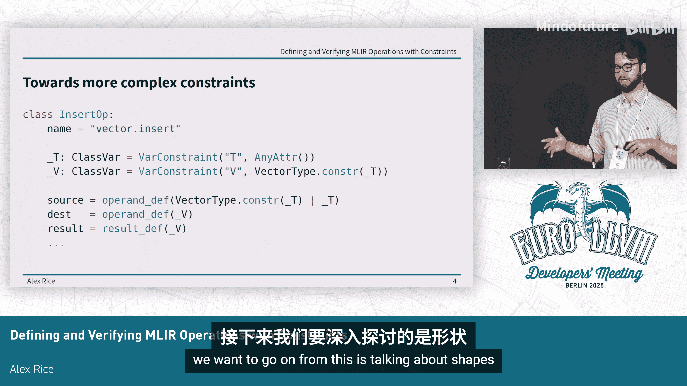

# 2025LLVM欧洲开发者大会-p26-P26-Defining-and-verifying-MLIR-operations-with-constraints--BV1EoE9zUEbG_p26-

Hi， is's me again。 As you can tell， this is a very different talk because the line is in blue instead of green。

 right last time。Yeah， I'll just get started。This， this talk is。

Going to be talking about some work we've been doing on basically different， a different way to。Dy。

 define your M IR operations in a more decative way。 So of。

 you can sort of view it as an extension to the sort of constraints that Ivan introduced in his I D L talk。

And this is the system that we've rolled out in the in X， E S L， which in case you don't know。

 is sort of a python clone of M IR。 And yeah， we're using this sort of throughout this system。

 And I'm going to sort of explain how it works， where we're at with the system and what we're sort of planning on doing next of it。

So before that， I'm going to take a small step back and sort of ask， what do。

 what does an operation definition actually do？ So in M I， you've defined some operation， But what。

 what does that actually mean， Have you just given it some name， Well， not really so。Firstly。

 the operation will usually have some associated verification with it so that it can check that its inputs are the right type and check that it has the right number of inputs and outputs。

 and it might have various attributes that it expects to。

Expects to always possess All of this is built into this operation definition。

 There's this second sort of category， which I've， I've called inference here。 But basically。

 this corresponds to sometimes we want to specify an operation with incomplete data and。

Be able to build the rest of the day， be able to infer what the rest of the data is from that incomplete data we've been given。

 So the two main examples I have of this are builders。

 You might want some very like small interface to building operation。

 but it needs to still fill in all this stuff。 And then maybe the more familiar one is passing where our custom formats don't have to。

Have loads of extra unnecessary data。 The last thing I'm not gonna to talk about so much is excesses。

 But this is another thing that came to mind of what your operation definition can do for you。

So I'm gonna go of the simplest example I could think of， which is additional two numbers。

 So here what do we need to what do we need to do to define this operation。

 So focusing on the verification to start with， we need all our inputs。

 So both inputs and the output are I think it's called sinus integer like something like something like that。

 But you can think of it as they need to be numbers to start with。

 But it's not just enough to put some sort of constraint on each of these things。

 because they need to they need to all the constraints are all linked together and they need they sort need to communicate with each other。

 And to see that if yeah， so we cannot define each of these independently。

 because if you look at sort of this generic format below。

 this sort of satisfies each individual thing and that both inputs are integers and the output is an integer。

 But it is clearly wrong because we actually need all of these things to be the same type。

Here we also get the， we also get to see this inference problem because the custom format above only specifies this one type。

 which is actually specified to be the result type。 And we。

 the operation definition needs to know that it should set the input types to the same as the result type。

So how are we going to encode all this？So， this is bad。So this is how we're encoding this。

 This is sort of a slightly pseudocody Python way of how we're encoding this in XDSL。

 But the the key thing is that we have this Var constraint。

 And what this V constraint means is that wherever this constraint is encountered。

So whenever it's encountered， it should be the same thing。

 So here we have this left hand side and right hand side operas there said that they need to be this far constraint。

 and the result also needs to be the same bark constraint。

And then we can specify this assembly format， as you can see， the only type given is the result type。

 as I said earlier。 And so the， the type of the left hand side and right hand side hasn't been given for the system can figure out from this file constraint that actually they need to be the same as the result type。

So this is kind of a simple example。 So where do we want to go on from this。So basically， all these。

 these sort of variable constraints can be nested within other constraints that this system has。

 I don't really have enough time to sort of explore the full range of different verification things we can talk about。

 But here's one example。 So if we have this vector do insert operation。

 This allows you to either insert an element into a vector or insert sort of a vector itself into a multi multi rank vector。

Here we so the interesting line here is this underscore V。

 And we're saying we've got this vector type， but we're constraining the elements of the vector type to be this other constraint。

 And this， yeah， this allows us to。Talk about all， all these things。

 The only last thing Ill talk about is that where we want to go on from this is talking about shapes because this has not done any of the shape verification yet。

 Sorry for running over。

