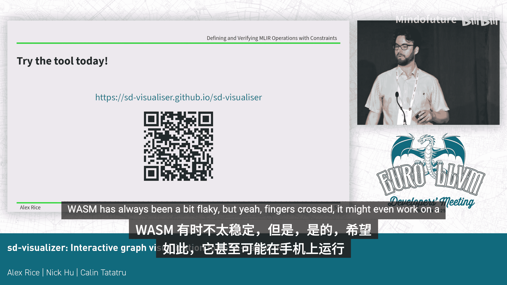

# 2025LLVM欧洲开发者大会-p27-P27-sd-visualiser---Interactive-graph-visualisation-for-SSA-based-IRs--BV1EoE9zUEbG_p27-

Hello， everyone。 I'm gonna present some work that I've done with a couple of my collaborators。 Yeah。

 basically， where we've made this tool， which is a visualizer for various different types of SSA programs。

 not necessarily specific to L VM and M I R， but they are good examples of the sort of things we're trying to visualize。

😊，So what are we trying to do。Basically， we want to take different。

 we want to take our intermediate representation of our program。

 and we want to have different ways that we can view the data view what's happening in the program。

 and display this as a graph to the user and let them basically see what's happening in the program and try to help aid them in working at what's going on。

 So the two main things， at least we've looked at the moment。

 are modeling the path the data flow takes through the program。

 So if you look at the graph on the left。 hopefully， I'm not sure how well the colors are showing up。

 but the black lines here represent data flow。 So you can sort of see that the output of the first ad function goes into the input of the second ad function on the right。

 there's more of an example of what's going on with the control flow。

 So in addition to having all the data flow of your program。

 Were also sort of representing the control flow graph as within the same diagram。 So the green。😊。

Why is I meant to represent control flow。Right， so there's certain features of I that make them difficult to difficult to draw。

 Basically。 So one of the things that is what crops up in both L VM and M I R。

 is that they have blocks and regions， which put a lot of constraints on the graph you're trying to draw。

 So you want to group up certain operations。 And you want to have， for example， in M I。

 So I think the one on the left is L VM。 We want to， or its some blocks and。

I can't remember which one is。 But in any case， we have these basic blocks and data flows allowed to travel out of one basic block and travel into another basic block。

 And so we end up with quite a big mess of to having sort of blocks。

 which are considered as big nodes of our graph。 But there are things inside the blocks and wire having in and out all over the place。

 the tool will deal with all that for you without any sort of without you needing to do anything。

 The other sort of feature that we want to natively able to support is that your SSA values can be used lots of times or use no times at all。

 And we didn't want So if you're trying to visualize your program。

 you shouldn't have to say I need to put in an explicit node here to copy my value。

 It just all happens automatically。 And so these two two things are what separates this from trying to use a more general graph physicalizationization program like graphs or something to deal with these sort。

😊，Visualization problems。So what actually， what actually happens when we。

 when you try to visualize things。 So this is the sort of approach we've taken。

 So you can you start with your IR。 So yeah， we have translations for L VM and MR。

 we also have this translation for sort of toy language S D language shows off some of the features of our tool。

 All these things。 So get mapped to this hierarchical graph structure。

 which is a sort of founding block of basically it describes everything about what is going to happen in the visualization。

 If someone wanted to be able to visualize a new type of IR that they had generated or made up or wanted to display some IR in a different way。

 or they would need to do is they would need to define some sort of translation to this hierarchical graph structure once that's happened。

 the tool， then it goes through a big drawing drawing pipeline where it decides where to put all the different nodes vertically in horizontally decides where to put these copy things and how to group。

h into blocks and puts swaps everywhere。 You end up with a bundle of shapes。

 And then you can either directly draw this to an SVG， or you can use our interactive front end。

And this interactive front end allows certain features。 Again。

 I'm not sure how well these things are going to。Going to show up。

 But there's theres certain features you can use to make it easier to explore the graph you're thinking about。

 So the first one of these is you can hover over any of the wires。

 and it will highlight the whole edge， including wherever it goes into blocks out of blocks wherever it goes。

 The second feature is that you can take blocks and regions and collapse into a single point。

 If you just don't want to focus on that region at the moment。 And lastly， we can search for。

 you can sort of do find and search for various node。 I think that's all I want to talk about。

 you can try it。 It should work on Wm。 Wam's always been a bit flaky。 But yeah， fingers crossed。

 It might even work on a foam。😊。

