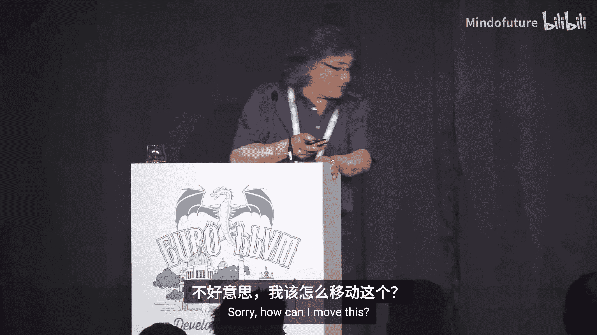
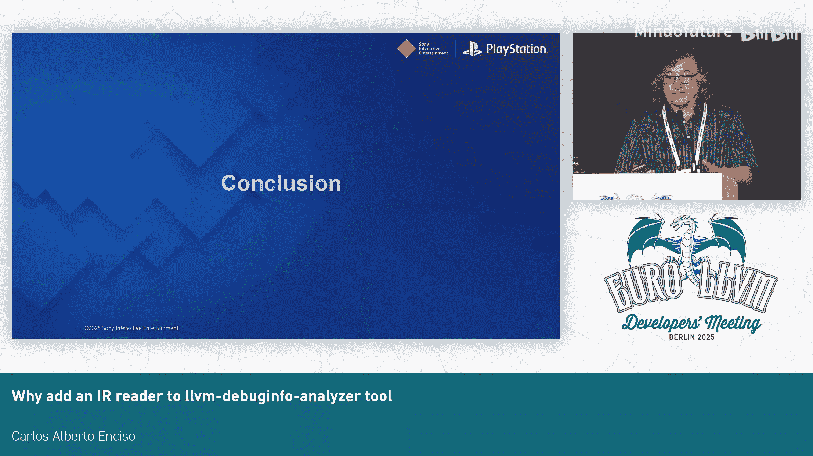
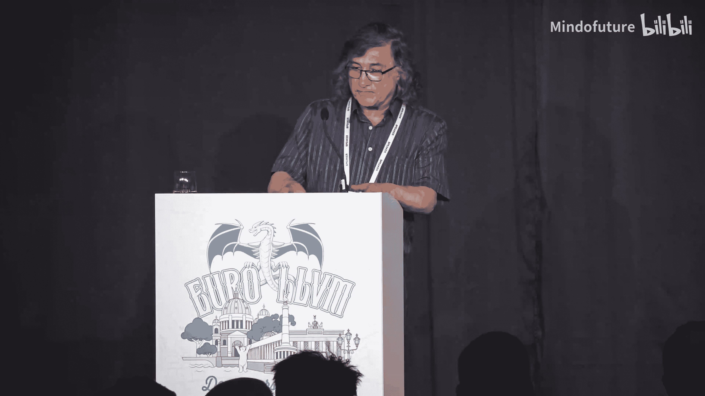

# 2025LLVM欧洲开发者大会-p28-P28-Why-add-an-IR-Reader-to-the-llvm-debuginfo-analyzer-tool--BV1EoE9zUEbG_p28-

Good morning， I Carllo and C Fran Sony Inter。Entertainment。Sorry how can I move it。

Okay， sorry。This presentation will show that by adding the area reader to the LLBM debugging for analyzer tool。

Will be able to reduce the noisiness of comparing the deba info and LBM IR。😊，Before that。

 let's go to a couple simple concepts。LLBM and thebugging information， it accepts different inputs。

Different tool chains。Different binary file formats。Different information format。

And def information tools to print the Dbg info。Common problems with the bug info。

Does the de for representing your original source code。

Which variables are dropped due to optimization？Wuai I cannot stop at a particular line， etc。

In addition to that， we have the semantic differences。

In the generated debu info when we use different tool chains on the same platform or same source code on different platforms。

Let's move now to the optimizer IR output。Is the output is very rich， but also is very noisy。

It's difficult to see the changes using a normal comparison tool。

And the metada identifier changes between passes。By byecting， we can pin down。

Which path causes a change？It includes a wide set of the back printing options。

 but it still is's difficult to see the changes。For this specifically。Presentation。

We are going to take an output after SP vectorized surpas that shows some drop in the back information。

On the left， we have the source code， the test case。This is the IR Me data after simplify C FG。

And the IR madeted data after SLP vectorized surpass。Using a normal comparison tool。

These are the changes between the year。Can anyone export the drop locations。I would say no。

L N Dbugging for analyze analyzer is a command line tool that process debu information。

 It supports different binary file formats。Different debugging information format。

And it produces a canonical logical view regardless of the input formats。

Those logical views can be printed， selected， or compared。On the left。

 we have some drf debug information printed by Dof Da。On their right。

 I'm called Bea bug information printed by PDV U。And in them either the canonical logical view for those two inputs。

These are the current components of stream， for the tool。And this is the proposed new module。

That will allow us to create a logical view for the debu info on N LBM IR。

Let's move a little bit through how we brain the logical bes。

 These are the common options when dealing with Is。

These is the test cases after those specific passes。

 to simplify CFV pass and the SLP vectorizer pass and the names of the IRs。

And this will be the full command line for the tool。These are the results。

 On the left is the standard IR metada after simplifyim CFfG。

And this will be the logical view after simplifyim CF FG。And the logical view after SLP vectorizer。

So now the tool also supports a built in comparison feature。

So let's see how we compare those logical viewss。 These are the common options。These are the tests。

And this is the full common line。So now using a comparison tool。

 we can see the differences in the IRs in the sorryideological views。And using the tool。

So we can see on missing symbols， on missing lines。Using a view mode。

 we can see now common part and the missing part。

In conclusion， we will be able to reduce the noisiness of comparing the deba info in LBM a year。😊。

Thank you。

