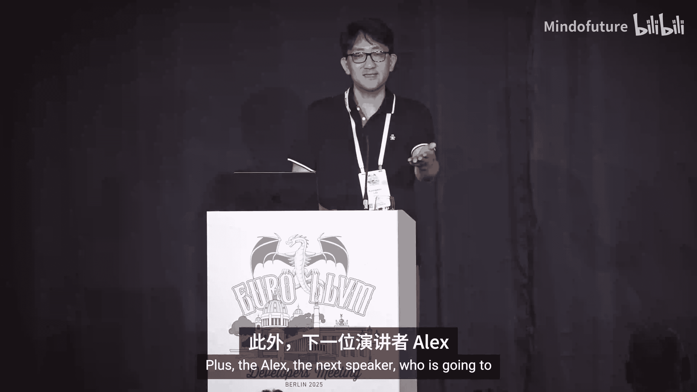
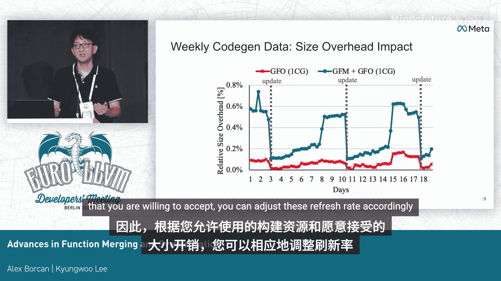
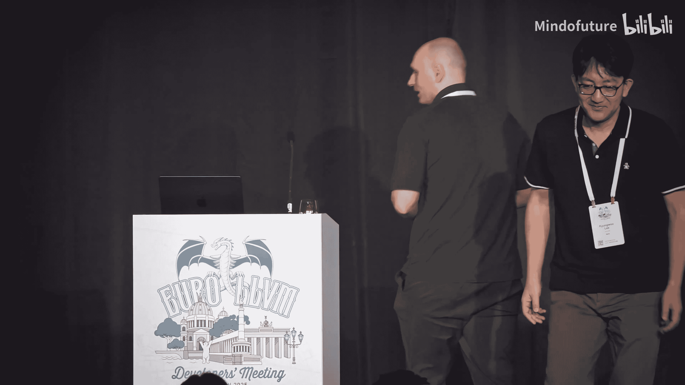
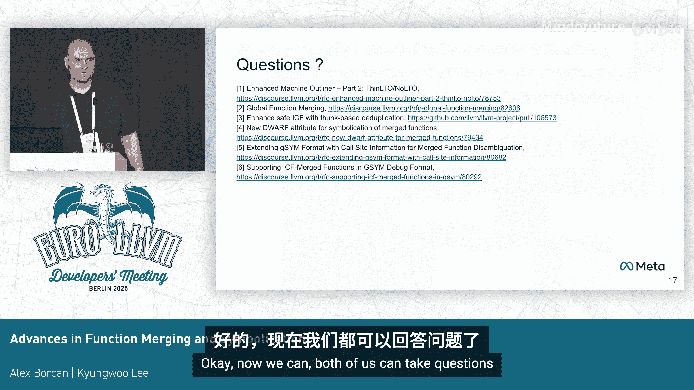
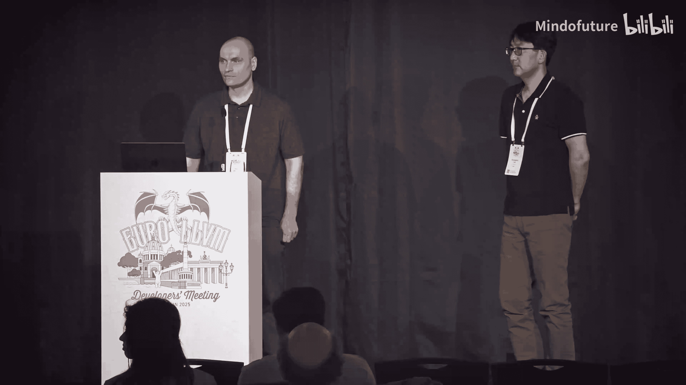

# 2025LLVM欧洲开发者大会-p29-P29-Advances-in-Function-Merging-and-Symbolication--BV1EoE9zUEbG_p29-

Hello， I'm working for Mera。 two years ago， I introduced global function merger here at U Arabiab in 2023。

I'm very excited to share that all these features are fully offstream that are available in Kang20。

 and also we take back into integration into our production in a scalable way using the distributed thinalTO。

Plus， the Alex next speaker， who is going to， who has taken step further to address the one the most challenging symbolification issue for the emerging functions。

So our mobile apps are getting bigger and bigger because we keep adding new features。 As you know。

 large and slow apps make impact user experience and user retention， user thinking our revenue。

 So it's critical to make mobile apps smaller and faster。If you look at this graph， in particular。

 the blue line， where baseline o magic is just applied。The upside growth has， know。

 quickly increased just in an year， which is over 20%。However。

 if you see the green line on the bottom of the graph。

 the gross rate is much lower because of our aggressive size of。

 like a function outlining or a function merging。Which I'm going to cover mostly in this talk。

So here is agenda I'm going to cover。 Basically， I'm going to introduce global function merger。

 which leverages Lier's identical code folding called ICF。Next， the next speaker， Alex。

And talkalk about you a safe ICF capability with the th。

And then he is going to talk about some challenges that we faces with me about symbolification of stes。

 and also he's going to talk about how to ensure sound stes for the merge function that are you know。

 relevant for the developers。So traditional function merger typically compares entire I R to see if they are identical。

In fact， the Lis ICF does a similar job。So when， when we enable so the the importance of the traditional function merger is minimal when we enable ICF together。

 which is typical setting in production。There is another function merger in the Sw report。

 which is able to not only identical but also similar functions through parameteritizing differences among the functions。

Let me give you a more concrete example with the two functions。

 They look very similar except the core constant target， which are F1 and F2。If you merge then。

 we can come up with a single merge function with extra parameter x2。

While these original function P and go become ths， while providing extra parameters。

 F and F 2 through the parameters。The downside of this traditional function merger is that they are only able to merge function within a single module。

Un you merge you combine everything into single module using LTO。

 then you are not able to merge functions across merge function across modules。In contrast。

 the global function merger is able to do that， even in a separate compilation environment like a thin L T O。

It actually uses the cogent data framework that has been in initially implemented for a global function outlineer。

Basically， at the high level， it has the two steps。 The first one， acting as a writer。

 generating cos data summary。 They can be merged at link time。The other one act as a reader。

 it the consumes the coient data projects from previous step to optimistically create merg functions。

As you know， that thin L T O backend compilation runs in pattern and independently。

 So there is no single orchestration。 So not only that there is a chance of sta of cogen data summary that we produce。

So our transformation is based on this summary data。 We cannot just merge in place。

 which can can lead to miscompilation。Instead， we actually merge the functions at link time。

 The way we do transformation during compilation is just can e colization of the function into certain you know merge function form。

Let me give you a more concrete example， let's say， in the first step over to No。

We can start with the original functions with the two module like this。

 They look very similar similar to the case I've shown earlier。

We first analyze each function into stable function form。

 which are independent of intermediate representation IR。 as you can see。

 we come up with the hash value， which is based on content of functions。And also just string name。

 and then locations of constants that we ignore， basically index to the instruction and or brand。

 And then they associate with constant hash value that we we ignore。When you combine a link time。

 we can combine into single summary that are grouped by same hash value。

 and also we compute the parameter that are a minimum set of the locations that are different among the stable functions with the same saved hash value。

In the second pass。We start with the same mood Your I R。Now， we compare against the summary。

And then we can optimistically create merge functions like this。 As I said。

 these module compilation running in parallel independently。

 So we have to make sure the merge function have unique function name。At the end of linking。

 if they turn out to be identical， then we can combine it to sync function through I CF capability。

So this is graph the early binary size improvement when we apply global outline and merger together with the thinner Q versus LTO。

 These are compiled under O Z， which is minimal size of humans。So as you see。

 the global outlineer flag is the same as local outlineer flag， machine outlineer。

 enable machine outlineer， which is actually owned by default for on the U Z targeting our Arch 64 arch。

 I'm6 for Arch。I also introduced Merji Flag， which is enable global Mer Fund。These flags。

 depending on cost data use or cost data generate， depending on these two mode。

 it could operate as local， which is default， when it consumes the cost data based on the previous summary data。

 it operates as global mode。Of course you can run in in to bag using single flag。

 but this is the only case for local thinT。 if you are about to using this technique for No till or are distributed thing。

 you have to use to express the that， which is scan and use。We。

 we have been tracking the relative ad size over the three past 30 weeks while updating the cos data weekly。

If you see the red， which is only outliner in April case。

 these relative size of overheadha is pretty low within only 0。2%。Which is pretty impressive。

 given the fact we have hundreds of thousands come in our socialrcly pool。

I think that this happens because our liner exploits very short machine instruction sequences that are tend that tend to be very repetitive and stable。

 So it's very insensitive to any sort changes。However。

 if you see the blue line where meji is enabled on top of the outlineer。

The size of overhead head becomes more noticeable up to 0。7%。 But our state is not bad， less than 1%。

Mger summary is basically is the most sensitivity source change because summary for merge is entire function rather than small outline sequence。

 So that's why it happens。So depending on the build resources you are allowed to use and the size overhead that you are willing to accept。

 you can adjust these you know， refresh rate accordingly。

Now， I'm going to hand it over to the next speaker， Alex。Hello， everyone。 I'm Alex。

 also working at Meta and。

The previous optimization logic was implemented the compiler。

 Now we're going to see how we improved function merging in the linker。So。

The linker is able to perform identical code folding known as ICF。

 where it can only merge binary identical functions。

 Here we have an example as a source code to functions A and B， and a function main。

 which takes the address of A and B compares them and returns the result。

 So we always want to return false here。 The address of A and B should never be equal because they are different functions。

As we can see in the object file， these end up as A And B separate functions， but identical。

 and then the function main takes the addressures of A， takes the address of B， compares them。

 and returns false。However， when linking with ICF equals all。

 which means that all functions that are identically merge。

 we see that we end up with only function A being kept and then function B being merged into it and all occurrences of B being replaced with a。

 So that ends up with main taking the address of a twice comparing it to itself and returning to。

 So this is a functional change that we got from enabling ICF that causess bugs and crashes in applications So how can we still perform ICF while maintaining program correctness。

We introduce a new ICF mold called Safe Ts， where we keep only when un enabled。

 we keep only one full body of the function。 And then all of the identical functions。

 We replace them with ths， which contain which consists of a single branch to the full body。

 So we can see here that in main。 we take the addresss of a。

 we take the address of the branch of the of the T。Of B。

 and then compare them and correctly return false。 So we maintain correct program behavior。

So for the ICF， when enabling this for real world applications， we've observed about 0。

45% size savings when compared to regular safe ICF， this is upstream for the LD Macco arm 64 linker。

 and it takes one flag to enable。Okay， now all of this function merging leads to issues with debug information。

 as we'll see。 So taking a different examples， function A and B are functionally identical。

 but they have different source code。 and then the function main calls B。

 and then calls A and returns。We can see that in the object file。

 we end up with two identical binary identical functions， but different debug informations for them。

 and the function main， we just call B and then call A and return。When linking with ICF equals all。

 we see that we only keep one full body of the function。

 We don't care about addresses here because addresses are not used。

 So this is correct program behavior。 And then in the function main we we branch twice to to the merge function。

 one corresponding to a branch to A and the other one corresponding to a branch to B in the original source code。

 And we can see that in the symbol for the binary， we only keep the symbol for a and same in the decent debug information we only keep the debug information for a。

 So at this point， all information of B has been completely stripped out。

 It's actually not possible to tell at this point that any that B existed at any point。So this。

 this function emerging can lead to symbol location issues， as we'll see。

 So we take the previous example again， and then we see how a crash in a would look like。

 So a crash in a would look like a frame in main。 And then the top frame in a， as you'd expect。

 So this is correct。 However， a crash in B would also look like a frame in main and a frame in A because they have emerged merge together。

 And we've lost all the bug information for B。 So this can be very confusing for reward applications where you have。

😊，Tens of thousands hundreds of thousands of functions arbitrarily merged together relative to the logical source code。

 and developers end up with very confusing call stacks where apparently completely unrelated functions are being called。

 This generally ends up with them thinking it's some sort of memory corruption issues and debugging for hours or days and figuring out that it's because of merge functions。

 So in order to this， we see that we'll need more data to perform correct symbolation in this merge function scenario。

😊，So what we do here is we keep all of the symbols for all the merge functions。

 even if they point to the same address in the binary。 So here we also keep the symbol for B。

Then in the debug information， this debug information， we keep the。

All the debugging information for all the mergesh functions。

 And we keep all of the call sites in the binary。 So wherever a call is made。

 we keep the address that is' made from and the target where it branches to。And similarly。

 in the GC debug information， which is just an indexed faster version of the DC debug information。

 we keep the debug information for the mergesh functions and all of the call sites。Now， how can we。

 how can we use this information to perform correct symbolation using the G debug format。

We take here the previous example in a typical production deployment where we have the completely stripped binary and the。

 the GC debug information for that binary。With additional data。

 And now we see how we can resolve a stack in a。So from the client。

 we get the raw frame addresses within the binary and we in order to take this approach。

 we symbolize from bottom to top rather than as usual from top to bottom。

 So we take the first address，0 x10。 We looked at that up in the GC file。

 We see that that corresponds to the main function， but it also corresponds to a call site to a。

 Well use this as a hint later on。 So we can look the lookup returns main plus call site A。

So we can correctly symbolcate the first frame as belonging to main。

And then when looking up the next function， we retain the filter from the call site as we apply the filter A for the next lookup。

 So then when we go into the GC and look up the addresszure 00，4。

 we see that this corresponds to two functions， A and B。

 And then we can correct by applying the filter， we could correctly narrow this down to being A being the functions。

 the debuggging information associated with the correct functions that we're looking for。

 So we can correctly resolve the full call stack as a framing main and a framing A。Now。

 for a call stack for B， a crash call stack for B， we again get the raw addresses from the client。

 and we see that the only difference here is the address for the first frame。

 So when looking that up in the GC file， we see that again， it corresponds to main。

 But this time it corresponds to a call site 4 B。So the lookup returns main Po callulsite in B。

 And then we correctly resolve the first frame as pointing to main。 And for the second frame。

 we applied the context filter B。So then when we go to look up in the GC binary。

 the address for the the first frame， the top frame， we see that again， it's A and B。

 but applying the context filter B， we can correctly narrow this down to be to needing the de bugg information for B。

So we end up with a correct call stack here with a call to with the bottom frame being main and the second frame being B。

So this is how we can use additionalbu the additional debug information to provide correct calls stacks in our applications where we maximize codes size by enabling as much function merging as possible。

 So this implementation is currently upstream。 it's currently upstream and it supports symbolation via GsM for Macco。

 but it is possible to extend debuggers and other symbolification pipelines with this approach and to enable this we needed to modify and we need to pass flags to clang to LLD the link and we need a recent version of Dimmal。

 and then for the symbolification via GsM， we need to provide additional additional flags and also to change the way we call LDMGCmle to perform the resolution the symbolification of the callst from bottom up。

Y， and yeah， that's our approach for， correctly symbollocating the bug information。 Okay， now we can。

 both of us can take questions。

Oh， wait。 interestingteresting work。 Does this work for indirect function calls like function pointers or virtual functions。

 So right now， upstream， we only have enabled support for direct function calls。

 We do plan to add support for indirect function calls like virtual functions and objective C selectors will base that on the function name。

 So the context filter in our case is actually a regular expression。

 So we can use the function name for virtual functions and the selector name for objective C selectors to narrow it down to the correct function。

 Now， for raw for raw pointers that you just arbitrary call。

 That's we can potentially narrow it down to like a few a few functions that we can sort the developer。

 That's the plan。 But it's difficult because that's basically just like user input that translates to a function。

 So it's not really possible without having some sort of data analysis also integrated into this。

 yeah。And this looks really cool。 what。Are there any plans to extend it。

 to do work to extend it to the other formats and architectures or you don't have a need for that。

 So we don't have a need for that。 Yes， unfortunately。

 but we have designed it to be extensible and usable for other architecture。

 The Gcent format is actually supported。 We use it for symbolating other architectures。

 So we might enable that internally and also ship it upstream。

 but there are no plans right now to do so。

