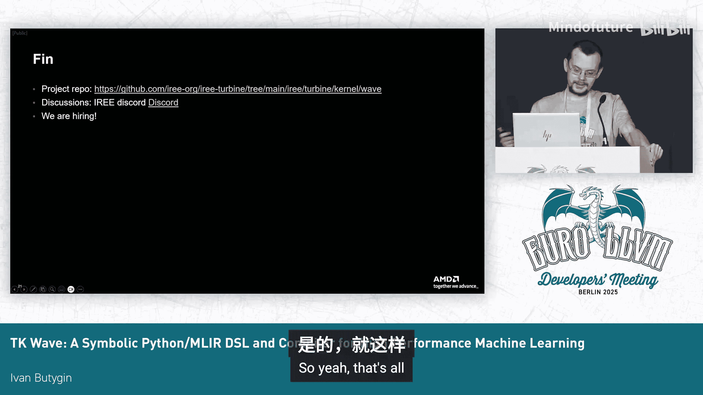
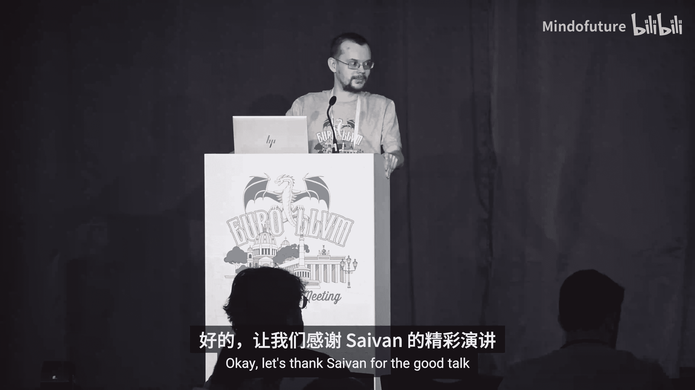

# 2025LLVM欧洲开发者大会-p30-P30-TK-Wave---Symbolic-Python-MLIR-DSL-and-Compiler-for-High-Performance-Machine--BV1EoE9zUEbG_p30-

So， first of all， motivationational， motivationational slide。

 So this is tiled an optimized gem kernel。 like， and its styled an optimized gem kernel。

 which fits into a single slide。 So it's quite an achievement so。😊。

What exactly is wave is this this is symbolic domain specific language for high performance machine learning。

 it's targetingrog GPUs currently MDG GPU only but it should be able enable other vendors if needed to use python syntax and simply symbolic expressions for the kernels。

 it does explicit separation between high level kernel logic and distribution strategy to use MLA for cogen。

 mostly upstream dialects， and it uses E and E as last mile optimizer and as time to actually launch kernels。

So。Why actually do we need the new language， so。All modern machine learning machine learningloads like require hardware GPU in26。

26 to use for a good performance。 and like all GP vendors have them in some form and the direct programming like in or he is very pro and time consume and those intrinsic security vibrations working across many threads not fits into usual C model needs some non trivial data layout and registers or memory and and scheduling like which is intoous logic。

 So we need them more convenient way to do to write high performance kernels。

 there are other languages which are working on this and triangs like but we still believe we still believe we can provide something novel like and provide more convenient way to write kernels。

 So in our case， so we have our high level。Okay know this description operating on a whole T level。

 our tiring distribution strategy like。Separated from the actual hell kernel description and can be changed without changing clear kernel。

The language， like tall and distribution appear on block on GPU block， A group level。

 which is then later subdivided into wave level。 We are using symbolic data type of data type data types for tensor shapes and for the distribution patterns and for the other some other things。

Like when we have distribution and kernelal memory access pattern for blocks andters decided by the compiler transparently。

 they are using masking for the。Onal line shapes like mask and vector ropes。

 And it's generally's like innovative way to test various hardware like what move hardware in 26。

 which require like all require like different layouts and such。

So let's see first for the simple element wise copypi kernel， just to see basic Cons。

 And so there there are three basic parts， which is kind of out of order here。

 But so we have a distribution description， which is called constraints。

 So we we specify how how divide our block and our how divide like entire work into blocks and then two waves。

 we have kernel body。 And it's， in this case， it's really simple。 So we takes two tenors。

 read one write to the other all tens symbolic M by M by N。 and so on。 and finally。

 we have a final final part。 and actual symbol values。 And then we compile compile kernel and run it。

😊，So here's jump kernelnel again。 And now well look at the actual parts， actual important parts。

 So we have hard trait， which describes taxpayer per wave， basically。Wa size。

 and it it describes like it says M O A momentum to use for M O A operations。

 We can set M A also pair ops， but sometimes it's more convenient to set it globally。

 We have we have assumptions。 So for dynamic dims， we can specify some properties。

 which can be used for by compiler for optimizations。 So we have Ts descriptions， which shape。

 data type and also enter space， which。😊，Which controls should we promote this to shed memory or not。

 We can allocate temporary storage using register。 And this is virtual register， which is like。

Has a full， full M A shape， full M shape and by N。 And then you have reduction loop across key dimension。

 And as this is normal， normal M。 So read two arguments M call M A M A up。

 which will can to the will be connected to the actual in6。 and then write the result。

So this is a more slightly more complicated example。

 So this is convolution through of the implicit gem and。If we， if we go to the。

But so the kernelal itself looks almost exactly as a normal gem。

 except we have4 dimensional tensors as inputs and outputs。 And we have special thing called mapping。

And my pink is。Describes auto map for the convolution inputs to actual 2 G。

To the input expected by M MA。 And it's basically， it's kinda similar to aar Leonult generic when you have iterators。

 which just correspond to generic parallel itators。

And you like map output to I N J and up input to the users this like foremosts how to actually translate。

Eient position from the input to output and outside。 they don't have。

 We don't have reduction iters yet。 we have also indirectederators， which I don't have in slides。

 but they basically allows indirect read or rights。

And here we have like part of the attention kernel。 Unfortunately。

 attention doesn't fit entirely in the into single slide。 So， and it's more complicated。

 So it has two M Ms， two M Ms inside the， inside the reduction loop。 if， it have like。Also。

 reduction reduces across world groups。 It has global marks and global sum operations。

 It has direct international success and some more advanced features。😊，So。

So let's go to the actual architecture and language architecture， so。Ftent middle end Bant， as usual。

 So for the front， we are using Toy f tracing for the middle end。

 we are kind of using Toy folks as intermediate a。 We'll。

 we would like to switch to em fully at the at some point。 but it we are not there yet。

 So we are doing some important transformation。Here's here。 And finally， in Baant， we are doing。

Upstream， we are using upstream Amalia dialects， react， react， S D S， S F， M G M D dispute dialects。

 We are using E as last mile optimizer， and we are also using E as runtime to launch kernels。

 There are also some ongoing work to enable stand alone runtime， which doesn't require E。

 but its what work in progress。给。Going to the front。So we are using Do F。 We are using Do F I think。

 so。Trace basically just calls your kernel by body with special perxy object。

 which construct the actual calculation flow inside kernel。 So they don't with tracing。

 you don't need the actual like python par here to pass kernel。

 And you can enable kernels like completion pretty quickly。 But as downside basically you。😊。

You need a special hand link for the。For the control flow， as you can， as if I switch back to。

Back to the good example。The reduction loop is actually a function wrapped into Python decorator。

So it's， it's okay。And they are using。And Tohi F itself is basically another。

 like intermediate representation。 Python， It's Python based area。 As I say。

 we have our very specific c and types。 We are using symbolic types from Si to do symbolic calculations。

 and we are leveraging some Tohifs Tohi infrastructure for graph rights。

So on the important transformation。 So we have index synchous analysis and shape T shape analysis。

 Basically， M O A instructions require nontrival， nontrival data layout out。 So we basically。

 we start from the M O A nodes in the。Execution graph and then propagate shapes backwards and forward。

 So the graph， like through whole nodes， the aream code to to resolve conflicts when you have different different layouts。

OrLike conflict clear layouts when you arrived from the different directions from the multiple M mice。

 for example。Some broadcasts or even like worst case， like moving to shared memory and back。

And there is also thing called expansion。 So in our case。

 we have wave for waves for which we can set basically any tile size。 And。

 but to like to map it to have inter6。 they usually have fixed size like something like 16 by 16 by 16。

 So we can， you can， you might need to basically unroll stuff and generate like sequence。

 sequence of coal to to the inter6。 oh yeah。嗯。We have a bunch of， we have a bunch of other。

 other optimizations happening in torture。Tohi F stage。 I'm not， Im， I won't go like。

Into much details into them is basically some shared memory layout optimizations， barrier insertions。

 like。But part， partitioning the read rights when you。

 when they are not actually like contiguous read or rights and stuff。

Like glue oisting and stuff like that。So， if。If you go to the。If you go to the Baant， so。

To the actual lowering， we are using。 So we are using a fine apply and a fine expressions to lower。

Symbolic types to like symbolic calculations from S。 So they， they basically related to the。

To the a fine apply when it's。Up like when it's directly mopped， can be directly moped to the。嗯。

To the fine expressions。 And otherwise， we are just generating like sequence sequence all of the like Arith Arith ops can generate select and such。

Like。We also can generate。 Sometimes we need to generate vectorized index calculations。

 So a fine plane doesn't support this currently。I have。

I have draft PR to enable a fine apply on vector types。 I'm not even sure at the point。 I go。

 I want to proceed。 but Y Ys is there so。But I have to go over link。

 we are calling simple eye simplifications。Functions to simplify expressions before。

 And then when we're done these expressions。 So well， we'll lower the rest of the operator。

 So we is leverage it to the like react react have to Ga mask load write like to store cutter and mask store M O A allow to like currently to M GPPU M forA 6 used to GPU shuffle。

 and we have some special like we have some also instruction scheduling code It's not。

Not very advanced to this point， but we still can do this。 And we are laing。And we are using click。

M DGPU specific instruction bias。In intrinsic to a climate instruction movement between Ps。

 And after all of this。Everything is loaded at to L V Mayar and then to the G P。

Som compiled for the MGP。Andm also yeah using。It it as run time， so。

They are using ED infrastructure to actually to be able to launch kernel。

 So the output is our language is just like GPU fun。 This is some GPU code。

 and E provides all the necessary host infrastructure to to run this kernel to in to do inter with Pytorch。

 like to do like to use。Py turns Pyto tenss with like this minimal overhead， which is。

 which wasn't really minimal overhead。 And there are some issues here， but we are working on it。

And so， so we can， we can just call our JQ kernel with Pythto chas and we can just call our kernel from Python and we can catch it and we do stuff like this。

And there are some， there are a few important optimizationmunizations in the backend。

 like in the actual， not really bookend， but Beckend， in a sense， in in the emalia part。So。

We are using。We are using like normal vector vector and di con con。 We are using。

We are using like at CE， and we are using inter analysis from ED。

 So inter analysis technically is upstream。 but in E D， in E D， there are some improvements over it。

 so。So what we are doing， like， we are reducing number of cars between in integer and index types。

 We are reducing some like， it's often possible to reduce like 64。

 So all index configurations initially generated I I 64 and。We are。

 we are using interaction just to users to I search it2， if possible， if like。If。

 if inter int is like fits。Into the range。They are doing。Al， we， it is。

 it is doing divisibility analysis。 So you have like。You have ，64， like。You have， for example。

64 threads and you， you can have， you can these like expressions。Pd ID D model is 64， and it。

 it can be like removed entirely from the code because we， we know we。

 we have like 64 threads so we can。We， we can do this。And。So some。

 some important things we learn like we learned from this。 So the， the compiler itself。

 So the language itself is completely potentython。 So users write。Kvinnas in Python。

 But the language itself， the compiler itself， is also written。Britain is in Python。

They are using Malaya。Emalia， Python painting， tox， Amalia， like。Using python for the compiler。

 because it's like potsum cons。Like the compilation。

 the compilation speed like definitely suffers when you're using Python。Like， it's partially upset。

 But the， by the fact， we can。Crash colons， like， you can crash colons in memory and we can crash colons on disk。

Like， and also， not all ML things I exported。Exposed to Python。

 which is expected because like Ame is like cheappot last lost。 and basically via， via agent。

 like missing things like us needed。On To， Tohifs side。 So Tochef is like Tochef is like minimal I R。

 It， it is good to， to enable like font stuff and to quickly enable。😊，Quickly enable， like and flow。

 We had。They had to implement some common utilities in on top of Tohif。

 like C the contaminatlimination and such， we would。

It really like not to do this and use emmelia directly， but it's not fully possible at this moment。

 And so going， going to the question why we cannot use emmalia， like fully in in the compiler。

 So there heavily heavily rely on symbolic expressions in like in the language And there are no like good symbolic expression type and symbolic symbolic tensor type inalia。

 like there is nothing in obmallia。 there is like a fine expressions which cover some cases。

 but not much。 And honestly， I don't even have a good。

 good design houses like houses like symbolic types should like， should should look like in。

In Eala and also in the same time， work efficiently。So this is open question。

 but we would really nice to have one。 And like， we are， we are open to collaboration。 if。

 if someone have any ideas， well， we， well be very happy to like， re。😊，And also on E side。

 it is actually really good to enable and and flow， like to quickly enable and flow。

 So from our side， we only needed like the red GPU kernels。😊，And then like there' are few lines of I。

 I custom like flow flow dialect and another flow and steam gel dialect。 and， like。

 and few few API calls and it's like allow it， allow it to like enable full。

 full end to end flow so you can， you can pass Pythtor cha array。

 you can you can run your kernel from Python and。And such。

 And it would be really nice to have something like this。😊，In upstream malair。

 I'm not sure how good it like feed this python， Python， Py torch stuff， but it can be discussed。

 but yeah， anyway。And yeah， that's all。 So the project itself is open source。 It's on Github。

 You can check it。 We also have a discco discussion discussion channel on the ED Discord so you can join and ask questions or this。

 And also， we are hiring currently。 So if you're interest interested to work。😊。

This is we will be really happy。😊，To listen for， to listen for you， so。

Yeah， that's all。 So questions。 Thank you， everyone。Questions， please。

Thank you very much for the talk。 I have two questions。 One is。

 how do you compare wave with Triton land。 And the second question is。

 what is the performance of the kernel that you see。

 which is written by wave versus a peak performance that's maybe the kernel manually written。

So comparing to Tton。 So Triton Tton is good， but its have some issues。 You have like。

To write these indexing， indexing and expressions like。Poiner， pointer， pointer mask stuff。

 And you have right to masking stuff。And it's， you。

 you still have like kind of T decisions intertwined with actual carial logic while we。In our case。

 we strive to like， to have them fully separate， fully separate。

 So we have have high level kernel and then have like distribution and talent specified like completely separately。

 So you can switch you can switch between them without like without do too much changes into into the kernel and also patternton contains like basically this direct calls to。

😊，嗯。To idea， something or I don'， don't remember。But I something。

 And this idea calculations is also completely abstracted in our， in our case， on performance side。

 So we are。So we are currently comparing。We are currently comparing with M DGP Uytan。

 and we are mostly like on par， sometimes sometimes slightly， slightly slower， sometimes slightly。

 slightly faster than M DGput item。 this is for their attentions。 for the gems。

 We compared with hipblast some time ago， and we were also on at least on par with it， so。

I would say performance， performance is pretty good， considering like how easy to write kernels。

Like Trirenton lands about 10% to 20% of peak performance， right。

 So are you saying that wave it is on par with Triton。I mean。

 our main target at this point just to be basically just just be on par of butters and Titan。

Thank you。Yeah， I have a technical question。 You mentioned symbolic types。

 Do you have dependent types or just symbols in tens。嗯。I mean。

We are like we are using They are using symbols for the like。

 We are using symbols for the like tensor dimensions and Europe。

You you can do like trivial dependencies between turns or dimensions。

 sometimes they are using symbolic types， like symbolic types and symbolic expressions effectively in this similar way。

For the mappingian， for example， we are using in the similar way you use it you will use it。

 for example， in linear ultragene， for the a maps。So so this is like not full fledged。Depenent types。

 And that is something that is easier to model in Malay answering。 Yeah， your P S。

 If you had had real dependent types， that would have been much harder。 I would， I would say。

 I would really。I would， really。Want to have like symbolic tensor type in Emmalar when you when like each dimension of the tensor is actually like some symbol on。

 on some expression。 But I'm， I don't have， like at this point。

 I don't have a good design how actually it should looks like in Emmallayar。

 Come to the open design meeting。 Yeah， thank you， definitely。More questions。Okay。

 let's thank Sa for the good talk。

👏Thank you。

