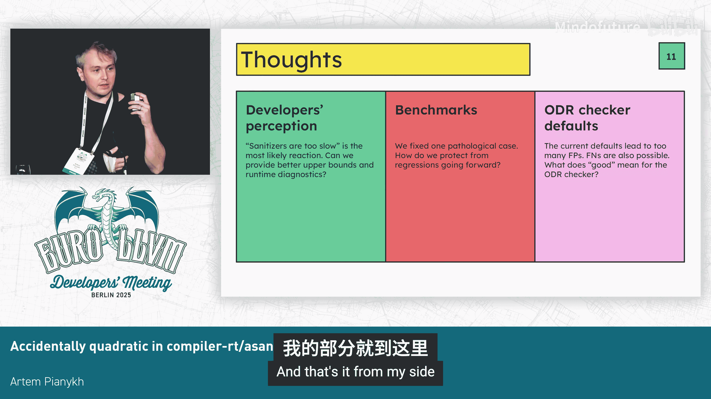

# 2025LLVM欧洲开发者大会-p32-P32-Accidentally-quadratic-in-compiler-rt-asan--BV1EoE9zUEbG_p32-

He， my name is Artem。 I work at metata， and this talk is about a fun performance bug in As runtime that I fixed recently。

 Let's start with a motivating example。 We have a simple program。 It just prints hello URL LVM。

 This program， however， depends on the number of shared libraries。

 Each shared library has some number of unique symbols and some number of shared symbols duplicated across those shared objects。

 but they have all the same size。 So it's not an node D violation in strict sense。😊。

You would expect that this program probably should just start and finish instantly。However。

 before the patch， it would take over 5 seconds to print hello U URL L OBM to the， to the screen。

 And after the patch， it would be pretty much instant。😊，So this is a simplified example。

 but it actually is very representative what we saw in our production。

 where development binders would actually spend from 2 to 20 seconds doing something before they actually start doing what they are supposed to do。

So since this was my first encounter with compiler R T。

 I'll tell a little bit about my debugging experience， troubleshooting experience here。

 looking at the Perth report， it was pretty clear that it's something that has to do with ASNN and globals。

 but otherwise this tech trace wasn't really very informative。And I guess like at this point。

 when you're a developer and you see this kind of problem， this reaction is not very unlikely。

 And we actually saw a pattern of projects starting to switch to an unsanitized build modes because of this problem。

However， we in develop infrastructure， we really like ASan。 We want more Asan and more safety。

 So it was important to resolve this issue。 make sure that developers can fall into the pit of success。

Continuing with the Perf， if we annotate the hotspot， like it we get a little bit more information。

 some names。 But otherwise， we're dealing with optimized code here。

 So it's not really straightforward to go from this to the original source code。However。

 if you squint hard enough， you can actually see that this loop there is kind of an iteration over a linked list。

 We load from the second word。 and then you know we do the test and whatnot。

 So this was actually enough to trace back the hotpot to this for loop inside checkout your vi violation by indicator。

 And so what is happening here is that when there is a potential violation。

 It triggers iteration over the linked list of all globals in the program。

 And if you have millions of globals， this can get very， very expensive。

 like2 to 20 seconds expensive。😊，And so what's happening here is that when we。

 we compare the ODR indicator to check if it's the same global and then some other conditions before maybe reporting an ODR violation。

So。The fix is actually very straightforward。 We just replaced a list with a map indexed by the indicator。

 I would like to thank Vitali for the review and context on the compiler or T code base。

 But the fix is actually just， you know， it fits on the screen。 It's very straightforward。

 You can probably come up with a synthetic example where it's still slow， but empirically。

 we like for us， it resolved the problem completely。😊，Allright， so thoughts。

 I think developers perception is important because unless someone is actually involved in like O VM and like the tool chainney stuff。

 sanitizers are too slow is's probably the most like reaction。

 And there's usually not enough time to like nuance。

 So even if people want to not turn off all sanitizers。

 they will probably not know which part of acent turn off to avoid this performance problem。

 So I guess like the question here is can you provide some better upper bounds and maybe runtime diagnostics to lead developers to the right conclusions。

 The second thing is benchmarks。 like here we fix one pathological case。

 but how to protect from regressions going forward。 I am new to the compile base。

 And it's not really it wasn't and still is not really clear to me how the performance is track and regressions are。

Identified maybe some matter of documentation or improving the benchmark suite。

 but I think this is something that is very important。

 and I don't think I have time to talk about the third one。

 but if you want to chat about ODR check or defaults。

 please wave with me or find me after after the talks。 and that's it from my site。

 Thank you very much for your attention。

