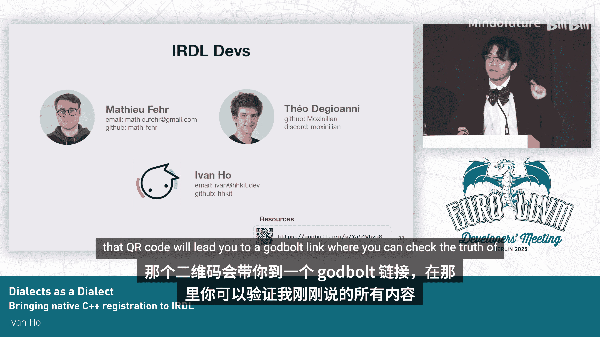

# 2025LLVM欧洲开发者大会-p33-P33-Dialects-as-a-Dialect---Bringing-native-C++-registration-to-IRDL--BV1EoE9zUEbG_p33-

Hello， everyone。 I'm I。 I'm from Cambridge。 And today we're gonna talk about dialects。

 So I'm kind of new to the whole M I scene。 But if there's anything that has been hammered home is that we do everything as a dialect。

 I mean， we do arithmetic as a dialect。 We do control flow as a dialect。

 We do functions as a dialect。 We even have transform as a dialect， right。

 And it should come as most surprise that someone woke up one day and said， hey。

 why don't we do dialects as a dialect。 Behold I D L， the I definition language。 Now。

 you might be thinking why would you do I definition as a dialect。

 rather than show you a slide with a bunch of bullet points。

 I'm gonna show you what I D L looks like。 that is an I D L file。11 lines of code。😊。

And it just works。 What does that mean， Well， with a single operation， you can define a dialect。

 You can define a type。😊，And you can define an operation。And all of this is just ready to go。

11 lines。 Allright， How ready is it to go。😊，On live upstream M， O， I， R right now。

 you can take this I R， D L file and you can pass it into M O I R opt。😊，As a flag。

 without recompiling M IR opt， the I RD L dialect is loaded dynamically。

 and you can immediately use it in any M L IR file that you want。😊，Once again。

 very little code to get this running on top of that。

 notice that we have a complex that's templated on some kind of floating point。

 And we expect when you take the norm of that complex to splitit out the same floating point type。

 I R D L is able to verify this and split out an error。 if you， for example。

 were to emit a floating point 64。 Once again， same 11 lines of code。

 And that is the pitch for IRD L。😊，Is a dialect for defining dialect that is concise， introspectable。

 dynamic and genetable。 And it just works。😊，Its that not really。What do I mean， Alright。

 Compr engineers， I have a question for you。Is passing a program enough。

 Is it enough that we verify the semantics of a program。Well。

 if you paid attention to Alex Denenko's talk yesterday is's not enough。

 You still have to execute it。 And how you do that is by taking this high level dialect and lowering it to the hardware。

 How you do that And M L I R is with the rewrite drivers。 So this is incredibly a bridge。

 But what the rewrite driver does。 is that it traverses the whole tree tries to find a pattern of operations to match and sends it to a rewriter。

😊，How you do that with a little bit of C plus plus code that you don't really need to know what exactly it is。

 Just look at the， the red parts， which I have highlighted because those are static C plus plus types。

 Now， here's a problem。 I R D L is loaded dynamically。 And we do not recompile M O I R。

 So what this means is that I R D L doesn't work with the existing M I R， C plus plus infrastructure。

😊，Oh well， No， I saw not until two weeks ago， A lot of blood。

 sweat and tears has been put into making this command work。

And what IRDL to CPP does is that it takes an IRDL file and spits out C+ just as it name this。😊，Now。

 as for what this C plus plus gives you， Well， did somebody ask for static C plus plus types。

 That's right。 Now you can use your IRD L dialect and you can rewrite it just fine。😊。

But we didn't just make this happen。 We put a lot of effort into getting infrastructure to work。

We have Cmic functions that generate targets so that when your M I opt that relies on the IDR dialect needs to recompile。

 it will detect the change when you change the dialect。

 We also invested a lot of time in getting proper unit testing going。😊。

Because we want IRD L to be stable， right。And we've done all this work。 And， in fact。

 this PR is just about ready to ship。 I think we're about a week or so away from getting it fully committed。

 although I will say big caveat， only a small subset of IDL features are supported right now。

 We have done foundational work。 There is still a lot to be done。😊。

What that means is that if you think this is cool，11 lines， easy verification， all of these keywords。

😊，If you think that that idea resonates with you， I would like to invite you to come help us。😊。

I think the I D L devaf team is full of very kind and approachable people。

 and they really helped me out in getting to know M L I ecosystem。

 Matthew and Theo are some of my good friends， and I would like to pass the torch forward。😊。

These are our contacts。 If you'd like to help out， please， please send us a message。

 We'd love to get you on board。 This is the end of my slides。

 But if you are interested in trying I RD L， that Q R code will lead you to a Godbo link where you can。

 you know， check the truth of everything that I just said。 Well that's it。 Yeah。

 Now next guy can come on。 Thank you。😊。

