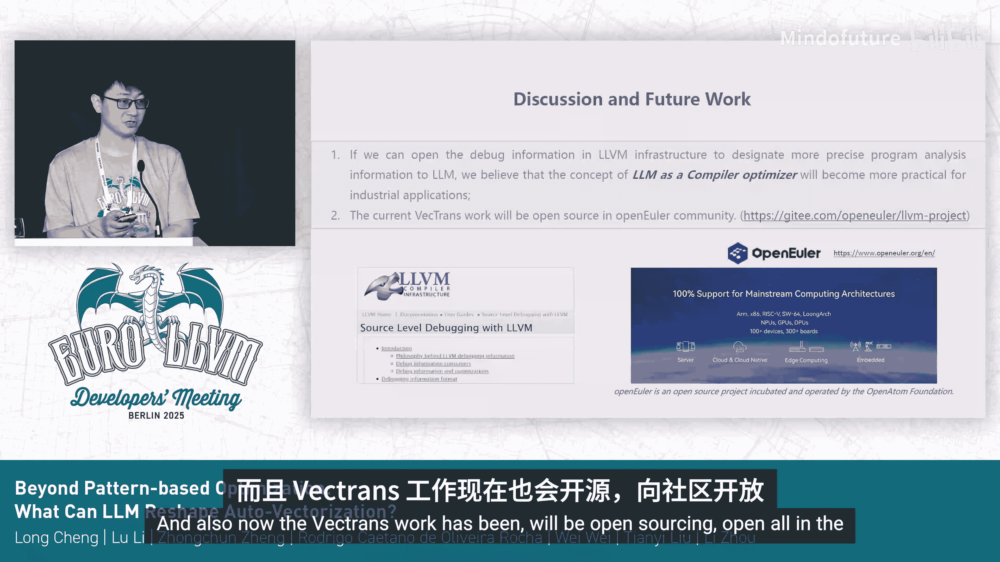

# 2025LLVM欧洲开发者大会-p34-P34-Beyond-Pattern-based-Optimization---What-Can-LLM-Reshape-Auto-vectorization--BV1EoE9zUEbG_p34-

So today， my talk is mainly about how to integrate large language model to enhance the auto vectorization in L M。

 LVM compiler。Well， in industrial applications， the autoization is quite important for many applications like HPC。

 as well as some mobile applications。Well， but so for example， like the Huawei。

 we were also developed。 the vision campaign is LVM based and is highly optimized for CPU。

 which is also unbased especially for the neon and SV instructions。

 but but it good enough for auto vectorization capability for this kind of LVM campaign。

 Well the answer is possibly not even for the very simple benchmark， the T SV C2。

 Well we just found there there is still about 34%% of cases that can't be well vectorized by this kind of well even the industrial campaign。

 well， then if we just utilize the analysis to to find the the course we can find is mostly due to the limited analysis for the memory dependency。

 as well as the reduction。Well for industrial， realistic， industrial application， like H say。

 there is big possibility。 They They won't behave very well for the auto vectorization， so。

So we try to just introduce the veterans。 This is a model compile agent framework to massively enhance the capability。

 it has some basic features for example， guided source code transformation。

 So it' suitable for C and C plus plus or maybe fortune。

 and well it also explain the and paradigm and naly support the cross verification due to the source code transformation。

 and form the following results you can see it can generate effective results。

 So here is a very rough framework for the work for no。

 So just imagine you are the performance engineer。 then you give the prompt I just want to vectorize the source code。

 which is very hard to be vectorized using the RVM compile like the Bi Well then it will for example。

 the deep。SoIn with many multiple sources feedback， okay。Thank you。

 And then well generate the optimized source code and which is easy to， to。

 to be vectorized by Bi to the D。 here is the results。 and have a very quick。

 And compared to the previous work naive Bieng， as well as the native arm vector rise。

 Yeah the success ratio。 Yeah， you can see that we we can achieve good results。

 and it also demonstrates the importance of campaign feedback。Well。

 but it's not enough is's just for simple code。 If for real realistic application is usually very not and communicate。

 So the remark remark information from the LVM is not enough。

 So we try to just open the debu information。 And also the now the veterans work has been will be open source in open community。

 So that's my So if you have any interest to this topic， just find in the wrong table。 Thank you。

