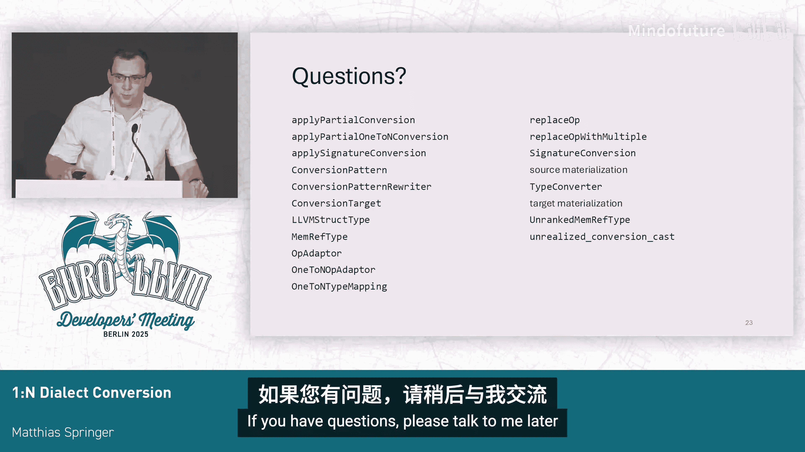

# 2025LLVM欧洲开发者大会-p35-P35-1--N-Dialect-Conversion-in-MLIR--BV1EoE9zUEbG_p35-

Hello， everyone， so I'm going to talk about the one to end dialect conversion framework in MLIR。

 and I'm mostly going to talk about how to use the framework and why it is important and why you may be interested in that。

If you have been following the dialect conversion changes over the last few months or years。

 actually， you may have noticed that a lot of stuff has happened。

 So it all started with simple rewriter or listener improvements adding listeners additional notifications or adding support to the dialect conversion then went into some internal refactoring of the dialect conversion framework along with some bug fixes and so on。

 And just recently in the last four months， I've been working on one to end support。

 which was partly implemented in MLR， but not fully maybe also seen a few RCs on discourse。

 So one that I posted a while ago was in relation to the oneshot dialect conversion framework。

 which is an effort to basically improve the performance of the dialect conversion and make it simpler。

 but as I was working on that， it turned out that I needed to do some additional or earlier simplifications。

 and that's why I worked on the one to end stuff before。And finally。

 one thing I have planned is using Dionto and dialect conversion for the MeF to LLVM lowering in MLAR。

 and I'm actually going to use that as a running example throughout this presentation。Okay。

 so the dialect conversion is one of the two main pattern drivers in MLAR。

 It's a bit more powerful than the pattern rewriter。

So the conversion rewrite is a bit more powerful than the pattern rewr。 So， for example。

 you have the what you can do here is you can apply signature conversions。

 or you have more additional functions to deal with with type with type changes。

And so this is what we have today。 And what was added over the last few months。 Basically。

 we have additional overload here now or additional function。

 which is called replace op with multiple。 And what this allows you to do is to replace an operational with a range of SSA values。

 So basically， every op result can be replaced with multiple SA values。😊。

So the applied signature conversion already supported that before。

 but we were missing this kind of functionality for， for opera results。

So why was I looking into this。 So the MLR co was in a bit of an unfortunate state that we have this existing dialect conversion。

 which supported one to end conversions partly。 So as part of signature conversion， it was supported。

 but you could not use that to basically replace operations。 So people had to use workarounds。

 and the L the member of LLVM lowering is one example of that workaround that I'm going to show later。

Also， we have this separate dialect conversion framework。

 which is in this one to n type conversions do H header file。

 which was implemented by a colleague of mine because of missing functionality and as an attempt to bring one toN conversions to MLIR。

 but they were not really composable because this framework is actually a greedy Pat rewrite。

 So this is now no longer needed and I plan to delete this after this conference。

 So a few more words how to migrate your code if you're using that later。So why is that important？

 So actually， we care about that a lot in Nvidia internal workloads。

 because we have a lot of one to end dialect conversions and we have to rely on workarounds that are slow and and produces a lot of Ir hard to debug。

 But there are also a few of these one to end cases in MLR itself。 For example。

 the member F to L VM lowering is an as a one to end dialect conversion。

 Or if you look at the sparse compiler， there's another example of a one to end dialect conversion。

 also other projects use one to end dialect conversions。

 or they have something that could benefit from a one to end dialect conversion。 For example。

 the Triton framework， it has this step where goes from level to Ste level。

 and they have to resort to workaround because there is no one to end dialect conversion available until recently。

So let me briefly talk about an example。 So you know what I'm what。

 what the work around this that we have at the moment。 So let's take a look at member to L LBM。

 So this is how we lower it at the moment。 So you have a member type。

 And because we don't have one to n conversions， one SSA value has to be converted to another SSA value。

 So in this case， we lower and a member type to an LBMstruct， which has two pointer types。

The reason why it's two pointer types is because we have an allocated pointer and an aligned pointer。

 Then we also store an offset in there。 We store the sizes。 that's because， well。

 this is a 2D me and also restore store the two strides。

 So all of that is is stored inside of this LL VMstruct。Now， if we would have a want to end lowering。

 we could just do the following。 One SSA value gets directly replaced with 7 SSA value。

 So no L L VM struct is needed anymore。And the same applies for unranked mes。 So at the moment。

 we lower to an L V Mstruct。 But this could just lower to two SSA values。

 a pointer to the descriptor and an I 64， which basically indicates the rank。

So to show you how MLR or how your code base may be able to benefit from migrating to one to n。

 let's take a look at a concrete example。 And here we have a memory of subview and a subsequent load。

 and we'll take a look at how that is lowered through MLR today and the two passes that you have to use for that is this expense drieded metadata pass。

 that one is needed just to break up the memory of subview into something into two other operations that you're going to see on the next slide。

😊，So basically， it's broken up into this extract strideed metadata and reinterpret cast。

 That's just an implementation data。 But now at this point。

 we have lowering patterns in the in in the finalized member F to LL VM pass。

 We have a lowering pattern for each one of those three operations。

 And we can basically call this convert it to L L VM。 And that will lower it。

So this is the AR that you get today。 So youre gonna receive。 Well， it was just what five operations。

 And now this expanded into 34 operations。 And if you take a closer look。

 what is happening there is that well at the function boundary。

 we already have we expand it the member into multiple SS A values。

 That's because block signature conversions already support it one to n。

 But for all the other things here， we basically have to pack that into a single SA value。

 So here's a target materialization。 that packs all the values into an LVMstruct。

 Then the pattern comes along， it needs to get some information out of that LVMstruct。

 So what does it do， it unpacks all the values。 does some computation。

 And then at the end packs it into an LVMstruct again。 next pattern comes along。

 It unpacks the LVMstruct。 does some computation packs it back into an LVMstruct again。😊，Right。

 so with a one to n implementationer， I actually prototype this。 If you're interested。

 you can take a look at this code here。This is what you get。 So basically。

 we generate much less I are， because all of this， all of these operations that you see here in the red boxes。

 they basically don't do anything。 They just pack and unpack。 And this is， this is what you get。

 If you use a one to end approach to， to your lowering patterns。And interestingly。

 if you run the canonicalizer pass on this thing， you also get this IR more or less directly。But。

 but all of that is a compilation overhead。 We generate a lot of operations that are basically useless。

So let me briefly talk about how to use the1 to end dialect conversion。 So， first of all。

 in the type converter， you have to use this addd conversion API as usual。

 And basically here you can specify， well， for this member of value。

 these are the multiple types that that it should be replaced with。 So in this case。

 the the member type that we have before was replaced with7。Well，7 LL VM types。

 So you have to do that in the type converter。 Then you have to specify your type conversion pattern in here as usually you have your operator andll operator your adapter。

 and inside of that adapter， you want to use you want to use a new class now。

 you want to use this one to end up adapter instead of the regular up adapter。

 And the only thing that's different here is that for every every time you query some opera from the adapter。

 you get a value range now instead of a single value right。

 because there may be multiple replacement values， for each of the original SSA values。

So what happens if you forget to update one of your patterns。

 you have a one to end conversion in your type converter， but you didn't update a pattern。

 You still use the original up adapter。 So if you do that， then you get an error。

 So basically LLVM fatal error。 And it tells you， well， I'm running this pattern here。

 I'm trying to get the replacement values。 But you're asking me to get to give me a single SSA value。

 But actually there multiple SSA values。 So this can be used this kind of a debugging tool to figure out which patterns were not updated yet。

Okay， so just a few words about the deprecated one to n type conversion。 If you're using that。

 pay attention， otherwise， this might not be relevant for you。嗯。

So this will be deleted from Opstream Mya after this conference。

It's already been deprecated for a while， and the conversion is pretty much straightforward。

 So instead of one to n conversion pattern， you want to use the regular MLR conversion pattern instead of using apply partial one to n conversion。

 you want to use apply partial conversion。 One thing that you have to watch out for。

 you have to define a conversion target。 The original one to n or this deprecated framework didn't have a conversion target because it was actually a greedy pattern rewrite。

Also， instead of replace Op， which had this additional one to end type mapping that doesn't exist anymore。

 If You want to use this new replace op with multiple。

 And this one to end type mapping is essentially a signature conversion object。

So what may take a while is updating all the test cases。

 because this was a greeditty pattern rewrite。 So it also did C S Eing and folding and all of that stuff。

 So that is no longer happening when you use the regular dialect conversion。

 So if you're lazy and don't want to update your test cases。

 maybe run the canonicalizer pass after switching to the new dialect conversion。😊，Alright。

 so this brings me to the end of my presentation。 If you have questions， please talk to me later。

