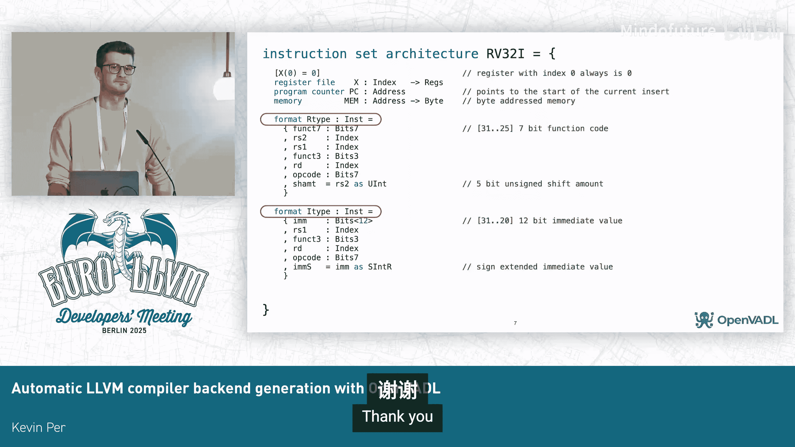

# 2025LLVM欧洲开发者大会-p36-P36-2025-EuroLLVM-Automatic-LLVM-compiler-backend-generation-with-OpenVADL--BV1EoE9zUEbG_p36-

My name is Kevin Peer I'm going to present to you how to automatically generate an LVM compiler backend with this tool called openva so what does Vl stands for it stands for Vienna architecture description language which was developed at Tech University at Viennam and the goal is that we have one specification and we generate a simulator HDL so how to description and a compiler automatically and of course this talk is going to be about the compiler。

The initial implementation started in 2019 together with a research partner。

But this cooperation has ended and due to licensing restrictions we decided to do a whole scratch rewrite。

 and this effort started in 2024 in the summer and at the moment we were around 12 people。

 mostly students。So how does model fit into the LVM world。

 so we have like our regular LVM and on top of it is our tool， so you have one specification。

 you run it through the tool and then you get a set of files。

And then what you can do is you clone LVM and copy over the files and then can just compile LVM make like you would regularly do with this experimental target。

So let's get let's talk about well， language itself。

 are going to present you a few language elements on the example of risk 5 and 32 version。

 so the initial declaration is looking like that so you have，Register file with a constraint。

Here' is the constraint that well， the Rega address zero has the value zero。

 you have a program counter， you have a memory Richard would clear。

 you can define your instruction formats， in this case， R type and i type。Where you have some fields。

For your binary representation and you have a thing called a field X function。

 and you can think of this field X function as a decoding function。

So you can reference these functions in your instruction behavior because they' are not part of your。

Well， instruction behavior， so you will see it shortly。So this is how you define an instruction。

 So you have this instruction ad of type R type below that is。How you define the。

Instruction behavior， so you read from your Er1 field and edit it with a second field and write it into RD。

You can define an encoding and an assembly printing function， not the assembly parel part。

 but printing。This is how you refine an immediate addition with immediate where you can reference this field access function so here just。

It's doing a type curse， but for example， in the load up immediate case。

 you would only store your like upper bits in the field and you can just shift it。

 but it's not part of your behavior， so that's the use case for it。

Here is an example of loading from memory， note that you are using this memory variable you've declared before。

And you're reading from an address， and if you want to store a value。

 then you would have the memory function call on the left side。That's how you would write to memory。

And a last type of example is how you would do a jump。

 So here you have the jump and in instruction where you write to PC to indicate that you have。

You want to change the program counter and also store the return address into this RD register。

So when I thought about this talk， well I asked myself。

 okay what is the most interesting part of this， so what's the most interesting aspect of a compiler generator and I think this is the generation of the instruction selectors。

But first， we have to talk about intermediate representation。

The intermediate representation is called VM and it's based on this C of nodes idea。

 so it's a graph data structure where it both combines the control flow and the data flow together。

So here we have the white notess which indicate the control flow， the blue nodes indicate the。

Data flow and the green one is just， well， the leaf nodes for fields and field x functioning constants。

And we want something like that， so this is a pattern， a classical table and pattern。

 and the way it works is the first parenttices indicate what you want to match in your program and the second one is what you want to emit as a machine instruction。

We only focus on program， the instruction selector here。So if you look at the data flow of a program。

 so we look at the side effect， which is here node6。We have here this right to register file。

 And if we walk recursively down， well， we already can see that。Its。Basically， it。

And we call this the naive approach， and it works OK for athmetic logic and comparisons。

But it doesn't really work very good with unconditionals conditionitional jumps and more complicated instructions。

 so let's consider an example， for example， let's go back to this jump anding instruction。

And we want in LVM something like that， so this pattern here is just。

 well we branched a basic block and emit a instruction called J。

And if we look at the VM representation it already gets more complicated。

 so now we can see we have two side effect nodes which are five and 11 because well we write to PCC and we also write the return address so this na approach has't already one problem because we don't know where to start。

 and if we choose one， well we only get junk because if you think about how LVM generates selection dark well this is not how it it's not the same as the instruction behavior of course because you would never do a bit mask so there is a semantic gap。

So how did we approach it？Well， we kind of know that we need a branch instruction and we kind of know the properties of a jumping link instruction。

 so what are the properties， well it has the right PC and it does it write the O PC in the register and if it's both crude and well we can just label this。

Instruction， which we don't know what it does， is just jump in link。But of course this is not enough。

 so for the LVM case that kind of coex here because。

LVM doesn't like the fact that we have this return we sorry return address。

 it mustn't have any output， so there has to be some well combination with absorb instruction and in that case how we approach this is that we look at absorb instruction and can see that。

This particular instruction labels all the machine instructions in it。

 so we kind of already know what the instruction does。

And because we know what the absurd instruction does。

 we know how to emit this special pattern because it won't change。

 the only thing that changes is the name of the instruction done。So let's recap that。

You have written a specification， you have a lot of instructions and each of them has a behavior and what you do is you have a set of static properties。

 you go over in your compiler generator and if you have found a match then we are in this jumping link case where you know the pattern and can just submit。

Emitted， or we don't have it， and。Then we have to check for what I call a red flag。

 because there are cases where this。naive approach doesn't work and we try to filter them out and that's the case when we have。

 for example， this multiple side effects all right specific register like PC and if that's the case well we tried our best but it was not good enough we can't limit the pattern。

 but if it's okay then just use this naive approach。And of course， the devil lies in details and。

This naive approach sometimes doesn't work for example consider an example where we want to combine both addition and division so here we have well we add two values together get and divide but the second one and we want to handle the edge case that the second parameter is0 and in that case we want to store value to0。

And what we try to do is we try to look at this condition and because we see， okay。

 it's restricting to one value or it maybe is raising an exception， we can just prune it。

And by just pruning it， we are able to re if approach again。

 so this is how we try to come up with better patterns。So。

Let's talk about performance so at the moment our the first is the benchmark suit which we are using to evaluate our compiler and our compiler generator is only limited now to assembly printing。

So the way we did this was。We printed assembly and used upstream for assembling and linking。

AndThen we used a spike to run the binary， and counted all the machine instruction which were executed。

 and then we did the same thing with upstream and here you have the plot for it。

 So the way you read this is on average our compiler generates runs 19 to 4% more instructions。

For this particular benchmark suit， and in one case， even up to nearly 50%。

So this is not yet very good。Why is that the case？So one of the reasons for that is because we really use soil structures extensively。

 so here we are in the ISL lowering class where there is an method where we translate the addresses into selection do values。

And the commented version here is just what the compiler generator would generate。

 so basically just emits a instruction following an address and then not commented version is what copied version is from upstream and just speak to our needs。

 so basically it does。Just does the same thing， but just earlier。And when we run the same benchmark。

 again drops by 6%， so now the average is 13 to 6%。And even this huge out got dropped to 37 to 5%。

Okay what's next so in the specification you have the opportunity to specify constant sequences。

 a constant sequence is a instruction， but just internal use by a compiler generator。

 it tells us how to materialize a constant。So a below that you can see how the code is generated is just checking if it fits and just emitting the sort instruction。

 but here you have。Again， copied version from upstream and tweak to our needs。

It just does the same thing as our instruction， but just earlier because instruction is very late in the stage。

And we can see just the mean decreases to 9 to 9% in even this huge outlier。It's now well。

 the bar is gone because it's nearly zero so。And the reason for that is there is a pass called a machine loop inductive code motion。

嗯。And it cannot just， did benchmarks use a lot of globals， global variables。

 and just it's not very good at moving them out， so it just generates a lot of code for them。

At the moment， our compile generator well generates the blue bar。

 but were working towardss like the gray bar。Okay what is the future work。

 so of course the performance I've mentioned before， we also working on riskk 64。

 there is some things going on which I have to deal with also we we want to support a more complicated instruction set which is AR64。

 unfortunately the proposed solutions so far are not there yet so we have to prove。

There are also two bunch piecesss going on。Right now in the compiler part。

 and we still have problems with well， anything ABI related。

 even though when the batchfuse completes and we have a linker and assember。

 it's still not going to work with the upstream。And of course。

 one important or two important feature requests are， of course， floating point and vector。

 which are still missing。Thank you。Any question， yeah。Thank you for your presentation。

So your approach now you generate selection deck patterns。two questions where first。

 How do you deal with instructions that have multiple results and second question。

How do or is there any plan to， let's say， generate global isSL backends， which is， I mean。

 hopefully the future we are heading to So of first question was regarding multiple outputs。

At the moment we don't have that， our plan will be to emit people passes for that so I think this is also to approach how currently most bes do that。

Second question regarding I Global ISIL。😊，ItWould be great。😊，Well， Ive I've。

I tried to disable global ISL on upstream and tried to run the benchmarks and it didn't have any impact on the benchmark so I think。

Yeah。It's going well， we try to。唉。We try to work on functionality first。

 which well the next thing is going to be AH。But maybe in the future， going to support global IL。

In the version other question， I have an another question regarding AR 64。 So the description。

 language you show it seems like it works fine for simplistic IA like risk 5。

 Now AR 64 has these nontrivial immediate encodings and always let's say with long list of sometimes very complex vector inions。

 How do you expect。How well do you expect that you can support these。So for a vector。

We still have to think about it， we don't have any plans so far for the immediate。

 we are working on extension。Where you can define your encoding functions in the format。

And also predicates， but it isn't implemented so far， but it's coming soon。

你 you。Okay， thank you for our student Sp。 Our next session will begin in5 minutes。 Thank you。

