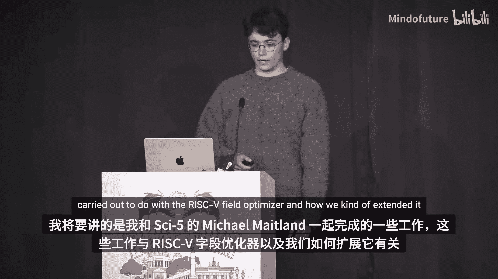
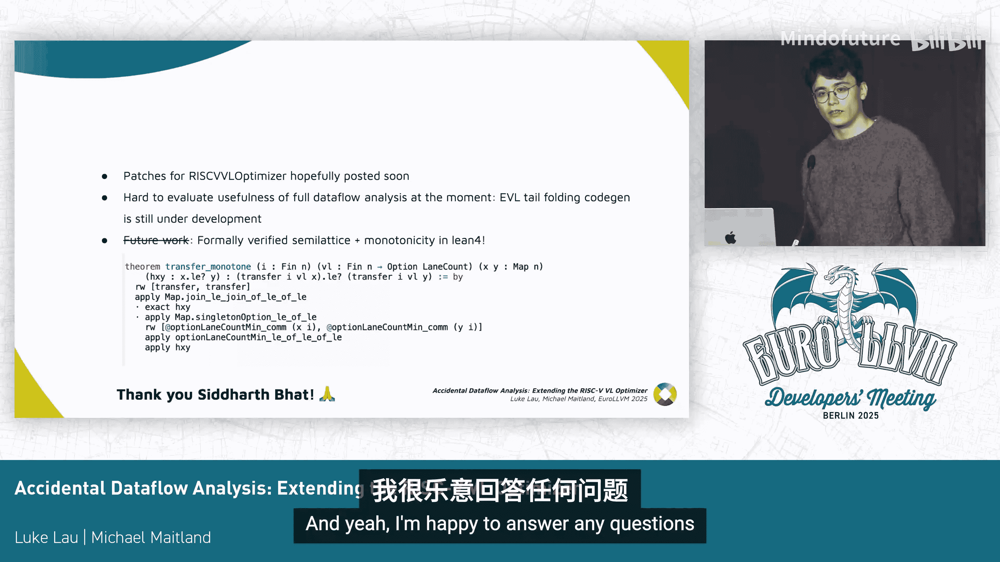

# 2025LLVM欧洲开发者大会-p37-P37-Accidental-Dataflow-Analysis---Extending-the-RISC-V-VL-Optimizer--BV1EoE9zUEbG_p37-

My name is Luke。 I'm a compiler engineer at a gallia。

 and this will be talking about some work that myself and Michael Midland at Sci-fi cardioite to do with the risk I feel optimizer and how we kind of extended it。

And yeah， this talk is kind of like a some kind of a my meandering story kind of format。

 So please bear with me。 But I'll start with the motivation for this work。 And right。

 it begins with this feature that we've wanted in the risk5 backend for quite some time。

 And I should say it's really in the middle end。 But we want to perform E V L T folding。

 And what this is， it's。😊，Folding the till of the loop that the loop vectorizer will emit into the body of it。

 So we just have one vectorized loop。The reason why the loop factorizer emits two loops in the first place is because。

Vector Is， they'll have vector instructions， right。

 they'll process like a fixed number of elements each time。 like， say， four elements。

 We call that the vectorization factor。And if your trip point is an awkward number that's not exactly divisible by the vectorization factor。

 You need the skillalar lip the an to kind of mop up those leftover elements。

The idea behind tail folding is that some vector ices， like Rik 5。

 have features that allow you to mask off lands in the vector instructions。And with that。

 you can then get rid of the scar loop at the end and just do everything in the vector by。

Masking off the unneeded lis and the last it。So Eric 64 has this enabled by default for S VE from what I understand。

 But they do it via。Mask registers。 What's kind of unique to risk 5 is that it's got a dedicated scalealar register called the vector length register。

 That's this V L that we'll hear about tons。 And it means that we don't need to compute a mask。

 and support for this was landed last year。 This was like a。Really long time coming patch。

 like this patch started off in like fabricator and then moved over to Github。

 But it's been a tremendous amount of work。 And thanks to everyone for making it happen。😊。

But it's enabled behind a flag for an eye。 Theres some significant。Cogi engine is involved with this。

 that we still kind of need to evaluate it and hammer right so。

I guess the goal that I was trying to pursue was， how can we enable this by default， You know。

 what needs to be done。 And I think the best place for kind of the vialuating whether or not a feature is ready is by。

You know， seeing how it runs on some real world pieces of code， so。LVM test speed is great for this。

 not only does it have a bunch of benchmarks and tests inside it。

 but you can also plug in things like spec CPU and stuff into it。

 it's a really useful harness for evaluating these types of changes。

 So the first thing I did was basically just  well give it a build。 know， I configure。

 I then pointed it to my client compiler and passed in the right flags and then ran it on lit and saw okay。

 well， there's mis compile。 we can't enable it by default。 Yeah， these need to be ironed out。😊。

And unfortunately， this is a mis compile in like a new feature。 So I'm a pretty lazy developer。

 And Usually whenever I see a mis compile， I just like write a script and ch them to get biected。

 But you can't do that here because this makes mis compilees being here since day  one。😊。

Since that patch landed。 So really， the only technique that you have is to just stare at the binaries and try and figure out what went wrong。

 But you know， this was a mis compile on Gcc。 like there's like what is that 90000 deletions。

90000 insertions。 there's no way I'm gonna be able to figure out what that is。

 but I stumbled across this really useful script that has been sitting around for quite some time。

 I don't know maybe other people are more familiar with it。 This RP bi pi script。

 what it lets you do is it lets you take a known and good build and a known bad build。

 But these can be like different configurations。 So in our case。

 it's a build with E V folding build without。And yeah。

 you give it like a script to recreate the mis compileile。

 And what it will do is that it will kind of bisc between the object files of the good binary and the bad binary。

Until eventually， now， is it down to like a minimal set， I guess。

 a binaries that are known to cause the mis compileile。 And from that， I was able to figure out。

 okay， well， there's one object file that has some changes in it。 And from that。

 I was able to actually dig in a bit deeper and figure out the cause of the mis compileile by reducing the surface area。

 So it was a very useful script。 And yeah， we were able to fix mis compiles。 so。😊，That was fantastic。

And we were able to then start doing some performance testing， so。We ran it on spec using L And T。

 and we saw some really nice scans。 And oh， we were really tempted to enable it by default at this point。

 but。😊，We have to do our due diligence。 We should probably also actually look at the generated code to make sure that nothing else is going wrong。

 right， So there may be regressions hidden behind that， like， you know。

16% improvement that just are kind of covered up。But again。

 LVM T suiteite has a very useful set of tools and scripts。 and it has this script T di dot Pi。

 which I don't know。Many of you probably also use this on a day to day basis。

 I use this all the time。 But it's great for comparing the kind of differences between two builds。

 So I stuck that in just to see what the difference was。 And I noticed， okay， well。

 there are actually some regressions lying in them。😊，The code on here， whenever we enable E。

 V L T folding。 So this is an example here about how we're not able to match a widening multiply。

And what I did was I looked at the LVM I R to see， you know， what exactly was the cause of this。

 And here's another useful tool。 LVM extract。 If you're looking at lots and lots of。LVM I R。

 LV M extract can just pick it up from the function that， you know， to be， you know， suspicious。

But yeah， here's the difference。 The difference is that we no longer have a multi instruction。

 The look factorizer with E V L T folding emitted this L of PM M dot VP dot mall intrinsic with a bunch of scary looking arguments。

 But it's not too bad。 These are V P intrinsics。 They're vector predication intrinsics。

 And they're hide the look factorizer。Controls the masking and predication for E V L T folding and for other types of tea folding within the loop factorizer。

The annoying thing about these intrinsics， though， is that they're all to a lot of optimizations to a lot of combines。

 And you need to make sure you have the correct patterns with them inside your own back end。

 which was the root cause here。 In this case， the risk I back end wasn't。You know。

 it didn't have the patterns for this widening multiply at the VP intrinsic level。嗯。

So the loop vector needs to submit these V P intrinsics for trapping instructions。

 So your're loads in stores， because we need to make sure that we're not actually executing on those lanes。

 but you might be thinking， well。Why do we need to do it for the instructions that don't trap。

 Is there any harm in just calculating that multiply for a disabled bin。

 And it turns out that on some microarchits for risk5。

 we do want to reduce the VL for even instructions that we don't going to trap because they can optimize that and。

 you know， carry out less cycles if that V L is reduced。

This screenshot is a screenshot from the vector predication roadmap， which was attached the RF。

 And it kind of had this like three stage plan。 The final stage of the plan was to lift every single combine to work on VP andics。

 you know， ins combined at insimplified， die combined。That's a lot of work， right。

 So I was looking at that thinking， okay， this， is this a dead and。

 we just stuck with subparcode generation。But that's where Michael Milin's kind of came in。

And he was also looking at E V L tail folding at Scifi。 But he was looking at a different problem。

 The problem that he was seeing was that。Theres no V P intrinsic for the get element pointer instruction。

So that meant for any kind of loop that was vectorized。 That was like a gather。

 We were calculating addresses unnecessarily。 we weren't reducing the V in those lanes。

 We were doing unnecessary work。 we don't have a get element pointer。

 V P instruction because G element pointer is just like a weird instruction in general。

 it's like very attic and stuff。 And like I think it's going away， but。In any case。

 we need to find a way to oil。 Michael wanted to find a way to reduce the VL in this case。

 So he upstreamed this patch。 the risk5 V optimizer， which is the title of this talk。

 And what it does is that it's。Like the loop vectorizer emitting V P intrinsics。

 it also reduces the V L of instructions， but specifically， it doesn't in the riskified back end。

 And I think it's quite elegant the way it works。 It's basically just a loop from the bottom of the basic block all the way up。

 kind of like in a reverse postoc fashion。For every instruction， it'll just look at its users。

 and then it'll take the maximum B L that is demanded by each of its users。

And then reduce its V L if it's possible。 And then this repeats。

 But just the way it works is that it kind of like bubbles up。

 And so it's able to reduce the VL of entire trees and like， you know， a pretty simple algorithm。

 which is fantastic。😊，And for the risk of five folks， if anyone's curious。

 we do have to take into account V type here like E， E W and Email。

 that's where the bulk of the logic this past lies。

 So I'm not gonna to divulge into it too much because that's like a whole other separate talk。

But in any case， yeah， the key thing about this past is that it SAT at the machine instruction level。

And whilst it also reduces the V L in the same way that VPN intrinsicics reduce the V L。

 the key thing is that because it does it at the M IR level。

 it's able to reduce both regular L VM IR and VPN intrinsics because they both get lowered into the same machine instructions at the end of the day。

And so that meant that the loop factorizer， whenever that pass landed。

 we didn't have to emit VP intrinsics anymore， we could just emit regular LVMI instructions。

 we got the best of both worlds。 We got the good cogen， and we also got reduced VL。

 And like we basically got that for free without pass， which is great。So again， we started thinking。

 okay， can we enable E V LT folding on by default night。But again。

 we have to go check with El Van Te suite， find regressions。 And this is not so much as a regression。

 as much as it is like a missed opportunity here。 But the VL optimizer was great at optimizing the VL in most cases。

 But there were some cases like this where we weren't。😊，You know， catching these final cases。

 These cases， more or less revolved drawing fine nodes。

So here's an example here where the VO optimizer wasn't able to previously handle。

 And this is kind of where we began extending it。So。In this kind of example here。

 we have fine node and it's。Its users are the A and B kind of like values。

 We should be able to reduce the V L of A and B to 2， because ultimately。

 they're only used by a store like this rude instruction， which only has a VL of two， right。

 We should be able to reduce this all the way。But these store instructions and these ad instructions that you' were seeing in the previous slides。

 These are These are risk5 specific machine instructions。 They're not target independent。

 and they have the Val operas。 The Phi instruction is a generic machine instruction。

 So it doesn't have a Val opera。 So whenever the Val optimizer kind of encounters this Phi instruction is's not able to reduce it any further。

So。The first thing that we addressed and the first thing that we extended was that we split this optimizer into two parts。

 We created a map which mapped instructions to the V L that they demand。

 And we then did the analysis。 It's like the same thing where we're just computing the maximum V L demanded from its users。

 And then in a separate step， we actually did the mutation。

Just looking over the instructions again and looking up in that map。And that meant in this case。

 whenever we reached the fine node， we were able to。Reduce the fine in。

 or the demanded V L in its demanded map。 And then we could propagate that up to A And B。

 which meant that we could then in a separate step。Do the actual mutation。

 So we're no longer doing it in C 2。The second example that we saw was this kind of like fibercurnce。

诶。I mean， right off the bat， we knew that this kind of bottom to top single pass approach wasn't going to work because now the。

A fine。Uses B， which is beneath it。 So we're going enough to switch to like a work list approach。

Where weend instructions to it。 and then we inside the loop， we pop it off。

 and then we append the inputs to that instruction back onto the work list。

And what's important here is that we also need to check that。

The demanded V L of that instruction actually changed。 And only then if it changed。

 do we append its upper end onto the workless because we want to iterate to a fixed point here。

 Otherwise we'll just end up with infinite loops。So if we go ahead and try this out。

 we're hoping that we can reduce the demanded V L of B to 2， but。It still doesn't work this way。

 It's because this fine node still has a demanded V L of V L Max， right。

 And it's one of the users of B。So。We needed to go ahead and fix this。 And， you know。

 what we had to fix was the fact that we're too conservative in our initial demanded map。

 and we had to relax this。 So now， instead of initializing the demanded V L map to the initial V opera of every instruction。

We're going go ahead and assume nothing is demanded。 So that's obviously not correct。 If， you know。

 the store is going to demand that some elements are computed。

 but we'll just run with it for now and assume that nothing is demanded。

And then instead of every instruction computing its own final demanded V L。

 we'll have each instruction work out what it requires and then propagate that up to its inputs。

 So in this case， we'll visit the store and then say， hey， I need a V of two。 I need two elements。

It'll propcate that up to the demanded VL of its input B。And then B will do the same in turn。

 probably get that up to the phi。 And then because B is a。And put to the fine node as well。

 It'll go back around。 But here， because nothing changed。 ultimately。

 we've kind of reached a stable fixed point。 The algorithm will term it。 So that's great。

 We were kind of able to handle these nice general cases。😊，And， of course， yeah。

 we have to go ahead and do the actual mutation。About this point， we kind of realized like。You know。

 this is kind of smelling kind of like a compiler theory problem。

 So we took a step back and kind of took stock of what we had。

 We had some sort of notion of like a state that's sort demanded map。 that maps， you know。

 instructions to some sort of demanded V L。We also had this notion of an initial step where everything is initialized to zero。

And we also had this function in the middle of this loop that moves from one state to another。

 And that's when the penny finally dropped that。 Oh， hey。

 this is just dataful analysis that we've like ended up making。 We have our transfer function。

 We have our notion of a least element or bottom。And our state， of course。

Some interesting things to note about this data flow analysis is that it's a sparse data flow analysis It's not a dense one。

 We're not computing the state at basic block boundaries， and we're not。

Computing at at individual points of the program。 We're only using the U staff chain。 And yeah。

 that's represented by what we store in the state。 And it's an optimistic。

 thoughtful analysis because。Some data flow analysis， they start off conservative。

 and then at any point in the algorithm they can terminate。

 we have to run this kind of like wild to completion。 Otherwise it's not correct。

 So that's the meaning of the term optimistic。And yeah， the state forms a Samat。

 The way to think about this is this is like a map of every possible state that the analysis could be in。

 It'll start off at the bottom。 And then as it gets go through the instructions and see what's demanded。

 It'll kind of like float all the way up to the top until everything is demanded in the worst case scenario。

 The ordering or the， you know， partial order， whatever it's called in Mads land， It's defined as。

One state being ordered above another state， If the V L for all those definitions are greater than that other state。

But with all this theory， anyway， we can use it to actually answer some pretty useful questions like。

 okay， we have this work list and we're popping off it， and we're pending things back onto it。

 Do we know what's ever going to terminate， That's like a very useful property to know。

 And we can use the saoage that we've defined to actually prove this specifically， Well。

 to look at it kind of the way I view it。😊，We start off at the bottom every time with nothing is demanded。

That yellow kind of bit in the function here。 That's our transfer function。

Whenever we read an instruction and propagate the demanded V L， we're moving up the lattice。

And the key thing to note is that we will only ever move up the lattice。 We will never move down。

So we can keep on going until we。Compute what's demanded for more and more elements， but。

We will never move down the lattice， so we will never end up in a cycle。

 We will always either reach a stable point at which point the algorithm will terminate。

 or we will go all the way up to the top， at which point everything is demanded。

 And we can't do anything else。Here's kind of like the more kind of formal reasoning about it。

 The Samla is this finite because at the height of it。

 I eat the longest chain from the bottom to the top。

 It's determined by the number of definitions in the program and the number of unique possible values that were used for the VL opera。

 which is finite。And the transfer function is monotonic becauseuse if you look at that definition at the bottom。

Yeah， it's either going to be。The previous demanded V L or the maximum of the previous demanded V L and something else。

 So no matter how many times you apply the transfer function。

 it will never give you a demanded V L that's less。

 And so it's monoonic with respect to that relation。And yeah。

 I guess that kind of brings us to where we got with extending this risk byve optimizer pass。

There's still some patches that need to be upstreamed。

 we still need to kind of properly evaluate the whole thing。 But yeah， this is kind of a funny story。

 But up until today， I had left this kind of last bullet point as like a piece of future work where。

 you know， I thought it would be really cool to， you know。

 not do this hand wavy mods and actually formally verify it。 So I gave it a stab and lean。😊。

Turns out I'm not really a mathematician。 I didn't really get anywhere left it。Yeah， future work。

 But earlier today， I attended a talk by Saar Bat on the， you know， formerly verifying。

 I think it was， yeah， inscombined people optimizations。 It was a great talk。 If you haven't seen it。

 I'd highly recommend checking out the recording if it's available。😊。

But I saw that talk at 11 o'clock。 bump to him in the hallway at 12， got talking to him。

 He seemed quite interested in this problem by 3 PM。

 He had sent me actually a mechanized proof of this all， so。😊，I guess， yeah， thank you， Saout。

 You've yeah， kind of done that last bullet point there。 So it's no longer really future work。

 But yeah， we can indeed verify that this algorithm does terminate。

 And so hopefully risk five optimizer will never be the cause of an infinite loop。 So again。

 thank you so much。 It our bad end。😊，Yeah， I don't know how you did so quickly。

 It's like 500 lines of lean， but。And I don't really understand much of it。 But thank you。 And yeah。

 thanks to Michael Miitland as well， who couldn't be here。

 who did all the hard work and upstreaming this。 And yeah， I'm happy to answer any questions。

 Thank you。😊。

