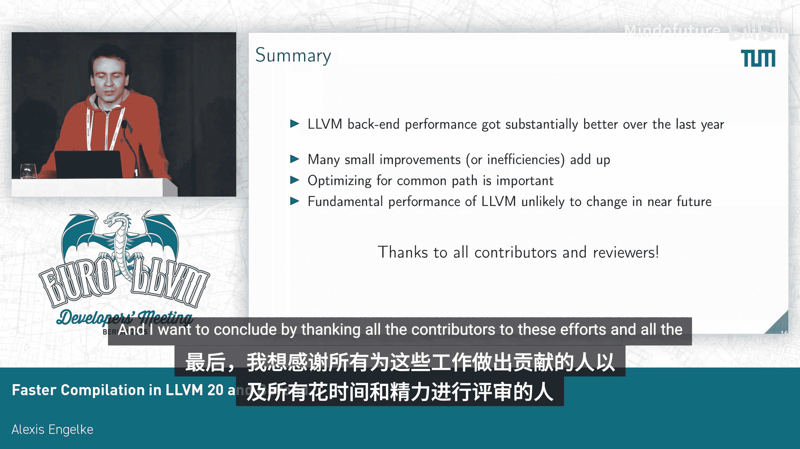
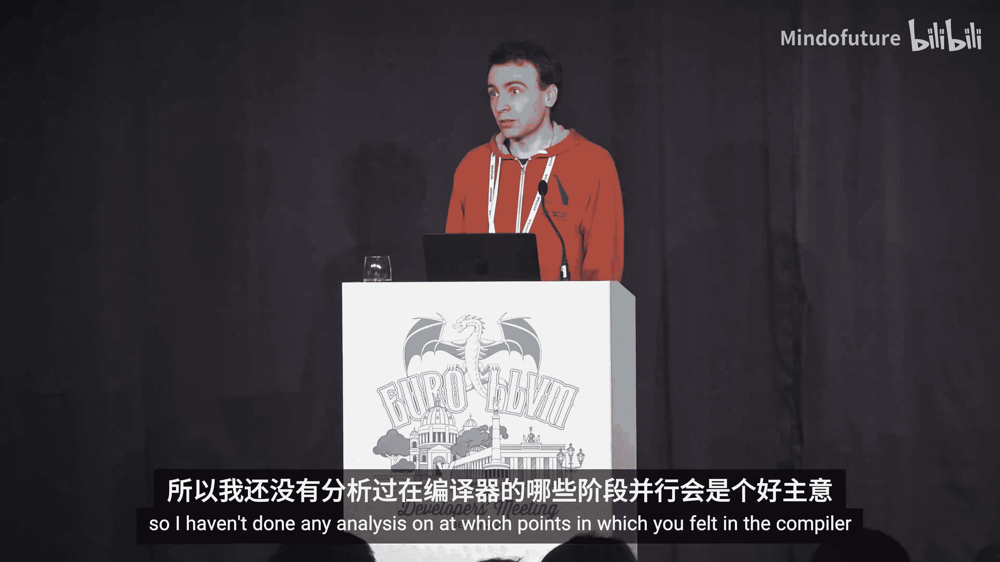

# 2025LLVM欧洲开发者大会-p38-P38-Faster-Compilation---Improvements-in-LLVM-20-and-Beyond--BV1EoE9zUEbG_p38-

Welcome， everyone。 So first of all， let's talk about why we should actually care about fast compilation。

 So there are mainly two user groups who care about fast compilation， especially at the level of0。

 The first group of users are Git compilers。😊，So， for example， databases。

 there are some databases that use L VM or also some Web assembly runtimes。

 and they use LO VM because， well， L VM is one of the best optimizing compiler frameworks that we have。

Now， when we already have one compiler backend， it also makes sense to use or try to use this as the。

 the baseline compiler。Because when these systems only have to implement support a single compiler backend and not separate a baseline compiler backend。

Never a user group are developers。 So you get if you get have faster compiler when you have faster develop test launchups。

 which makes you more productive and's also important for the eyes when you care about the latency when you get back your compile errors or your test results。

 Now for developer experience， which also needs to consider the compiler frontend。

 which I'm not going to talk about today， So today's talk will be only will primarily focus on the back end。

Now， over the last year， LOVM has seen quite a substantial improvement in the zero backend performance of up to 18% on X86。

 and what we'll do in this talk is we'll look at how we got where what are some lessons learned from implementing these improvements and I will also try to outline some ideas on how to make LOVM baseline compilation even faster in the future。

Now， the first thing first few things are some more general remarks on performance optimization。

 And the first topic I want to talk about are hash maps。

 So hash maps have an o of one average asymptotic time complexity for many of their operations。

 but with O of one neglect some constant factors。 And if we access hash tables very often we get quite a substantial runtime cost。

 So it's typically a good idea to avoid hash maps if possible。

 And one type of hash map that occurs particularly often in LVM are hash maps from pointer to something else。

 And for this type of map CPUs luckily have very efficient in feature， which is。

De you referencing the pointer？So one example where we implemented this was the selection deck。

Combiners， which manages a work list of the nodes where it still needs to combine and also has a hash map。

 which maps the node to the index in the work list so that it can remove or modify items in the work list。

Now， this hash map was arguably used quite often。 And by storing the workless index in the node itself。

 instead of using hashm， it was one point something compile improvement three end to end。

 So this was pretty substantial performance impact。 Now this of course， not always possible。

 So for example， whenever you run the map your Lv and basic block something else。

 it's not always feasible to add with something else the basic block and have all users pay for this possibly start something else。

 So for this case， it's a better option when a hash map might be to use a dense numbering and an array。

 and this led to the addition of block numbers which allowed us to substantially improve the dominated3。

 which was previously dominated by hash table lookups。

And another thing is to avoid redundant lookups of the same key in the same or in different hash tables。

 So， for example， in the M C asmbler。When creating a symbol。

 it was inserted in4 into four different hash tables。

 and we were able to reduce the number of hash tables where it was that need to be needed to be coned to one。

 which also had quite a substantial performance impact。😊，And there's a general remark on hash mapps。

 so might sound that hash mapps are itself problematicmatic。

 the data structures we use our LVM Dens map and also the string map are actually quite efficient data structures。

 but there is only so much that you can do to implement hashmap in general。The next topic。

 I wanna briefly talk about our memory allocations。 So memory allocations do have a cost。

 especially if we have many small memory allocations。 So this obviously depends on the allocator。

 So something like M Ilo might be faster， but do you live Cs melo， which is also。

 let's say quite widely used by our users where it's a bit less。Less performant。

 So it's often a good idea to reduce the number of memory allocations。 So one way to do this is。

 for example， to use a bump pointer allocator for cases where the memory usage is monotonically increasing。

 So this makes allocations much cheaper and also improves the special locality。

 So we we did this for the M fragments in asser。 so。Ba is。Fragments of machine code or data。

 which have either fixed or fixed size or can also grow。

 But the downside this that might need an overall increase in the memory utilization。

 So this is not always a clear cut。And for the future it would be nice to have a small vector that supports bump allocator bag storage。

 this is particularly relevant for MC fragments which have a small inland storage for their contents and where the fix ups that needs to be applied。

But it's， it's always a trade off in having a large inland buffer。

 which is often wasted or have going too often into an out of line storage。

 So a small vector with a more efficient。Out outlines storage would be could be a good idea。

And then there are few minor general considerations。

 so indirect and virtual function cos have some overhead。

 especially if these virtual functions do nothing by default。

 So in such cases it's always a good idea to try to avoid this。

 especially if this is done very often。 So for example。

 LVMMC and there doesn't print that they do half a dozen of virtual function cos per encoded instruction。

 And if some of these do nothing when it has also a noticeable impact if the call can be avoided。

R S vector O stream is another problematic case where currently every right goes through the slow path。

 which is a virtual function coil。 We try to make the slow path a bit faster。

 but this is still less than id。 So ideally， we would be able to use the small vector itself as the buffer for the raw O stream fast path and it' buffering logic。

 unfortunately， this is not quite easy to implement because there are a few users that depend on the raw S vector O stream keeping the small vector immediately up to date。

 So this would require adding a new type something along lines of the buffer O stream。

And timers are also quite expensive， even if they are disabled。

 So having too many timers is not always a good idea。

 It's also not a good idea to have them in in general。

 but also I just want to mention that just having the check whetherver to keep the time is also not a free operation。

Okay， so let's look at the LOVM beends。 So this is the LOVM 18 state for X86 and AR 64 roughly grouped by the faces。

 We look at the individual faces in more detail afterwards and for LOVM 20 we saw on X 86 that almost all parts improved and leading up to a total improvement of 18% on CT Mark。

The biggest improvements were on the As printer and the register loator for X 86。On AR 64。

 the inspection selector is a bit slower because global isil is the default at00。

 And here we also saw some substantial improvements on the As printer and on the inspection selector。

The register allocator changes were primarily affecting X 86 and some other pulses， in particular。

 target specific passes got a bit slower。When we were in LVM18。Okay。

 so let's look at the IR process in the beginning。 So there are 15 to 20 passes。

 Those concerned about lowering intrinsics and some complex operations。

 But the observation is that for many functions， especially at those zero。

 they don't have these intrinsics or complex operations but these pass the handle。

 So they do nothing。And we started fixing this by emerging some of these passes into with this the。

The big pre isil intrinsic lowering pass to avoid iterating over the L V M I R so often。

 which is not a free operation。 And I think it would be a good go to merge merge of these passes further of that we have in the end only one or two pre isL legalization passes。

 So maybe one for intrinsics and maybe one for our complex operations。After after the this passes。

 the backend only primary operates on machine IR， which is a very featureful IR and can we present machine code for the very target architectures that we support。

Now， machinech IR itself is not exactly efficient in the in terms of modifying it。

 and one thing that routinely shows up in the profile is machine install at operaend。

So machine instruction operas are have an order。 So we are first explicit and when implicit operas and first defines and when uses。

 and at opera iterates over or looks for the right place。

 where to insert then the opera end and also looks up some flexs。So which takes quite some time。

 It was in consideration to add an unchecked or fast ad opera。

 which avoids some of these search and flag changing operations。 But this。

 no one has done this work yet。Another thing is that managing the use def lists of registers is also not free。

 but there are similar considerations that apply to L O V M I R。

 And I don't think this is going to change because we probably want to keep eagerly updated use def lists。

The other thing is whether the supports storing extra information in line and out of line for specific and rarely used functionality。

 but checking whether some sort of extra information is available and where it is or frequently causes some branch misses that I think could be somewhat easily avoided。

Okay， so how do we get to machine I R， Well， What's the job of the inspection selector of which we have currently free in LVM。

 So fast ISL is probably the is is the fastest one we have because it does everything in a single step。

 whereas a selection deck and newer global IL are。Incrementally lower。

 And we write the IR until we get to machine I R。Where in general。

 there are true observations that are expensive and unfortunately also hard to avoid。

 The first thing is coil lowering。 so coil lowering is a thing that shows up in the profile quite often。

 but I don't think that there is substantial room for improvement there because of the various attributes and A details that need to be considered。

The other thing is that selection deck fallbacks are and also will remain expensive for fast ISIL。

 and at this point it's probably recommended for front and over to change the way in which we generate LVMIR。

And to generate， let's say， fast isL friendly I R。 and there are optimization remarks that we can enable to find out very。

 where fast Iil fell back to selection deck。Now， I want to talk a bit about a global ISIL。

 which has seen quite a bit of improvement over the last two releases。

So Global ISIL has a multi pass approach of translating。

 legalizing and inspection selecting with combiners running in between for some optimizations。

The first change was to to the first observation was that fixed point atvation is often not really beneficial。

 especially at00。 So there was an opt in flag added to do only a single pass of global is combineers instead of the fixed point atvation。

 And this is also in line with somewhat similar earlier changes for incombinance selection deck where the fixed point observationvation was also dropped。

AAnother observation was that that full that code elimination is not cheap and also not always needed。

 So the legalizer already performs that code elimination。

 And so combiners don't need to do this again。Okay。

 never change was that the of that the legalizer didn't generate to have it generate less bad。

 I R for things like I1 arithmetic， but is not legal and。

Using nonn bits can avoid to generate such artifacts and noun bits。

 even although it is not exactly cheap， is always beneficial Even at00。

 for a0 it uses a reduced recursion depth。And despite obvious changes。

 global ISIL is still 47% slower than fast ISIL。It was the idea to add faster after directly generate a target machine I affirm I art translator。

 but this requires some， some more work。 And while it would be beneficial， I don't think this is。

 this is coming up for the next few releases。So for the register allocator。

 it's a pretty complex thing。 I think the main takeaway is that fast paths for the common cases are important and likewise using fast data structuress。

 and for example， widened the intervention of a power set by using a vector directly。

 I think theres also a room for improvement in the way that rec units are handled。

 So rec units are stored as a di generated by table gen。

 and this causes a lot of data dependencies when itating over the re units of a register。

 And I have measured but I suspect that these dependencies also cause some performance overhead。

When there are quite a few target specific passes and again。

 there is a similar observation that many of these passes。Do nothing on typical or0 input。

So one change was that0 compilation X 86 no longer requires a dominator tree。

 and we changed the pass that used it to detect to first look where it actually needs a doator tree and then compute it on demand。

 And I hope that implementing such changes will get easier with the new pass manager。Also。

 passes that are specific for certain IA features like AM M X would be should do nothing if these features are not used。

 So for AM X， we tracked during instruction selection。

 lowering whether AM X instruction actually occur。 And if they don't occur。

 we add an early exit to these passes so that they do nothing in the in the very。

 very common case that the I A extension is not used。Okay。

 so the last step of the backend is the As printer and MC。

 which lowers machine I R first to M inss and then encodes this into into object files。

 This is very flexible and highly customizable and supports various object file formats hooking into instructions for various things has a full asble built into it and for its flexibility most of its functionality is built around virtual function calls。

 but it's also quite evident that it was designed with functionality in mind and not with performance。

Over the last releases F Waisson did a lot of work in refactoring MC to be more performant。

 So some of these changes are related to reducing virtual function co or to reduce a number of times where a data and instruction are copied。

 but I think there is still optimization potential when focusing on the common path。

 And I think still there is still a lot of time spent on paths but typical zero input does not need。

Some more general consideration on LVM backend performance。

I think L VM has a fundamental performance problem， which is unfortunately also its biggest strength。

 namely the incremental I rewriting approach。 great for composability， but also very expensive。

 And the other thing is that compile time is often not the primary concern。 So where concerns。

 for example， the quality of the generated code。 size of the generated code。

 maintainability memory usage and so on。 So there is always a trade of to be made And the other consideration。

 So it was about the backend。 But on the front and side。

 front and center generate pretty bad I sometimes and with L backend getting faster。

 we also found that clang increasingly dominates the C plus compile time。

 and clang over time tends to become slower and eat up some of the performance improvements that we achieved。

 So I think would clang would indeed actually some laugh。And in term regarding the backend。

 So I think that separate zero backend， as we've been working on， we hope to open source very。

 very soon to focus on the common case would is 10 times faster LM or0 would be much more welfare investment of time when trying to get another 10 or 15% out of the LVM or0 backend。

 So to summarize LM backend performance got substantially better over last year。

 many small improvements add up optimizing for the common path is important But I don't think theres a fundamental change or fundamental2 x improvement coming up to LVM。

 And I want to conclude by thanking all the contributors to these efforts and all the reviewsers for their time and effort。

 Thank you。

I think I was first。 so I just want to ask you say the front end time dominates compilation time。

 So do you mean like the whole front end from like parsing to I R n or do you talk just that I R is very slow。

 So I R n from what I remember is not the biggest part。

 The biggest part is really parsing and semantic analysis。For C plus plus， also。

 template insiation is routinely a problem。 I R generation is is a problem for none。

 So far let say compilation fronts。 So in our database。

 we spend like 5 to 10% of the compile time is spend for just simply emitting the L VM IR。

 but for Kang， I think really the the pars and getting to the stage where you can emit L VM IR is the dominating time。

Thank you。H， great talk。 I' Mount Shu Lakta from Qualcom。 I had a couple of questions。

 So one is a lot of the improvements that you listed。Didn't have much to do with 00。

 So do you have any data on how it affected， say，02 compilation time。

 So an X8602 compilation improved by 9% back in time on AR 64， There was no improvement。 I see。

 And then maybe I'll have one more question， which is。

 have you considered having a persistent cash for something like I sell or something similar。So I'm。

 we are not working on a on a cache。 I think there are other people who do work on caching schemes。

 I'm not aware whether any of this is where any of this is currently that safe it is ready to use or has a clear path to upstreaming。

 I'm not aware of any of that。 Thank you。Hey， you mentioned that timers， you know。

 even when they're not active， can be really expensive。

 but I think it's a really big problem in compilation time that programmers don't have any visibility into where the time is going。

 So I find tools like timetrace to be really helpful。 I've just been using them recently。

 So do you any if timers are expensive。 Do you have any ideas on how we can provide programmers more visibility into what the compiler is doing so they can actually like engage in the process of optimizing their own builds。

Yeah， so I think the problem is if you place the timers in a two fine granular way so for example。

 one timer per instruction and I think these timers also don't really help because at this point the measurement overhead also makes your results less valuable than you get from the timers so I think for let's say higher granularity of things like passes or analysis。

 I think it's great to have and a time phase also has a pretty low overhead so I think it's only 2% to 3%。

So for this is pretty great。 And for other things， I've had some success in combining L VM with frame pointers and using profiling tools。

 So this was this is typically my way to go for things that don't show up in timers。😊。

Very interesting talk。 Thank you。 You mentioned that inc the front end dominates。

 and this actually matches our experience。 I'm curious what would be your top two things on the front end side。

 Do you have any thoughts on。topty hotspots there。 So I'm not， I， I。

 I don't think I ever committed to Kang。 And I'm not exactly familiar with the code base， I think。

So intuitively， I think the AS S T is not as good as it should be。

And I think it's a pretty expensive data structure。I think it's possible。

 at least for C to write much faster， have a much faster approach to write much faster compilers for C plus plus。

 I have no， no idea。 I've never wrote my own C plus plus compiler。 Thank you。

Have you thought about code Gen each function in its own thread or its crazy。

So parallelism with L VM is very difficult to achieve because everything is basically munched into one single context。

We tried or we thought about it a bit。 but so as I briefly mentioned。

 we have in opt to write our own LM back， which handles the common case 10 to 20 times faster。

 And if were 20 times faster， when I don't think parallelism is that important。

 if you still have the parallelism over translation units。 well。For Jet。

 it probably doesn't matter because it will be one function anyway。

 But for and for big project where sea make run stuff in parallel， it also doesn't matter。

 like maybe there is a sweet spot， but。Yeah， so so I。

 I haven't done any analysis on at which point which you affect the compiler would be a good idea at this point。

