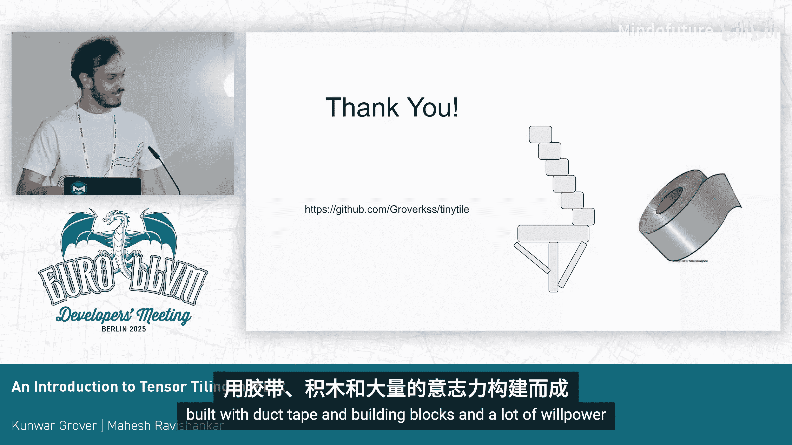

# 2025LLVM欧洲开发者大会-p39-P39-An-Introduction-to-Tensor-Tiling-in-MLIR--BV1EoE9zUEbG_p39-

Hello， everyone。 I'll be giving a talk on introduction to Tensor Tling in Mr。

 So I think the first thing that I'd like to you know talk about is why I decided to give this tutorial。

 It's something I think every tutorial should tell you like there must be some reason why you want to educate the community about it。

 So I work on E that goes is a symbol。 And it's M compiler that uses upstream MR dialects to build M compilation pipeline。

😊，And a lot of people usually come to me and ask， hey， if you can do that， how do I do it。

 I want to make my own compiler。 How do I just use upstream M dialects to build my own M compilation pipeline。

And I feel bad sending them to look at Erie， which is like the co in itself is like 1。

60000 plus lines of C plus plus If I send that to a beginner。

 they would leave like they wouldn't just decide M L is not for me。

 And Another thing is people usually ask me smaller questions like Why is there no simple pass in MR just to tile some tensor operations。

 Why， that that seems simple。 Why isn't there one。So well， we'll cover that in this tutorial。

 And that's my main motivation。 And there's another thing that。

Er currently has a lot of stuff for Tling in various dialects。

 which has built up throughout the year， through the years。

 And there is like some kind of private and knowledge which me like a couple of other folks know how to use this weird building blocks that we have。

 But it's very hard to navigate。 how do you make your own tensor Tling Genga tower if you want to。

 Some people have done it。 people who built this stuff know how to。

 But it's very hard to just look at what's there and find out how can I build something。

 So that's what this talk will cover。 And one thing to note is that Em has so many dialects。😊。

And you could tile at any of them if you wanted。 Well cover a very narrow path。

 which is like you will。 we will tile on tensor operations operating on tensors and then lower to vector dialect。

 which lowers BM IR， a very narrow path， which works for Erie is something that people have tried before it works。

 People can do something else。 Also， Emla is， after all， like extensible。

 But this is what we will cover。😊，So how this tutorial is designed is there'll be four parts。And the。

 the first part is。这 stop book。哦。Okay， first， we'll look at like some existing tiling tower that someone built and see。

What is happening there， What are they using and try to understand the building blocks they build。

 they used。 And then we'll take those building blocks and try to build our own little compiler with some duct tape。

 I wrote in 400 lines of code in two days。 So if I can write it that I think someone could write it like faster or maybe at Max in a week。

And。After of that， well also see。this is thing is yeah， after that， we'll also see。

 how can we make this like extend this tower compiler thing that we built with even more duct tape。

 And if we get time， we'll also look at like more advanced building blocks。

 which E uses to build like an even more advanced compilation pipeline。 I'll just give ideas here。

 I want to expand on them much because it gets really hard。 So this is how we look at it。

 So we' start with the first section willll look at something that someone has done for tensor tiling compilation things。

 and we'll try to understand what they're using。😊，So， Alex， two years ago， gave a fantastic talk on。

😊，Transform dialect in。 And one part that I really， really liked about his talk was in the end。

 he showed that how can you using transform dialect with ML operations build like a schedule talk about that more but which can beat hlight for convolution co using whatever is existing upstream。

 That seems like the perfect target to show like there is something in upstream that we can use to beat something likelight for convolutions。

 So we're going to take a look at that。 And this is I that we're going to start with it some like con2 you're doing raillu after that。

 some element by rail is an wise and you're doing a broadcast on the bias。

 and the loop structure for this looks something like that。

 Theres if you lower it just naively It looks like you first the broadcast。

 then the convolution and then raillu， there is no fusion or anything。

 And what we want to really achieve to get good performance is we want to fuse。😊，Doll。

In something like in a loop structure that looks like that and try to get a good tile size。

 not use intermediate buffers， Try to use registers。 And that's what we'll try to do。

 So this part of the talk is actually inspired by M tutorial。 It's called the H tutorial chapter H。

 You can check it out。 It's a good totalle。 but you don't need to have tried it out。

 We'll cover it slowly。 I'll even tell you a little bit of about transform direct and we' try to。😊。

Build upon that。So let's look at what the tutorial does。

 And then we'll look at what building blocks they used and then build our own compiler。

After understanding them。So a little bit about transform dialect。

 because we'll use it in the tutorial is it's basically a meta I where you can say how you want to transform your operations。

 So here this is the original a that we are transforming。 And there's another a that has like。

 oh bias conreu， which are these operations。 And you can say。😊，I just use this。 So， and you can say。

 oh， take that convolution。Tie it using a for all loop by time size 1，1，5，64。

 And that will just be applied in the I。 So you can see here previously。

 we had like a normal convolution 2D。 And after that。

 we have a tile convolution 2 D where it's computing a little tile of that。 As you said。

 So that's what transform direct looks like。 And we'll take the schedule that was in the tutorial and try to see what we do here with that。

😊，So the first thing that the tutorial does is tries is to tile parallel dimensions by using a for loop。

 which is like just a parallel loop。 So that's what we do here。 We're going to say。

 just style using for。😊，Tile the last operation。 So one thing to note there。

 we're using some tiling transformation。And the second thing it does is takes the other operations and fuses them into this loop。

 using something called fuses into containing op。😊，So， the thing note here。

An interesting thing is how we are doing tiling is we tile one operation and start fusing things into it。

😊，And as we few stuff， the other operations get tiled also。

 So you can see like something like broadcasters right now outside。 And it's just saying。

 give me an extract slice is basically extracting a tile out of it。 So it's saying in it。

 give me a slice of in it。😊，Man， we' are going to say， oh。

 fu thatinate into this loopness and we'll just basically compute that tile of the in it。

So this is usually how you do tiling in like tensor operations。

 you tile1 operations start fusing things into it。😊，So that was parallel tiling。

 And then we can do like reduction tiling， which is tiling on the reduction dimension。

 So it's like computing a sum。 So here we're going to take the convolution dimensions。

 The last three which are reduction dimensions。 just tell them。

 And this basically gives us the loop structure we wanted。😊，And this is the tiing thing we did。

And after this， it's kind of simple。 You vectorize it。

 I'm not going to cover the vectorization baths， but it's a fixed pipeline。

 So you vectorize this competition。 So you convert the lials con the element by stuff into vectors。

 competition， Some like a it or mull or it or art， or or max， whatever things。

 And then you bufferize it to convert the tensors to buffers。😊。

And you basically get like the that can be lower to LLVM。

 There's like few more passes that you need to run。 And youre， basically。

 you get the compute that you needed。 and this。Pipeline kind of outperforms a by， I think。

10% or 8% I don't remember。 It's in the tutorial。 It's the exact same pipeline I described。

But the important observations that we need to see in this part is。

The part that is really variable is how you tile and fuse like you the how you decide the loop structure of the code。

And getting the loop structure is important。 Like if you didn't do that tiring。

 you would have like some intermediate buffers。 But instead。

 you tiles infused them and got the correct thing。And other stuff is kind of fixed。

 like vectorization buffer。 you， theyre just like， you apply them。 Theres no like。

 or use this style size or anything。So mainly we're going to be looking at the tiling and fusion part of this。

 So when we use that tiling for our op。It's just saying tile this。

 But how we actually tile it is use a transformation called tile using a C F。

 which is a method like in the tiling infrastructure， which basically says， oh， take an operation。

 T it however it is described， use these style sizes。

 We look at it later how it actually is described。 But it's like。

 there's one operation that does that。😊，And for fusion， there are two operations。

 It's a producer slice fusion or a consumer slice fusion。

 So you can either fuse like through an extract slice。

 like something that is being like a producer of that tile or like a consumer of that slice。

 If it something was using the rail part of this Sf for。

 So these three methods are basically what all there is。😊，To， do tiling and fusion。

 And you can build various pipelines using these Trans direct is just like another block on that tower that uses these things。

 But we'll use these three methods to actually build a whole compiler that can do arbitrary convolution fusions。

 And I wrote that in this reossory。 You can check it out after or like anytime you want。😊，basically。

400 lines of code for replicating that exact convolution thing in a past pipeline。

 which can do arbitrary fusions。 And I'll give you some examples of what I mean by arbitrary fusions。

 And youll slowly see like how this builds up。 But it's mainly these three methods that we care about and nothing else。

😊，So。The first thing we'll see is like， well start write some simple test code because you can write these transform specs。

 but we want to build a compilation pipeline。 We don't want to write a transform spec for every different file。

 Like I'm building a compiler。 I have thousands of kernels to write。

 I can't write thousands transform specs。😊，Maybe real estate well， not for me， so。

How you can do this is first， the method we talked about T using SF， which literally says that， oh。

 if you have operation。Tile it the way I'm asking you to how it's described in options。

 So let's say we somehow got the tile sizes。 You can say， oh， take a see of tiling options。

 set the tile sizes to these ones that I've asked you to tile to and just call it。

 And it works out of the box It will give you a tile competition。😊。

It's doing exactly the same thing that transforming does。

 It's a building block to do tiling in on any operation that this that implements something。

 We'll talk about something later， but usually it works on like most operations that can be tileed。

So this is the tiing part of it。And the other part is fusion。 So the fusion part is。

Slightly more complex。 But what you can do is you can just take like， you can greedily start fusing。

You can take like， oh， if you see extract size， f it， if you see an insert or this S for yield。

 fuse it like as a consumer， otherwise， like if it's an extract size fuser as a producer and keep doing this in a while loop and keep fusing。

😊，You can write a cost model here also， But greed D is usually fine。 Like， it works out if you。

Have something sensible。 So that's what we're going to try to do is just greedily start fusing everything into the luness。

And that's what youre doing Like get， get a slice。 We'll see how to get the slice later。 You can。

 I mean， just iterate over there air and do it also。 But if it's extract slice， do produce a fusion。

 if it's insert slice or that parallel insert slice， that's basically the for all yield thing。

fuse it as a consumer and。😊，It should basically give you a whole loopness that is fused into that loop nest。

So you don't need to write like exactly， Oh，fuse it this way。fuse it this way。

 You can write a while loop。And it works out。The only issue is that how do you actually track these slices。

 Like， when did I what slice to fuse as a producer， What slice to fuse as a consumer。

 Em I has this concept of listeners， which we can use。

 which is basically any time an operations is inserted。 You just started to work list。😊，And。

When you're doing that， trying to get a slice， just ask like use that workless queue so you can just listen to any new operations being inserted。

 And as youre tiing things， these extract slice operations will be generatedll automatically get populated into your queue and you'll keep it rating on them and they like composed with the more like as you use。

 they'll be more extract slices， theyll get called to the listener and they'll。😊。

Become part of the work list。So this works out pretty well。 Gry talentfuse。

 This is actually a very simplified version of what E does。 And E uses it in production。

 So it's not like it's a proper algorithm。 I said duct tape。

 but because there are some things that could be improved。

 You could add like a little bit of cost modeling。 But this is actually the algorithm E uses mostly。

 and it's a good algorithm that works。😊，You just need three methods。

 It's the tile using a CF and producer fusion consumer fusion。

 And you can write a fusing compiler with this transformation。

 I can show you how you can build an entire compiler that just does things automatically。😊。

So there was one thing that I didn't mention is like。

 how do we actually say what time sizes to use for an operation。

 You can throw a discardable attribute on the operation。 People don't like this。

 but well do it anyway。 So you can just say oh， lower in config for this operation。

 use these parallel time sizes， use these reduction time sizes and just query the time sizes。😊。

There may be other better ways， but we'll just do this it， It works out。 It works out in practice。

 E actually does this in production， so。It's a tried and tested method of using discard carnival activities。

 no matter how much people hear them。 But you can just queryy them and。

You can also add we also add option to like if you're using a parallel loop， use a for loop。

 And otherwise， if you're using a reduction loop， use a serial loop， like a4 operation。

 So tiling interface allows you to like sorry not T using a Cf gives these options to you to control how you're tiling things。

 You can use like any kind of loop that is available in future。

 we maybe even extend it to like whatever you want to use。 But right now， this4 loop P and4 P。

 So you can use a parallel loop or a serial loop for reduction since like we don't like。😊。

It's a reduction。 Then you don't want to really do like reductions using a parallel loop。

 use a serial loop here。So。With that。We can。Get the loop structure with those two passes。

 Our first pastor says。Tile the parallel at the parallel level and the second pass is tile reduction level。

 And you get the same loop nest that you got through using the transform direct script to like tile and then fuse things into it。

 The only thing that you need to specify is like what tile size you use。

 You can write a tur or like some kind of heuristic。 I haven't written it。😊，But you can do that， too。

 so。With that， you have the loop structure right。 After that， the pipeline was anyway fixed。

 you can just add， oh， vectorize this。 And upstream my doesn't actually have a password vectorization I wrote like。

😊，6，7 lines， and it works。And then you just call upstream buffer registration。

 And you have the same code that you wrote using a spec file just as a pass pipeline。

But you can do interesting things with it where this was the original competition。

 And this was the final loop structure we got。😊，Now， you can throw arbitrary stuff on it。

 You can say， oh， throw some packs。 It'll just fuse and book。 You can throw some more element wise。

 It will fuse and book。 You can keep throwing stuff at it， and it'll keep fusing because in the end。

 you are just greedily fusing everything you want。😊。

And you can write very interesting kernel code generators using this。😊，And yeah。

 I'm going to go to the next part also。 but this part I is interesting。 And usually I think of like。

 can I put this in a kernel in the form of， can I greedily fuse them like this。😊。

Thishi is an interesting thing， but。There's also sometimes people say， oh。

 this doesn't work 1 hundred0% of the time。 And I want my compiler to be slightly more robust。

So you can also tell it， hey， if I give you， you can actually put an attribute on the function that。

😊，If I say， use this transform spec。Like underscore scoreied as a tutorial set for something very specialized。

😊，You can just write like a little pass that says， if there's a discardable attribute on the function that says。

 use this transform file， just run that。 and we add that pass at start。

 This gives us a compiler like a full fully working compiler that can do like Ma convolution reduction plus any element wise fusions。

 producer or consumer。😊，And you can even change the compilation if you want by just adding you can hook into it。

And in practice， this works really well。 This is kind of like a very simplistic pipeline。

 what E D does。😊，So that was like， how do you build such a pipeline。

I'm also going to talk about how you can extend this pipeline。 Like。

 I didn't talk about what can you tie。 I told you like， how can you tell things。

 How can you build the proper pipeline， But I still never talked about What can you tell。

 Can I extend this， What like， what are we even telling， How does it know what to tile。

 But we do know。We can tell things and how we can do that。

So that's what we're going to talk about now。So let's say we're implementing a new operation in this pipeline。

 I don't want to rewrite the entire thing again。 And again， anytime I add a new operation。

 there are like10 different retention variants that come out every week， I think。

 And I cannot be writing a whole pipeline for them every day。

 So what you can instead like do is just hook into this pipeline。

 So let's say we'll define a new operation tutorial de top。 This is also in the laboratoryosory。

 but we'll define anob that takes an input scale and output。

 And theyre all the same shape as all types math is。😊。

You can don' think too much about the deant stuff。 I don't really know much quantization。

 but it's just element wise operation， which you can think of it like this is multiplication。

 Maybe input into scale is equal to output。 Don't think about it too much。 but which is add that up。

 It's a tutorial or decoant。😊，We just add up。 There's no way the compiler knows how to tile this。

 So we need to teach the compiler。 How do you actually tile this or how do you fuse this。

 And that's the interesting part of how actually things work behind the hood。So。Everything。

How you T an operation is described through tiling interface， as the name suggests。

 And we look at like what methods you actually need to implement to just hook into this。Compilr。

 we wrote。 So if you implement these methods on any operation。

 it will just work with your greedy fusion stuff。 So tomorrow。

 if you had like a new gather operation or maybe some fancy new decoquetization。

 you implement it this interface and it'll just work with your compiler。

 You don't need to keep rewriting things。😊，So we look at what parts of the tiling interface to the first method tiling using S CF。

 What part of it do producer fusion and what part of it do consumer fusion。So。

The first method in this interface is like get iteration domain。

 which iteration domain is a very fancy polyethral word， but it literally means。😊。

What is the like if you have a statements what is the bounds of the loop surrounding it So here the statement is like decoquantization of row coacological decoquant row call row call。

 So the loop bounds are rh is between 0 and m column is between 0 and n。

And that's exactly what it asks for。 And you can， that's what I implemented for it。

 And you can also is just get the sizes of the input。

 which is like because that's what we're iterating on and just pass it to that that offset is 0。

 We're going from0 to size of the tensor and the stride is one。

 And you can return that And that satation domain for this operation。

 I'm going to show like how to implement each of the methods and explain them for this operation specifically and we'll see it fusing through。

😊，So the next method is get loop it trade types。 So we also need to know which loops are reductions and which are parallel because sometimes like if you try to tile a reduction dimension using a parallel loop is just not valid。

 So you do need to know you can't just starttyling anything you want。

As much as the interface would like you to。 But here in this operation it's an element wise operation。

 both loops are parallel， we just return that or that get the rank。

 All dimensions are parallel return that。 So for this， it's a simple thing。

 but something like mat convolution will usually have some reduction dimensions and you would return that there usually the op。

 It's part of the op definition。😊，Now， the more interesting methods， the first one。Fine。

 but these are more interesting methods， which actually do the tileling。

 The first method is get tile implementation， which is that if I tell you what is the like what tile offset and what tile size do I have want have like the iteration domain of the tile。

 Let's say I say my whole shape is from0 to M and the0 to n on the other other axis， I'll tell you。

 oh， can I get a compute me a tile from I to I plus small and and I J to J plus small L。

 And given that generate rate code to compute that tile。

 So that's what the figure is saying that the dark green tiles are what I'm telling you to compute。

 and you need to compute the result tile。 So for this， you can for this operation。

 you can just take like extract slice to get a tile of it。😊，Get it for the input。

 Get it for the scale。 clone the operation with those output types and just change the result type。

 And that's your tile implementation of an element wise operation like Dent。

 for element wise operation styling is really， really simple。

 I try to keep it simple for this example。 And because it can get hairy sometimes。

 and I don't want to get in that much。😊，So that's how tiling implement like tiring interface decides of how do I actually tie this。

So。The next method is like get result tile position。You know how to tile an operation。

 But like what tile are you computing Like I computed a tile based on like what my input tiles were。

 But like where is this style going， Like where did I compute？

 So you need to tell that also that given like what input tiles I'm computing。

 Tell me what position is the result tile that I'm computing to like in this example。

 like you want to know what is the like relatives position of that compute tile So for an element wise operation is just the same as the input tiles like they are all same。

 So just result offset physical equal to offset result size is equal to sizes。

 for something like Matm or something or like something we transpoes this this is harder and you need to take care of that。

 But in the end， it's just like a method that says how do I what tile position that I'm am I computing。

😊，So these were just the tiring methods using that。If any operation implements those four methods。

 you can tile it。 You can call tile using a Cf on it， and it will work。

And sometimes we don't even implement other methods because we don't care。

But for the sake of this tutorial， because sometimes we do need to do this stuff。

 we will talk about them， so。Producive fusion is something like。

If I put that code like sorrytyling it， I'll come at at some point。

 I'll come at this point where I'm trying to extract a slice out of that tutorial decon operation。

 And I need to know， how do I actually tile this now through fusion。

 So this is the tile and fuse producer slice method implementation coming here。 So for this。

 I need two methods。😊，First is like， how do I compute the iteration domain from the result tile position。

 I know what result time time I'm computing。But。😡，Like what input tiles am I computing or like what is the iteration space。

 iteration domain of the actual compute thing that I'm computing。 So， you know。

 the result tile position now and you want the input tile position。For an element wise operation。

 it's， again， very simple。 There's nothing much you need to do。

 Usually for like something like linearard genetics， you need to do some analysis。

 But here it's fine。 You can just say， like whatever is the output 1， it's the input 1。😊，So。

Similarly， there's a generate result tile value， which says， I know the result tile position。

Compute me tile this operation in a way that it produces that result that result tile。

 So it's like going bypassing through everything。 for this operation。

 what you can just do is like for any operation really， but sometimes you need to bypass it。

 But for most operations you can just say get the iteration domain from the result tile。

 the previous method we implement it and just style it using the normal tiling method it is possible like sometimes you need to overwrite this because it is possible that maybe you never implement tiling and you can only do producer and consumer fusion。

 maybe but this is a very simple thing to implement like this works for most operations that you just check what would be the domain that I would get what would be the iteration domain I would get from the result tile and just style using that domain。

😊，So those are the producer of fusion ops of produce fusion methods for consumer fusion。

 These are there just like kind of reverse of that。

And there is get iteration remain tile from opera tile where now you know the tile position for one of the inputs and you want to just get like it for the whole operation。

😊，As I like for this， it works out to be very simple because it's a relevant wise operation。

 but it can get like slightly harder。 And similarly， for the get tile implementation for opera tile。

 it's， again， pretty simple。 You get theeration domain from the opera tile and just use the previous style implementation。

 This is， I think， by the default implementation also， but I'm not sure if it's hooked in。

 So I implemented all of them。😊，But with this， these like8 methods。

 you can just plug it into the pipeline and it would just work， so。嗯，Yeah。

So I took the previous example where we were doing like a pack and then a broadcast， a convolution。

 then two element wise。 And then we stick a tutorial or de there in the same pipeline。

 and it just fuses it。😊，It just puts it in the loop nest， and we will vectorize bufferes。

 Itll work the same way。 But now we have a new op that we define。 And like anyone can define it。

And it just works with that pipeline。 So it's。Kind of in 400 lines， like including this operation。

 it's a whole compiler that can do like these loop structures。

 which are very efficient and can beat like actual production software like a light。😊。

So I'm going to go into a little more advanced stuff after this。 I think I can take some questions。

 Is that okay。😊，Okay， yeah， okay。 Yeah， I don't have much content there。

 So we'll have a bigger Q And A。 So I'll also talk about some more advanced stuff。

 which we use in Erie to build like even more advanced pipelines。😊。

This is more like you can talk to me more about this。

 but I'm not going to build a pipeline for this because it is hard and。Yeah。

 I don't want to talk about very， very hard things。

 So an interesting thing about something like S of dot for all is。 So it goes beyond tiling。

 It's distribution at some point。 So you can literally like there's a mapping attribute that can say when I'm doing this for all。

 like parallel thing， I get a grid of two into2。 these， this grid is actually a warps on a GPp。😊。

And you can distribute competition to warps this way。So something like。

 we'll take this pointvol on a GPU and we'll say。When we do the set mapping thing for for all。

 we'll say I'm distributing on wars。 So set the mapping as that any dimension that I'mtyling now is being distributed to a GP war or like GP。

 like any accelerator stuff。And you can tell that。 And now inside this S dot for。

 you are in a context where youre distributed。On like resources。

 this resource can be anything based on the mapping。

 I think there's an attribute also on this mapping， which you can implement。 and it works with this。

 And then you can fuse stuff into it。And you distributed your whole computation on vers。

 So you can do this for GPU threads。 and you have a like like normal Ml to Sti compiler for GPus。

 You can do it for like Mamal stuff。 You can do it for like whatever you want and you can build GPU compiler re like any accelator compilers with like T infuse using SCf4 What I showed in the previous stuff is like a basic CPU pipeline。

 but you can also do distribution。 There was a em workshop talk before where people were discussing that or were doing like device partitioning you can do device partitioning using this T infuse method because you could say Sf dot for on eight devices and you can greedily T infuse it and youve done sharding on your program。

😊，And you can take this like very far， like it's beyond tiling。 if you just implement。

 if you change your loop to be something else。That's one advanced thing。

 I have another advanced thing that I wanted to talk about。 it's。When you tile a reduction。

 there's actually multiple ways you can tie it。You can tie it as like a normal。

 like how four loop does where you just keep doing accumulation。In other ways。

 you can do it like this partial reduction outer parallel， which is split K， you can say。😊。

I'm going to parallel like cut this reduction。 Each thing does its own small reduction bit。

 And then I'm going to combine them all。 And there's another one which is a slightly weird。

 which is what GPU compilers do for reduction is outer partial reduction outer reduction where you kind of do an element like you do like a strideed addition。

 It's a weird thing which you do not realize until you look at it and then you do like a merge at the end。

 So you can using this and you can do split k using T fuse。

 So you can take like something likelins do sum。 and you can say in options when you're tiling or set the reduction trialling strategy to partial reduction outer parallel。

 which is basically split k and you tie it and you will get split k。

 you could put something like devices here。 let's say shed devices and you have all reduce here you can do wars and you have like。

😊，like war production through shared memory。 you can do threads and you can put keplash shles here。

 and you can do like more interesting stuff with this。

 So these are more advanced building blocks that we can use for GPus。 But that's all I had。

 I was hoping， itll take more time。 But yeah， so you can check out the this on the link。

 And that's the final image。 We have a small compile 400 lines built withduct tape and building blocks and lot ofpower。

 Yeah， thank you。😊。

So。There's the magnet for the Q&A。Thank you for your talk。 I wish I was given this talk before。

 actually because I've done something that was very similar。

 I have a question with respect to the fusion aspect of it。

 say you' got an operation which is used in several different contexts that lead to a common consumer right and if you're start by titling the consumer。

 you're going to end up consuming different slices of the same producer， which means。

Repeat like computing it multiple times， right？ Can you state that you don't want this to happen and you want the tiling of this other ro to be done separately before。

 So there's two ways to handle that。 in when you're doing that greedD algorithm。

 you can put a cost function that you don't want to do that Like it's the I is in your hands。

 You can do whatever you want。 It's an algorithm。 Other ways。

 you could also horizontally fuse those two operations。And then because it's the。

 the problem is there are two different regions using the same thing。 It's like。

 if there's like a diamond like thing and you have two regions。

 you could horizontally fuse those regions。And that's something some people do sometimes。

 And then when you fuse them horizontally， you will have like a single chain and then you can do it properly。

 So you could prefer horizontal fusion over vertical fusions。 And it would work。 Otherwise。

 you just add it in the cost model when like instead of just like running a while loop greedily。

 you could add like， don't do this， yeah。😊，And one other thing。

 I've realized that the list algorithm that was used to。

 know schedule who is going to be titled Next。I was wondering if the order mattered in in this。

 like how you process the the different knos if we could sort it somehow in the algorithm I wrote is greedy。

 so it doesn't matter， but it's a D queue。 You can make a heap there。

 maybe like where you put priority on what to tile first in the end， it's a work list。

 how you make the work list is dependent on you。 You could put a priority on it。

 Its like free for all you can do it's in the end， there's like as I said， there's three methods。

 Styling tile tile producer， tile consumer， you can write whatever you want with this。

 however you want。 you can completely like decide， you can even write。

 I think there was a talk of planning how to tile You can plan it。

 you can do an analysis how you want to tile and just use these methods in the end。

 you can do whatever you want with these。 Thank you so much。Thanks， thanks， Gore。

So did you also evaluate， I， I think。At least initially， Erie used to do the fusions first。

 So from named do to convert them to generics， then do the。Fusion on this generic。

 and then do the tiling， so。In some ways， they are equivalent yeah， in the end， for tiling。

 it doesn't matter。 like you could implement you could implement like a tiling interface for a generic。

 you could also implement for a conf in the end， it's a op。 you could not use Linux at all for this。

 I mean， the generic coming like uses tiling it's already there。 So Yeah。

 but like Erie uses generics。 I think there are good other reasons also other than like just the tiling interface part of it。

 but in the end， like I don't like for tiling purposes。

 It absolutely doesn't matter if it's a generic or named off because in the end。

 it's tiling interface， you can I could make tutorial con that and I think I had another question。😊。

So。Ma you use S Cf。For， I mean， liage， I think under the hood probably uses the same thing。 Yeah。

 mean， li styling options。 and yeah， I think in E， there are theres like lineal extension dialect。

 which is basically offset maybe could exist in linears。

 but like it's still experimental and we just implement tiling interface for that。

 And we use them as linear jobs and it works out。 So another thing like an upstream tiyling interface is implemented for most lineage operations and some tensor operations。

 So that's why if you just use it with upstream line dialect， it works。 But yeah。

You you could we actually use the for thing that I showed for a GP PU compilation pipeline in areass。

 It's not experimental It works also， yeah。And also for the address spaces， so。Okay， maybe did。

 did you compare like a fine level tiling like， you know， with memory with the tensor level tiling。

That's like that's that's another different conversation。 Like it's like this is。

 that's why the first this is purely for tensor operations And narrowpath in Erie， I it was like。

 you know， I， is there any place where you say， okay， I need to do some more stuff。

 And so I'm already after bufferuffization。 So let me。😊，Now， it is a purely tensor tiling compiler。

 We maybe do things， but it's like it strives to do everything on tensors like optimizations likes like tiling on tensors because on memory。

 you have to do like analysis and stuff。 And yeah but there is an equal body of work in the ML I or on the fine tiling right。

 on memory F。 maybe I， I just w like thing that's like orthogonal to this tutorial this one。

 Yeah absolutely， yeah， absolutely， thanks。😊，Hey， thanks， Conva。 and that was really informative。

One thing that I'm wondering what should happen from the point of view of tiling in cases where your input tensors do not you cannot divide them evenly。

 you know， you specify your tile sizes but then you say your last tile is smaller or cannot be the full size of what is tiling meant to do And also you mentioned vectorization that just going to work So I know it's not going to just work yes but so about dynamic shapes sorry about if it's not an even tile use dynamic shapes So the last tile will be just like kind of like a smaller part of it and vectorization when I said mostly works it's like you just need to set more options and stuff like but it's like like a comfortable transformations is not like a lot of or what size do I use like that's all in tiling is what I was trying to say like this yeah you can do like as you get more complex with better dynamic shapes you need like a more complex。

Pipeline， but this is like a more simple pipeline that you could build on。 Yes， I was wondering。

 So in the case of like this final tile being smaller than others。

 is the tiling logic going to just automatically select a dynamically shape。 yeah Yeah。

 so it's going to so this tiyling stuff works on like dynamic shapes also that's why it's all O P fold result and like which is value or attribute。

 there's no assumption of static shapes， This is all for dynamic and for static， it just folds。

 And if when you have dynamic shapes， you could do something like masking or you could do padding or you could do like peeling like。

😊，Multiple approaches。 Yeah， Yeah， this tutorial doesn't cover it because it's so simple。 Yeah， Okay。

 thank you。Thank you for asking that。Yeah， I， I can add to that one。 So if。

 if you are starting off with， with tenses that are。Static shapes。

 then the tiling size if you choose。 like so let's say you've got 2，56 by 2，56 and。

 and you tile by power of two， though you don't end up with the last tiles where you have modular and stuff。

 So that's a better strategy than treating everything as dynamic。 So you're right， like， you know。

 if you treat。Everything dynamic， it works is correct。 But then either the types sizes chosen or not。

Evenly dividing the tenses， you end up in a problem that need not be there。

So the good part of our tiling is that it kind of bounds like when you say oh use a tile size of 16。

 it bounds that dimension， so you can mask it or par it to be that like tide size。

 So you have a statically bound like masking vector size or something。

 you can do it would be correct。 but if you got 256 by 256 Or tensor Ted by maybe 64。

 And then you don't have those masking and extra stuff。 But if it's totally dynamic。

 then you don't really know you have to So this is like thing that we use op P fold result。

 which is basically a union of a value or attribute。 So if it's static， it will always be attribute。

 So it will automatically start doing everything static。 But if it's dynamic。

 it will be a value and itll do everything。 So it's like。😊。

I think Emma I took consideration of it and made O P full result。 So it works。 If it's static。

 it remains static because of op full result。 So we don't need to like。

 it's not a pessimization there。 Now what， what happens sometimes is like， you know。

 So going back to that suppose you have an original 10s are 256 by 2，56。

 and you decide to tile it by 10 by 10， your tile is 10 by 10。

 So then you end up creating because 256 divided by 10， you end up with the last tiles of 6。😊。

And so then you have extra code and those thing like masking， etc cetera。 that you talk about。

 But if， if your inputs are 2，56 and you know it's that。

 then just you choose a tile size that evenly devise the original tense。

 So that's not a tiring problem。 That's Yeah， I know， I know tiling works。 I I believe in tiling。

 Otherwise we create a problem that didn't exist in the first mix。 Yeah， thanks。Any other questions？

Great， so thank you very much， Gu and。

