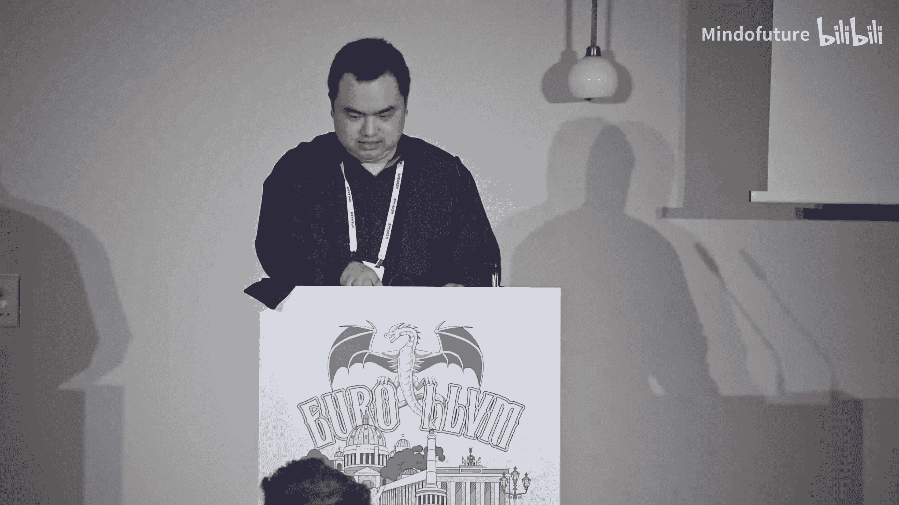

# 2025LLVM欧洲开发者大会-p40-P40-Optimizing-FDTD-Solvers-for-Electromagnetics-Using-MLIR-Across-Multiple-Hard--BV1EoE9zUEbG_p40-

Hello everyone， my name is Yi Feihe， I'm a PhD student from the KTH Royal Institute of Technology in Stockholm。

 and today I'm going to present our work on optimizing FDTD solvers for electronic magnetics。

 a compiler guided approach with high level tensor abstractions。Yeah。

 and this work is done together with my colleague， Monz Anderson and my supervisor Fa Mc Kis。

Here is the outline of the talk first I will go through the background of the application。

 the FDD method， and then I will talk about the methodology about our domain specific compiler framework and later on is's the performance evaluation and our conclusion。

So first about the mathematic background of the FDDT algorithm， FDT。

 which is short for the finite different time domain method。

 is one of the most commonly used method in the numerical simulation for to solve the max equations and in the above is the the two curl equations are from the empire and Friday laws and in the bottom we can see it's the reputation in the 3D tensor form。

Using a Cartesian3，3D geometry。 And we can the E and H here represents for the electronic field and also the magnetic field component。

 Yeah， and we can see that they have the equations on different directions on three different directions for the 3D input。

 And on the left， we have visualization of our application。So more about the FTTT algorithm。

 it actually requires high computational and memory access because to have accurate electronicmatictic simulations。

 we need to have very high spatial and temporal resolution。

 so we need to have a large inputcise and also we need to have many iterations to get get simulations and also it's basically a memory bound issue because we need to update every point iteration and the calculation is relatively not that complicated。

And also compare with the traditional FDTD implementations。

 which based on more like handwritten platform and application specific code。

 they may have different kernels for different hardwares and different cases。

So they are not portable across hardware and may perform well on some kernels and not on some unoptimized cases。

So our work is like we have an end to end compiler for the FDTD program。

We have an overview graph on here。 we can see that the input。😊。

Is that we use the MR Python bindings to directly generate the FTDTD algorithms， the MRR。

 and we have and for the operators we need， we extended in the algebra depth with the FTD specific operations。

 which I will talk about later and with the tensor representation we。

App some transformations like operator fusion and toling。

 and after that we apply the we managed to have the in place bufferization and we here we have the different pipeline for factorization like for the fixed size bufferization for the X86 CPUUs and also the scalable vector。

Vization for the arm SVE extensions。And for the co generation， we use the LVM。

So here is the simplified Python version for our application， we can see on the left。

 here is the different functions to calculate the first is how to update the H field components to update the HX。

 HY， and H， and then is the boundary conditions。Followed by how to update the electronic field。

So basically for the main kernels on H and E， they have 3D input and for the boundary condition。

 they have like 2D input。And on the right here is a naive Python。Impleation for one of the kernels。

We can see that for in this case for the how to calculate the Hx， it would need the EY and easy。

 but with different address and。Also， we applied this kind of calculation repeatedly on every point in the to 3D input tensor。

 So basically， we can tensorize the。Computation， because for the different points。

 they calculated independently。 They don't have data dependence with each other so we can make it into a tensor。

 And in the right bottom， here is based implementation。 because they we kind of like。

Ex the computation in the matrix form。And also we can see that from the left。

 for the calculation of Hx， H YH， they read they have some kind of data re because they will read the same input buffer。

 so here we have the potential of using the operator fusion or loop fusion for better data reuse。😊。

And here is one of our implementation in the tensor abstraction。

 we extend the linear algebra deect with our specific curl step operation。

 the curl step operation is used for both the H and the E fields but with different tensors and different configurations and also is implemented using the linear algebra of DSL。

Here the code is kind of like abridged for clarity and space。

We can see that the code is in a single assignment， single static assignment form。

 So unlike the Python code， which offer， which operates on buffers。

 here is like if we want to update the want to write to the tensor。

 we need to generate a different new tensor。 And later on in the bufferization。 we， we。

 I'll talk about later， we manage to to。Eliminate the redundant tensors。

And the main body operates on 3D tensors。 And for the boundary condition， it's on 2D tensors。

And here is simplified code for our the transform IR code we use in our optimization。

 we match the specific curl ops and then perform talling and loop fusion and vization。

 which I will talk in detail later。First is the talling。

 we can see that before talling we have some specific curl step our custom ops and after Ting there will be a four all parallel loop over a smaller ops on smaller data input and the innermost dimension is set to the vectorization wide。

For the vization， we have two pipelines， one for the X6 for the fixed vization。For the arm。Platform。

 the fixed size of the transition also works， but it will only generate the neon instructions instead of the S V instructions。

But SV instructions has have better potential， so we try a different pipeline and enable the scalable factorization。

On the right is the codes example for our code like after the vector is in virtual vector code。

 later on， when lowering down to all to specific SD6 or arm code。And for the evaluation。

We compared our FDDT application with the NI implementation， which is showed in the beginning。

 a Ny matrix from implementation， and here we compared our performance on different data sizes from the input 64 to 1024。

And here we compare the performance on both the single and double data on the left。

 and all the performance is shown as speed up compared to a normalized non implementation。

 on the left is the。Double implementation， double data precision implementation on the right is the single data implementation。

 we can see generally the single data implementation would have like a two times speedup compared with the double implementation and also our implementation have like up to 10 times speed up compared with the baseline and the we here it's like we test down two platforms on the Intel platforms would generate the aVx 512 code and on the M it would generate the Ax525。

56 256 code， but they both perform well。And also， we tried it on the armA64 Fx code。

Because our application would use lots of the memories。

 So here the arm system we use doesn't have that much memory。

 So we so the largest input size was 512 because for the larger size。 It would collapse。

 And for the arm， there is an interesting thing。 we can see that is's that for the double for this single data precision is not like two times more。

Compared with the double precision， because we find that in the code that for the arm could code generation pipeline。

 some of although most of code is already vectorized and generate the SVE code。

 there are still a small portion of it， that's like not vectorized vectorized。

 So for those part of scalar code， the double precision won't be like so for that part。

 it won't be like like the。The single precision won't have two times more speed up。

And in the right here is different optimization combinations we have to show the effect of different optimizations we applied in the bottom is the code without any MR optimization I talked before。

 but with the some of the LVM low level optimizations。

In the above is the code after telling after vectorization。 and after loop fusion。

 we can see that the most of the performance speed up comes from like after the vectorization。

 and for the loop fusion is's like for small sizes， it doesn't really help much。

 but for large sizes to， it would help better I， because that's also expected because for small sizes。

 the data can be contained in cache。 So yeah。And here is like we have a profiling for the performance counters for the applications of the nonP implementation and our MR implementation on the Intel platform。

And also， the all the sum of the counters are normalized to the nuy as1 x。

We can see that in the bottom like after tall， we have like much less L1 cash loads。And。

Much less airborne cash flows。And after the fusion， the L cash misses also drops significantly。

And we also find that in the assembly hotspot of the Na implementation。

 they would generate some very expensive vector insert and structure operations。

 but in our implementation there isn't such hotspot。

 we use the consecutive vector load and storing step。So in conclusion is that we developed。

H level Ten abstraction for the FDTT kernels， and also we can apply some telling and fusion on that。

Ofobstructions。Also， we have an automated extraction of the hardware specific parallelism。

 we enabled vization and some architecture where co generation for like Intel MD and Ar CPUs。

And in the end， also we have some performance evaluation and an analysis for our implementation compared with the Np baseline and have some speed up。

Yeah， thanks， everyone that's my presentation。So we have time for questions。

Thank you for the presentation。 Yeah， I have a question It's about do you try loop scaling。

Loop scaling optimization for F TD screen。 I mean， in Poedro。

 the loop scaling is like before this to this。 Yeah。

 it's also a good optimization methods for F T TD computation because in the poly benchmark the F T TD A D I and Jack B and hit。

 it named。😊，Also， it this has a common name。 It named computation。 Yeah， yeah， So， I mean。

 this methods， is suitable for other computation and the yeah， I mean， if it's suitable。

 Then your in module， you can abstract your method into a cost module。

 Then Po Hero can out schedule this methods for any。😊，For any spatial computation。 Yeah， thank you。

 Yes， thanks for your question。 Right now， we don't have the optimization。 like you said。

 the loop scaling or also we don't have the polyhedro model in our scheduling。

 But youre the loop scaling。 for sure， it looks very promising。 So later on。

 when we optimizing it further， we might like what you said to apply some other stenc code。

 some sten patterns， optimization patterns。 Yeah， but right now， we don't have those。 Yeah， okay。

 thank you。 Thank you。Hello， thanks for the talk so my understanding I'm not so familiar with this problem。

 but my understanding from the talk was that this is also very memory bound as well as time bound did you evaluate the memory usage of your method compared to the NP methods or is it not change or。

Does that make sense， I don't know。 memory usage， You mean the memory usage of the main memory。

 as in so which whichever one is like the the the constrained one。 I don't know。

 my understanding is that this problem uses a lot of memory。 Yeah。

 Does your method lower the like max memory usage you need at all， or is it is it constant。

 Is it more。Yeah here is one of the profiling results。 I would say that for the total memory usage。

 it would be the same because the algorithm， they need to traverse the input the whole input data。

 But here's like by applying something like toing and fusion。

 we can improve the data reuse like use utilizing the locality in the in the in the data access。

 So here we have better like L1 cache or last level cache reference。 But the total memory usage。

 I would say it would be the same。 Yeah okay， thank you。Are you familiar， There has been an effort。

 I think， last year on getting a stencil dialect for MLIR。

So that you can express these operations in like an MLIR dialect that has lowerings for GPU and。

CPU and even like open MPI。Support， are， are you familiar with that work， I'm not familiar。

 but I heard of that work。 Yeah， there's some stencil application。 But here is like。

 our work is more like specific to this， like overall。Problem。 and yeah， I like you said。

 for the sense optimization， actually there are。Already some of the like MR implementations or some implementation。

 not based MR， but still very fancy。 Here is like our work is like more like focused on overall problem。

 We we we met。 And for sure， later on， we can。😊，Tive deeply into it and apply some of the optimization they already there for the stenil code。

 and also， we have a GPU implementation， but right now， it's not like fully optimized。

 So I didn't show the result here， yeah。Okay， thank you。

So have you think about trying on risk of fire better extension， some of the risk of fire pres。Yeah。

 I think Ri5 is like a very popular and promising hardware for sure I would like to try。

 but right now as our project motivation， we don't have that needs。

 but for sure it's very interesting， not just this application， but maybe some other application。

 riskk5 is for sure a must try yeah。Okay， thank you， thank you Sp， thank you。😊。

