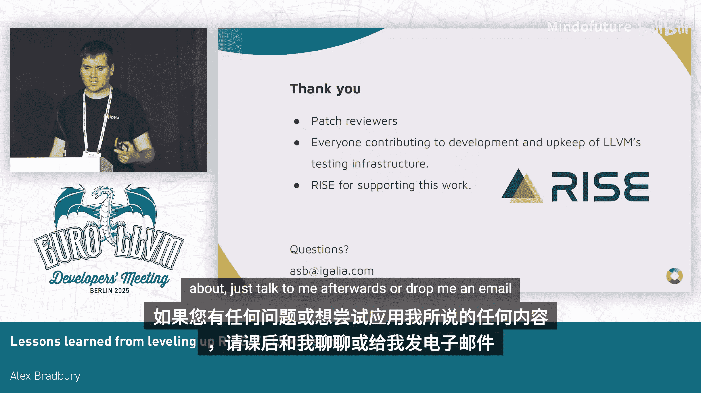
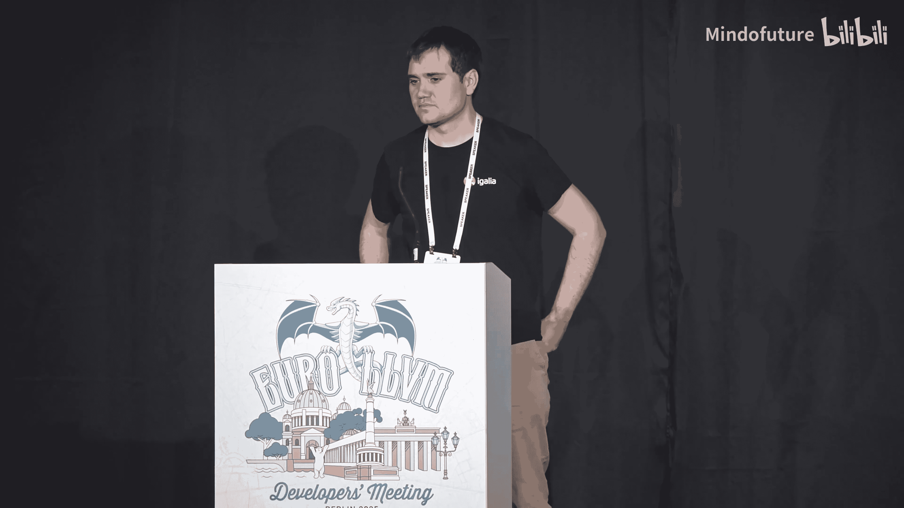

# 2025LLVM欧洲开发者大会-p42-P42-Lessons-learned-from-leveling-up-RISC-V-LLVM-testing--BV1EoE9zUEbG_p42-

I'm going to be talking about what I learned working with improving the continuous integration for Ri 5。

 the intent is that at least some of this， probably a good chunk of it should be relevant to whatever target you're working on。

 if you have any interest in LVM's buildbot infrastructure at all。

 and one point just to clarify is that although much of this could be relevant to like premge testing that we heard about before。

 I've been focused on the buildbot based post commitmit CI。

So I thought a bit about how best to kind of transfer the information I wanted to。

 I figured I'll have a go it rather than a， you know war story of a blow by blow。

 This is what I tried。 I'll go through some of the challenges I encountered and what worked for me and worked for risk 5。

 So I have 10 challenges。 less than 10 minutes now。 We'll see how we get on。Firstly。

 this one is a little bit specific to Ri5。 it's an architecture where there's now a pretty reasonable amount of hardware in terms of development boards and a like。

 but there isn't a decent server class system。 You can stick in a rack。

 You can build do a bootstrap build of clang an LDM and have it and have it run in a reasonable runtime。

So this is a challenge。 and naturally the solution here is to use emulation with QMU running on a fast commodity X 86。

64 hostt。 So that is sacrificing something in terms of speed if you have that hardware available。

 But if we can't have speed， at least we can have flexibility So the dominant cost for setting up this infrastructure in the first place is engineering time。

 hardware is very cheap。 I can rent a server from Hesnerve for 100s a month that that's completely very high performance for doing this stuff。

 And I don't have to worry about the hardware at all。 and running under QMU。

 it gives us more flexibility in terms of testing instructions to extensions or combination of instructions to extensions that may not be available in hardware yet。

 or even options of extensions that may not be present in real hardware， but helps us to find bugs。

So we have our QM U based setup。 we set it up and running。

 but as I say it's a little bit slow running running under full system mode emulation。

 This is where you have simulating a full risk 5 system。

 including running a Linux kernel compiled to risk 5 doing a full two stage bootstrap build。

 running running the included unit tests takes something like 16 hours。 What can we do about this。

 cross compilation obviously comes to mind because then we can compile everything as fast as we possibly can on X 86。

 But how do we run it。 QMU user is another option。 This is a separate a separate kind mode of using QM U whereby rather than simulating a full system。

 you have it's performing translation at the Ciscal level。

 This is a little bit faster than QMU system， somewhat more scalable can。

term system has reasonable scalability across multiple cores。 Canmi using can do a little bit better。

 at least in the separate process build setup， But it has issues in terms of emulation。

 fidelity by that， I mean。if you find a bug or an issue。

 what are the chances that it is an artifact of the setup that you have in order to actually do your testing。

 versus is a real problem。So the solution I've ended up at。

 which I think could actually be quite helpful for others。 I've written about a bit。

 if you look at my blog and also look at LVM Z or all the scripts that needed for it are in there。

 So we do a cross compilation and then spin up a kind of appliance virtual machine that's running So it's a risk5 base system attached the generated build artifacts as a mounted file system then switch to that to run the tests we have a ra script around LVM Li that makes it transparent to the LVM build system and this works very well and doesn't have the same limitations that K user has in terms of lack of support for P trace or issues around handling the sanitizers and that kind of thing。

And。Compiling cllang and LVM， running the unit tests。 This is， it's a challenging workload。

 but it doesn't represent everything that people do with the compiler。

 represents most of what I do with the compiler， but not the wider world。

 so there are more things you could do to widen the testing pool。

 but at least the minimum is going ahead and adding in the separate LVM test suite repo building that running the tests。

 I actually run that with Q user as the kind of requirements there a fairly minimal。 It works nicely。

 And on K user in general， I did upstream。 if few fixes around working that with LVM。

 So it works reasonably well for the baseline unit test if you wanted to go to that route。

And this one might be a bit surprising unless you're a much better engineer than I am。

 probably you know all the things that I've described， it's conceptually， you know fairly reasonable。

 but you're unlikely to write out your build script and it works perfectly first time and in longstanding issue we've had with the LM buildboard is actually quite hard to go and test things downstream without committing it to LVM Zorg waiting till it gets deployed on the staging buildmaster and seeing if it works or not a few people had some downstream patch sets around this。

 I went ahead and upstreamed support for a local testing mode as well as writing up documentation So it's now super easy to set up a new builder test it locally or modify on existing one and pushed upstream。

 It's been a huge improvement for me in terms of my workflow。

 we also have some C for our C I've added a few simple Github actions to check that if your。

ifying the kind of core L VM Z or Python scripts。 Things still work know。

 with at least some simple tests。Ive maybe been a bit been a bit vervo here。

 but the point here here is really。the LVM Z org infrastructure has a bunch of kind reusable recipes for building like say。

 clang Seam factory。 you parameterize that by a few options。 This is great。

 if you want to do something that's just like an existing builder but a little bit different。

 But you start to change one thing you change another。

 you need to add some new parameters to that function， thread it through。

 it may interact with the ways other people using it in unexpected ways。

 This is mainly an advert for the annotated builder infrastructure。

 which lets you commit a shell script that does the build steps you want to very easy to terate and change and related to the next challenge。

 makes it a lot easier for people to people can literally just check out that shell script。

 And if you write it in a way that allows this， they can just run it without caring about the rest of the buildboard infrastructure。

 Another issue we had here was cross compilation， not being well documented。

s now upstream documentation that gives a modern flow on how to do。😊，This in a way that works。

A more recent change has been deploying a new builder type。

 this is what I call so we've kind of said that well maybe I didn't say， but we went from 16 hours。

 kind of crosscomp and then run a Km system。 That's about one and a half to two hours。

 that still multiple commits in a single batch typically So can we do something better here。

 My observation was that when I find a regression flagged by the builders。

 I tended to go through a 30 similar set of debugging steps and why don't I set up a builder that does this。

 So doing a cross compile of doing a compile a fresh clang and LVM and then running compiling and running a multiple configuration of the LVM test suite。

 limiting the test to just those it can run in a relatively fast time gives about five different risk five configurations a run time about 25 to 30 minutes。

 I kind set this up at what I call the gauntlet builder The idea here is that it's is adding some extra testing。

Alongside what you already have， we already have the separate builders。

 which are providing tests that are a bit more detailed。 They're running longer。 But if this。

 if you had a failure on one of those slower builders， but you didn't see it on the faster one。

 that's useful information to be bugging。 if you have it on both。

 you've gotta starting a head start on actually working out what the issue is。 and you know。

 as I'm kind of hinting at here， you know， clearly。You know。

 there isn't a one size fits all approach。 I talked about going from like a 6 hour time to  one and a half hour time to 25 minutes。

 These are all testing different things with different trade offs in terms of what you what you cover。

 what the fidelity is having a combination of these， I find works really well。

 The final thing here is that the billboard interface is quite powerful。

 but not that great for flicking through， particularly if you're any interest in a few builders。

 So there's a nice dashboard set up to look at。 know， in my case。

 I'm many interested in the risk5 ones to see where they're what their run times like。

So I wanted to thank everybody who has helped working on this。

 particularly reviewers and those who are maintaining the billboard infrastructure。

 a fairly thankless task。 But theyre very grateful to everybody who's been incredibly responsive with reviews or questions。

 And thank you to R for supporting this work。 if you have any questions or you know。

 you're looking to try and apply anything I've talked about。

 Just talk to me afterwards or drop me an email。 Thank you very much。😊。

