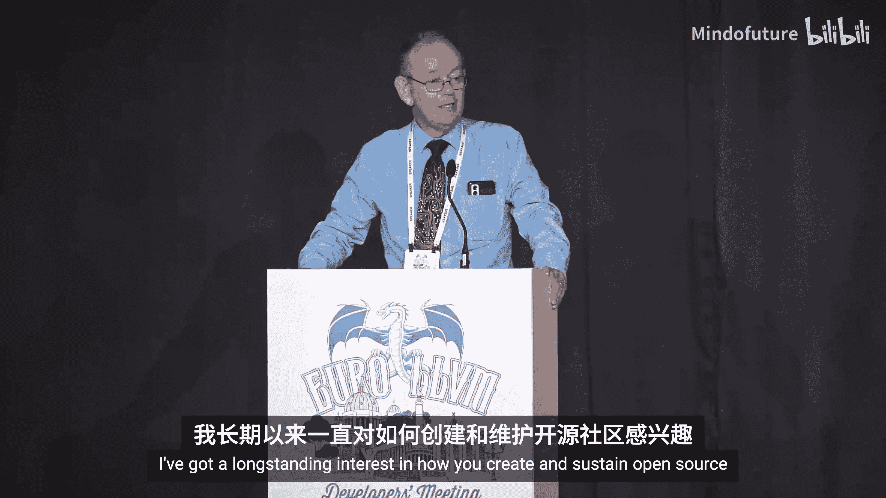
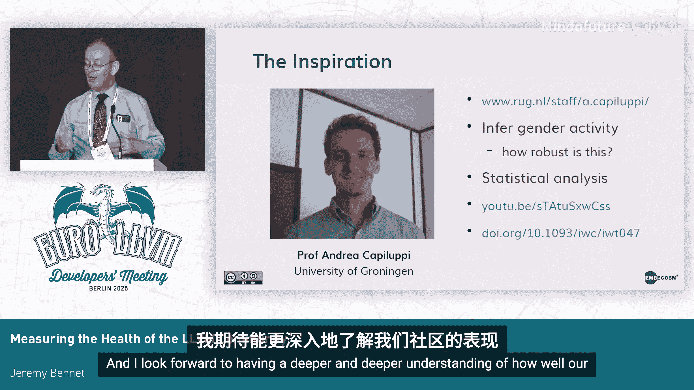

# 2025LLVM欧洲开发者大会-p43-P43-Measuring-the-health-of-the-LLVM-community--BV1EoE9zUEbG_p43-

L L M has a longstand and very successful commitment to a healthy community that is diverse。😊。

And inclusive。Some of you will know Druckcker's law。 You cannot manage。What you cannot measure。

So the question is， how do we measure the health of the L LVM community。I'm Jeremy Bennett。

 I've got a longstand interest in how you create and sustain open source communities。

I'm going to introduce some very simple techniques we can use to look at the activity in the L L V M community。

 And I hope you'll go away， inspired。😊，To think about how we track the health of our community。

So first place， I look。Is the git repository。And simple thing， let's just count commits。

 and we can count them by release， or we can count them by time。 Okay， and fairly mainstream things。

And then we can look at the number of commits per release with something funny with the branches around 3。

43。5。 but you can see over the nearly 25 years we've been going steady increase in the number of commits per year as the project gets bigger and more complex。

 very healthy。And we can do those same commands， But on parts of the file structure。

 So we can look at front end and subproject activity， so。First few years。

 there was just the one project。 And then we add in clan， and that remains a big project。

 And then along comes L LDB， an LLD。 And then we see a big burst of activity as Fang comes in and continues to be developed。

😊，And we can do the same at the back end。 And so you can see that X 86， obviously， all along。

 then long comes the 32 B arm。 And then 64 B arm。 And then we go through and we start to see in the last few years。

 risk 5 coming in and the total activity and risk 5 and。Looks to be about the same。

 So we can see how different projects are going。We can go into a bit more detail。

 and we can count contributors， and we can do that two ways。 We can look at the names of people。

 That's quite good if people change companies that they're working for。

 They're still the same person。But we can also look at the email addresses of the people who are committing the authors of these commits。

 and from that extract the domains they come from， and if we get rid of domains like Gmail and so forth。

 the domains are quite a good proxy for the number of different companies that are contributing to L of M。

So we can look at the authors per release and we can see a steady increase nearly 1。

600 authors in the last release of LLVM， and we can look at how many user domains and it's steadily gone up over the years。

 it's been stable the last few releases sitting at around 70 different unique multi-us domains that probably companies。

And we can do that per back end。 And here's where you start to get some interesting information。嗯。

All the arm backends。 So that's the 64 and 32 bit。 compared with all the risk 5 backends。

 It a bit worrying。 Arms， one company。 It's got a sort of software organization in Naro。

 That's two domains。 and perhaps half a dozen dozen big companies who might also contribute to the compiler people like Qlcomm and so forth。

Risk fives got 4000 members。Where are they all here that barely half the number of companies contributing to risk Fives arm。

 So maybe there's a bit of a call to arms for the Ri5 community。 Start pulling your weight。

And we can look into great detail because then we don't just have to look at the big numbers。

 We can actually spit out all who those contributors are。 The 151571 contributors， the 70 corporates。

 the 63 individuals who contributed more than once per week。

 And if you look one person contributed 767 commits to release 20， That's a phenomenal commitment。

 And if you go back and look at previous。 So you'll saying the same names that are really the big players and who we ought to celebrate as the supercoms。

 a bit of fun， I went back to release 1。0，17 individuals two corporate domains， actually。

 those were the University of Illinois Champaign。 And the computer science department of the University of Illinois and Champaign。

7 individuals contributed more than once per week。 And I leave you to guess who that individual was who contributed 6 and a half thousand0 commits。

😊，We can do this。 We can apply different compilers。 How are we comparing。To between Ku and L L V M。

And we can see Ganos built up， and it's nearly 40 years old。

 And it got up to about 10 or 15000 commits。 And I'm including in their GDB and LLDB and L and LD。

 because they're all part of。The LL V M project equivalent as well。 But you can see by 2007。

 L L VM's activity into commits overtakes， and it is now something like three times。More than GCC。

 So it's a bit， we're a bigger community。 And I work in both communities。

 This is not a judgment between them。 I'm I do Gcc， as well。I do it per year。

 and not per release because we have different release cycles for the two， two compilers。And again。

 you can go into more detail。 And again， we see the same thing。 If we look， we， we can start see。

 This is， again， L L V M and Gcc for arm， And we can see arm has really committed to L L VM。

 There's much more arm activity on L L VM。 There's a Gcc。 That's not the case for risk 5。 Rik 5。

Actually， there's more activity on arm， but not much more。

 And that's perhaps something telling us where the communities are sitting for those different architectures。

And let's move to Github itself。 There's a command line tool G H。

 And I'm only going to show you one example here because I've shown the general principle here。

 Here's a little script。 We spit out all the pull requests that in the closed state。

 and we'll spit them out as Jason and the minus Q option is putting piping them into the JQ tool to extract the detail data in a bit more compact way and post post in all script and we can get graphs like this。

 where we can look at 90% of PRs are eventually commented on and then merged and then we can start to see the statistics of the comments per merge PR。

 I've done it per month because we've only been using Git for a year and a half or so in anger。

 Github as a priming thing for a year and a half or so。

 But you can see we've got about three and a half comments per merged PR。

 And that's consistent with what we we used to see that statistics's been collected for years。

 just a reminder if。You want people to work on your PR。

 Make sure you're commenting and helping with about three and a half other PRs to match。

Here's the last bit。 I'm not going to go in detail。 There's not enough time。

 but how do we start to get to more things， How do we look at diversity and inclusion。

 And I'm going to introduce you to someone else's work， This is Andrea Capapppi Lupi。

 He's at now at the University of Grnegan。 I met him first when he was at the University of Brunenel。

 There's his links。 And he asked the question。 How well do communities look after different genders。

 And he used things like looking at names to infer gender。 He look looking at people's git。

 pictures to infer。And what I like about his work is it is purely analytical。

 He does a rigorous statistical analysis。 I've given you a link。

 That's the first time I heard him speak。 It's the British Computer Society。

There's a link to one of his key papers on this。 And you can find things how， you know。

How many women are involved in the community by contributing as opposed to men。

 How many women answer questions， How many women ask questions。

 How long do they stay engaged community。 and with modern。

 large language models you can do really intensely What is the language like when responding to someone who's apparently got a female name as apparently a male name。

 There's a huge amount there。 Andrea goes into great detail。

 There are a huge number of things you can get wrong with that？ He looks at those very。

 very carefully。I'm leaving as youre my final thing。 Look at his work。

 and let's see if we can do the same sort of thing。 I't。 I haven't got the time。

 I didn't have the time this year to do it。 I'd love to see the same analysis done on L L V M。

 And I think from what I know just subjectively， we might be pleasantly surprised when we compare ourselves to other communities。

 But it's a great set of techniques we can use to mark our homework， as it were。😊。

I hope that' fired you up。 You've got some ideas， and I look forward to having。

A deeper and deeper understanding of how well our community is performing and that we continue to grow and be healthy and inclusive and diverse。

 Thank you very much。😊。

