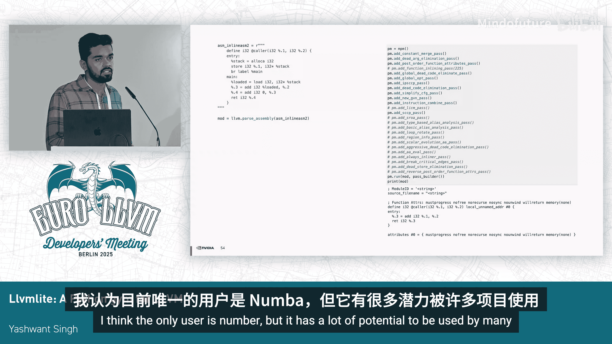

# 2025LLVM欧洲开发者大会-p45-P45-llvmlite---A-python-gym-for-LLVM--BV1EoE9zUEbG_p45-

Welcome to the last talk of the day， I hope I can keep you engaged for 2 more minutes。So here am I。

 I' am Yesshhuan， I work at NVdia， I work with the CPU Comp team。😊。

We tried to contribute to the R64 back in upstream and LVM and for past year or I've been working with Numbba as well and Numbai is a LVM basedit compiler for Python I have a few slides about Nmba as well upcoming。

😊，Okay， now starting off with what exactly are LBM lighten number so number is an LVM based did compiler a Python it is used widely to speed up a Python code。

😊，By factor of 100 x to even 000 x and the way it works is so Python is an interpreted language and the no tries to bypass the Python interpreter and in instead of relying on the interpreter。

 it did execute the Python code using LVM's J execution engine， so it lowers Python to LVMIR。

 optimizes it and then executes it on the machine。😊。

And LM light is a bridge that connects number Python front end to LVMs backend and this top is going to focus more on LVM light numberine itself is a very interesting topic but there are a lot of resources available about it and you can read more about it but I will still give a brief overview what exactly Numbai is。

😊，So Numbba as I said is a LVM based compiler for Python。

 the way it works it you start with Python which is then lower to something called NumbayR which is very close to Python but I haven't exactly worked on Numbba IR but then NbaR is then lower to LVMIR once you have the LVMIR it is then optimized using LVMC plus plus APIs for which we have that personal LVM light。

 one more thing the python to Nba IR translation to LVMIR translation is again done by LVM light which acts like a compiler front end for Python。

😊，Once you have the optimize IR， you can just send the machine code and directly execute it on the machine。

So here I have an example about which demonstrate how you can use number to speed up a Python code。

 So I have two exactly two functions which calculates the sum of anump array。 However。

 in the first function Im using， I am decorating it the j decorator， which instructs number to。😊。

Jt compile this function Institute of invoing the Python interpreter and if you see at the execution speed you can see the giit executed function is a lot faster than the normal Python interpreted function。

 so it is around 60。1 microsecond compared to 5。14 milliseconds。😊。

Coming back to this talk I'm going to talk more about LVM light and basically three main things in LVM light which makes LVM light what it is。

 the IRBuilder which is a compiler frontend an LVM playground I'm calling it LBM playground I'll show you some examples how you can use LVM light to develop day to-day tools as a compile engineer and in the very end I have few slides about how you can directly execute any LBMI you have using LVM's GitT execution engine Python。

😊，So disclaimers so some of the examples in these slides might not work。

 the reason is there are some pull requests that are still waiting to be merge but you have them and you merge that pull request locally and below you might or everything should work fine。

😊，And Ive tried to push all the code examples this in the second link。

 this is the Python notebook which contains all the examples that I'm going to go about today。😊。

Starting with IRBuilder so IRBuilder Act as a compiler front end。

 which allows you to lower any programmingying language to LVMIR。😊。

And in this talk I am not going to show you how to build your own programming language I am going to focus on few examples on how LBM light IL builder works to generate an LVM I function。

So let's try to build LM function with our2 in teachers a very simple function lets see how we can do it first thing first we import the IL layer for NM light it contains all the APIs for building the LVM I。

😊，We' will create an empty module， we willll name it my module。

And then we will define the function in the first line I have tried to define the function type so the first parameter is the written type which is the integralteger sub type 32 and then I have list of parameters which are the function arguments again two parameters of type 32 and I have added this function4 to the module mode and I have named this function L 2。

😊，Once we have done that we will try to add some basic blocks to a function since this is our first basic block let us call it entry。

 this is how you do it in LVM and。😊，So this IR builder Act is a pointer to the LVMI that you are building it works at three layers of abstraction so build dot block will point to the basic block level it itself for forulating instruction at basic block level and things like that then you have build dot function which is a slightly higher level of abstraction it is for modifying the IR at the function level the function return type arguments and stuff like that then you have the highest level of abstraction build dot module which you can use to modify module by changes such as module name target triple。

 data layout etc。😊，Let's try to add the actual instruction in our function。

 we will capture the function arguments in A and B Python variables A and B。

 and this is how you add an add instruction to the function。

 mill out add which takes2 parameter A and B， which are the function arguments that we have captured in Python variables A and B and we are calling the output variables C。

And lets say I an injection， which returns this variable C。😊，This is the final code。

 its just the same code in one slide and this is the output I。😊。

So we have the module name set to my module target ripper is unknown because we have set it yet target layout literally layout is empty but the function tab is I32 it has two parameters of type I32。

 the name is at to it has one basic bulk call entry and it has two instruction and add instruction in a written instruction they output a pair in variable C and we are returning their variable C here。

You don't have to stop there number actually it does a lot more with lot more than just building the basic as we may it is a full F compiler you can try let try to do something we here I have tried to pinname the function module to test module I have set the target Tri to a 64。

You can even add function attributes to the functions in the module here I have tried to add the no inline attribute。

 let's try to see how our module looks right now， so you have this no in attribute set now the module name is in and you have target triple set。

Al right as you know LMI module can contain a a lot more function now just single function。

 lets try to add another function to a module and this time this function takes three parameters and it will return sum of those three values。

😊，So I am not going to go over the code line by line I' will give you a second to just get an idea about the code and we will just go over the output。

Yeah so as you can see now we have two functions in our module the add2 is the older function and now we have add3 function as well which takes3 parameters of type I32 and it turns this sum we have two add instruction which we add over here。

 the add one and add2 and then we have written instruction which we added over here。😊。

Moving on coming to the second part of the talk， so Im going to talk about Im going to go over a few examples which will show how you can use LVM light in your day to day compiler work for if you are working with LBM directly and find C++ a bit intimidating forqui for rapid prototyping with LVM。

😊，So let's try running some of the LVM supplement passes directly。

 so we are going to try to run a pass on this LVMIR so this time we are not building LVMIR on our own instead we are passing the LVMIR from Python string so we have a Python string over here which is an LVMIR function and。

😊，ThisThis is how you pass in LVM my module， a Python string to a LVM light module object。

If you notice here instead of inputting the I layer， we are inputting the binding layer。

 which contains the APIs which。😊，Which interact with Belllgium itself。

Once we have the module object ready， we can start with our experimentations。😊，First things first。

 we are going to do some initializations， these fi slide are the knit target and the assembly printer for the machine you are working on。

😊，We define some heer function， this target machine function will create a target machine object for the machine you are working on。

😊，Again， Pass builder PassBuilder is a class in LVM which is responsible for managing the analyzes and automation passes under the new pass major infrastructure。

 this is just a Python wrapper over that C++ class。😊。

Then we have an MPM function which return a empty module pass major object we use it to an individual passes on a Python mode on an LMR module。

Okay， let's try to run simplify CFG pass on this IR。嗯。

So this is how you do it first you create a pass manager object using the MPM function we define in the last slide。

 you create a pass pillar object， you add and simply by CFG pass to a pass manager object and we just call it un function on it and that's it。

This is the output。We dont have to go into the details of the LVM Mi。

 you can see we here we have that is how many one to three or five basic blocks here we have three basic blocks the input it significantly significantly different than the output is different than the input。

😊，How about default operation pipelines so you are not limited to individual passes you can run the default 5900010203 etc ce。

 you don't have to stop there， you can combine those pipelines with your custom optimizations you can send whichman default optimization pipelines you can do basically everything you can think of with LBM passes。

So here I we will try to run 03 pipeline on this LM my module again pass we will create a module object from the Python string。

 we will pass it into a module object。Lets create a pass object this time we are creating pass object with speed level 3。

 speed level 3 will correspond to 03 in LBM。😊，Yeah， okay。

 well query the pass object to give us a pass manager object。

 what this will do it will attend as a pass manager object with all the passes initialized for03 operational level。

😊，We will call the run function on it and this is the output as you can see the output is significantly different than the input。

😊，This was the O3 pipeline。Moving on so this is my favorite part。

 so LBM has a plethora visualulation par that you can use。😊。

Either for debugging or just trying to figure out what exactly is going on with the automation that LVM has。

Passes that visualize control for graphs， dormories， post dormories。

 it has variation of those passes that can print those graphs with with less verity。

 so we will try to create some quick functions in an LVM light to easily access these passes。😊。

So here I've tried to define a Python function， which will generate a。

Control for graph of LB my am moduleum。Going over the code I am creating a pass major object in the first line。

 then Im adding a CFG printer pass to it and Im calling the run function on the module that I'm passing the parameter。

😊，And in the last line， I'm converting that。So that LM pass in it basically generates a dot file and the last time Im converting the dot file into a PNG image and I' am naming the image as the second parameter that I'm passing the function。

How do we you， How do we call it， This is how we call it。

We call the render modular dot co function with this count zeros module。

 this is the module I have defined in the left and I'm going to call the output file count zeros。😊。

Let's see the output file， this is the output image。好么。Okay。So again this is not something new。

 LVM already does it， I'm just trying to showcase a new interface to do the same things that you have always done in LVM。

So more visualizations。 So you don't have。I think I have few more example yeah。

 this is generate dom tree function it will generate the dominant tree of LVM module。

 then I have a post generate post dom function it will generate a posttro tree of the LVM module。😊。

Building custom operation pipelines， like I said before。

 you can build your own custom operation pipelines using LVM light。

So let's try to do some experiment with this l my module。

So first thing first will parts will create a module object from this Python string and here I have tried to create a very random pass pipeline so I was not thinking about doing some kind of optimization over here I just I just wrote whatever passes I could find as light and arrange them over here This is just to show you a glimpse about how you can create your own custom pass pipelines in it you can club these optimization with。

😊，Default of levels such as  over and02 as well。This is。

 this will come particularly handy when you are working on， let's say， some。Oims。

 for example some vectorization and you want to test the effects on how does your optimization works with some of the loop automations and you also want to quickly test what happens if I reorder those optimizations so you can quickly come up with the Python screen。

 define some functions and basically automate everything and just look over the outputs。

It's great for building fuuzzing tools， sand debugging tools。Yeah， I think I yeah。

 so this is the in the last line I am calling the run function on this module， this is the output。

 something has happened to the input。Because of this passage that we had earlier。How about codes in。

 we can also look at the assembly。So here instead of initializing native targets。

 I am trying to initialize all targets because I want to show you assembly for multiple targets。😊。

Aspoer that you need LBM built for all targets， otherwise it won't work it will give you some error something error。

 something like target triple notize or something。😊。

So in the so here I am trying to create a risk speed target machine from a risk speed triple then I have created a x36 target machine from x 36 triple and I am creating a。

😊，Native target machine from a default target， this will be the target machine for the target you are working on it will automatically query the triple and create a target machine。

For the alert， this is I was working on a64 machine， so this native target machine is an a64 machine。

😊，We will try to generate assembly for this L Mi module。

 so I am going to skip over the part where we try to optimize L May because we already know how to do that instead I am going to show you how to we just look at the assembly output for this unopimized L Mi。

So it is very simple you just call the image assembly function on the target machine object and you pass the module you want to look at assembly for。

😊，So in order we have x 86 rex 5 and native that is achi assembly it is not very irritable but you can take my word on it。

 these are all different assemblies。😊，Okay coming to the last part， executing your IR。

 so lets try to execute the air2 function that in the very first slide。😊，Yeah。

 so instead of using the module object we created earlier， I am going to create a module object。

 a fresh module object from a Python string just to keep these lights contained and。

For simplicity purposes， we could have re used the same module object。

 but I am creating a new module object from this Python string， Ill passse it into L mode。😊。

Once I have it。I will create a target machine object and I will create a compiler object so this LVM do create MCGt compiler this will create a MCGt compiler instance that we have in LVM so LVM has two jet execution engines MCG and object LVM light is currently lying on MCGt。

😊，But you you feel free to propose the change to ship to object it is actually one of the ongoing project that nobody has picked up yet。

 but it is definitely something if you want to contribute to OEMVM night and number。

environmentvironment。SoAnd compile or final object will create the binaries or the machine code for the cellium me。

😊，Once you have it， you can execute that function using。

usingsing function pointers will will query the address of this add2 functions once we have it I have to try to execute it with two sets of input minus1 and 21 and2 you will get the sum 1 and 3 respectively。

😊，Yeah， thank you so much for listening。 If you have any question I can take them now。😊。

Hey thank you maybe you are slide 54 I think where you showed the pass pipelines do we have the facility to pass let's say if I have pass has like multiple options can this facilitate feeding those options as well say the threshold that you show on the landing site it just one there but if there are multiple options for a complex pass then can we feed them all through this so there are two things over here first you need a wrap around the pass you want to experiment in so let's say so some of the pass I have commented out are yet not supported in LVM light it's very easy to support them it it's 10ut lines of change so once you have that support you can call that pass then the other thing is you should support the passes with particular parameter it works with so here in landing threshold has a in learning threshold parameter which default 25 which you can overwrite。

😊，Okay， thank you。So my question is， is there any support for allowing us to write passes or rewrites in Python itself because now you're just calling passes that already exist on the C++ side you should be able to do that。

 nobody can stop you， you can write your own passes in Python。

 but the down set will be you won't be able to use the data sector that we have in LVM that allow you to easily write operation passes。

OkaySo I know for the MoR side of things Python bindings。

 they actually have an issue with allowing people to write rewrites in Python basically because there's an ownership mismatch of the memory of the different ops so when you start manipulating ops on the Python sides++ things about ownership differently now they issues do you think this is also the case on the LVM site or not I'm not aware of it mainly because LVM light not doesn't have custom passes right now so maybe that's why they haven't done LVM light basically exist to cater to numberba so whatever no money is supported right now。

 noma doesn't need a custom pass so they don't have their functionality but its still an digital project So if somebody wants to write custom passes in it want to use more LVM interface they can feel they can write either their own for or contribute to LVM light and expose more LVM data and APIs in LVM light or even write their own passes but。

This memory safety issue， I am not aware of it， that sounds interesting when we can chat offline。😊。

Thank you。 sure。Thank you for the talk I wanted to ask how exactly you are binding to LLVM and is it easy to use a custom LLVM build。

 so for example， if I I don't know， change something in a core。

 can I use LLVM light to use my LLVM build and play around with it。

So for the first half of your question， LVN Knight uses C types。

To interact with C plus plus code base。 it's a standard。 It's not very difficult to use。

 If you look at the code。 it will be very intuitive。 I didn't get the second part。

 Can you repeat the So I mean， if I create a custom LV and build with some changes of my own can I。

But I guess the answer is yes because he said it uses C type so then I can use my own LVM builds Yeah you can for the slide example here I'm not actually using the upstream LVM light and Im using LVM light with my own build of LVM upstream LVM light still still stuck on LVM 16 we are trying to move it to tip up trend they are pull request open for it like I mentioned earlier。

😊，So yeah you can do it I' am basically doing it in my example。

 there is an environment variable that you can use to point LVM light to your build of LVM and we try to interact with those LVM APIs。

Okay， thank you， sure。Hi， thanks for the talk My question kind of has two folds to it What do you see like the use case of LLVM light is maybe a post。

 let's say MLLIR Python bindings and maybe the second question is what does the future for LLVM look like？

Okay， for the first question， there are many use cases first them。

Let's see you can build your own compiler front end in Python。

 you can design an Uami language but targets LVM， I think it's a great feature to have no does it it designs a Python front end for LVM。

And。And the other benefit is you can create these tools that I have mentioned over here。😊。

So some of these can come very handy， for example， those visualization passes。

So I found myself stuck on how this optimization is working then I have to go to Goldboard or to file fire of my own LVM tools and try to dump those dump those optimization images。

 control for graphs and it gets very messy， so it' is very helpful for developing those tools which might help to help you in day to development。

And coming to the future of Alveium light。The first thing is we want to move it to albumviium 1020 or tip of trunk。

Maybe try to pitch it to more projects to use right now it's I think it's only user is number。

 but it has a lot of potential to be used by many projects cool thank you very much sure， no problem。

