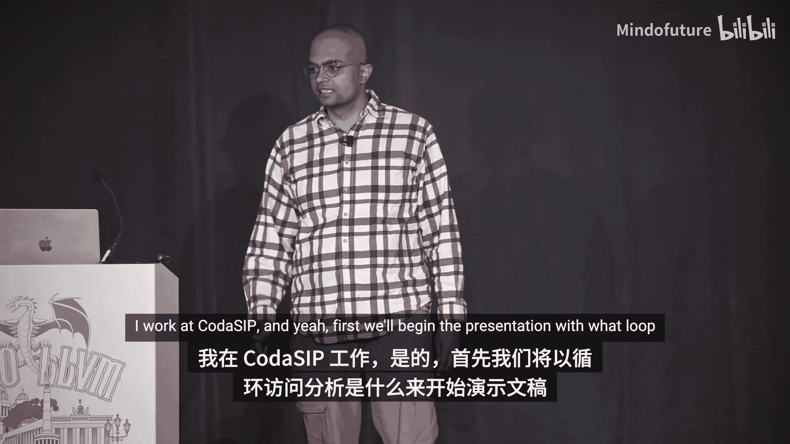
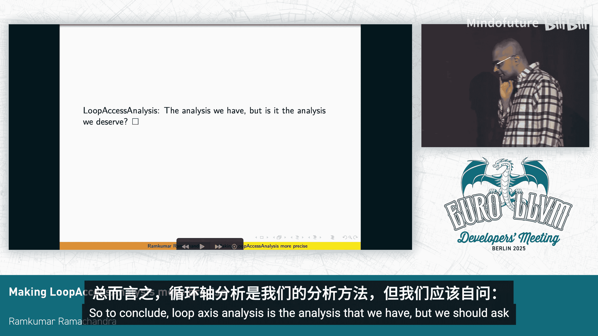

# 2025LLVM欧洲开发者大会-p46-P46-Making-LoopAccessAnalysis-more-precise--BV1EoE9zUEbG_p46-

So hi， my name is Ron。 I will be talking about making loop access analysis more precise。

 I work at code S and。Yeah， first we' will begin the presentation with what loop axis analysis is。

 because many of you probably aren't familiar with what it is exactly。

So loop axis analysis was actually built for loop vectors。

 That is the primary reason why loop A analysis was built and。It the among the other users。

 there are some other users， S P V， for instance， but it doesn't use that many features of loop access analysis。

 It's not very。Its not it is not a very heavy user of loopax analysis。

 so it's a dependency analysis essentially which is built on scalar evolution that tries to prove that something is legal to vectorize or is legal to vectorize with runtime checks or just I mean like。

I just don't know the dependency and you know， the dependencies are unsafe and therefore don't vectorize it。

Among the other users there is also loop versioning which I will talk about briefly it versions the loop。

 so I will talk about what this versioning is and there loop load elimination which uses the version loop per se。

😊，So these are the users and of course there's loop distribute loop distribute is not turned on by default although there is the equivalentvalent in Gcc which is loop  Eldist you know。

 which is actually quite powerful so we should wonder why our loop distribute is not as good as Gccs and whether it can be useful for vectorizing some additional cases。

So。The reason， I mean， I would say that loopx analysis was primarily built so that can emit runtime checks。

 And here you see that you have a cons float star x cons float star y。

 which means that you don't know if the areas。So if it does alias， I mean。

 there is a problem with vectorizing this and。The reason loop X analysis was built and the primary thing that it does is it communicates what runtime checks are needed。

 and loop loop vector synthesizes these constraints。

 It's basically a scalealar evolution expression that it is a scalar evolution expander and it synthesizes these constraints and it says that。

 yeah， these are runtime checks。 You know， if， if it， if it's not satisfied， then don't vectorize it。

 if it is satisfied， then vectorize it。So，Yeah， I mean， of course， if you。

 if you make the float star， a float star restrict， it means that it doesn't alias。

 then it's just trivially safe。 That's fine。 Lowax analysis will say it's just trivially safe。

 And that's， that's totally fine。 But it can also perform like nontravalal analysis。

 Here's an example of a nontravial analysis。 This is like。😊。

It it determines that this is safe because Ive actually taken two times IV because if you take IV is equal to IV minus1 what happens is that it does mem copy it synthess it into a me copy so I just made it a two times so that you know for the purposes of you being able to check out the example。

😊，So， yeah， what is a dependence。 A dependence is there between a load and a store or a store and a store。

 It's never like， you know， you're just reading from some， from some memory and there's a dependence。

 No， that's not a dependence。 I mean， if you're reading from memory。

 like I mean if youre only reading from memory， if it's a read only loop， you know。

 what is a dependence， there's no dependence。 But if you're storing to conflicting parts of memory。

 then that's a dependence。 or if you're loading something and you're storing something， you know， in。

 in in a manner that either has some kind of loop carry dependency or some kind of indirect unsafe dependency in loop terminology。

 then that's a problem。 so。Let's look at what are forward dependences。

 So this is the forward dependence。 I've written a plus equals over here so that it emits the forward dependence here。

 what does it mean， It means that this I V， this induction bar is is like。Given to the， I mean。

 the previous value is now given to the next value， which means it's， it's like it。

 it should be reczable。 They should be reczable。But let's look at a backward loop carry dependency。

 And here Ive used something called a stride。 So stride is basically some。

 some kind of constant or some kind of symbol that is multiplied with the induction bar。

 So you often see strides in in real world programs like the induction bar is multiplied by So for instance。

 in the previous example in this one。😊，The two times was a stride。So that's a constant stride。

In this case， it's a symbolic stride， which means that it's。

 it's some variable that it knows it's a symbol， but it doesn't know what it is。 You know。

s it's like you have to， it's like an argumental a function or something like that。 So in this case。

 what it does is loop axis analysis also performs the other function， which is to。Version the stride。

 So it generates a version of the loop with stride equal to1。

 and a version of the loop with stride is just symbolic。😊，So this is what loop versioning uses。

 And this is useful in certain cases。 For instance， loop load elimination。😊。

So let's look at these variations。 Okay， these are interesting variations because these are actually not vectorizable。

 but loop axis analysis doesn't is not。 this is， this is an example to illustrate that loop X analysis is not really a full dependence analysis。

 It's not like， you know， it's a freestanding depend analysis that will tell you the dependencies of all the。

 all the dependencies in the loop。 So it's， it's only going to tell you like， I mean， in these cases。

 you know， okay， I mean， you can， you can ask what is the。

 what is the utility of telling me the dependence if it's not vectorizable anyway。😊，But， I mean。

 if it's not factorizable， I mean， the loopax analysis， the freestanding analysis， right。

 So it should， it should give you a dependence analysis。 but， I mean。

 I don't know how we want to approach this。 We can say that it it's good enough in practice。

 you know， and it， it just reasons based on simple scale expressions。 It works in practice。

 And it is， it is like。Good for vectorization。 That is， you know， it's like， okay。

 it works in practice。 It's not good， good in in an absolute sense， but it works for most cases。

So this is this is the very illustrated structure。 actually。

 this is what it internally uses to communicate what information it has dug out in terms of its analysis。

 There is a dependence distance。😊，Which is basically， you know。

 if it's I V-1 and IV is1 or some something multiplied by the typebyte size。

 which is basically if it's an inch star， then the in star size times1。

 But I not am going to get into the details of that。

 So the type byte size is essentially the the like I said， the the size of the pointer no。

 the the underlying variable。 That is， if it's an instar， then you know。

 it's the size of how much that instar will increment with every plus one。So that's。

 that's what the typebyte size is。 Then there is a max stride。

 a common stride should retri with runtime check。 So what is all this。 I mean， like。

 so if you look at it over here， there is only one stride？ I what does this mean， I mean。

 like why why is there only one stride？ I mean， is， is。

 is everything like if I write multi indexexing， is there just one stride？ I mean。

 is there only one constant or one symbol that is multiplied by an induction v。

 are there no other induction wars。But this is， there is only one stride for luex analysis。

 And this is very illustrative。So， I mean， this is， I mean， you， you would say， okay， what is this。

 I mean， like， is this， is this some， I this some theory or something like that？ No， it's not。

It's just， you know， we found that， yeah， I mean， we。

 this is the most obvious way to like subtract scale expressions and say that， you know。

 we want to communicate whether we should re with on time checks。 what is the max rate。

 What is the distance。 And， you know， we can tell what is the re therefore。😊，So like I said。

 the dependent systems is just a s minus。 But again， you have to ask yourself， you know。

 if you do the s minus， you know， so you know that S is something that does not use。

Arbitary precision antigentegers。 So this means that there is certain bandwidth width associated with it。

 which means that， you know， if you， if you have ever experimented with it。 You know， it's like s。

 you usually ask for the trip count。 It says， yeah。

 some sign extent expression or some zero extent expression， therell be some cost， you know。

 there's going to be some cost and then plus one of the max back taken can count。😊。

So there are costs there are costs in ca expressions。 so and there is there are， I mean， like。

 so if you， if you don't minus ca， okay， if you have two addd x， two simple add re， you know。

 like say3 plus 4 or x plus4， something like that and something else， x plus 3， it's fine， but。😊。

What if we have something more complicated， I mean， what if we have something with， with more。

Stuff in it。 I mean， like， it's just like a nested a。

 or let's say it's like there is a mu expression。 There is there's like， there's like ad expression。

 you know， this， like， how do you handle all this so that it。There are some cases that it handles。

So if you're familiar with how SCab works， I mean， SCab is described in in various papers。 Of course。

 it is， it is actually backed by theory。There is not one paper for SC。

 but several papers that all describe the general idea of SC。So。I mean， you would ask yourself is。

 is gaev sort of， I mean。How do you recover that information from S。

 How do you recover the indices from sc。So， I mean。This lux analysis。Is。

 is like quite simplistic in that in that regard。 So the stride versioning is also there in the case of an non constant strip。

 which is what I talked about with loop versioning。

 it generates version of the loop with stride equal to1。 And the strides are got from the at。

 It's as simple as that。 It just says， you know， get step。 That's it。 step， get step。 And， you know。

 if you， if you don't get the step。 then sorry， I mean， I just don't know the stride， you know。

The other problem is that， yeah， it can only really analyze the enormous slope。

Which means that outer loops， I mean， any kind of， any kind of thing that requires reasoning about some outer loop。

 some loop nest， some dependence that is carried between like loop nest that it doesn't really do。

Now， if you want to contrast this， of course， there is always the dependence analysis。

Which is not turned on by default， of course。But it， it has， you know， the paper from 1991。

 the practical dependence testing。 That's what it is based on。

 So that one is more dependence analysis for， in contrast is more。How do I say， I mean。

 it's theory based。 So it works in many cases， many， it is supposed to theoretically work in many。

 many cases。 There is some MV test。 There is an S IV test。 It's it's quite complicated。 It doesn't。

 It doesn't do runtime checks。It it tries to， it just tries to say that， you know。

 what is the repents。 That's it。 And it is a complete。 It is like complete。 It won't say that oh。

 this is not recizable。 So what is the point of telling you the repents。 It'll tell you the repents。

So the uses of dependence analysis are rule control and jam and loop and change。

 which are again not turned on by default because dependence analysis is not turned on by default so。

To perform a loop on and jam or loop interchange， you know， loop interchange you can。

 you can think about。 I mean， it's this is like an outer loop， There is like an inner loop。

 You want to swap them。 So obviously， you need， you need analysis of autoer loops fundamentally。

 and unroll and jam also requires it。So， I mean， what。I mean， what。

 what is the what is the meaning of this innermost loop analysis and where does it actually， okay。

 I've been I've been like very negative about loopax analysis。

 but let me show you like an example where it actually works really well。

So here is an example where it works really well。 You have an outer induction variable。

 You have an inner inner induction variable， and this is actually taken out of a test in lo analysis and。

😊，It is aware of the vector width。So it can either generate on time checks or it can say that it is safe for a maximum vector width。

 you know。So you have， I I， have cleverly put 32 as the start of the outer induction variable。

So that， you know， only goes to 33，34，35，36。 And then the inner loop only goes until from 0 to to 56。

So， I mean。This is， this is possible direct vector price now does it require runtime checks， Yes。

 if you dont have a certain minimum vector width， then it does require。Run time checks。But otherwise。

 it doesn't。Let's look at some output of loop axis analysis。 This， this thing is， yeah， I mean。

 this is what it prints。It says that this is a forward dependence and all the information that loop access analysis has within it is like printed in this debug output。

 You just say opt hyp passes equal to access info and it prints you all the it prints you this information。

 Now， this is a simple example。 Let's look at a more complicated example。😊。

This is a more complicated example。 So in this case， you know， it has。

 it has now found some runtime checks that it wants to synthesize that loop vector I should synthesize。

It has taken some sc expressions。 has shown the low and the high。 That is the range of axis。

 and it is also given you the equal predicate。 that is the that is the stride versioning and some expressions that were rewritten by predicated scalar revolutions assumptions。

😊，Which。Again， will be used。So let's， let's like summarize what is the what are the issues in loop access analysis。

 It doesn't reason about auto lobes。 It。I mean， if you want to do multiple littices。

 you have to do something like dependence analysis where you have to deal in your eyes， you know。

The sc expression。But that's also not perfect。 So the other route is basically a full blown LP solve。

 which is also not perfect because it blows up compile time。

 So there is really no good solution to all this。But what we can improve on is all false runtime checks and spurious false dependreencies。

 These are things that we can engineer and we can make it better。 We can。 we can like。

 we can like not let it emit。😊，Spirits on time checks and false dependencies。

And we can try to increase the number of contributors to luax analysis。

 like it does require more eyeballs。 It does require more contributors。

 It does have very few at the moment。So to conclude loopax analysis is the analysis that we have。

 but we should ask ourselves， this is the analysis that we deserve。

Thank you。Thanks， Ram， for your presentation， Any questions。Hello， thanks for the nice talk。

 I wanted to ask。About the strength of scab。 So is it something similar to a fine analysis or。

Can you do maybe more。So it is a fan analysis， you mean like in terms of a solver， right。

 somehow extracting out the multiple indices and and like saying that each one is in a fan expression and then and then doing some kind of polytral optimization based on that。

Scaab is not is not that powerful。 Of course， it is not a full blown solver， but it is。

It is powerful enough in practice。 I mean， in practice， it gives you， you know， like。

Things that it does well are trip counts。 So backage taken count， trip count， you know。

 things like this。 it does。 It does well。There are certain issues with it like is known non negative is known nonpo。

 These things are not exactly it's not it's not like 10 percent there。

 it doesn't know some expression is complete is is like nonpoitive or non negative， you know。

 or is known zero， you know， these things these things don't work super well。 I mean。

 there if there are some cast expressions if theres something it could trip over。 So it is。

 it is very much like something that doesn't blow up compile time， but is very useful in practice。if。

 if you don't mind another question。 So what can you do if。If the arrays are not restricted or not。

With the restrict modifier。Yeah， so the rays are not restrict。

 It's not a problem because loop X analysis， like I said。

 would would emit runtime checks for the asing part。 And I mean。

 loop X analysis will communicate these runtime checks and loop X will insert these runtime checks in the preheader。

😊，So it's not that you know your your your vector price loop get any slower。

 it's just the the pre header， there will be a small there will be a small overhead of checking some at run time。

 whether they alias or not and whether whether the alias within a certain range within the range of vectorization or not。

😊，So as long as this is done， I think if you pay that small upfront cost， it will rec perfectly。

Thanks。So has there been thought of combining this with dependence analysis。

 and the reason why I ask， I'm not super familiar with this past is your statement that。

It's more ad hoc versus built on theory。So。I'm not sure how to like bolt on runtime checks into dependence analysis。

 That's the major。 That's the main cause for concern。Butter。Depenence analysis， I mean。

 at the moment， it's， it's a very complicated piece of code。 You know， it's like， it's very large。

 It's complicated。 People are trying to fix it， but there are still some outstanding issues in dependence analysis。

 I think。And。We don't know if there is a way to move forward with dependence analysis。

 that is to actually， because see if you when you're developing a new pass， you know。

 the end the finish line is getting it turned on by default in the LBM3， then if contributors。

 I mean， if it's turned off by default， then no contributor。

 no active contributor wants to look at it。 you know， because it could be wasted time。

 So it depends on the community effort really， but as far as I can tell there is no。

 there is no they are completely incompatible。 you know， it cannot be combined anyway。 I mean。

 you can add runtime checks to dependence analysis， but thats also a hard problem。Thank you。

Any other questions。Okay， thanks， Ram again， for your presentation。 Thank you。

