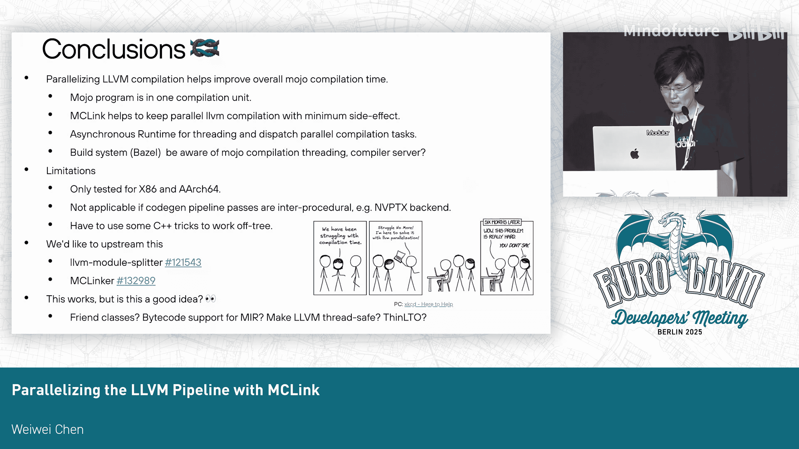
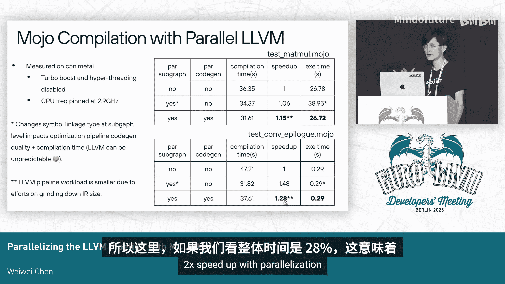

# 2025LLVM欧洲开发者大会-p47-P47-Parallelizing-the-LLVM-Pipeline-with-MCLink--BV1EoE9zUEbG_p47-

Hello， I'm Wei Wei。 I work on the moduleular language team at moduleular。 Today。

 I'm going to talk about paralyzing the pipeline with my M C link。

So this talk is in the context context of module computation。

 which we've already discussed about in last year's LBM dev meeting about how the whole computation pipeline look like。

 So today I'm going to mostly focus on the LM part mostly zoom into some of the implementation details that we are doing to parallellyze the LB part with the help of M link that give us both fast computation time performance generated code with very minimum side effect。

 And at the end， I will put everything back to the module computation context and show some numbers and have some discussion from system designs perspective。

Alright， just a quick recap on module compil。 So module compiler is built on top of both M I R and L B M。

 We use M L I R to build our front end and the middle end。

 which is the par the e plus some of the middle end optimizations。

 Then we use L V M for the code to go to target generator code We're kind of using L B in a unconventional way。

 in the sense that we paralyze the L pipeline so that we can get fast comp time。

 And also we wantna guarantee that generator code is performance。

 This actually significantly help us to cut down the L pipeline time for the overall module compil time。

So one reason to use LBM is because L M is powerful。

 It's very good for us to go to target specific generation result。

 There's also a lot of optimizations that we want to use。 which is。

 we don't want to build everything from scratch。 L B also has a little of limitations。

 The biggest limitations is that the framework is not designed for parallelization。

 So just like everything is not threadsa。 And it's usually a bottleneck for completion time for systems that's building on top of LBM。

And also， some of the optimizations are kind of unpredictable。 There are a lot of heuristics。

 It's like a compiler magic。 It's hard to predict towards the effect。 So when we build our pipeline。

 we kind of use two principles。 One is that we try to simplify the pipeline as much as possible。

 So currently module pipeline only has most of the function level passes and plus only one IPO pass that is the inliner。

 the second part is the main part is that we try to parallellyze the part。

 the way how we parallellyze the pipeline is that we have the input to one module。

 we split the module into sub modules and run each sub module with its own pipeline and we can run the main parallel we do two level of splitting。

 The first level of splitting is that we split the module into subgraphs anchoring based on anchoring functions。

 anchoring functions。External visible functions。 And when we split the graph。

 we will keep all the functions on the function costs stack in the same subgraph。

 so that we can run transformation passes， including the IPO passes and with pretty much the same get the same effect out of that。

 And further down once we finish the transformation。

 we will split in subgraph further into function and run codegen in parallel for each function。

 So if we put this into the pipeline context on on the right side。 So mainly consists four parts。

 the front end， the optimization passes， transformation passes codegen and then emission。

 We don't really care about the front end here because we have our own front end。

 So the subgraph level splitting is mostly applying on the optimization pass the second part。

 and the codegen part is we do pro function level parallelization。

So this is also from last year's talk， but just like a quick example to show how does this splitting look like with a concrete example。

 So here we have a log module with two external visible functions4 in the bar and two internal functions。

 G N H G N H are being called by4 in the bar at the first level， subgraph splitting。

 We will split the module into two subgraphs1 for full and one for bar and we will copy duplicate G N H in each of the subgraph so that we can see the whole function called stack。

And further down， when we finish all the transformations。

 then we will split the subgraph into per function here， Each function is in their own sub module。

 And you you may also notice that we have to change simple linkage type for those internal functions into weak。

 because when we do cogen， we don't want those functions to be optimized away。

 when they are in their own separate modules。 If there's no。

 no ones using them and they are also internal， they will disappear。 And we。

 we don't want that to happen。So this is pretty much how splitting looks like once we can do all splitting。

 we can run the things in parallel。 But eventually we need to put them together。 How do we do that。

 the easiest way is just like around the whole pipeline all the way to the end of code emission。

 we have object files and then we put them all together into an archive file。 This mostly works fine。

 if we just want to have a binary object like binary output for a module program。

 or we just want to send the code for jet execution。

 This is a little bit problem if we want to actually generate the assembly output， for example。

 if we want to do it for thebu or generate P X code。

 It's kind of hard to combine multiple assembly files into one。

 And one big problem is that we can fix simple linkage type。

 if we are just archiving the code code emitted result because the code it has already been generated this。

So they can expose some in internal functions as externals。 That's not ideal。

 There's also duplicated function issue here。So the ideal case would be we have one L module as input。

 and we wanna have just one output as if nothing happen in between， right。

 like parallelization should just be an implementation details。

 It should be a kind of a transient state。 and we want to minimize the side effect。

 especially for the simple linkage type change。 we want to。

Make sure that it's just internally happening and we don't see it in the reflected in the output。

 So essentially， this is a map reduce problem for the splitting。

 we are mapping everything into some module so that we can run in parallel。

 we do have to duplicate some of the like a context。

 those things so that to make sure that even though they are not thread safe because now each split has their own copy。

 we can run everything safely。 But eventually， at the end。

 we need to reduce each split into one output。So it more looks like this on the left side。

 We kind of have to split the codegen pipeline into two parts。 Its the cogen and code emission。

 So we can run the code generation in parallel， we have optimize M module as input for the codegen pipeline。

 And at the end of the codegen pipeline， we have the kind of machine code result。

 which mostly are in in memory data structures。 And before we emit the code calling as and printer。

 we want to do some reduction。 there are multiple ways to do this more straightforward logically easy to understand ways to use MI。

 And because M I is kind of the serialized format for codegen result。

 and we can have we can use linker to link the M I。

 our our experiment and prototyping shows is not quite stable for this use case。 It's also Ya based。

 So it's kind of text based is's not quite perform。In terms of how to manage these things。

 So instead of using M I， we introduce this new component called M link。 Basically。

 we just directly go to manage and manipulate the generated code in memory data structure for the reduction。

 Fortunately， they are not to many things that we have to do to manage the reduction。

 mostly is we need to do bunch of unique for those global things when we put each split together。

 For example， the constant I need to be unique。 And for 86。

 we need to do unique for the PC based symbol。 That's for the position independent code symbol。

 and also the external symbol need to be unique。 basically just do3 things。

 And then we also need to have the kind of linked of M module to guide the A S M printer for the final printing。

 So we still use linker to link the sub modules。I'm some modules， sorry。Into one linked version。

 and we can fix the single linkage type in the linked version that will solve the single simple linkage type change problem。

 So eventually we can use this linked module to guide AS M printer for the code emission。

 So more details we introduce two passes for unique mostly is for the we can manipulate the function machine function I D to to unique the the custom and things like that。

 And we can also try to unique the M symbol that is for the external symbol。 In addition to that。

 we actually have to move those private data structures in the code and result around to all back to one centralized place for the final code emission in specific for each split after the code generation module becomes have all the code generated information in machine module for each split。

And every function has a machine function， and everything is in the M C context。 These are per split。

But for code emission， we want to move those machine functions all into one machine module info that belongs to the A SM print printer and。

 and also has only one M C contact for the， for the A S M printer。

 And then we use the linked version here to guide the A S M printer to do the code emission。

Another kind of implementation detail implementation kind of surprise that we saw is a peak memory jump。

 So on the left side on the right side， there this is the memory footprint for one of the example start we running without m link and on the left side is with link。

 And you can see on the left side， there is a memory peak memory like keep increasing and drop at one point。

 So the main reason of this is because now due due to M link。

 we have to hold all the code result together to meter barrier。 instead of without M link。

 we can just run the codegen generate do the code emission and we can release all those data structures。

 And we only need to hold the object file buffer to meet the barrier。

 which is much smaller than the code result in in memory data structure size。 So but luckily。

 we figure out why one of the reason why。This is keep jumping。 This is from the instrument result。

 which we figure out is that in target machine， it is a mutable data structure。

 So which means that we have to keep each split has their own copy。

 But they ever share one data structure called subt map。

 which has exactly the same information for every split because we are comping for one initial module and for one specific target。

 we do need these information for the codegen for each split， but once the cogen is done。

 we will not need this anymore。 We only need one copy for the final code emission。

 So we can actually release these this data structure as soon as we finish co for each split。

 So by doing this， we also try to reduce the duplicate function。

 because we eventually only need one copy of the like a duplicate function。

 especially for those internal functions。 So with these。To fix。

 we can drop the peak memory footprint by about a third from 2。5 GB for this test case to 1。7。Okay。

 now let's take everything back to the context of module compil。

 here I'm showing two computation time for two test cases， one for Mamo。

 one for con epi These are the two kind of benchmark that we we are running internally it it used to be a kind of a pain completion time is the pain point for development iterations。

 So we try to like really improve the completion time for these test cases。

 I'm showing three sets of numbers here without any parallelization with only subgraph parallelization and with both subgraph and function level parallelization。

So the good news is that with parallelization， we have， we can improve the computationil time。

 So for Mama， we got， we get about 15% speed up and for con。

 we get about 30% speed up in terms of computation time。 And also。

 we don't sacrifice the generated code quality。 You can see the execution time is still the same as if we don't have any parallelization。

😊，The second， the second row is a little bit interesting here。

 So we are having lower level of parallelization。 But here you see that computation time is faster。

 And for this case， execution time is is slower。 My guess is that this is actually not exactly the same as if we have full compilation。

 because here I have duplicate symbols。 for duplicate symbols to make M link work。

 I have to change the symbol linkage type。 My guess is that that affect the transformation pass quality So that we actually run less optimization。

 That's why computation time is faster but the generated code quality is worse。

You may also see that maybe the speed up for the computation time is not so impressive。

 mostly is because now our album pipeline is much smaller compared to the whole module completion time。

 because at the same time， we also try to really cut down the IR size。 So now actually。

 the person and the more front end part takes more time in in terms of the whole module computation time。

Alright， now， let's。Step back to to see what do we learn from this practice。 First of all。

 we we learned that paralyzing computation can really help us to improve the overall module completion time。

 This is mostly related with module comp model because it's different from C plus we usually have a C plus plus project。

 we have multiple C plus CPP files。 and we compile them into that object files and then try to link them。

 But for module， we write different things in different module files and we import them from each other。

 So once after the pricing is finished， the whole module project is in one comp unit。

 So we usually have like the whole world in one comp unit。

 That's why parallelization really help us to speed up the comp time。

 and with the help of M link we can parallellyze the pipeline， but have very minimum side effect。

 No simple linkage type change， no loss of generate。The code performance。

 I wouldn't say it's 100% exactly the same as if we don't have parallelization。

 but it's pretty close to very， very minimum side effect。

And in terms of how we do the threading and parallelization within the compiler。

 the compiler does not do too much of the implementation details。

 We actually rely on our asynchronous run time to handle the threading。

 So the compiler just create different tasks and set up the dependency and send everything into the run time。

 So the run time we decide how to dispatch the workload。 In a sense。

 if we want to control the level of parallelization。

 we can just control the like size of the thread for the runtime system to control the level of parallelization for single for completion of single module program。

 But there's another question of like what if in build systems we want to compile multiple module programs in parallel。

 for example， in a base system。 This is an ongoing kind of topic are trying to figure out the solution internally。

 maybe we can use a compiler server or something else。 But fundamentally， we need。

Somehow a global supervisor who can see the whole situation and try to decide how to balance the resource and how to do the like threading scheduling。

 make a that kind of decision。For disclosure， this approach has limitations。

 We've only tested this for X 86 and I'm 64 backend。

 This is not really like the function level parallelization is not applicable if the code and pipeline is into procedure。

 For example， N VP T X is not。We， we cannot really do that for NP T X back。

 We do use the same infrastructure for GPU compil， but mostly is at the subgraph splitting level so that we can split the different kernels into different sub modules and compile them in parallel。

 we do not really have the reduced problem for GPU compil for now。

 And I also have to use some of the C pass plus tricks to work off tree。

 because when I move those data structures for cogen result。

 those data structures are mostly private and protected members to move them out of the tree。

We have to use C loopos， to make that happen。We would love to upstream this。

 I created two PR's upstream PR one for the L module split， was for the M link。

 I would love to have folks to review it to see if it's beneficial for the community。

 And I probably should write an RFFC for this so that we can go through the formal process to upstream it if this is something that people like。

😊，So this is kind of how we try to solve this problem without having to do like a big surgery on L of M。

 It works for us。 Is this the best idea， I would like to get more discussion and have feedbacks on how。

If you guys have any inputs on this approach。This is all I have。 Thank you very much for listening。

 Any questions。

Thank you。 That's very interesting。 on slide 17， you have the comparison of compile times。

I'm curious， what does the peak memory overhead， if any， would look like。The memory of hand。

 like something in here。Yeah， so if you compare the situation where you do parallelization with the one where there's just single Vm handling everything。

 That's a very good question。 theres definitely memory overhead because we have to duplicate a lot of things right Like here you can see if without parallelization。

 we just have one module and one element context。 When we try to parallellyze。

 we have to duplicate the context。 So these are the extra memory kind of pressure we have to put on And for codegen。

 we actually also have to duplicate the M context。 And。

 and here for the first level sub graph splitting。 we also have duplicate functions。

 So these are all potential memory pressure to put on it really case by depend on case by case how big the module look like and how much do we have to duplicate。

Yeah， I guess like just interesting for some of those examples where at the compile times。

 it would be really great to also have some big memory comparison。Got it。 Yes， agree。Thank you。

 Thank you。Could you comment on the speed up with limited to the back end itself。

 So from what I understand the numbers that you show here are your end to end compound times。

 So could you comment on the speed up for just the L VM part of it？ Yes， so， yes。

 this is end to end speed up，Empirical data， just based on my memory right now， for us。

 the past takes about 30% of the overall competition time。 The interpreter。

 which is part of the elaborateator， takes close to about 30%。

 So the back end is about less than 40%。 So here if we look at this 28% overall time。

 it means that the back end is probably 2 x speed up with parallellyization。

All right， thank you。