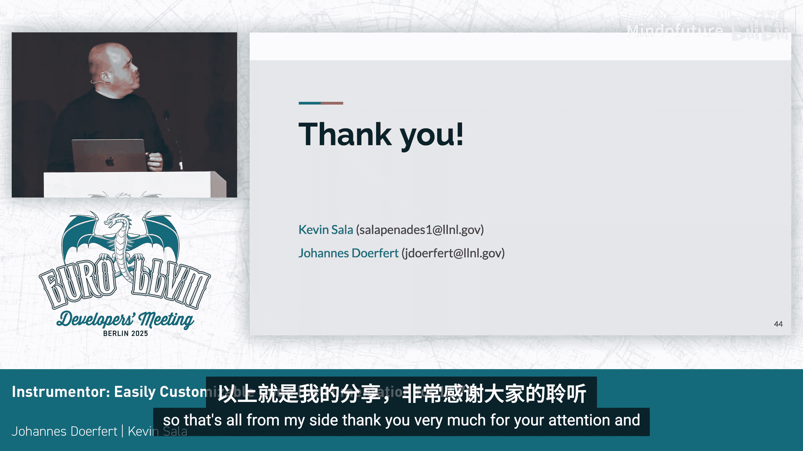

# 2025LLVM欧洲开发者大会-p48-P48-Instrumentor---Easily-Customizable-Code-Instrumentation--BV1EoE9zUEbG_p48-

So Im Kevin Sala from the Lawrence Livermore National Laboratory。

And I will talk about the instrumentor， which is easily customizable called instrumentation for L L VM。

So instrumenting code has been used widely in the last decades for tracking the runtime behavior of applicationss and user programs。

We have been using for the bagging， sanitization， logging of events， monitoring resource usage。

 but also for performance analysis。 so we can find the performance bottlenecks and try to optimize that parse。

So the instrumentation first starts with original code from a user application。

 we see here a function in LLPMIR， this is the original code without instrumentation。

 it takes a pointer parameter， we load from using that pointer， from the memory。

 then we store value into the same memory position， and then we return the value that we have load。

So let's say that we want to instrument the load operations and forward some information about the operation。

To a runtime component， a library。That will perform some processing of that information later。

 So we can generate the instrumentation code， instrumented code。

 sorry that before the load just calls to the runtime component。 Its a instrumentation code。

And it passes some information about the load operation， like the pointer。And the size of the axis。

 which in this case， is4 bytes。So the main actors of the instrumentation support are in first in the compilation stage and then in the execution stage。

In the first one， we have the compiler that has to augment the original code of the user with some extra code for instrumentation。

 as we have seen before it has to in insert some instrumentation calls。

And then the runtime component， which can be a library。

 is the one that will receive all this information。

 gather it during the execution of the application。

And process the data online or just store that data on。

 on a file and then process it later in another moment。

So the implementation of the instrumentation libraries will be different between the different instrumentation tools that we have。

 if we are doing thebuging or if we are doing sanitization， the libraries will be different。

 That's okay。 But the question is， do we actually need to do the same and re implement the instrumentation pass in the compiler side。

 It's time that we have a new instrumentation tool。The answer is most likely， yes。

 and that's because compilers lack generic mechanism for instrumenting the code。 I mean。

 we can insert manually the LLBM passes some instrumentation calls。

 but that's like a low level mechanism。 and we would like to have something more generic and higher level。

What happens actually and it's the case also in the LLBM compiler infrastructure is that we have multiple passes that implement custom logic for instrumentation。

 each one targets a different instrumentation tool or instrumentation library。And they are actually。

 in general， similar on what they want to do， but they are not enough similar in order to reuse the same pass。

 the instrumentation pass for all these libraries。So what we are missing here is several opportunities。

 We are having bad code maintainability。 We have replication of code。

 we have because we have multiple instrumentation passes doing similar things。

And when you are building a new instrumentation library， you have to go to the compiler site。

 duplicate instrumentation pass that is already existing and then adapt it to your needs of your instrumentation tool。

 So thats。Add some difficulties in the development of new tools。

So why not we use a generic instrumentation pass that tries to be generic and customizable。

 And instead of having multiple of the passes like we have now。

 we just have one and we can target multiple instrumentation tools or libraries。The。

 this is the task of the new instrument or pass in L LBM。

 It's somehow generic and it can be customizable。 The user can decide what to instrument。

 what information you want to provide to the runtime component at runtime。

And then it's also extendable for LLBM developers。 Like if there is some other opportunities to instrument that are worthy to have in the instrument or pass。

 they can extend it。 So with this， we enable multiple users to， to have。

With the same instrumentation pass， instead of having multiple。

This improve the situation that we had before。 We have。 we will have now better code maintainability。

 less code replication。 And now when you are building a new instrumentation tool。

 you will have just to generate， well， have a configuration for the instrument or pass specifying what you want to instrument and you will not need to create a new pass from scratch to to target your instrumentation tool。

So let's see how the instrumentor works。It's L LBM pass。

 and this instrument or pass works based on a Json file that the user can provide。

 We have a default Json file describing all the opportunities that we can instrument。

 but then you can copy that file and just adapt it to your needs。Here in this file。

 you specify what you want to instrument and also how you want to instrument。

 Let's see the first section of the JSO file is the configuration section。

 There are other options inside。 But the most important one is the runtime prefis。

 where this will be the prefis of the instrumentation functions that will be inserted into the user code。

AndG， you will set here the name of your instrumentation tool or library。

 and then you have you can specify other sections saying what you want to to be instrumented by this pass。

For instance， if we go back to the code that we had before。

 the original IR of the function and we say that we want to instrument load operations just before they happen。

 We will need to create section here saying that we want to instrument the instructions the instruction just before it happens and then a list of instructions that we want to instrument。

 We are just doing it for the load operation here。 we open。

 and then we enable the instrumentation for that instruction and the other options are for saying what information we want to forward to the runtime component。

For instance， we want to， we will want to forward the pointer。

 We will want to forward the size of the access of download load operation。

 the alignment and whether it is volatile。So if you run the instrument or pass passing this Json file as the command line below。

And you have the input of the original layer。 You will get the following code below that it will insert instrumentation function call here with the pres that you specify it pre load just before the load and forward wording all the information that we have specified the pointer。

 the exercise alignment and whether it is volatile， which is not in this case。Okay。

 so that's the basic working。 Then there are some other interesting features like， okay。

 let's say that your instrumentation tool wants to replace some of the opponents of the of the instruction that you are being instrumented。

For instance， the we want to change the pointer of the load that we are instrumenting。

 So you have to specify here in the pointer dot replay。 You have to specify a true。

 It was false before。And now it generates the same instrumented code， except that。

The instrumentation function now returns a pointer， which is provided by the runtime component。

 And then we just forwarded it， and we used it as the pointer open of our load operation。

We have seen that these patterns are useful in some cases， for instance。

 in a sanitizer that we have been developing。And。How does this work in the pe in the pipeline。

 It's just you have your example in C plus plus， you can convert it to LBMIR using clang then internally。

 the。The instrumenter will execute。 if you have enabled it， it will read from the Json config file。

 what you want to instrument。 If you didn't provide any， it will just read from the default one。

And it will generate the instrumented version。 And finally。

 you will be able to compile it and link it to your instrumentation runtime library that is the one that will gather all the information and process it it later。

Here I am showing some opportunities that we allow to instrument right now。

 This means that these are the instrumentation points that we allow。

 There are different instructions that we allow to instrument。 as I said， the loads， the stores。

 it's similar。 The options that we can forward。 Then we have also。

The option  to instrument function calls。 Let's say that youre。

Original code calls the f print F as the code there。

 Then we will the instrument or pass will instrument that function call。

 notify the runtime component about that call just before it happens and you can specify several information about that call like。

 for instance， the co address here， the call name， the intrinsic I D if it's actually an in an intrinsic the number of parameters of the F print F。

 the pointer to the parameters。So with that， you can actually access the parameters of the F print f just before they。

 it is called and you can inspect them。But there is also the option to replace these parameters。

 like say that you want to replace some of the opponent of the F print F function call。

 you will be able to do it with the parameters thatt replace option。

 Then you will be able to change any of the parameters。There is also instrumentation for aocs。

 passing the address， the size， alignment， etc。 the branches compares and some other instructions that I will not mention。

We also in allow instrumentation of the function， enter and exit points。

Which is just just before entering the sorry， just after entering the。

 the function and before exiting。 And we allow also to inspect the arguments of the functions。Sorry。

 and we also allow instrumentation of global variables and model construct， the structure。

We can also all these opportunities can be instrumented in two positions just before they happen or after they happen。

 And we use the prayer and post keywords in order to distinguish between those two cases。

There are other opportunities that we have used for optimizing the instrumentation。Like。

 for instance， the range information。Let's say that you have the。

 the user the user code has a loop and you want to。

 you want to perform some checks just before the loop。

 instead of doing them inside each of the loop iterations。

 you can use that opportunities in order to。Get a function call of the instrumentation just before the loop。

There are some other use cases。 I'm， I'm showing some use cases here。 One is the profiler。

 We have implemented a very simple profiler for checking the execution time and the time spent in each of the functions from user code using the Chrome。

The chromrome tracing tool。And the important thing here is that we only need to files to implement the profiler。

 This is the profiler dot C，P。 This is our runtime component。We only have 56 lines of code。

 These are the one， the code that implements the start and stop of the watch when function when we enter a function。

 and when we exit。 And then we do not need any change on the compiler side。

 the instrumentation is done automatically by the instrumental pass and we only have to provide him with a profiler that Json that are like 26 lines of code。

The it's quite simple。 I'm just showing here the Json that we have used。

 We instrument the functions at the enter point and the instructions of function calls just before and after they happen。

I'm showing only here an example of the runtime that we have used for the profiler。

 It just used the LOBM support utilities。For the tracing。

 and we can see there are the three functions that will be called by the user code for instrumentation。

There is another example of usage of our instrumentor。

 We can have a simple detector of that and red stores。 In the first case， we don't。

 we do not detect anything because the code is okay， then we can detect。

With this small detector that store a situation where we write to the same global variable with different values。

 and we don't we do not consume it in between the instrumentation shows the values that are the old and new ones。

 Then there is also the red and done store case where we are storing the same value。

 and that is also detected by the the simple instrumentation tool。Again。

 the important thing with few lines of code， we implement a runtime component。

 and we do not need any change on the compiler side。

 We just provide the Json file here where we instrument loads and stores providing some information like a pointer and the values that are being。

L they dancet door。Some extras of the instrument or pass。

 I have been explaining that we use a Json file in order to provide the information that to。

 to know what the user wants to instrument。But that's when you are using the instrumentor as a external user that you don't want to touch anything on the L LBM site。

But there are cases where you may have your own instrumentation pass and you want to use the features of the instrumentor from URL LBM pass。

 So we allow to use the instrumenter programmatically without the need of the use the Json file。

With the same capabilities， but with extended features。So we can， for instance， from your LLBM pass。

 you can create an instance of the instrument or。 You can then specify the opportunities that you want to instrument like the load opportunities。

 You can specify here what you want to forward。 Then you want。

 you can specify you want it just before the load happens。

Then you can specify also call back to filter the， the load instructions that you want to instrument or not。

 So it。Provides you some fine grain control of what is being instrumented。 And finally。

 you can pass custom data to the instrumentation functions in case they are not。

It's something specific to your instrumentation tool。Okay。

 another extra feature is that when you are doing your new instrumentation tool。

 you will start by defining the Json file， saying what you want to instrument what what in information you want to forward。

When you have it already， it's time for building the runtime component。 but this will be adding。

 you will have to make the implementation of the runtime component and specify the prototypes of that function with the parameter types。

 the parameter names， the order， etc。But the problem is that that is tedious。

 so you can specify here。The runtime steps file。Which is you can specify the name of a file that will be created。

 when the instrumenter runs， Then you can run the the instrumenter passing that file。

 the adjacent file。 And then this will automatically generate a stop runtime for you with all the prototypes of the instrumentation functions with the correct types and return types and everything。

 So this will make the， the live better for developers of new instrumentation types。😊，And finally。

 the last extra is that we allow for optimization of the instrumentation。

 we allow to instead of having calls to the instrumentation library。

 we can provide here using the runtime bit code option。😊。

The name of a bit code file that contains the implementation of your runtime component。

 So when the instrumentor is running， it will perform the instrumentation and just in the last stage of the of the instrumenter。

 it will read from this file。 and it it will import the implementation of the。

 the instrumentation functions into the user code。 So the function calls will just disappear。

And with that， you will avoid the cost of calling to the granttime library。

So as a summary and conclusion， the instrumenter is customizable instrumentation based on LLBM。

 It's a unified way of instrumenting programs， and we hope that it iss easy to use for users easy to custom customize。

 but it is also easy to extend as an LLBM developer in case there are some features that are not yet implemented。

This should， these instrumental should try to pave the path for future instrumentation tools。

 And well， we have shown several use cases in most of them were very simple。

 but there are other complete use cases where we have demonstrated that these instrument or pass has the capability of providing all。

 all the features that are needed。 For instance， the input gen from I Uov is already ported to that instrumental pass。

 and also， there is a new object sanitizer。For CPN and GO code that we are implementing。

 that is also relying on。On that instrument or pass。So that's all from my side。

 Thank you very much for your attention。 And if， you have any question I will be happy to answer。😊。

Thanks for the talk。 my question is， so is it feasible to kind of retrofit the the existing sanitizers like A and T San。

 And is that， if yes， is that something you are looking into。We have not arrived to that step yet。

 We should at some point check how， how is the I， I'm not familiarized with the implementation of the address the coron address sanitizer。

But yeah， we should at some point try to board that。Into into the instrumenter， if it's possible。

Okay， thank you。 It should。 We should first check what features are needed。

Thank you for the presentation。 I think it's a very useful tool for everyone。 One question。

Is the pass now part of the default optimization pipeline。Incline。Yes， you， you only have to， you。

 but you have to enable it as an option。 Okay， but it it always runs。

 and then it will check if it's enabled， right？ Yes， yes。

 at which part of the pipeline is running like in the beginning。

 before after loop optimization I think it's running after the optimizations， Most of。

 because we want to get into the point that the code is already optd。But then there are。

 there are there is the need for applying more optimization passes after the after the instrument or pass。

 Okay， did you， did you consider implement that as a pass plug。

 maybe so that the user could decide where the pass is inserted and we wouldn't need the extra pass in all the default。

Cs where it's not used。 we have considered it， but we haven't done it yet。 It's in the。

 in the future steps。

That would be very interesting。 Thank you。 Thank you。

