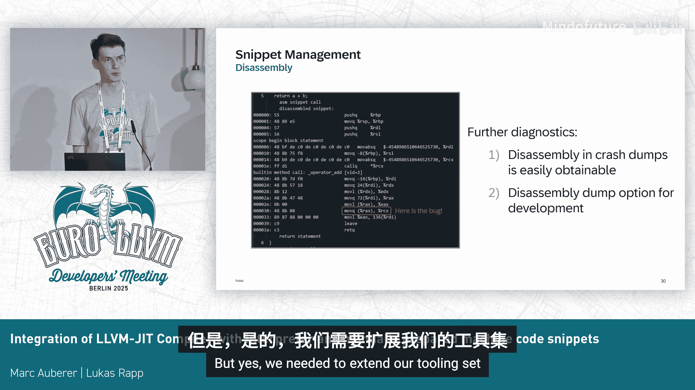

# 2025LLVM欧洲开发者大会-p49-P49-Integration-of-LLVM-JIT-Compiler-with-Interpreter-and-manually-prepared-mach--BV1EoE9zUEbG_p49-

This is Lucass。 My name is Mark。 and today we're going to talk a bit about how we did integrate our LLVM based chip compiler into interpreter and vendorly prepared machine code snippets。

So what are we doing at SAP， we work on SAP Han， which is SAP's flagship in memory database。

 which processes SQL queries by processing it through a complex multistage pipeline which whose last step basically is to generate L or LN programs and execute them。

 so L or Lang is our program language that we support at SAP。For Hannah。

Which essentially has a focus on performance， and。It's tailored to our database use case。

 so for execution of those SQL queries and programs， we use a tier compile interpreter approach。

So what does that mean on one hand we have the L compiler which uses LLVM as compiler backbone。

 we currently use MCGit for actually jting the machine code。

 but we're in discussion if you want to go to OGt instead because that is the currently maintained version。

We have a default 00 pipeline， we have a custom01 pipeline which we actually use in production where we have some optimizations disabled。

 for example， loop optimizations which do not scale very well if we have huge programs。

 then we also have a default O2 and a default 03 pipeline。

And the important thing is that the IR actually is constructed in the main process。

 which is called the index server of the database， but when it comes to middle and backend compilation。

 we actually zeroize our IR to bitcode and send it over to another process which is called the compile server and we do this because we didn't manage to get middle end and backend compilation out of memorySa or exceptions exception save so whenever the compiler crashes。

 we don't crash the whole database， but instead only the compiler and this one we can simply start it up again and simply continue compiling。

If we did this through the index server or the index server crashes。

 we would potentially risk data loss because we， we have an e memorymory database。

 So the data gets owned by the index server。And if we would have to start up the index server again。

 we also would have to reload the whole data from disk。

 which for many configurations can can take up to minutes or hours。So on the other hand。

 we have the L interpreter， which is actually a custom C++ implementation tailor to our in memorymory database use case。

Whi has a sequential bitwise block execution， similar to IR interpretation。

 and we use the L interpreter always when the L compile is not suitable。 So for example。

 if we have very large programs。Above 250000 lines。

 we switch back to the interpreter user as fallback。 And also， if we have very。

A very low amount of data records to process。 if we can guarantee that we also use the interpreter in favor。

We use the interpreter。So the basic main mantra is we want to execute allqueries as fast as possible from an end to end perspective。

 So the user's perspective， and to achieve that， we want to start early to keep the compile times low。

 but also we want to finish quickly to keep the runtime low。

 So balance between latency and throughput is key。Another absolutely essential precondition for our in memory database context is that we may not crash under no circumstances。

 which I just explained， but that's also true for runtime because we execute actually on the index server so the process that owns the data records in memory and this is why we may not crash under no circumstances at runtime and we have to be very very careful because of that。

So what performance do we start with before developing the optimization that we're going to show in a minute？

So we did some benchmarking on an X8664 machine with 128 cores and 256 threats。

We did some benchmarking with the Tp's H query set。

Which is a well known benchmark for database queries， especially for analytical queries。

And we run all 22 of those CP edge queries in bulk。And then。Collected the compile times。

 collected the run times and plotted those charts here。

So on the left side you can see the compile time charge。

 so we did measure four of our compilation tiers。So first， we have compile O1， we have compile00。

 both where we switch the interpreter completely off。Then we have interpret only web compiler of。

 and then we also have mixed execution， which is a blue bar where we basically have a eic into place。

 which then decides whether to use only the interpreter。Or start off with interpreter。

 And then later， when the compile result is ready， switch。

 switch over to the compile to the compiler。So as you can see。

 we have about 93% improvement between00 compilation times and interpret only。

But also at the same time， we have 20 times more runtime。

With interpret only in contrast to compile only or0。

So let's break down the compile times a bit again， so here are the compile times for a sample program which is about 48。

000 lines of code and involves many jams， many loops。

 many mathematical expressions and should be representative for our use case。

We chose this program because here we can see the individual steps they make up the compilation a bit better。

 so here we can see in00 that instruction selection registered location in life interval analysis are very dominant for compilation with00 and if we take a look at one we see that if we apply some middle end optimizations that can reduce the amount of IR that we want to feed into the back end。

 then the backend takes much less time which is obvious。And yeah， the， the third bar you can see。

 which you can barely even see is the compartment of our interpreter。In its original form。

 So why was our interpreter that slower at runtime。Here we can see the main loop of our interpreter。

 which basically is just so we have an instruction pointer， an insert pointer。

 which we can do reference to obtain the next instruction that we want to execute。

And to execute this instruction， we can simply call the virtual execute method on this instruction。

So important notice that most instructions in our case are very simple， so we have， for example。

 an E instruction， a multiply instruction， memo selection instruction， and so on。So in our case。

 we noted that actually the virtual call overhead dominates the runtime。This is bad for performance。

 obviously。Another problem we had was that we had a lot of redundant loads in stores。

 so we use so-called El long values for storing values in memory for the interpreter。

 which is a generic container for temporary or named values。

Along values live consecutively in memory and either contain buffer with a value or point directly to the heA。

 another buffer lives flexible size。And we have some kind of node isolation into place。

 So one instruction doesn't really know what its previous already did。

So if you imagine an addition followed by multiplication， which then uses the result of the addition。

 will first have to load the opera of the addition， then perform the addition。

 then store the result into its Lang value， then immediately for the multiplication。

 load the same Lang value again and to perform a multiplication。

 And this is obviously not good for performance because we。We could have stored it into a register。

 and simply reus it。So the two central questions for us were。

How can we get rid of this execution overhead？ And secondly。

 can we do this somehow incrementally or do we have to to go for a all or nothing approach。

And for that， I hand over to Lucas to tell you about SM benefits。

So our answer to both of these questions is what we call assembly snippets or ASM snippets in short and the basic idea behind this is that that we can take those instructions and if they're simple enough we can produce simple machine code from it and then we can take that machine code to integrate it into the existing interpreter execution mechanism this should allow for incremental integration because we can simply redefine what the simple instruction is and what sequences of simple instructions are and enable or disable the cogeneration for those node types we focused on the most essential aspects of the language so historically those were arithmetic expressions and assignments and such of course the scope was extended but this is good for low compile time and also for low complexity which helps to avoid bugs。

Oops。So。Yeah， the integration works as follows， So suppose we have a basic block with a sequence of interpreter nodes。

 and those in this example represent an arithmetic expression。

 And we now have a mechanism that detects the sequence of those simple instructions and transforms it into just one node。

This nicely integrates with the existing execution mechanism because this ASM snippet node is just a normal node。

 it also implements this virtual execute function and if we call this function。

 it then calls the machine code snippet that were prepared elsewhere。

 so the snippet actually implements or is a function that we can call from C++ and encapsulates other logic from the replaced nodes on the left。

So for Spper generation， there are two main mechanisms at play， the first one being compactization。

 and this encompasses all the explicit machine called translation separate prepared so for example。

 for addition， subtractions， demo selections， and so on。

But also a state for co generator that keeps track of the data dependencies between those nodes and also register contents to optimize the loads in the stores。

 so formally we would have to do two loads for each of these nodes in one store。

 so six loads in total and three three stores。But now this has come down to just four loads and one store because as soon as the first operation is done。

 we have an intermediate value in more of the registers and the cogenerator analysis and of course then has to only。

In loading an additional opera。 And this keeps going until we don't use the intermediary anymore。

So we store it。Yeah and the second mechanism is divization so suppose we have a sequence that could have been just one snippet。

 this one on the right but there are untranslatable nodes in between and we don't have explicit machine code translations for them so how do we get them into the snippet because you can see that we now have five notes that we have to do a virtual function column which is bad for performance so we really want to get rid of them now the question is how do we do it and allow is that we resolve those untranslatable nodes to the function address of this execute function that would have been called and we take this address and do just the normal function call bake this into the snippet and so we can get rid of the fragmentation so of course an explicit machine code translation would probably be better but yeah it is a fallback mechanism so every node that's not translatable can still be expressed as a function call in those snippets and yeah we avoid the virtual function call for all of them。

And the fragmentation， of course。So the current state of our implementation is that we implemented just 30H x86 and AH 64 instructions。

 and with this we managed to cover a somewhat broad range of language features。

 so unary and binary operations， member selections， assignments， logical jumps and so on。

Yeah and now that you've got a close overview of how snippets work， what they are。

 we can have a closer look at the specifics of cogeneration and I was already talking about oh its not skipping talking about the state for cogenerator they keep track of register contents and so we first have to define what registers are actually in use and we decided to just use two main registers for opera of binary operations so operant one and operant2。

 then we have an additional help or register。And we have to register for function arguments。

So pretty simple and all of them are color clubboard。

 which means we don't have to worry about previous register contents。

 we don't have to store them anywhere， we don't have to restore them later。

 we can simply use those registers as is。And this is actually the first rule of a small set of simple rules we decided on to simplify the code generation。

 there are more trivial ones like that the left hand side is always in the first register in operant one。

 the right hand side is always in operant2。And also， if a binary operation， for example。

 produces a result， the result is always in in the first opera register so that the co generator knows。

 okay， this operation is done， we can find the value right there。

If we need the value in the other register because suddenly it's the right hand side of the next operation。

 we simply move it between registers。And the last rule is that we have lazy data movement。

 so we only do the loads in stores if it's absolutely necessary。

 which helps us to cut on loads and stores and is to drive the mechanism behind stringing together those machine code fragments。

 those singular translations into a coherent machine code snippet。

So I don't think that people in the back can really see it。

 but this is the whole implementation for cogen for this revralization。

 so all of those lines do generate the machine code on the right。

 so every time we translate a node or devralize it we find a fragment like this one。

And what it actually does is it prepares to function arguments for this execute function。

 stores them into registers， then we resolve a note to the function address， write it into register。

 and then we write the call finally。 And you can also see the interface with which we describe those machine code instructions。

 how we can combine them。Yeah， so now coming to Snippet management the problem with dynamically generated code is that you get little help from the compiler so there is a lot of information missing。

 for example， onlinewin tables for proper C++ exception handling。

 but also trivial data like function met data because the function has just been generated there's simply no data about it like name and location for example so you can get creative and here you can see a stack traces。

So of course， this function would have been represented as a normal stack frame here in this trace and we just decided to prefix it with dynamic and also appent the name of the L function the snippet was generated in。

 And in L you have in an L program you have a function that is calledF and somewhere in there the mechanism decided to generate a machine code snippet and this is the snippet that crashed and of course you also get all the other basic information。

Yeah， also if a crash happens or if you're in development。

 you obviously can view the disassembly of that generated machine code and a nice feature of our diagnostic is that we can assign the machine code instructions back to the original operation that generated it so that we have better overview for for debugging。

And with that， I hand back to Mark for the final results。Thank you。

 So let's take a look at the performance results that we got with the improvement So here we have our two bar charts again。

 but we have a new bar here， which is interpret only plus assembly the likely green1 and here we can see that we still have a very decent improvement in contrast to00 which is 86% in compile time but we got our runtime down of a factor3 or4 so we just have a factor of6 between00 and interpret only plus assembly snippets and that helps us get off the ground with interpreter as fast as possible。

So let's take a look at the compile times again for our sample program here we can see that the interpreter plus assembly is definitely worse than the interpreter without snippets。

 but still way way better than00 performance compile time。

So what's the conclusion here so we have developed a simple mechanism so we can improve performance query latency by generating assembly snippets at runtime with a very little effort but robust and tailored solution that we developed and which slightly increases comp time。

 but it has a very big performance gain。We are still an order of magnitude slower than the compiler。

 but for the TPCH queries we saw about factor 7， which is definitely acceptable， as I said。

 to get off the ground with run in quiries and the most important thing for us was that we support incremental translations or we can simply switch AST nodes or instructions on instruction level on or off if you want to compactize them if you want to deviralize them or if we do nothing with them。

So what are the learnings especially also for LLVM with this， so LLVM00 compile time was in our case。

 not sufficient for our latency sensitive application， at least with LLVM 20。

OZero mostly spends time at compiled time in Reg allocation。

 instruction selection and life interval analysis。And we would have wished before started with this improvement that LLVM would offer some kind of ultra low latency compilation load。

 which wasn't available at that time and still isn't available and we could have imagined for a bit more configuration options for the backend so for example。

 so we can implement a custom register allocation strategy where we only just use two registers like we did in the interpreter to handle data so。

Supidify the registered location in other words， also maybe for the instruction selection to limit the subset of instructions that we want to use。

I know there is some kind of fast isSL， but we tried it and it wasn't helpful。

 it didn't get much improvement。So yeah， that that's that's our suggestions。

 And also for00 compile time， you can take a look at the talk that was this morning from Alexis。

So this was also very interesting。 And we are looking forward to the upstreamed version of the custom0 backend。

We were very excited about that。So that wraps our talk。 Thank you for listening。

 And if you have questions， you can ask them now。Thank you for the presentation。

 One thing that comes with custom solution and compilers is that you lose all the tooling around it。

 right。You have no debug information。 Yes you have no profiling building。 You can do a lot of things。

With LBM that you cannot do that。 So how do you think you， do you need to replace that， or can you。

Go without it。 What's your experience。 So we have introduced a few tools， for example。

 like Lucas showed the。The disassembly dump for development so that we can assign the disassembly to each instruction。

 so that is something that we did。 Another thing would be the unwind table generator。That is。

 I must admit currently not at use because we have another problem with it。

 but that's a different story。Currently， we only disable compactization for anti virtualization for those instructions that may throw C plus plus exceptions。

 But， yes， we， we needed to extend our tooling we。

Did you， did you evaluate other co generators like cranelift that is used and rust a lot， I think。

Yes， we did。 We thought about that。 we also considered Asm Jit for Jit assembling。

 but yeah the problem with large companies like SAP is that if you want to use depend penencies that you are not really。

 you can guarantee to maintain if it goes out of maintenance。This is a problem。

 and is it wasn't it also wasn't。 So we we do't， we do need to guarantee that it it is out of memory safe and exception save。

 We would have invested more time into that。 And therefore we decided to implement it ourselves because it's very rather easy。

 I would， I would say thank you very much。Thank you for the talk。 I wanted to ask。

 So when you say El El 20 and all0， do you mean。The lowering from L VM IR to machine code。Yes。

 so the back compil the front end compilation we， we didn't include in those measurements。

 though we did， we only included the the I R2 machine code have you considered using K L I as as a way to interpret in the beginning。

I don't think that is known to us， at least for me。That I know we didn't consider it。Cause。

cause one of the features， I guess， in the new or infrastructure is that you can hide the compilation latency if you。

 if you start and then you， if you move away from MC G to org， then in the you can ask。Or。

To compile in the background and then hot swap。 But you need to。

 to be able to kind of hot swap at some point。 So maybe you can look at the org infrastructure and look at the as well。

 Yes， as I said， we're currently discussing if we want to go to org we're currently using m Gt。

 which is a bit bad for because we we don't we do have to use code model large with mt and also orchid supports code model small code model medium and this would also be beneficial for us。

 So we're currently currently looking into how to do orchid。 And yes。

 thank you for that tip that is very useful。 and maybe a last question or like a comment。

 So when you are saying you have overhetting the virtual function calls。

That's your custom interpreter， right？ Yes， that has。

 Do you have deep instruction inherit and chain or you can just have like one。

 if you have like one level of instructions， you can kind of like。

Omit to the V tables with this CRTP pattern or use context per virtual。

 There is like a new C plus plus 20 thing。This one， we also didn't try。

 but maybe that's something that we could look into。We have two more minutes。Maybe one more question。

 have you explored anything in between00 and01， like creating your own pass pipeline and RVM to run cheap passes like Me to wreck to drastically reduce the amount of IR then maybe the back end becomes fast again without spending all the time in the middle end。

 you mean to a custom backend pipeline to say middle end pipeline specifically middle end pipeline the problem is that we。

So， yes， we， we could do that。 So basically， in between something like O00 and01 or customer1 pipeline。

 but that doesn't we， we try actually tried that， but that didn't yield much performance to be honest。

00 compile time and01 compile time is still not sufficient。Yeah， then let's thank speakers again。

