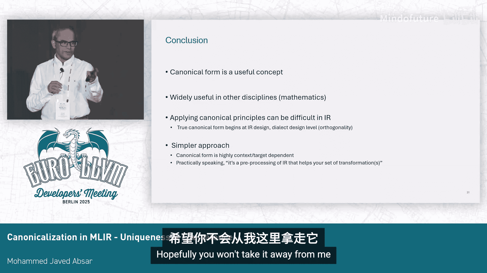

# 2025LLVM欧洲开发者大会-p50-P50-Canonicalization-in-MLIR---Uniqueness-and-Equivalence--BV1EoE9zUEbG_p50-

还有 everyone。I don't know， I picked up very contentious topics。

Hoping there's be a lot of energy in the room。Let's say how it goes。 Yeah， O。

 so canopization in MLIR。So first， we'll cover the basics。 and it is not a deep dive。

 So it's really going to be like， you know， explain a little bit what's canization in MLIR。

 how it's done， etc cetera， so that everybody's on the same page。😊。

And then we'll talk about what's the problem with it。

Then try to understand the problem from different perspective and see if we in the Q And A。呃。

Reach some conclusions and consensus。So， okay， so what is canonical form and canization。So basically。

 a canonical form is a rewrite of the IR at the same abstraction level as the original but in simpler form。

So， for example， you have a vector broadcast， you're broadcasting。One value really。

1 cross F 32 to 8 cross 1。 And then that value is transpoposed from8 cross 1 to one cross 8。

You can quickly see like， okay， maybe we， it's easy and simpler if you could just broadcast it a single value to one cross 8。

And if youre run the Pizer， that's what it going do。And so， okay。

 if you want to have something like this for your ops， what do you need to do？Okay。

 so in the table gen description of your op。 So in this case。

 it transpose op you where you have defined your your op， you say has can kser equal to one。

 And so then what happens is from the table gen， the table gen backend will generate the C P。

 the class description of。😊，A declaration of your， of your， of your op。

 it will populate this get canonization pattern， which takes arguments werite pattern set。

Then so then what do you do in your implementation。 So in this case， in your。

vectorectctor transpose up， get colonization patterns you。You add those patterns。 So one of the。

 for the example before， you add this full transpose sc up kind of long name。

As one of the patterns and the code below you see okay what， what that pattern does really。

 so match and rewrite where gets a transpose op And then it see， okay。

 is my defining op So the input to the transpose op is， is it a broadcast。 if that's the case。

 I'm going to just replace the I'm going to replace the transpose with a broadcast basically to get back。

😊，What we had below here。Where the result is from the transpose and the source is from the source of the broadcast。

 when the details of this doesn't matter it's basically like， okay。

 there is a way of stitching together so you can get the conser to do and get you the code that you wanted。

 right。There is another way， which is using the dark pattern matching。

 So suppose you have minus x divided by minus Y。 we know from basic arithmetic。

 that's the same as x divided by y。And so。You can rerite this dark pattern where the code in the gray is the pattern you're matching and the one in blue is the rewrite。

 So basically replacing the opera， etc cea。 with So instead of doing the negatives of the two opera。

 you just straight away do the division。😊，And so what happens is you write this duck pattern。

And the table gen backend， in which in this case， is a rewrite gen or CPP will auto generate for you the code that we saw earlier with a match and rewrite。

 So just。Bills is a boiler paid code or whatever you call it in this case。

 so you get the job done with less code。So。Yeah， these are two ways。

 And another is the full patterns that you can write。 And actually。

 for a lot of the arithmetic and math the fold is much more。 The preferred win for a lot of folks。😊。

The stock is not really not about how really to the currentiler patterns， etc cea。

 And there's also write ups on those。 So this is just so that everybody understands， okay。

 this is what's really we're talking about。You might have used it a lot in the passes that you build。

 So， for example， if this is。A piece of code is kind of like， you know。

 got a lot of things in there for a purpose， because I'm about to show how it gets screened up。

 So in this case， you have now generic which gets a bunch of inputs。 Those are dynamic shapes。 So。

 and it wants to create a tensor empty， it needs the sizes。 So therefore。

 it probes and gets the tensor dome， etc ce。 Well what's really happening inside the generic is using back the input that it got in the reverse order。

 And if you run thegser， This is a much better code， isn't it， Yeah， Okay， so that's great。 Doxo。

 therefore theser darts。 What's the problem。😊，Well， if you've been following the RFcs and the dis。

 there this is， this is。A very contentious topic。 why， because。Simple forms are easy。 Okay。

 you rewrite it， you get smaller， code， and most people agree on certain things。

But look at the example on the left。You got to transpose。

 You are transposing a one cross 5 to 5 cross  one。

You could get the same effect if you did a tensor car shape。Ship cost， sorry， Yeah， Okay， yeah。

 on the right hand side is a more complicatedate example。 So you're doing an insert slice。

 So inserting something into something， which is essentially re overr these。Destination tensor。

 we got a new tensor of code， but。And you could get the same thing if you did expand slice of the original slice。

No。Which one is the more canonical form。 And there's lots of debates about this because it depends。

 Let's say you are looking for a pattern in a certain extract slice。 You prefer the first one。

If you' are looking at it from a different perspective， you， you say， okay， expand shape。

 I want this to be written。 So it's back and forth。Okay， and as the bottom you see。

 Matthews is there has identified like， you know， okay， this， These are two examples。

 But there are a lot more。 actually， we have been having these debates again and again about like。

 know， which is the canonical form。So there you go， there's a kind of worm。 I've not open it because。

 you know， we just had lunch。 we don't to feel messy。Okay。

 what are the problems Def the canonical form。 This side of the room has one definition。

 That side of the room has another definition of for a particular case。

 what is a simple canonical form。And then most people say， oh， there is no canonical form。

Is it canonical or optimization？Which one is better on all this， Are you making better worse。

 How come your positive relying on the kind of gler， which is not supposed to be the case。Okay， it's。

 it's good， but it's taking too long because everything under the sun has been put under the canizer。

Right。So， okay， maybe we can step back and say， like， okay， let's get some actions here。

 So eliminating operations is a good idea。 So suppose like an x plus 0。😊，Is X。

 you can think of it in terms of like a linear generic which a linear generic just text takes the inputs and forwards to the outputward review。

Basically， a no operator。 you can fold them together。 And at different instance level。

 you can start thinking of， oh， what's the identity。

 What's the inverse X and X inverse And those can be folded or permutations。

 If you're doing a transpo followed by a transpose， I can fold it， etc cea。

Or canized towards fewer values。 Now， as it gets trick here， fewer values may not always mean better。

 right， But in some， if you're thinking one way， yes， yeah， if you're passing X and X， just pass X。

Let do。 You have a new app or different op that can do that。 reduce the variety in the code。 So yeah。

 one of the things that you really want in in， in your countryser is reduce the variety And because then your passes。

 which you write using it can help can can only cater or address of particular style of code。😊，Okay。

Are we wearinging quickly down to like， you know， we want to code into a very compact form。

 Its like commonograph complexity。 We， we want a very compact form。And no。

 because if you think about it like， most people would know LM。

 And like if you see that canonical form of a loop， you have a preheader and a loop exit。

 you might not be compressing it。 actually， You're rewriting it in a form that is much more enmenable for other things like hoisting some code。

 etc cetera。 So compact is not the same as simple。😊，And so what is it then。Okay。

 let's take a step back then。 Okay， what is canonical form。

 We are not the ones who invented this word， right， it comes from mathematics。

 computer science in general。 So what do they mean there maybe just using the wrong word or using the right word。

 But very loose about the definition。 Okay， so canonical form is the unique representation of an abstract object。

 abstract could be an op or an intesia， etc cetera。 So uniqueness is important。

 And that uniqueness comes from some mathematical property。😊，And it's okay。 and you。

You have this unique， unique canonical form， but everything needs to be translatable to it There always no point。

 So that's a closure part。 And then if two things， the canonical form is the same。That means they。

 we have to agree that they are the same。And all these things help build。Transforms， optimization。

 query that once if we agree， O， this is a canonical form， then we can do that now。So， okay。

 I should shown this one。 So two properties。 And you know， we are abstract away even from， okay。

 whether it's an op or an teacherger or whatever field。

Canonical means like if once you do the canonical form。

 you get something And if you run it again where there's an open an I。

 you don't get something else convergence。 Yeah， and the other one is equience like you， you。

 if two things canonical representation the same， then we have to agree that they are essentially the same。

What essentially is happening like if you think in terms of I。

 youve got this one I and you can rewrite it in 10 different ways。

 you're trying to find that unique thing where， okay， that's a canonical form of it。

 And that depends on context， because what is the representation。So I take an example like you know。

 okay。😊，So， we know， okay， any number greater than n can represented in one way using prime where。

 That's a fundamental theorem of arithmetic。 withs the context。

 you want to present it as multiplication。The same number  thousand00。You， you。

 I think it's 10000 In this case。 you can represent  one plus  one plus one or plus  one。

 That's also canonical unique， but that's a different context。So， context matters。Oops， whats。Yeah。

And actually， we have seen canonical forms in many different disciplines。

 And so it's nothing new in ML IR。 I mean， we have adopted very good。 I think in that way。

 So whether you are doing the， you know， finding the basis vector by reduce echelon matrix or all the disturb difference。

😊，Canonical form has helped。So what did I be missing here。Why， when it comes to open I。

 it doesn't seem to help us。Because if you really think about it， what is it that we are looking for。

 We are looking for orthogonality， meaning， like if you have an op doing something， that op。

Should not be able to do the same thing in 10 different ways。Now， for ops， that's pretty easy。

 But when you have bunch of I， a bunch of ops， if you can rewrite in 10 different ways。

Then you don't have canonical form。 So you have competing simple forms of I。

Just to dig in a little bit more on that， so。For an op is easy by definition。

 there's only way one way to do write athdot ad。 Okay， it's canonical by construction。

 If you have a generic op they not generic， then maybe it has unused arguments that you can throw away or you know。

 default map is actually an native map。 you can also throw away and。At the construction。

 you can create something that you can say， is canonical。

But then when you come to bunch of ops in your dialect。

 If you have two ops competing with each other that that are essentially is the same。Then。

 then you run through this problem。And so that's， that's， that's the root of this problem， okay。

So therefore， there's been a lot of discussion on this。

 I'm just trying to bring to the audience or the different perspective。 run through a little bit。

 So op has a canonical form either in general， which is hard per pose per face。

 So no contextual you make it。😊，You have more agreement。 Okay， this is what you're doing。 Okay。

 this is myal representation。 The generic。 So at higher level of abstractions， like a linear generic。

 is harder to。Agree on a canonical form at lower abstraction level。

 because it just does a little small thing。 Maybe it's easy。

Some would be canonization really as a prepoing。 Basically things you do for your past or set of passes。

 generate a big one。 A global casual is not really。 And then there are more examples of it。

Canons should not be required for correctness， should not do semantics， etc cea。Okay， let's see。

 So as canonicalization is often run， should not be too computationally intensive。 So these。

 these are some sort of actions。 people like you know， things that people agree with。

 should not be required for correctness bar for something inronization should be high。

 meaning like not anything and everything and avoid cycles， meaning like， you know。

 if if if we have designed the whole I such that， you know。

 there are many competing ops at the same doing essentially the same things。 you have these problems。

So。This is part  one。 So my perspective。 So aspiring for a canonical form is not realistic。

 Overping ops do exist。There's a reality。 What we can view is the canonizer really is a simplifier。

 It helps me。 I mean， I I run it。 I see， oh， the code has become smaller。 Yeah。

 so it uses clutter the fold， etc ce， Keep it thin or restructure it for different context。😊。

So it's not me just throwing my opinion on you， let's。Have a pool。First question。

 should canoner be removed if you raise your hand。Okay， should it be retained as is。Raise your hand。

 if you agree。Okay， we got， okay， so two hands。 So first one。Should it be improved？😡，Yay， more hands。

 Of course， we love improvements。😊，And now we have the arguments， How should it be improved。

 Should it have levels like optimizations or restructured， This is an idea。Actually。

 my H gave it to me， restructured it for a more like contextual。

 So we have an iron out how exactly to go about it。😊，But I think it's。

 I think most people would like it。 And in the Q And A， we can discuss more about it， so。

So the point of this was not really to present like， you know， tutorial on K Klyer。 We want Emmalay。

 like how Alex was saying this morning， things to improve。Don't just accept everything， as is。

So this is a great thing。 We want the commer to do things better。 We find it useful。

 and sometimes we find it very annoying because it destroys things。 So how we can improve ML IR。

 And so this is the point of this presentation。😊，Do you want to have more polls， Okay。

 so here is a bit cast。 So you will British cast from A to B， and then B to C。

 you can go straight from A to C。Do you think this is part of Kenon Kleiser， Should it be。

Show of hands， yes， yes， yes， okay， forhand。It gets harder， this one。

Do you want this code to be clean up？ Yeah， I guess most people would agree， yeah。Okay， in this case。

 you have a tensor of0 size iss inserted。 So basically， the insertion is noob， or you have a tensor。

Overriding the whole destination。Yes， is this canizer or is it optimization， Canizer？ Yeah， yeah。

 most people I。😊，So there样。People who lie the Kser。How about this one， So you go from。To tensor。

 And so you， you go from membrane to tensor and tensor to Me。The tough one。Yeah， show hands， yes。

Yeah， okay。 thank you。 few hands。 The second one is youre going from memory to tensor and tensor to memory。

 but you are going across address space。 So when the what the kernelizer does is it actually does an all。

😊，Memorth copy。Do you want that？Yes， hands， no， okay， anyway， Q and A。This one propagates the shape。

 So you go from a fixed shape。To dynamic shape。And then you have alinnaia。 But actually。

 if youre underized， it figures out that one of the dimension is actually not truly dynamic。

 It's been propagated。The point is， if you didn't run the caner and your passes We were all interpreting that everything is dynamic。

 you have suboptimal code， isn't it？ So we need these solutions。

 But what's the best way to get these solutions is what these discussions。Here's another one。 Okay。

 I need really hand。 So you go from B， F 16 to F 32， you do a math operation。

 Then you go put the result back to B F 16。 You do a sign。 And what the character does is it just。😊。

Does the conversion from B F16 to F32？There's a two math absolute sign and then gives you back the result。

I think that's cool， but that's contentious， probably， yeah。Do you want it is this canoclyizer？

Assuming is correct， like what it's doing。Yeah， okay？😊，Anyway， I I， this is a contentious issue。

 So I want to leave more time for the Q And A。 So I' been finish one hour1 minute before。

 hopefully you won't take it away from me。 So， yeah， thank you。😊。

Andebted。👏For a great talk。Thank you questions please。And I don't have the answer。

 Matthis has answer。 Where is。 hi， thanks for talk。

 So since you brought up the connection to other disciplines in sort of term rewriting context。

 a very common property you want is the you have confluence。

 So no matter which order you apply applyonization patterns you should get to the same place as far as I know。

 theres no sort of requirement on I R patterns to have this property in any way。

 is this something you believe they should have， I it something we could even want to have like we want is it something that's even achievable if we wanted to have this。

 I just physical， I don't know if so。😊，So a common thing you want with the sort of rewriting systems and the sort of theoretical background between them is if I have two different pattern。

 if I have two different rewrite patterns on say， two different operations。

 it shouldn't matter in which order。 I applied them。

 I should be able to get back to the same canical form， no matter what choice I took。

 The reality is that's not true when you have a large。

 I agree that's probably not true at the moment， But is it seen as a bug when this doesn't hold。

 I it something people want to strive towards is a bit of an open question。Maybe could。

I don't know how you would enforce that parents can do whatever they want。 And it's very hard to。

 even if that's happening， it's very hard to， to find cases， how to trigger it， how to test it。

 how enforce it Yeah， enforce it。 But maybe it sounds like a useful property。 Yeah。

 I think the property is useful。 Yeah， okay， get I add that， yeah。I think on that part。

 we just need a way to randomize the order in which the patterns apply。

 That should be a test Well yeah， sure， but but also like mathematically。

 there's a theorem that says local confluence plus some other property implies confluence。

 So I'll do formal proofs and in the context of a proof's like we we also struggle with this because when you write down a theorem。

 there are many ways to state the theorem So it's important to have normal forms。

 And so we have a li， which essentially So the idea is that if you have like many rewrites。

 What you can do is to like construct a synthetic term。

 and then apply rewrite a and then rewrite B and then rewrite B and then rewrite a。

 So essentially you can show that like if all such diamonds give you the same answer。

 then the full rewrite system will give you like a canonical normal form。

's very close to what my Yeah， but but sort of of like randomizing the you can actually like you can you can write a program that like you can algorithmically test this property。

😊，So， so like， so it doesn't need to be like a test。 It can it like you can。

 you can sort of how to say Yeah， like you can write an algorithm that checks this。

 I'd be happy to chat with people if they want to， this is what is for yeah。😊，So。

 so consensus seems to be people， I mean， from the show of hands。 and of course。

 this sort fully represent。 People do find that e caner useful。

What is that strong opinion on it should be removed and everybody f for themselves。

 So I have an answer to the post question。 Yeah I think weve we already kind of accepted that Emily is chaos。

 And I think it will always be chaos。 And while Car can do formal proofs mere modelss。

 We write wrong shit all the time。 And I think I think ultimately。

 what we need is just a way to customize it。 I need different flavors of canonizer。

 It's never all gonna fit into one box。 And right now。

 I have to opt into all canonization or no canization or I have to copy paste upstream canonizer。

Exactly， yeah， I just wanted to be extensible somehow。 true。 Yeah， we should fix I don't。

 My opinion is we we should improve it， but not remove it。

 but yes but I think that's exactly the thing， right， It's like it seems to be one system。

 but it's used for so many different things currently， right， There's like a canonical form。

 unclear what that is。 We do like simplification， like avoiding computation that we know like folding stuff。

 and sometimes we just use it as like to enable preconditions of passes or something。

 So maybe we should kind of make this explicit that there are different things we use it for and they have like one know thing which fold stuff。

 But other things where you can say like my pass has this these preconditions on the IR。

 and you can kind of make that explicit formalize somehow。 Its like a normal form or something。😊。

I just think it' it's super important to not formalize it because too dark。

The problem is as soon as you put it into these strict boxes。

 then people will just get it wrong all the time。 And then you will end up having all these fights about what belongs where and what doesn't belong where。

 And I think that is nice to have the option to do that。 But we should also have the option to。😊。

Do pretty much whatever。 That's why like the cost， it needs to be extensible。

 not just two levels or three levels。 So we need like a downstream extensible way of working with you can do the work。

 but keep it in your rap never committed both depending on the use case， right。

 Yes But that's what kind of what I mean， right， Like a pass can declare。

 I need these specificization。 So we opt into the host。 These are the preconditions for a passing。😊。

Right， so it needs to be more flexible。 That's what I think， maybe one comment to that。

 The pass could also run these canonicalization patterns itself。

 but there was another point I wanted to bring up。 I'm not sure if people are aware。

 but if you use the canonlier pass right now， you have the problem that it may just suddenly stop。

 So it's based on a greedy rewrites and there this basically check， if you do too many iterations。

 we notice there's too much work to do， we just suddenly stop。 So even if you have this。

This idea of a canonical form， you have decided what it is right now we we don't necessarily reach it。

 You might just stop suddenly。 And the past doesn't even signal the past failure。

 So that was something that was discussed on an R。 So unfortunately we couldn't find consensus there。

 but maybe for me personally， that would be one thing where we could start improving the canon。

 doesn't give the partial result as it is So again， So can it give a partial result。

 like know big kick。 Yeah， I mean， it starts rewriting the I And then it would just suddenly stop And then as a programmer。

 don't really know did I reach that canonical form It's just half of it is done half is not because it took too long and you don't even get the result from the past It just says okay succeed it But it's not really in canonical form。

 So's why I voted for maybe let's it it's not like know like dial conversion it's not as good because。

But in this case， half is okay key， maybe。Yeah， but then what is really， if， if。

 is there any kind of post condition， What's， what kind of post condition holds after the canonicaler。

 you can't really say it's in a canonical form。 You really don't know。 Maybe nothing happened。

 Maybe there was a pattern which went into an infinite loop。 Well， we tried a few times。

 And then eventually， we， we noticed， okay， it takes too long。 which just stopped。

 So you have no idea what state the I R is afterwards。M。

Yeah just running And to add to Matta's point。 And that would be the worst question。

 Im gonna get the last to his point because it came up with lunch during lunch。

 So if somebody adds a pattern to another dialect that supposed that just gets pulled into your canononic li。

 your compiler behavior changes。 even though nothing that you are using changes because it just happened to run a pattern that was added completely out of band。

 So it's completely nondeterministic， not controllable。

 So definitely canononic li as it exists today is broken， you need to fix it。

 but I agree there are a lot of different solutions。😊，Thank you。 Thank you。 Thank you， Jaed。

 for the great。 trigger and wonderful discussion。😊。

