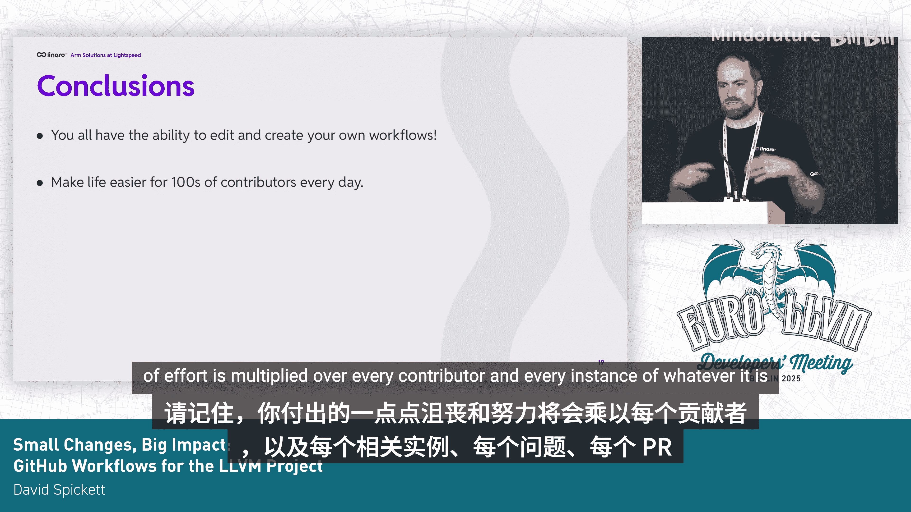
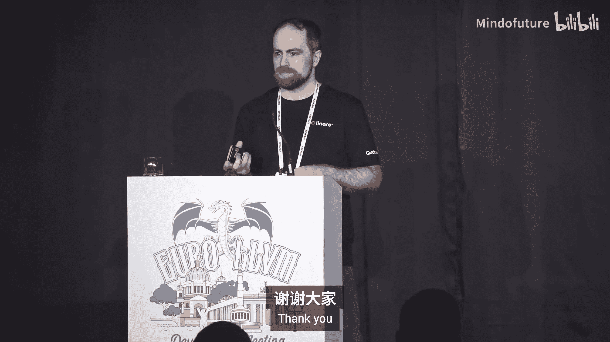

# 2025LLVM欧洲开发者大会-p51-P51-Small-Changes,-Big-Impact---GitHub-Workflows-for-the-LLVM-Project--BV1EoE9zUEbG_p51-

Okay， this is gonna go pretty quickly， especially with lunch about the start。

 I'm gonna highlight the important bits。The idea is that you can come back to this if you're interested in this topic。

 and this will be a bit of a reference for you。So the branding is a bit weird。

 I think Github Github actions is the high level feature that adds an automation server in the background of your Github repository。

 And then workflows is the way that you define what gets done in those jobs。So。

They run on these remote cloud machines that they call runners。You define them in Yamel。

 and they live in this special folder in the root of your repository。

So you'll have all seen a workflow in action， even if you've never looked inside of one。

 So if you've opened an issue or a PR， that will have been interacted with by workflow and we'll go over some examples later。

This is what they look like。 It's this declarative syntax。 where are answering a set of questions。

What do you want to access， What event should start the job running， What should it do。

 Where should it do it， Which operating system should it do it on。

And then how to do that work in a assert steps。And the main message of this talk really is that everyone can write workflows。

 Yes， it's part of the， the C I and Devopy side of things。 But you don't need a special account。

 You don't need to be an admin。 You don't need to pay any extra money to Github or even have a pro account。

 for example。And。You do need a bit of uncommon patience。

 but I'm going to give you some tactics to make the most of that。

So most of you in this room will have a for of L V M already。 So go ahead and do that if you haven't。

You probably haven't gone to the actions tab and enabled the existing workflows because you would never need to normally。

 The reason they don't enable them by default is that if they were just start running。

 they could start eating your C I minutes。 and that applies to your account in general。

 So that would be a bad idea。In LVM， most of the workflows won't actually run because they。

 they're on triggers。 And the couple that do run have extra checks that mean they won't run。

 And I'm going to show you how to make them run in a minute。

Yaml is pretty notorious for being very sensitive。 And then you add Github's custom Yaml schema on top of it。

 and it gets worse。 There's not very good validation， so。Even if you're doing a whole new workflow。

 I would start by taking an existing workflow。3 things to look for is what starts the workflow running。

What does the workflow look at， Does it iterate comments or issues， PRs， that sort of thing。

 And then the results of the workflow， which is basically。

 how is the repository going to change depending on what it finds in those comments or those PRs。

And we're gonna to use the example that anybody has contributed will have seen。

 which is the new PR workflow。 So whenever a PR is opened or goes from like draft into review。

 this workflow comes along。 And then the big thing that everybody sees for every PR at these labels。

So the example I took had changes in these folders， and we translate those to labels。

The labels then signal the teams， which gets your reviewers and so on。

The niche thing that not everybody is going to see， although some people will see once。

Is it if you're new to L VM， you'll get a comment that says， thank you for submitting a PR。 But also。

 here's how the process is going to go。 And if it goes wrong， here's how to get help。

I'll just note here that the script used for this。Is specific to LVM。 It's in the Montere repo。

 but it's really just a wrapper around the Gitthub API。

 and you don't have to use a special script to be doing this stuff。

I mentioned some extra checks earlier。 You go click that box in the actions tab。

 and then you'll see a bunch of jobs that say this job was skipped。 Unfortunately。

 it doesn't say in the U I why it was skipped， but it'll be these checks。

 They currently point up to upstream L V M。 So if you run them in any other repo， it just skips。

 Just change out to your username， and it'll start running。

And then what you can do in a workflow is basically limitless。 And I don't have limitless time。

 So top level ideas， if you can find an editor that understands Yaml， Great use that。

Do your editing in very small chunks and commit often。 So if something breaks。

 you might not know why， but you will know what broke it。If you're gonna to do complex logic。

 multiple ans and o's。Lots of brackets do that in a script step or a script file instead of writing in Yaml。

The Github documentation is surprisingly useful。 There are some big overlaps because there's different ways you can access the API。

 but either document will usually help you。And then because all this is Github specific code。

 If you are using a very niche API， you can just Github code search。

 And from built the billions of lines of code， you'll probably find some good examples。

But then you want to make sure that the thing you actually does what you think it does。

 And we hidden into a big roadblock。 We don't control those remote runners。

 We don't control Githubs infrastructure。 And unfortunately， at this time。

 you can't run any of that locally。There's not even really a intuition test framework to describe your tests either。

 And the final problem is that although some of the things your workflow looks at are very easy to set up。

 like you can open a fake PR and add fake labels。Opening fake user accounts gets into weird territory because you either have to buy new pro accounts or break the terms of service。

 which you obviously shouldn't be doing。 So we need to compromise here。And my compromise。

 although I hope there is a better one out there if someone can correct me。

 is manual testing and the realization that。Okay， I can't simulate all the inputs。

 but I could make a tiny change to the code temporarily as if I had changed the inputs。

And tested it that way。And in theory， that looks like this。

 We basically write out a manual test plan of the paths we're going to take through our workflow。

And then we consider， can we simulate each one with a single set of changes。

 And you keep breaking it down until you've got these segments that you can do in one set of changes。

You test it， make that segment work， reset any changes that were just for testing purposes。

 and then keep repeating it。And practically， it looks like this back to the new PR example。

 You got two basic paths。 You either get the new greeting， the new PR greeting comment or you don't。

 Now， when I was testing this， my user account is not new to my fork of L VM， so。Yeah。

 short of opening up another account。 I couldn't fake being new。

 So I literally just deleted the check for whether it was a new account， ran it。

 made sure I got the comment， and the formatting was correct。 Then I put back the check。

And made sure that it didn't attempt to post the comment。 So we're not testing what we ship。

 but I think it's says。As good as we can really get in a lot of scenarios。So you've done all that。

 You think you've got your coverage。 Save a copy of that branch that you've done your coverage on。

 It's going to be really， really messy， but that's。That's， it's not a good thing。

 but it is a normal thing in this sort of development。Take out your testing hacks。

Point the repo check back at upstream LVM， squash it。

 and then contributing a workflow is just like contributing any other change to LVM。And indeed。

 the new PR branch， the new PR job will come and add this label to get your reviewers。So some ideas。

 stuff we're already doing is labeling PRs like we've talked about。 We're automating back ports。

 using workflows。 You'll see in the formatting checks for clang format and Python checks。

You can request and relinquish commit access via workflow automation。

Some things that are being worked on is premerge testing as it exists in Billkite right now is moving to GitHub actions。

 there's something in the works for cleaning up user branches that are on the upstream repo and I'm working on some tooling to help people who don't have commit access。

 make sure their PRs get merged by somebody who does。And finally， things that haven't been built。

 just recently， somebody suggested that we could have profile reviewer notes。

They would pop up on PRs that edit those files。 A lot of people have requested that unusual builds on demand。

 especially in pre commitmit。 if they know they're possibly going break a strange configuration。

 It'd be great to request one。Recommended testing so that reviewers can ask an author。

 hey have you run these configurations。 And domain specific Lis is another one。

 We have one ondeaf right now， but I'm sure there's more scope for others。So in conclusion。

 it might be a little bit frustrating， but fundamentally， there's no permissions。

 extra permissions that you need to write a workflow。

 And remember that that small amount of frustration on your part and the small amount of effort is multiplied over every contributor and every instance of whatever it is。

 every issue， every PR so it it can really pay off。

And that's all I have， thank you。

