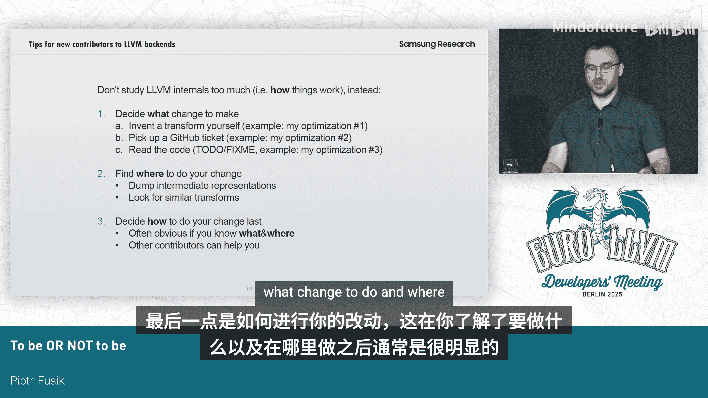

# 2025LLVM欧洲开发者大会-p52-P52-To-be-OR-NOT-to-be--BV1EoE9zUEbG_p52-

My talk is about risk 5 inverted bitwise instructionss。

There are five such instructions and not are not exclusive nor vector and not taking to vectors。

And vector and not taking a vector and a scalar。We have already edited these instructions using these simple patterns。

For a bit wide， bitwise operation with an inverted opera。It emitted the inverted instruction。

Of course， your selection deck buttons are more valuable than what you see in this table。

I made three simple optimizations first as for a bitwise operation with a constant。The second is for。

During the inverted operation in the loop。And the further enables some。

Target independent transforms meeting vector and not。Now I will explain my first optimization。

Rk5 instructions are fadeted a bit， which is not enough to load any f bit constant。

So depending on the value of the constant。You use either an art instruction。

Lo upper immediate or load upper immediate， followed by ambition。

So if the inverted constant takes fewer instructions to load， it makes sense to。Amid the。

 the inverter。Operation with the inverted constant。A typical example for Fi orbit bit constant is。

We avoid setting the low order bits to once。And in instead of free instructions， we emit。

The instructions， including。And invertted。It was approach。64 B constant are more complex。

 There's a whole fiber in other V N that。That is over 500 lineos lines of code。

 and it emits a sequence of several different instructions just to load a account into our register。

And in order to， to tell if my transform is profitable， I asked it about the。Cost， to。

 to load the original constant， the inverted constant。 And I apply my transform if。

 if the inverted constant takes fewer instructions to load。My second changer was for。Los。

And if there is an in be before the loop and a bit wide separation inside the loop。嗯。We think the。

Inversion， so we can。Amit to the inverted operation。I implemented it for just four risk 5。

 if you work on X 86 or please part optimization。My last change was。Just enabling some。

 some transforms。 I came across a fixed me comment。

 which said we don't have test for because this case。

 So I added that the test and implemented this function for vectors。Some types。

 if you are new to American development。Dot spend too much time studying upfront。Instead。

 start working on a specific change。You can either。Look at the generated assembly and find。

 find the mod way to improve it。 You can pick up a Github ticket。

 or you can walk on a to door or fix me comment。Then you should decide whether to do your change。

 your intermediate representations will will help you。And you can look for some URL transforms。

And the last thing is how to your change， which is often obvious once you know what change to do and where and you can ask other contributors for help。

Thank you。

