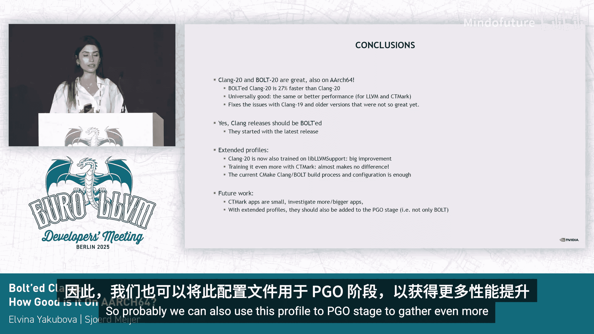

# 2025LLVM欧洲开发者大会-p53-P53-LTO-BOLT-Optimised-Clang-LLD-AArch64-toolchain--BV1EoE9zUEbG_p53-

Hello， my name is Alvina， and we prepared to be talk together with my colleagues， George。

 So bolted clk， how good is it on Air 64。😊，Questions we wanted to investigate in this talk。

 What performance improvement can we obtain by using bolt on Air 64 platforms。

 Should we bolt our cl build by our here I means our upstream version of clk。

 And can we do better and change build process。 during this talk。

 we will show performance results for timed compilation of LBM and city mark from LVM test suite veteran cl 1819 and 20 and show experiments with more and different profiles。

😊，So our story began with a goal of creating a fixed compiler。

 a compiler which can do the same amount of work in a less time。 Firstly。

 we did experiments only for Cl 18 and 19， but when the latest release of Cl 20 came。

 So we added to it to our measurements。 Let's look in the G。

 blue line here means original stage 1 Cl build。 and orange line means Cl build。

 which is optimized by L T O PGOvol pipeline。 As you can see from the G。 The difference is around 12。

15% for Cl 18 and 19。 but we were release of the latest version difference the speedup is 27%。😊，So。

 yeah， these results are quite impressive， but the question is is it good for all workloads。

 And it turns out it is not。 In practice， we found a 4% compile time regression regression for SQL light with Clk。

 which is optimized by bold。😊，So there could be several reasons for we and our hypothesis is that bolted cllink is trained on more than C plus plus code。

 and maybe it is not enough for eskeolate because it is a C code base。So we were wondering。

 is it only one case regression or can we find more。 And to check it。

 we decided to run city mark benchmarks and turned out that yeah， we can find even more regressions。

 C mark is a collection of applications for measure compile time performance。

 and more of a half of these benchmarks， C code base。 So you can see from this chart。

 But all of C code based benchmarks actually have a regression up to 6%。

 The results are shown for client 19 version。😊，But yeah。

 we decided to extend our experiment for Cl 20， and we gotten a nice surprise here。

 Instead of regression。 Now we see a 20% improvement。😊，The same is related to city mark benchmarks。

 So yeah， no more regressions on the improvement up to 20% to secret based benchmarks。

And this is not what we expected initially when we started our work， but the remains the same。

 Can we do even better than we。So significant improvement which we see on the latest client version could come from different sources。

 Maybe someone changed Cmate configurations， maybe different options passed on maybe bold to learn new optimizations or more and better profiles were added。

😊，So given all of that， our new hypothesis is that we can improve performance even more by extending the stage。

 So a bolt optimized build currently uses only C plus plus code base profiles so maybe we can extend veteran phase via a C code base。

 collect different profiles， merge them all and merge them with original profiles。

 which are already present and feed it into both output to improve improve Kca even more。😊。

I used bolt instrumentation to collect profiles for city mark benchmarks。

 And as you can see from this graph， it actually helps for cl19 versions。

 So green line green charts here means comparison of Clt19。

 like original stage 1 build these we've bolted clk 19 and gray line gray charts here means like bolted cl 19。

 we've extended profile。 So regressions were fixed。 and we can see up to 6% improvement。

But when we go to Clink 20， the results are not so impressive。 In average。

 we have only 1% improvement。 again， here， gray charts means like Clink 20， we extended profile。

But yeah， let's also look how changed the time compilation of cl building itself。

 So as you remember from a previous slides， which chart shows like times LVM compilation for Air 64 grey CPU in seconds。

 So blue line means standard build orange means both optimized。 And now we have green line。

 which means both optimized Cl， we've extended profile。 So for Cl19 version。

 we have additional 6% improvement， but unfortunately， we see no difference for Cllink 20。

So given all of that data， what conclusions can we make。

 The first one is that Cl 20 and bolt 20 are great。 And by doing great on Air 64。

 Bed Cl 20 is almost 30% fast compared to original Cl 20 stage 1 build。 and it also universally good。

 we have the same amount performance， both for ClBuild and C Mar build。

 and it also fixes the issues which we had on Clt19 and all the versions which were not great yetat。

😊，And if you still have a question， should you bold your cl release， The answer is yes， you should。

 And as I'm aware， currently， we started to do it upstream with the latest commit。

And experiments with extending profiles also proved its efficiency。

 So the main difference in Kang 20 bolted performance is because it was currently trained on level V support。

 and this brings big improvement。 Currently the percentage of functions。

 which is covered with profile increased from 6% to 15%。 So yeah， that's the main reason。

 Unfortunately， trained it with for more data like benchmarks from city marks almost makes no difference。

 and this brings us to a conclusion that the current make Kang bolt build process and configuration is enough。

😊，In terms of future work of what else can be done。 so firstly， city marketss are quite small。

 so probably it's worth to investigate more and bigger applications to cover more functions。

And another option is that currently we use profile only on a bold stage。

 So probably we can also use this profile to PG stage to gather even more performance。😊。

Yeah， but so。 Thank you very much。

