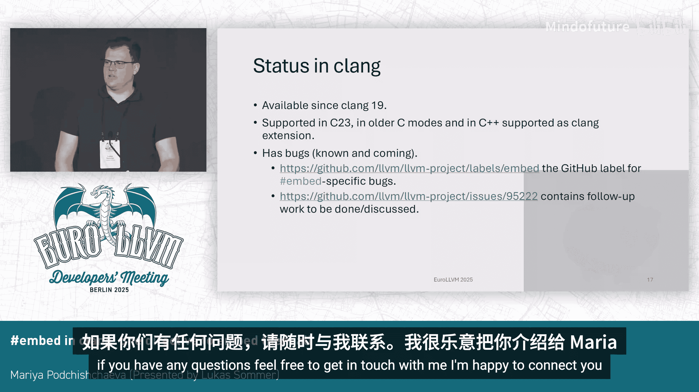

# 2025LLVM欧洲开发者大会-p54-P54-#embed-in-clang---one-directive-to-embed-them-all--BV1EoE9zUEbG_p54-

As you'll realize， I'm Lucas， but as lie says Maria， Maria， unfortunately couldn't come here。

 So I'll be presenting this on her behalf。 And I'll be talking about the in back directive in Kang。

First off， what is the emba directive， Because I think a lot of people are not familiar with it。

 is's basically a portable way to embed data， especially binary data into your C and C+ bus code。

 And there was always solutions around to do that。 But in the emba directive is the first portable way to do it。

 So you can have that in different implementations。

 and it's not specific to one compiler or one linker。In addition。

 you get some parameters that you can specify。 So， for example。

 you have this limit parameter now that basically lets you decide how many of the data you want to import from a file。

What's also nice about the embed directive is that similar to the include directive。

 it's basically be solve in the file system。 So you only specify the name and the compiler will take care of resolving the file name。

As a mental model of basically how this works。 is so if you imagine we have some data file here that we want to embed as a mental model。

 what you can imagine is that it's basically taking the data from that and putting it as a list of integers。

 for example， in this case。And this works nice as a mental model。

 but it's not how it's implemented in Kang And that's for a simple reason。And that's performance。

And to illustrate why that is， we can compare two things here。

 So we have a solution that uses basically the embed directive and clang's implementation。

 And then to compare and to see what the naive implementation would give you in terms of performance。

 we have a version where we take the X X D tool。But we convert the binary data into actual hackx literals and include that in our program。

 And then we can compile and compare the compilation time and the remember usage of the two implementations。

And if you look at the data here， you can see in blue。

 the naive solution that basically takes all those data in that file。

 puts it into integer hackx literals， and then puts it into the file。

 And you can see that depending on the amount of data that we want to include。

 our compilation time goes from like 5 seconds up to 25 seconds。

 just because we include 20 MB of data。Compared to that。

 you can see that the clang implementation of the embed directive does much better。

 So you can barely see the bar here， and it also doesn't increase as much as the N Aive implementation does。

So how is this implemented， wise is it that fast？Essential， okay， let's talk about about Ram。

 So also， if you look at the Ram usage， you can see the clang increases a bit with the more data you embed。

 but not as much as the solution does。 So you can see the each solution to include 20 MB of data in the source file。

 you get more than 2 GB of Ram usage from your compiler。 So that's definitely not ideal。

 And that's why we want to have to see optimize implementation。In the。

Simple case that we have an unsigned chart array here， and we have an emba。

 We just get a single string literal in the A T。 And that's basically how this is implemented。

But using string literal for that isn't always possible。

 especially in the case that we have a array which is not unsigned cha。

 We can't use the string lital here。So basically， what the implementation then does。

 It used is em bad expression， basically an additional A T note in Kang to express。

That we're embedding some data with the embed directive here。

And so especially just to reference that embedded embedded data。 It knows where it is。

 It knows how much it is and represents that multiple bytes of data now as a single expression compared to。

 if you would do it with the naive implementation， where you put a lot of bytes into a list。

 and then you have one expression per item in that list。

 You now have a single expression that refers to multiple bytes of data。

The embed expression can only appear in inside of in list expressions。

 which will be relevant in a minute。 and it's handled by A T consumers similar to an array fill。

So what happens in that case that we can't represent it as a string literal。

 we can also compare performance here。 So we have the generic case， which uses the embed expression。

 In this case， we have an in。 And on the right hand side。

 we have the optimized case where we get a string literal。Because we use an unsanial array。 So again。

 if you compare compilation time， it seems okay， the generic case is somewhat slower than the string latereral case。

So that does look too good on the the first side。 But if we add back our accessD。

 or basically our really naive implementation， you can see that it's not as bad。

 So we have to really optimize the implementation in case you have an onsign chartr here。

You have the one with the embedded direct fear there。On this scale， or this Y axis。

 theyre pretty close to each other。 And then you have to naive implementation。

 which again takes a lot of time and also a lot of room。Yeah， for RAM， you can also see the， I mean。

 within generic case， the RamM usage increases a bit。

 but not as much as it does within the E implementation。

The important part that I wanted to also highlight here is that the em expression can only appear inside of inless expressions。

 So that means if you use some embedded in in the wild， as Maria I called it here。

 So you put it into some int here。 you actually go back to this like interte literals。

 and that's obviously。For status of the embed directive in in Kang where it's available since Kang 19。

 it's supported in C 23 in older modes is supported as a clang extension。

 has the embed directive is also on good track to be voted into the C plus+ 26 specification。

 So there's a good chance of land there。 as long as it hasn't gotten into the C plus+ specifications also support as a clang extension。

 There is some issue still to address in this implementation。 Maria has paid a label for that。

 So if you want to follow the development or maybe even get involved into the development。

 you can just do that。And then there's some， the issue where Maria describes some of the follow up work that needs to be done。

Yes， and。That's it for me。 If you have any questions， feel free to get in touch with me。

 I'm happy to connect you to Maria so you can ask for questions。 Yeah。

 thank you very much for your attention。😊。

