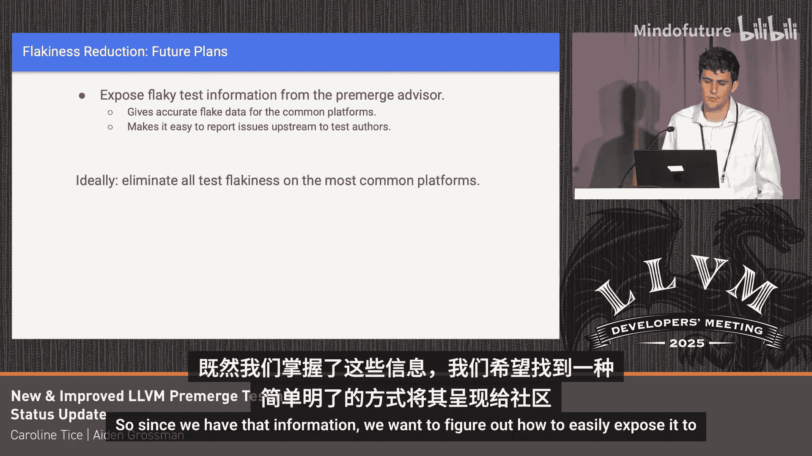

# LLVM开发者大会-US-｜-2025-Llvm-Developers-Meeting-p01-.mp4--BV1ejr5BAEja_p1-

Let's get started so。If I can make this work， there we go So GitHub pull requests automatically launch various checks and tests whenever you create a pull request or update the pull request and some of these jobs include running various Ninja check tests on various platforms。

The Linux and Windows tests are run and supported by Google on Google Cloud Pla。

 so these are the tests we're going to be talking about in particular in this session Recently some tests were also launched for AAR 64 on Amazon AWS。

 and these tests can benefit from some of our work。

 but these are not specifically covered in this talk。

So premge testing is very useful for developers because it helps you find and identify errors in your code before you actually commit it upstream and what is especially useful is it runs a test on a bunch of platforms so you might not have access personally to all the platforms on which it runs the tests。

 So when the premage tests pass， you actually have higher confidence that your changes are not going to break something upstream unexpectedly。

Now， pre testing has been around in LVM since 2019。 The old system ran on build kitite。 It was slow。

 It was flaky。 It was unreliable。 The results were not necessarily correct。

 and it was not particularly well maintained。 We did not think this was a particularly good state of things。

 So we've been working on a new system。 We launched the new system officially in May of this year。

 It runs on faster， more dedicated machines。 It has its's much more efficient because it has auto scaling。

 So the number of machines we use actually grows the shrinks depending on the actual number of tests that are being run。

We also have dedicated on call support rotation during business hours。

 so people are actually watching the premge testing system and if there are issues。

 we identify them and jump on them right away so it's actually being well supported and fixed。

We also have added metrics and performance tracking to the system which we surface on dashboards。

 so now we can see how many machines we're using， how many jobs are running。

 how long the jobs are taking， how long things are being cud before they actually get to launch on machines。

 all that kind of good stuff， and of course we also use that in our tracking in the oncal rotation。

We actually migrated the Libps C++ Premge tests to use the new system in early July。

 this fixed a lot of problems that the LibpsC++ community was having with their tests and the LipsC++ maintainers have been particularly happy with our system。

The overall goals for this new prem testing infrastructure are speed， reliability， and ease of use。

So we would like ideally for 80 to 90% of the tests， at least to finish in 30 minutes or less。

We want to make sure that we have no false positive error reports。

 so we would like it to be the case that if our testing system tells you that your PR broke particular test。

 your PR actually broke that test， and it's not some flaky test or some other failure at head that broke it。

And addition， we also want to make it very easy for you to find failures and understand the cause of the failure and so you can debu it and fix it faster。

I'm going to go over a couple of the new features that we've added that we think will help with all of this。

So one of them is the failure summarymaries， so here I have this screen that shows a pull request with some failed tests。

You can click on the three dots， of course， and that brings up the view details。

 you click on view details， and that takes you to the failures understanding page。

Now under the build and test thing there， you can see all the log lines from your scic logs and your Ninja logs and you can scroll through those and find all your build failures。

 but those can be thousands of lines long and can take a very long time to scroll through and be very hard to find the actual messages you're looking for。

So we've added this summary button here。 You click on the summary。

 and that takes you to a summary of the tests for the various architectures。

 You scroll down to the architecture that you're interested in。 in this case， Linux。

 because that's why I had my failures， and I can immediately see which tests failed on Linux。

 I can even click on one of the tests and get the actual test error messages。

 So this is a lot faster and easier than trying to scroll through thousands of ninja build log lines。

The other feature I wanted to point out was we've added the ability to not have to wait and babysit your tests if you don't want to。

 so we have two ways of not having to sit and wait for the tests to finish one of them。

 if you are sure that you want to merge your changes and you don't need to wait for the test results you know you're trying to do revert or something very quick and simple like that。

 you can click on the merge without waiting for the requirements and then you can just immediately merge your change。

If on the other hand you actually care about the test results。

 but you still don't want to have to sit and watch your PR and wait for the tests to finish。

 You can click on the enable auto merge。 This will allow the tests to finish running and if the tests pass it will automatically push your changes into the repository so you don't have to sit there and do it yourself but if the tests failed then you don't get the merge because you didn't want that so those are some of the features that we've added and now I'm going to pass it over to Aden who's going to talk about some of our performance in fling those improvements。

Yeah， so one of the big things that we have for performance now we actually have a Grfana dashboard that' set up that actually tracks all of this so we can see if like there's regressions immediately so like someone on the on call rotation can take a look at it and see what's happening like if it's like stuff is queuing for a long time and then we also have support so we have this setup for the Libt+ plus dashboard too and then we also have good support for looking at like trends over time to see if like we're making improvements that actually matter so there's a lot of noise in these charts because like someone touches an ADT header and suddenly the cache ths or like。

There's just a lot of noise depending upon what commits people are landing that day。

 but so we can' see a couple big performance improvements on here so like mid like late July we actually landed we significantly improve the caching architecture for like how we do compilation caching so that was a pretty big gap so when we migrated so the build kitite system would cache everything locally because it would keep a bunch of state between runs which isn't necessarily the greatest way to do things and with how GitHub works we have to use a clean slate so we used GitHub caching but it didn't work particularly well because it wouldn't share compilation caches between PRs very effectively so we set it up to use。

Google Cloud storage， so it just stores everything in a cloud bucket and then so that ended up waiting to like significantly higher cash hit rate。

 So like we now like most PR is assuming you're not touching some common header file you'll get about a 99 plus percent cash hit rate which led to a 30 to 35% reduction in the overall test times not even when the built like just the compile time is now usually a small fraction So because of that like test times are now dominating in terms of what as actually like running on the pre mergege when you look at the profile so we've been working on like migrating tests to whats internal shell because that remove some process startup overhead So that led to a 10 to 15% performance improvement on the Linux side Windows is already using it by default because process startup overhead is a lot more significant there So calling an LVm are the like big test suites that are using it so everything outside of compiler Rt is currently using it by default I have a patch stack up that I need to land to get compiler Rt working there's still。

Some issues with clang that and working on finishing up but so you get that like on pre mergege which is nice and you also get it locally when you run check LVM which can be even better for a local development cycle so we've also done work on switching to using clang on Windows like if you get a high cache hit rate it doesn't like the specific compile well the speed of the compile that you use doesn't matter too much but when you end up needing to rebuild a bunch of things the compilation time matters a lot so the long tail here can be pretty significant so using Kang instead of like MSVCL on Windows led to like a 40 to 50% reduction compile time like I think mostly just due to how the tool chains built like it is actually P like the release tool chain on Windows is actually PGO optimized specifically for building LLVM which definitely helps。

And then we're also working on flakiness reduction so as Caroline mentioned earlier。

 making sure that failures reported on your PR are actually caused by your PR because LVM is a big project。

 there's flaky tests and there's failures that had usually because of mid-air collisions or like even the pre mergege passes。

 but then you land it and it conflicts with the change inside that landed earlier。

 so we have we have buildbot set up they're currently just connected to the staging buildmaster so that allows us to like easily see the current state of head。

And then we're like plumbing all of that data along with failure information from PRs into what we call the prege advisor。

 so basically it's it's the system that's mostly implemented at this point we just need to do a couple touchups and then actually surface the information like inside that summary view and probably also in a PR comment where。

😡，If you have your PR runs into like either a known flaky test or a test that's failing it ahead。

 it marks it as it marks it is failing it ahead and not inside your PR。

 so the premge text pass and then you're removing all the false positive test reports and then also probably gives you a couple links to like here's the postubmit run where this actually failed so you can see that it is confirm that it is actually a flaky test if you're interested in doing that So yeah。

 another thing that we want to do flaky tests can often be hard to find unless you're like looking holistically at all this infrastructure So since we have that information we want to figure out like how to easily expose it to the community I've landed flaky tests before and it's usually someone like ping me on discord to let me know about it So having a nicer way to do that would be helpful and then yeah ideally eliminate all test flakiness so that's it Thank you。

