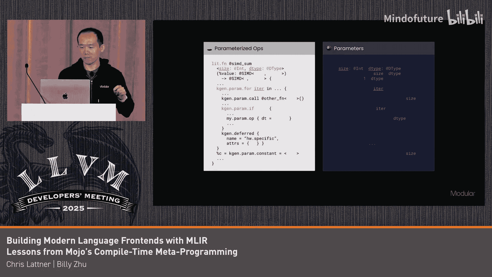

# LLVM开发者大会-US-｜-2025-Llvm-Developers-Meeting-p03-P02_使用MLIR构建现代语言前端_Mojo的经验教训--BV1ejr5BAEja_p3-

So hello folks， today we're going to be talking about building modern language fronts with MIR。

 So Mojo is one of the first general purpose programming languages built for MIR using MIR。

 And today we'll talk about how meta programminggramm in Mojo works and how we implemented with MIR。

😊，So first， we'll go over a brief introduction of Mojo and how metaprogramming works in Mojo。

 and then we'll dive into the technical details of how we implemented all this in M IR。

 And then finally， we'll wrap up with some practical benefits of this system。

And so without further ado， let me introduce the intern of the Mojo compile team， Chris Latner。

 hi everyone。👏All right。So we're not going to talk too much about what Mojo is。

 There's a ton of information， but I'll just tell you where it's coming from。

 So we built Mojo out of need。We are here tackling the problems of heterogeneous， distributed。

 accelerated compute。 And there's no programming language out there that was really designed for this。

 But there's this amazing Mr thing that was actually built to support this kind of stuff。

 And so Mojo came into existence because we wanted to crack open these problems。 And so what Mojo is。

 is fundamentally a very low level language。 It provides zero cost abstractions and safety and things like this。

 And we were willing to invest a lot of time， energy and effort into building something is truly great because we think this is really important。

 Now one quick clarification， Mojo is a real programming language is not a Python DSL。

 There's a lot of Python DSLs， but this is actually MR based compiler。😊，So today。

 Mojos working and modular， we're not going to dwell on this too much。

 but we support seven different GPUs， Apire Hopper， Blackwell， AM D 3003。5，355 and Apple GPU。

 now in Beta， which is really cool。 And so it's working。 not only does it work。

 it delivers amazing performance。 And so like Blackwell mama of 405 B， for example。

 We're quite a lot faster than a lot of the VLLM， which by the way。

 is a really annoying name if you're an LVM person。 which is really cool。

 And so this is all powered by Mojo， we also have， again， portability。

 which is another big thing which Mojo provides and we'll talk about how this works a little bit。😊。

And one of the cool things about what we've done is we've really enabled people to build large scale。

 portable， accelerated algorithms that then enable new hardware to be able to play in the ecosystem。

So the question though， is how and how does all these results are important for people building AI applications and things like this。

 but the key thing that Billy was talking about is meta programminggram。

And so Mojo is not an AI compiler， it is not something like TVM or XLA or Erie or things like this。

 it does not use Linnow， in fact， the major thing that Mojo does is it takes stuff out of the compiler and puts it up in libraries。

And the whole thing is about enabling powerful libraries to be built with meta programminggramm and with other powerful type system features like traits and things like this。

 Now， this is important for AI because you need things like specialization on shapes and you need auto tuning。

 you need generation of code like we wouldn't be nice move past tablegen。

 And so we want to give Mojo programmers these abilities instead of hard coding things into the compiler。

😊，So now Mojo is cool for lots of other reasons we're not going to go into in this talk。

 It has a very powerful type system with linear types and all kinds of other fancy things。

 but we're not going to talk about that today。 We've given lots of talks about Mojo in different venues。

😊，Now， when you're thinking about metaprogramm， the first thing that many folks turn to is well what about C++。

 C++ is an emerging programming language if few people use。

 It has been used for GP programming for a couple of years and it has this things called templates and concepts and all this stuff。

The problem with a lot of these existing systems are numerous。

 right One is you get terrible error messages when you get something wrong。

 you have a really weird type system。 you can't just pass a dynamic or like a computed S string to a template Like you have really slow compile times。

 it's like a different language than the base language and it has lots and lots and lots of problems。

 And so while the experience we have with C++ is very important。

 What Mojo is doing is propelling us forward and doing a new take that is helping move this ecosystem forward。

So I'll give you a quick tour， just the very basics that you need to know to understand the rest of the talk and kind of frame this up。

So if you take emoji function， here's a simple power function。 It has arguments。

 just like a normal function。Awesome， so Moji is too hot to handle， because is clearly thing。So I'll。

Jumping back in， we'll talk about the briefest highest level things you know about how meta programminggramm works。

 so like many programming languages， Mos functions， functions are written in very Python style。

 functions have arguments， arguments are runtime values。

 these runtime values can vary based on what you call the function with， of course。

Mojo also has compile time parameters， we them we call them parameters because they parameterize the code。

 and so we use parameters， the meta template argument things and arguments to mean runtime things。

 and so these are conceptually two different things and Mojo even though in many other the languages are kind of the same thing。

And so the cool thing about parameters， and we'll talk about this a bit is that parameters have superpowers because they're known at compile time。

 you can do really interesting things like you can have a loop that's guaranteed to be unrolled fully。

 and so this compile time known thing is really a lot of the power that we'll be talking about。😊。

Now it's not just functions that can be parameterized anything， motion can be parameterized。

 and they can be parameterized by almost anything， and so you can parameter types en closuresures。

 even arbitrary expressions， you can use arbitrary user defined find types and so in this case。

Layout is a struct up there， has two lists， lists are like an SDD vector， they have Malex in them。

 and then layout Tensor uses layout as a compile time parameter。

 and so you have a very complicated aggregate data structure with APIs and methods and all the things you'd expect that now can be used at compile time。

It so this ability to blend run time and compile time， this ability to hey。

 I can debug layout by stepping into it， these features are really powerful and make it possible to build these high level GP programming and fancy things that we're not going to talk about today。

Now， this also simplifies the language， a lot of languages get a lot of features in the space of meta programminggram or like weird variants and things like this。

 and this also absorbs a lot of complexity， which makes Mojo easier to learn and teach。

So how does this work Well， to make this work and this is the key thing you need to know about how Mojo works to understand the IR representation is it has effectively two different kinds of declarations。

 It has， for example， parameters to functions and runtime arguments。

 you'll learn about how those are represented shortly。

 but then also you want to be able to say this thing is a comp time expression and so we use this keyword alias to say that this is defining a new alias for compile time expression and so in our main function there。

 we have a6 and what because it's an alias， this is saying call this fill Fibonacci function。

 it's computing a list of integers which is he allocated， but it's calling it at compile time。

And then what that loop does is that loop actually is statically enrolled over the elements of that list。

 and it's all evaluated a compile time and then guaranteed to be enrolled。

 which is a very important thing for certain performance segments。

Now V6 down below is calling the exact same function， but because it's a var。

 it's happening at runtime。 you're computing and doing that algorithm at runtime。

 And so this is just a very simple example of showing how you can use that same fillfib function at both runtime and compile time and it's contextual based on how you use it。

 And so we'll talk about this One of the things that's also cool about this is that types themselves are just compile time values。

 And so you can have dependent types。 and we'll talk about that as well。😊。

So one of the key purposes of this talk is that we end up building these massively complicated things with a lot of parametric metaprograms Now Mojo isn't just like C++ where we want to sp it all down and do template expansion。

 we actually want to maintain this in the IR and so the cool thing about this entire talk is that we're maintaining all this generic type information all this parametric representation in the IR。

 which then allows us to do really cool things with it for example。

 all that fancy compiler stuff like specialization that also makes it so that we have representational challenges and so we do this because we want split compilation for GPUs and heterogeneous compute and things like this we don't want to just compile things multiple times to specialize in different ways but the question is is how do you do this in MLLIR Billy because it sounds like that's pretty hard because MLLR is not really good at this kind of stuff。

Well， let's see。 We'll go through step by step how we did this。In MR。So。😊。

Mojo uses the attribute system very heavily in its representation of our parametric IR。

 And so keep in mind， before we dive in the distinction between what we call the base I R。

 which is really the basic IR building blocks that carry used the runtime application logic and the meta IR that manipulates any base I R that's nested inside。

 So let's look at how we actually build this。Let's first define parameters as digging typed holes in something and instantiate as filling these holes with values of the correct type。

 So from now on， any time you see parameters， think digging holes， any time you see instantiate。

 think filling the holes with these balls。So let's first look。

 let's first look at how we define parameterized types。 So in a traditional dialect。

 if you were to define the S D type， you would probably specify the parameters with this index adder。

 which is a very specific kind of adder integer adder that has the type index type。

But in a parametric dialect， you want to abstract away the specifics of what the size is and only restrict its type。

 And so in the bottom， you'll see that we define the size as just a type aer。

 and we'll verify that the type is indexed in C plus plus， but we don't restrict anything else。

 So the meta programminggram system is free to put in anything that has the index type into this hole。

 And we'll see how the meta programminggram system takes advantage of this。

The same thing can be done for ops。 So any op attribute or property that you want to be parameterized can have the same treatment。

 And this is a key part of how we do programmatic codegen。

So now that you have the basic I R building blocks， What can you do with them， right。

 One thing people naturally want to do is encapsulate a bunch of them into a function。 right。

 So we have these parametric declarations like a parametric function that encapsulate a block of parametric I R over a set of input parameters。

😊，So the size and D type are the input parameters to this parametric function。

 and you can refer to the size and d type inside the body of this function。

 and they will be guaranteed to have that type。 So what this allows you to do is reuse the body of this parametric function with different concrete input parameters。

There's also in line instantiations。 So we have these two very typical meta programminggramm directives。

 which are parameter if and parameter fours， which allow you to specify when and how many times to inline instantiate this nested parametric IR。

So putting this all together， the parametric IR looks something like this。

 which is this inner leave of some of these meta programminggram ops and some regular based IR ops。

 But you'll notice that this is actually two layers。😊。

Comprised of the base layer of parameterized dobs with a bunch of holes in them and the layer of parameters on top。

 And these parameters go into these holes。

And the great thing about M IR is that it enables a natural interlea of these meta I R ops and the base I ops。

😊，So that you can maintain dialect composability， right。

 So you can imagine you can define your meta IR ops in one dialect and use it to manipulate base I ops of any other dialect。

 which is one of the great features of M IR。 And if you have third party ops。

 like sometimes we have to deal with。 that aren't natively parametric and can't put。

 you can't just put any attribute into the op。 you can even have this completely deferred representation of the op。

 And we don't even instantiate it until all the attributes are concrete。

 So this allows us to give Mo users ability to write hardware specific intrinsics or LVM and intrinsics。

😊，So looking closer at the M I R， you'll notice that these actually define parameter scopes。

 So inside each parameter scope， you have these named inputs。

 and you can refer to them in the body of that scope。 But only having this isn't quite enough。 right。

 You just have indirect。 What we really want is allow you to perform computations on these attributes。

 So how do we do that。So before we， we actually give computations to the attributes。

 let's first consider the consequences of allowing this， right？

 So remember that type checking sometimes requires determining type equality。

 And recall that types can actually be parameterized by anything。 right。

 So the PR nerds will recognize this is dependent types。

 And so what that means in practice is that determining type equality actually requires determining parameter expression equality。

 When are two parameter expressions equal。 right， the three types on the left。

 the three array types are actually the same type。And the user expects the type system to know about it。

You might say， let's just evaluate it， right。 Evaluation is the ultimate judge of identity。

 You just run the interpreter on the expression until you reach some value。

 But the problem is that not only is it really slow， it requires fully concrete expressions， right。

 which requires instantiation， which we want to avoid when type checking， For example。

 the lower examples， use completely symbolic。Variables。

And there's no way you can actually evaluate them。So the way we do this is with canalization。

We canize these parameter expressions into a normal form， so that。

P parameter expressions that are supposed to be equal end up in the same normal form。

 And this is pretty typical for languages with dependent types。

 But what this means in practice for us is that we need a super powerful expression canonicalizer in M I R that can。

Simplify super complicated expressions that uses， right。And also。

 note that this canonicalizer is not an oracle， right。

 So we do allow the users in escape patch to complement this canonicalizer with user annotations to specify that。

 oh， these three types are actually the same type。 when the compiler can't really figure that out yet。

So the way we've chosen to represent parameters is as type attributes。As a Mojo Mojo user。

 you really don't care about this， right， You just write your expressions the exact same way you write on the top right corner。

But inside the compiler， we know when an expression plays the role of a base I or when it plays the role of a parameter。

 And so when it is a parameter， we represent it in a typed attribute form。

 which is an attribute tree。There are some benefits to this。 So， first of all。

 attributes are unique and in of MLR context， which means that parameter equality really reduces to a pointer equality。

 So no matter how complicated the expression is， you always get constant time equality checking。

You also get a much smaller memory footprint because repeated nodes。

 repeated subtes will all be unique。 You don't pay the cost of having a bunch of repeated subexpressions。

 which is quite common。 And also， you get a really nice， you know。

 inline representation when you print it out。So even though this exists in a separate layer on top。

 right in the parameter domain， you can still refer to user declared functions that exist in the bottom layer。

 This allows us to complete the loop so that not only is metcode code， but also code is metcode。

 users can call functions in parameter expressions。

 and these will stay as a atomic piece of this call tree of this expression tree。

 and the user of the function， we actually allow them to specify whether this function should participate in canonopization or not。

 If not this node would just be compared symbolically。 If they do。

 we will lift the body of this function into attribute representation when needed。Okay。

 so what does all this mean in practice。Yeah， so the major thing we do all this work to enable is really powerful libraries。

 we want people to be able to build these high levell abstractions like tile based programming models and things like this as libraries which you can go check out all our Mo codes open source。

Now， this really leads to a much simplified programming model that。

People can learn and understand and they can actually go crazy using these abstractions that they want to do。

 but also means that things like debuggers work。Because if you want to bug your meta programgram。

 just call it runtime。 you can step into it。 And this is a huge difference between things like C++ templates or other languages where the meta programgram is really just like a completely different universe from the base language。

Now， there's also other really fancy things you want to do。 And these are simple examples， but。

Often things live on a spectrum of dynamic to static so you can have， for example。

 a fully dynamic list type， for example， and you want to have the elements and the size be fully dynamic。

 it's like an STD vector。 you might want to specialize a little bit and say I have an inline list of some sort and the elements are dynamic but the sizes known you may say that I'm actually coning it down to something that's implicitly splated and every time you access an element。

 it actually just stores one value of it or you may want to just store all of the elements of compile time and have a hard code specializedize the ability to have this modeling power allows you to build these types。

 which these are simple examples， but as you get higher level and abstraction allows you to really blend the power of compile time and runtime programs。

Now， this is all very abstract and all very nice and good and people building libraries is wonderful。

 but really actually comes down to this。😊，If you instantiate all your code。

 then you can only find errors at instantiation time。

 which means you get these horrific C++ compile time spts。

 particularly if you're doing advancement programming。And I mean。

 I think I and we are all used to this because many of us have stared at this kind of stuff and we've developed some coping skills。

 but it's really actually pretty horrible for lots of different reasons and so with Mojo you can do things like say。

 hey， I have a process prime function that requires X to be prime。

Mojo doesn't know what primeness is， right， but what it allows you to do is be able to say， okay。

 cool， if I call this function and I haven't proven to the compiler that it's prime。

Then I get a very simple error message saying it's supposed to be prime。

 you can't call the thing yet。 And then when you do actually guard it by something that checks it as prime。

 the compiler can enforce that and it does at part time in a very efficient way by the way。

 not it's a very advanced canoclyizer but is efficient。

 it's not using IOP solvers or anything else like that。

 And so you just get a very simple user experience。 Now。

 the other cool thing about this and the reason that the parametric IR is really important is that the graph compiler and everything else built on top of it can process this parametric portable representation。

😊，And so these features end up composing together in a nice way that enable us to build a larger scale system that actually fits together。

So we are all fans of Mmo Air and we think it's a pretty cool thing， Moji likes it too。

 hopefully this has been an interesting little tour into a little corner of how Aoji works in Charlie。

If you have any questions， we'd love to take them。Hi， I have a question about the type system。

 You mentioned the canonicalizer。 when you see， say a function call in your generic parameter。 Like。

 what do you do， Do you keep the function there or do you inline the body。 Yeah。

 so we give the choice to the author of the function， right， So by default。

 the function call node stays as an atomic thing， right， So we compare things symbolically。

 But the author of the function can choose to have their function body participate in canonitalization。

 Is there any risk of nonp functions in fewer functions。 So。So at compile time， we don't have， well。

 even not a compile time。 We don't really support global variables。 There is no worry about。

Like side effects that you might。Affect future calls to the same function。Yeah。

 so you don't really get that kind of， you're saying that all functions in module are pure。Well。

they have memory effects。 Yes， and they have effects explicit。 But yes， yeah， or。

 we didn't talk about it has a whole effect system for memory。 And okay。

 it's kind of like a reference system with bar checking and stuff like this too。

 And how does canonicalizer deal with things like loops or。Yeah。

 so I would quibble about canonicalizer， so what we have is we maintain a canonical form when building the expressions。

 and so the attribute builders canonicalize in constant time when building the adder node。

So it's just a typed adder it's just an ODS style builder and then the implementation of the get method just maintains its canonical form and so we canonize things like a fine expressions and things like this。

 it's not a general purpose solver， it's meant to provide a simple and predictable programming model for Mojo users understood thank you。

Let's thank our speakers。